# 影刀RPA自动化工作流：📕爆款笔记采集与AI评论辅助分析，进行数据驱动的内容创作
作者：龙哥

很多人做内容时最头疼的是：不知道用户想看什么，也不知道选题从哪来。如果有一套流程，能自动把📕上的爆款笔记收集起来，再让AI读懂评论区里的“潜台词”，内容创作是不是就能从碰运气变成拼数据？今天就分享一套基于影刀RPA的自动化工作流，或许能给你带来启发。

整套流程可以拆成三步。

第一步，按关键词启动RPA采集笔记。先设定一个你感兴趣的关键词，比如“美妆”或“旅游”。RPA不仅会搜索这个词本身，还会自动扩展平台上生成的一级、二级关联词，把这些潜在流量词一网打尽，再逐个去抓取相关笔记。相比手工搜索，这种方式覆盖面更广，也能减少漏掉优质内容的情况。

第二步，用统计方法筛出异常值。为了避免被普通内容淹没，系统会把点赞数或互动量显著高于平均值的笔记标记成“异常值”。这一步结合了RPA工具和IQR、CES两种计算方法，而方法选取参考了GPT-4的建议。数据抓完以后，机器人会根据预设阈值自动做出标识，方便接下来集中采集这些高互动内容的评论。

第三步，分析评论并生成选题建议。评论区往往藏着用户最真实的声音。爆款笔记之所以能火，通常是因为说中了某种普遍需求或生活状态。所以，采集异常值笔记的正文与评论之后，可以交给Claude opus、Gemini 1.5等大模型来做情感分析和主题提取，从而了解用户真正关心什么，并得到AI给出的选题建议，为后续创作提供方向。

下面用“备孕”这个关键词，完整演示一下。

📕的数据采集分PC端和APP端两条路径。PC端操作方便，但局限在于每个关键词最多只能抓取大约200条笔记；APP端采集则可以突破数量限制，抓取关键词下的全部笔记。为了解决PC端的数量问题，RPA会先去拓展平台的一级/二级关联词，再用这些新词重新采集。

以“备孕”为例，一级联想词有10个，像“备孕攻略”“备孕期间吃什么”“备孕需要准备什么”“备孕检查去什么医院什么科”“备孕叶酸推荐哪个品牌”等。二级联想词则有200多个，几乎把热门长尾搜索都包含进来了，例如“备孕app”“备孕b超”“备孕补剂”“备孕早餐”“备孕vlog”等。用这些更细的词去搜索，可以抓到更多笔记。

先看PC端的过程。

1. 采集输入关键词的一级联想词
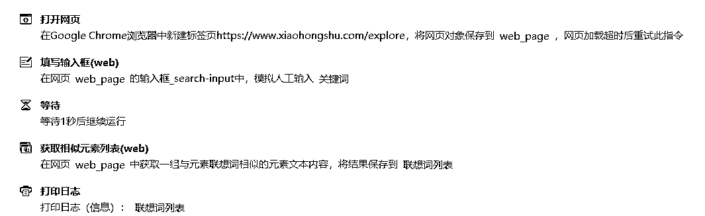

2. 采集原关键词与所有联想词相关的笔记
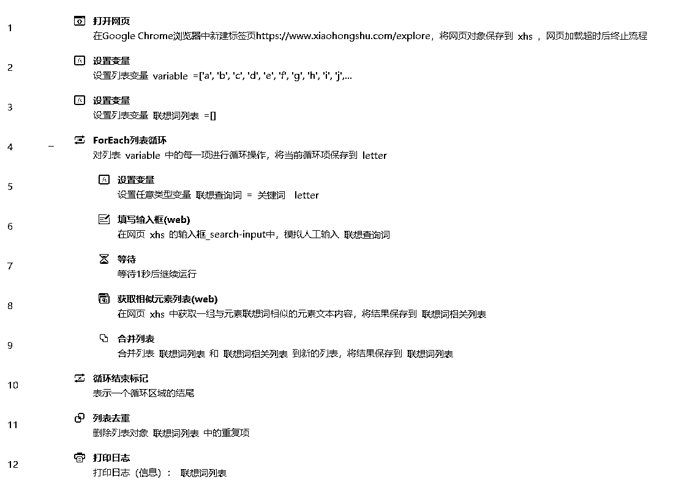

实际采集时，RPA可以选择用一级还是二级联想词来跑。二级词数量庞大，但如果先用一级词试跑，也能看出效果。比如用10个一级联想词执行后，最终拿到了1000多条笔记。影刀会利用IQR方法对这些笔记做异常值筛选，并把筛选结果单独导出成Excel文件，名为“📕笔记采集_备孕_异常笔记.xlsx”。后续可以继续采集这些异常笔记的评论做分析；也可以选择全自动模式，让采集、筛选、评论抓取、模型分析一气呵成，适合批量无人值守的场景。如果只想针对部分笔记采集评论，半自动模式更方便，可以手动筛选后再进入下一步。
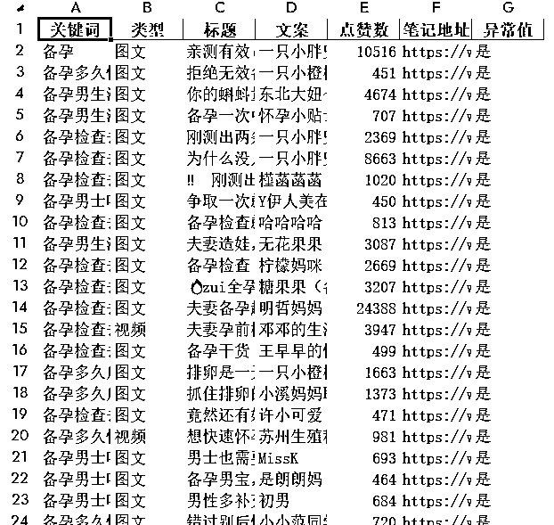

接下来是📕评论采集环节。评论区本身就是一座金矿。用户留下的吐槽、期待、疑问和真实体验，都是最直接的需求信号。爆款笔记能引发大量互动，通常是因为戳中了某个普遍痛点或生活情境。对这些内容进行收集和拆解，我们往往能发现新的切入点和市场空白。
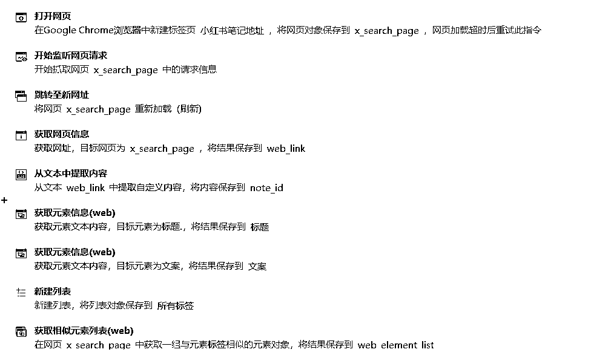
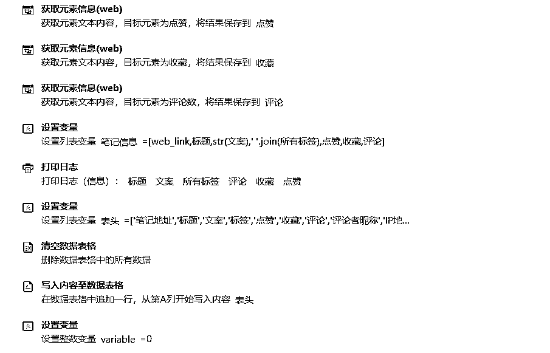
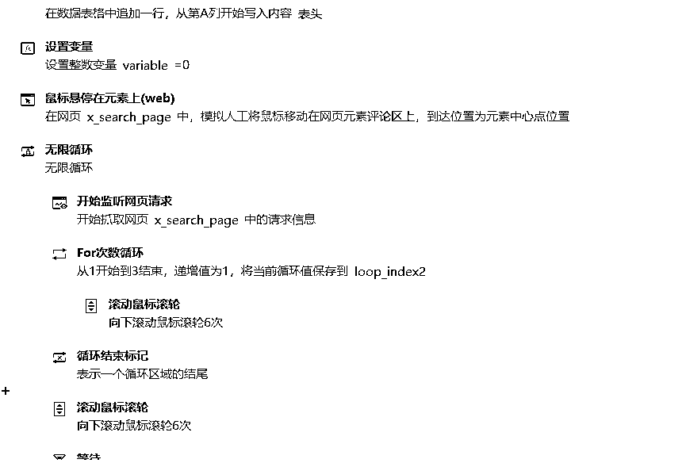
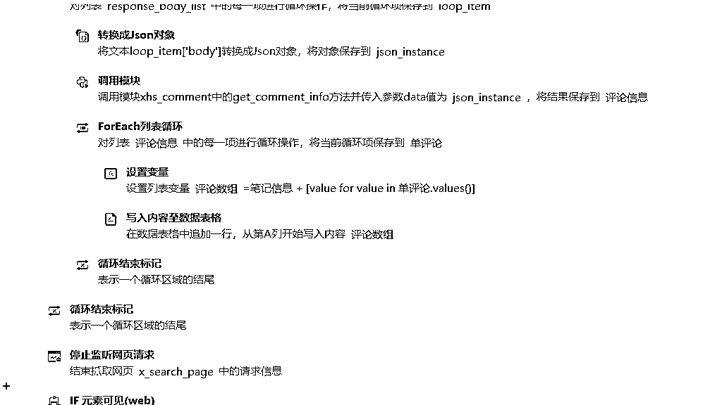
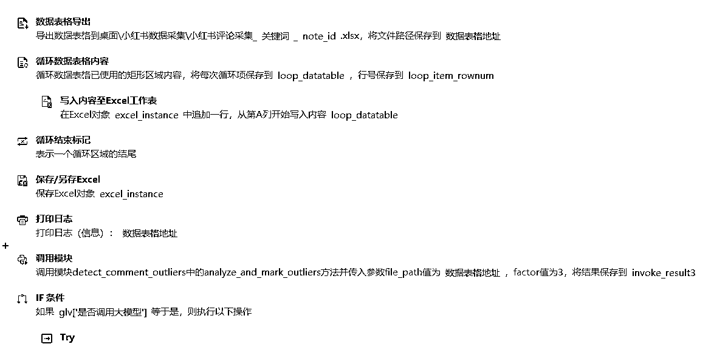
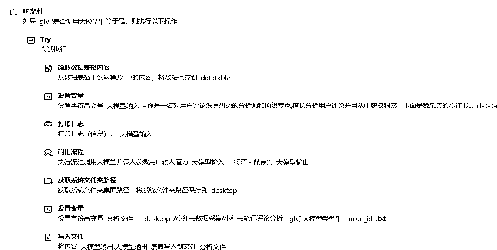
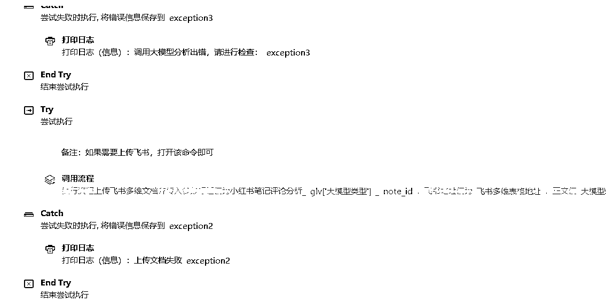
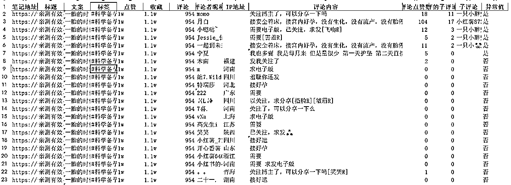

这些步骤会自动执行。如果在采集前勾选了评论采集，影刀会同步抓取异常值笔记的文案、点赞评藏和所有评论数据。最终得到的表格里，包含笔记正文、话题标签、互动数据以及评论明细，信息相当完整。如果还勾选了大模型分析，数据会被导入Claude opus或Kimi等模型，按照预设提示词进行解读。模型跑完以后，机器人会把分析结论保存到桌面文件，报告内容可以根据自己的提示词随时改。
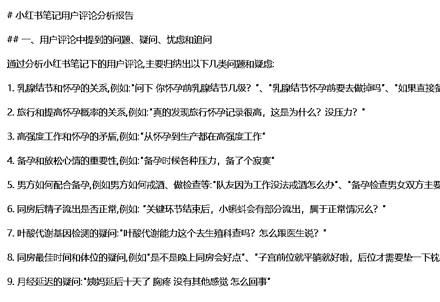
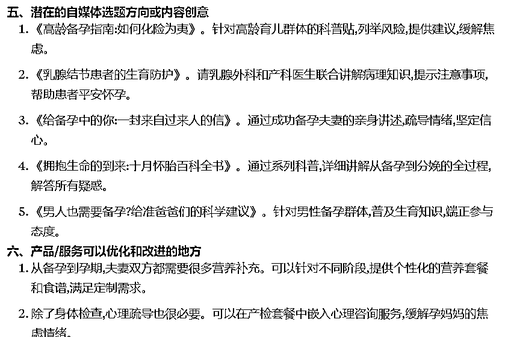

感谢你看到这里。简单来说，用数据采集和AI分析，我们能更准确地把握用户的需求和喜好，进而优化内容创作与营销策略。这套方法不只适用于📕，在抖音和其他平台同样可以落地。信息时代，把AI和数据驱动结合起来，也许才是内容突围的关键。希望这套工作流能给你提供一些思路。