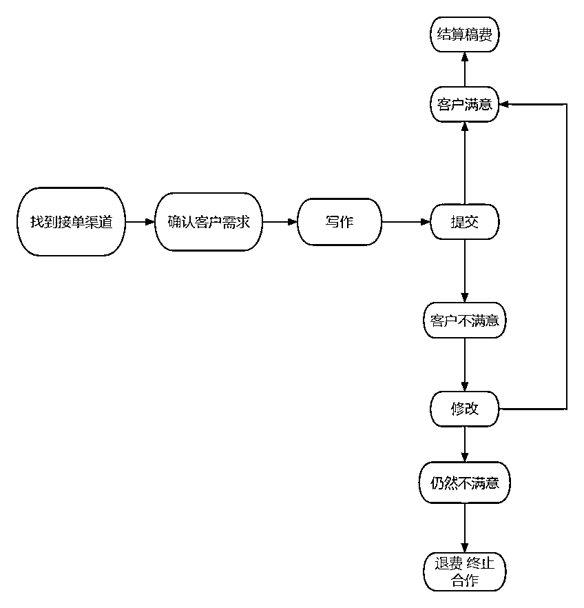

# ('基于4P理论的【ai写作变现】小干货技巧分享', (2, 24))

在传统写作行当里泡了四年，我从2023年2月开始尝试AI写作变现。同样的时间、同样的精力，收入后来翻了3倍还多。很多人靠自媒体吃到了红利，但我当年真的是个自媒体小白，自己发了好几篇内容都石沉大海。后来索性不碰公域流量，一门心思服务私域客户，直接给甲方或中介写稿，赚稿费。

整套玩法流程不复杂：先找到渠道接单，再和客户确认需求，然后用AI辅助写完交稿收钱。步骤听着简单，但每一步都有门道。

今天借4P理论——产品、价格、渠道、促销，把这几年攒下来的实操经验重新捋一遍。

一、产品：让AI写的东西“像个人”
稿子能不能卖出去，第一标准不是写得多花哨，而是合不合客户预期。我带学员时最大的感受是，很多人一上来就理解偏了。客户说往东，他非要往西，最后交出去的东西，客户不骂你骂谁。所以，除非是专业硬伤或原则问题，你提醒一下可以，其余时刻，跟着客户方向写。

但这不是说专业功底不重要。写论文，第一章就是绪论、研究背景、研究意义、文献综述，你不能上来就写现状；写市场调研报告，数据一个都不能少，没数据就是胡扯。这类文体基本功，得靠平时自觉补课。

另一个常见毛病，是太把AI当神。客户给个标题，AI啪一下生成一篇，文献不查，数据不看，满纸都是机器味。说到底，天下文章一大抄，能抄出水平就是本事。拿到题目后，先上平台搜同类文章和相关数据，拆解别人怎么定框架、怎么遣词造句，把有用的部分摘出来，再改结构、改逻辑，变成自己的内容。大纲尤其重要，它是文章的骨架。工作类文章套路很固定：先概况现状，再摆出问题，最后逐一给方案。征文类就要有文采、有论点；一些口水文或者凑合老板的小文章，AI直出再润色一下也能交，因为AI逻辑本来在线。但大纲这步别偷懒，多读文献、模仿框架，效果最妙。

交稿前，还要把明显的AI痕迹清理掉。短篇文章偶尔改改能用，但长文章不行。看到“总而言之”“这些怎么怎么样”这类总结话术，以及“首先、其次、再次、最后”“同样、此外”这些机械连接词，能删就删，能合并就合并。还有“不仅……而且……”这个句式，AI特别爱用，满篇都是，不烦吗？调得像正常人说话，再发给客户。

二、价格：报价不是拍脑袋
报价之前，一定要有“打破砂锅问到底”的耐心。别玻璃心，别嫌烦。字数多少？交期多急？要不要做图表？后续修改怎么算？这些问题全问清楚，再报数字。这么做一方面显得你专业，另一方面避免自己因为信息不全而亏本。

一个真实笑话说：有人200块接了“脚本”，乐滋滋写完了才发现，客户要的是APP小程序的功能脚本，不是视频脚本。这种事听着好笑，但每天都在发生。所以，收钱之前把责任范围白纸黑字聊清楚，别等到后续一堆扯皮才开始头疼。

报价方式上，我最推荐阶梯式报价。同一个单子，按服务档位从低到高分：只写稿不管改，100；修改一次，200；修改套餐再往上加。好处有两个：一是低预算客户不会被高价吓跑，二是明确责任能过滤想白嫖的人。总有人给点小钱就要求无限次修改、还要包过，做梦呢？我们的时间很值钱，你是为自己干，不用做低眉顺眼的打工者。

三、渠道：闲鱼引流，中介保底
闲鱼别只当二手平台用，它本身流量不小，营销工具也丰富。每天签到做任务，账号活跃起来，商品更容易被刷到；再配合对标和卖同款，从热销商品里偷学文案与卖点，优化自己的描述；发布要有规律，不能三天打鱼两天晒网；超级曝光、急速卖这类工具，关键时刻该用就用；降价功能也能刺激那些犹豫的买家赶紧下单。这套组合拳要形成固定节奏，你按自己的时间调整就好。

除了自己接单，强烈建议每个人维护2-3个稳定中介。中介单单价低、事情多，但胜在长期稳定，还省掉很多谈单的内耗。我自己靠两三个固定中介，淡季也不怕饿肚子。中介怎么找？一是混各种写作群，主动链接靠谱的人；二是去面试淘宝写手，从中筛选优质店铺长期合作。

四、促销：不吆喝，真没人知道
很多人不好意思在朋友圈吆喝，可你不晒，客户怎么知道你会写？复购更无从谈起。发朋友圈也不是无脑刷屏，我更倾向于用高质量服务树立专业人设，穿插生活日常，偶尔露一嘴业务，客户接受度反而更高。想学朋友圈课件的，可以来私我。

促销也可以玩点实际的。单量大的时候适当让利：两个人9折，三个人88折。老客户愿意转介绍，我就直接分他10-20个点，大家都开心。这看着是让利，其实是在为后续的单子铺路。

做AI写作变现，没什么高深玄学，就是把产品、价格、渠道、促销这四块慢慢打磨到位。能做到这些，月入过万不是梦。希望这篇干货，能帮你少踩一些我当年踩过的坑。