# 【实操分享】日引流破百，我在用这12个📕低风险引流打法
作者：龙哥

大家好，我是龙哥，正在做自媒体创业，帮职场人和个体创业者把自媒体IP孵化成可变现的资产。教育、情感、职场、企业管理、收纳整理等多个赛道，我都跑通过📕从流量到变现的完整闭环。

最近身边很多同行都在反馈，包括我自己带学员实操，也能明显感觉到📕对引流的管控越来越紧了。那么平台还能不能做引流，怎么做才更稳？

今天把我现在在用、风险相对可控的12个引流思路整理出来，核心逻辑就一个：主号做内容做信任，小号放联系方式分散风险。

下面拆开来说，主号怎么搭台，小号怎么藏私联。

# 一、先把风险分散到小号上

## 头像即暗号

头像里放联系方式，比文字更隐蔽。只要头像里不出现vx等敏感词，通常能顺利过审。简介里补一句“看头像”，点到为止既直接又不露痕。

我实测过，首页举报入口里没有直接举报头像的选项。只要不被系统抓取，也别被同行恶意连环举报，这套打法稳定性很高。

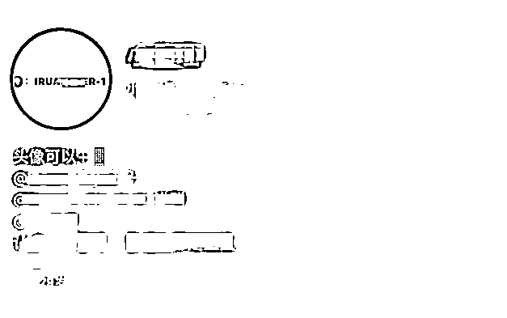

## 置顶笔记当名片

小号只发一篇带联系方式的笔记，然后置顶。标题可以写“看图找我”“聪明人都知道怎么加我”之类的文案，点进主页就能看到。

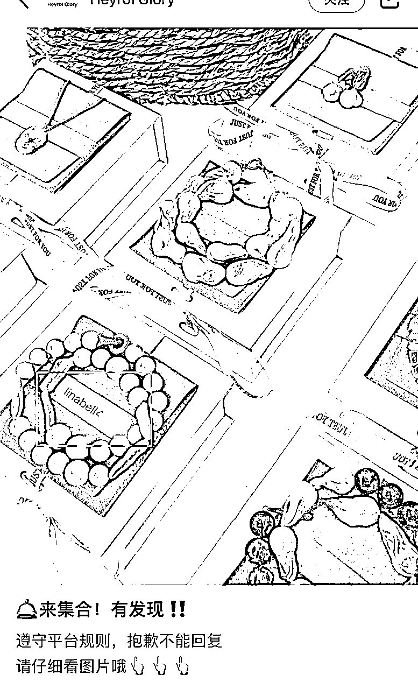

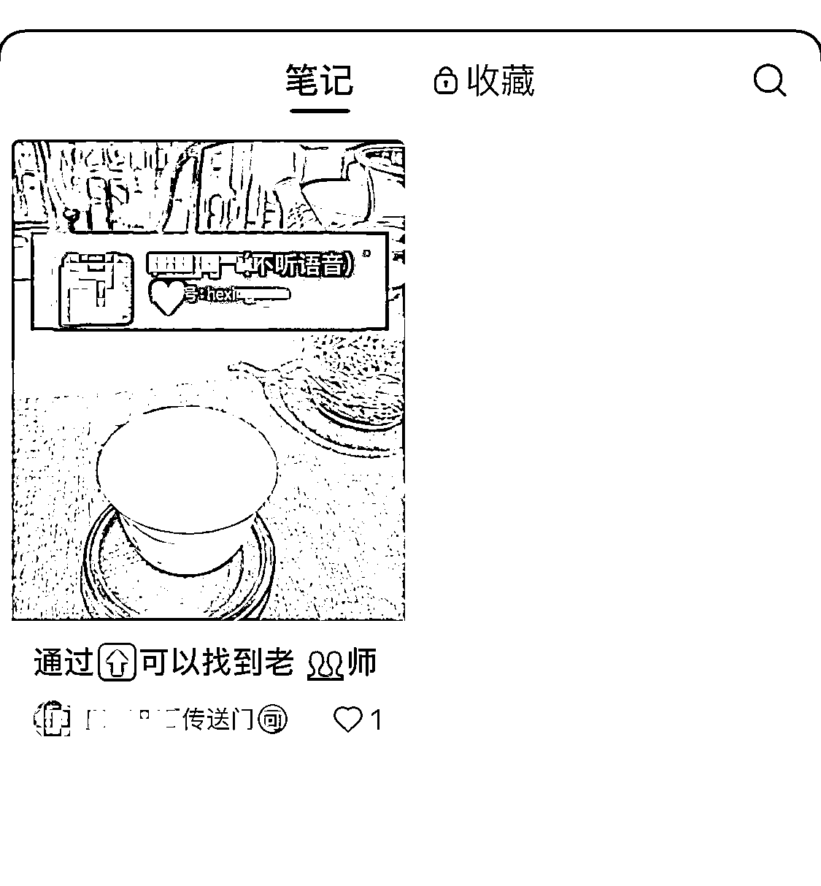

## 背景图藏信息

个人主页的背景图审核通常只在发布时进行一次，通过之后基本不会再复审。信息直观，也很安全。

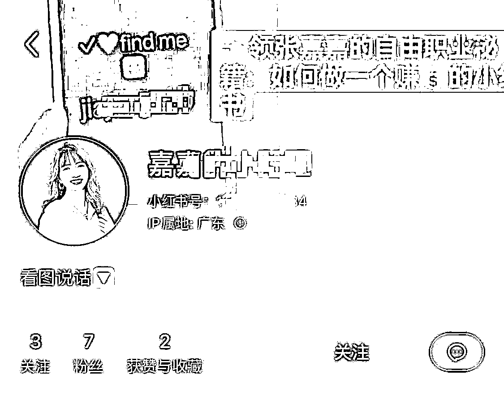

## 把📕号改成🛰️号

把小号的用户名直接改成🛰️号，也是常见做法。配合私信或群内提示“看主页昵称”使用，曝光度不如直接放🛰️明显，但也不会那么容易触发规则。

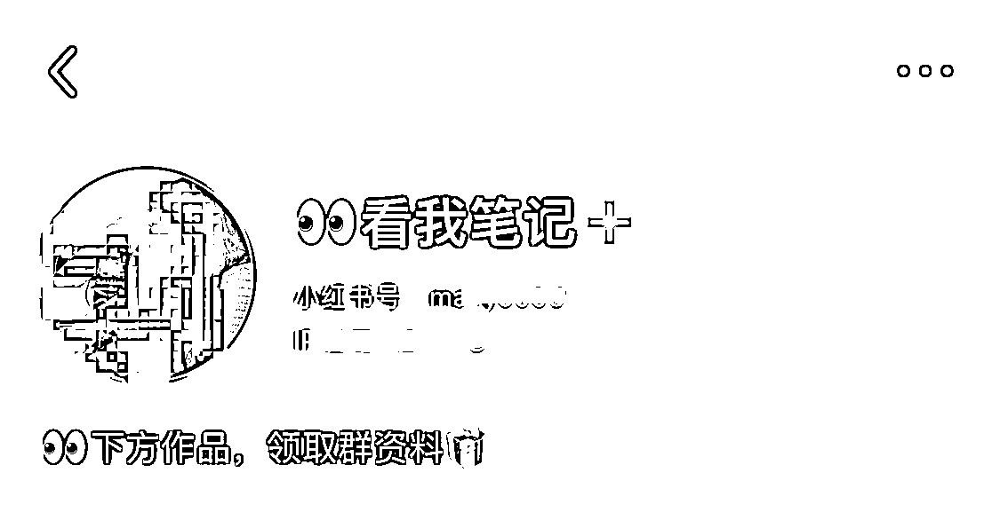

# 二、主号负责吸粉搭台

## 简介里埋被动路径

在主号简介的最后一行，留下一句行动指令：合作/咨询/领资料 @ 小号昵称。通过@让用户点过去就能找到小号，实现被动引流。

操作注意：编辑简介时，先点@，输入小号昵称的首字母，等系统下拉出现后再选择，不能全程手打，否则@会失效。另外简介7天内仅能修改3次，改之前想清楚。

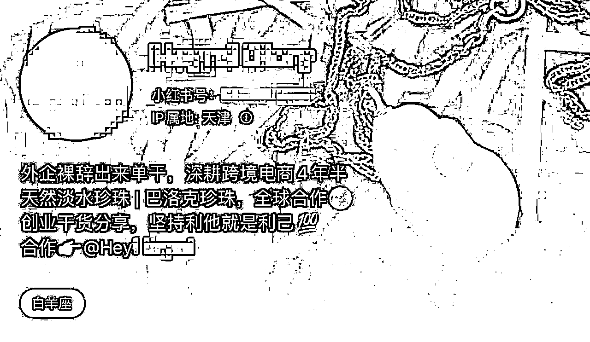

## 收藏夹当广告位

把小号的引流笔记收藏到主号的收藏夹里。能用到的位置都用上，相当于多了一个曝光口。

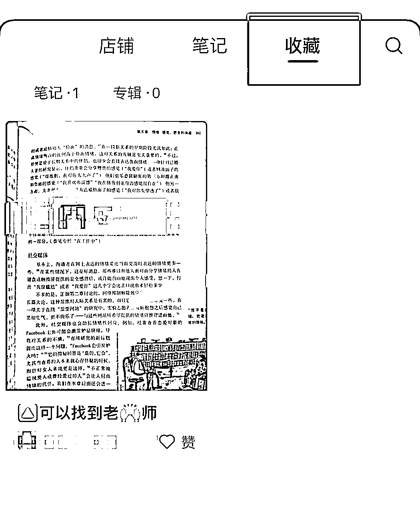

## 主号建群，小号在群里收割

群是转化效率最高的地方，关键是分工。主号负责控群增粉，小号负责发引流信息，主号尽量别碰联系方式类内容。

具体配合方式：

### 1）改群名做诱饵
把群名改成“领取xxx资料”“免费领xxx”之类，用户进来就是冲着福利。

### 2）转发引流笔记
小号把自己的引流笔记转发到群里，让感兴趣的人自行跳转。但转发频率别太高，容易被系统限流屏蔽。

### 3）改小号群昵称为引导语
把小号在群里的昵称改成“进主页领xx”“点我进主页”，用户点进主页就能看到联系方式。

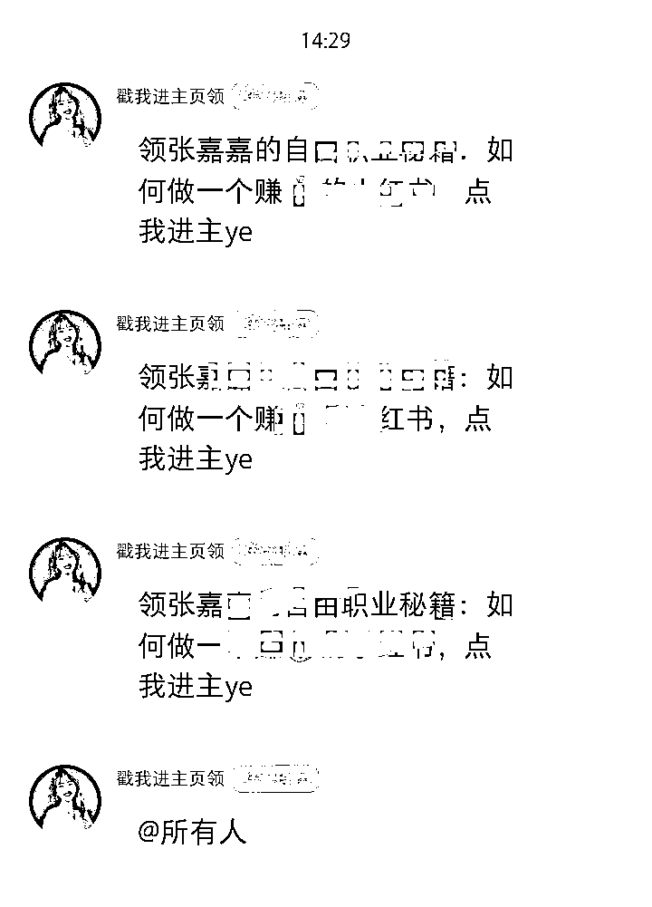

### 4）表情包发🛰️号
把带🛰️号的图片做成表情包，发到群里。系统对表情包的识别度低，容错率高。

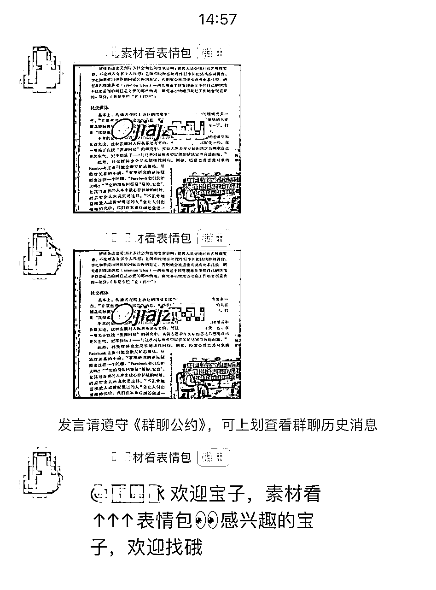

### 5）拆分🛰️号做筛选
把🛰️号拆成几段发在群里，末尾引导“组合搜索”。看不懂的自然过滤，留下来的基本都是精准人群。

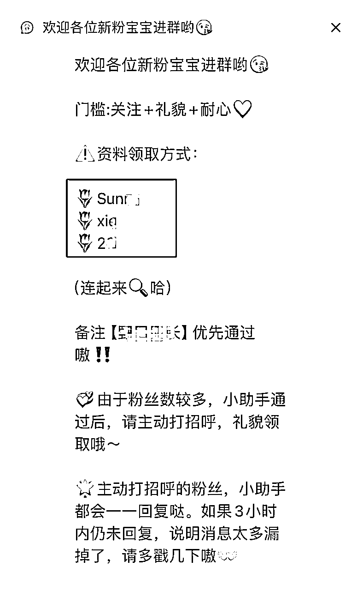

### 6）群打卡留广告位
最近很火的玩法是做群打卡。既能提升互动，又能在打卡模板里固定留一个引流位置。

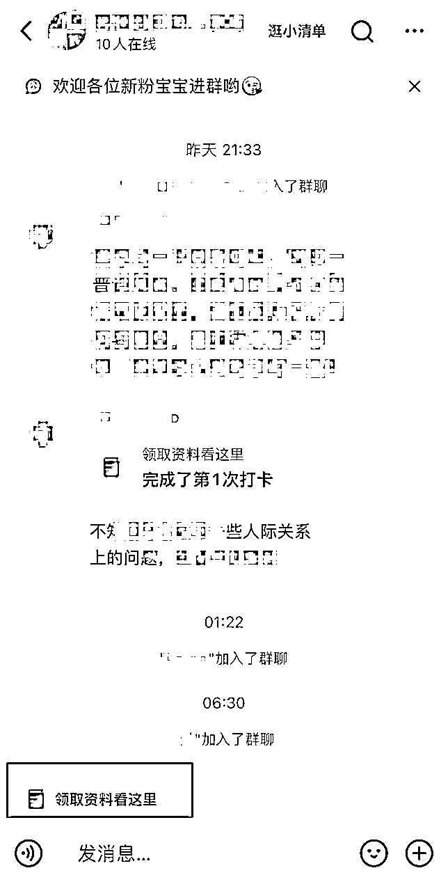

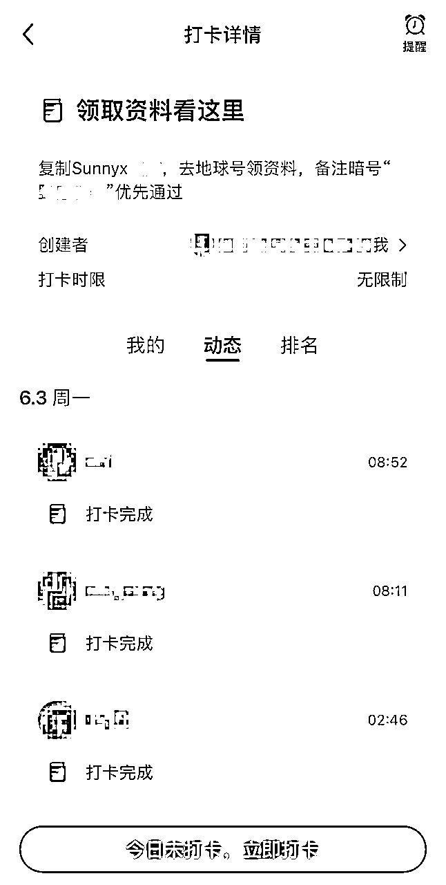

# 三、做引流的心法

技巧我讲完了，最后说点更重要的心态。

1. 引流不是单点技能，多套方法融会贯通后才能灵活组合出招
2. 没有一招永恒的打法，平台规则在变，战术也要跟着迭代优化
3. 平台管控越严，恰恰说明流量价值越高，低成本获客依然值得做

# 更多精彩分享：