# 高考季卖花笔记：从刷到到实操的72小时
作者：龙哥

# 序

很早就在📕上瞥见过高考卖花的帖子，那会儿只是在脑子里过了一遍，没当回事。思维还停留在观望阶段，并没有付诸行动。

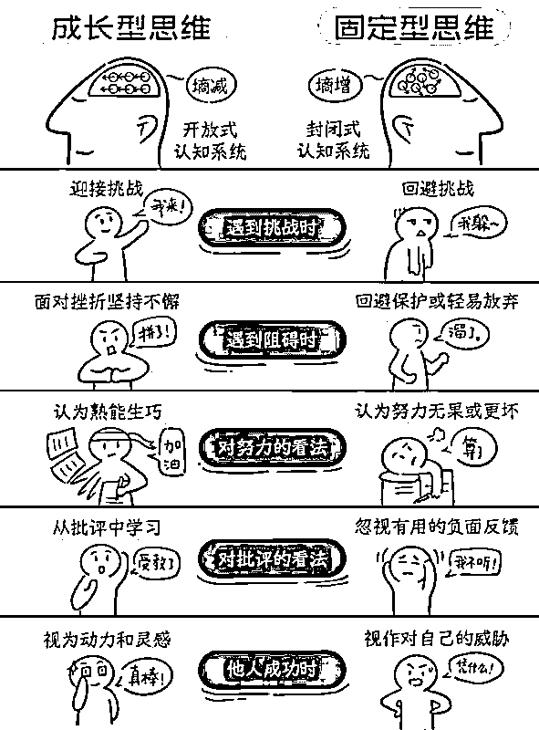

后来在群里看到有人聊起实操去校门口摆花，才意识到时间点已经到了。高考的脚步近了。

周五第一天，我还在上班，午休就开始搜攻略。知识星球和📕翻了半天，找到艾小飞老师那篇《如何利用高考两天摆摊卖花赚笔快钱》。干货很足，细节很具体，像是及时雨。

我把飞书文档反复看了几遍，结合自身情况落地去试，真的赚到钱了。这里感谢艾小飞老师的分享，经老师同意，我在他的飞书文档紫色内容基础上补充自己的实战感悟。

# 1. 为什么高考能卖花

艾小飞老师的原理解读

十二年苦读，就为这一次考试。考场里是考生焦虑，门外等候的家长更紧张。等待时情绪需要出口，想给孩子一点祝福，一点仪式感，花是最直观的表达方式。

孩子出来看到家长手里拿着写有祝福的卡片的花束，紧绷感会松下来，顺手拍张照发圈留念。高考一年一次，情绪价值拉满自然就有生意。

需求有了，市场就有了，竞争自然也会出现。

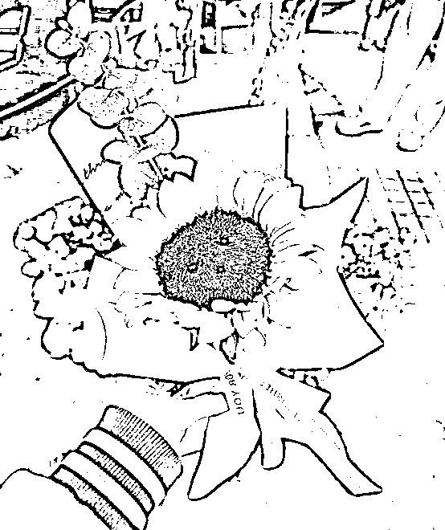

我的理解补充：
1. 本质是情绪生意，抓住家长心里那根弦就能成交。
2. 我自己经历过高考，能共情那种忐忑与期待，跟家长沟通更顺畅。
3. 收到花对考生是一种正向暗示，容易更放松。
4. 校门口家长很多，有提前准备的，也有临时看到别家孩子有花就后悔没准备的。抓住这种临时决策，给足情绪价值就能成交。

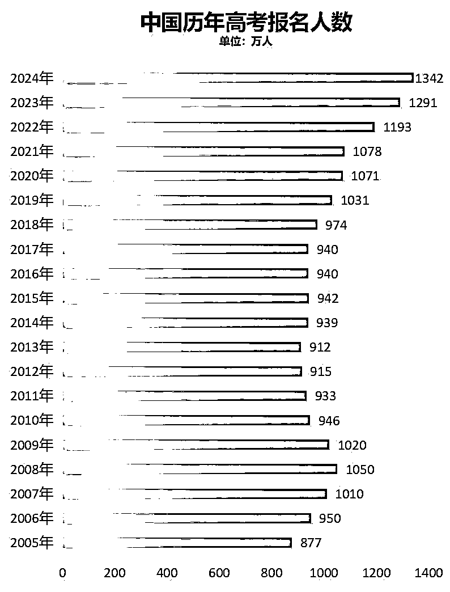

# 2. 卖给谁

很多人第一反应是考生，错了。考生很少自己买。真正下单的是家长，集中在40到48岁区间。

先把用户画像定准，再去想进货、定价、话术的逻辑才会通顺。

我自己吃过亏。上海最后一天考外语口语，我对考试时间没核实清楚，早上空等一上午一条没卖。给了我一记闷棍：别想当然，事前调研是门槛。

下午场家长少了很多，只能硬着头皮在人群里穿梭询问。起初我还是站着吆喝，嗓子喊哑也不管用。旁边家长提示我去人群里走。换了方式后，突然围上来几个人，我抓住一位女儿家长，输出情绪价值，完成首单12.11。

# 3. 卖什么花

老师推荐三种：
1. 向日葵 寓意“一举夺魁”
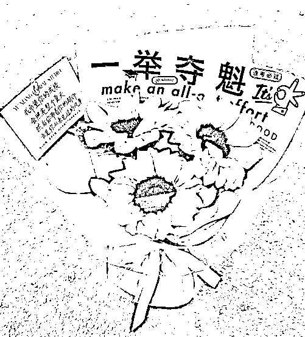
2. 莲花 寓意“好运莲莲”
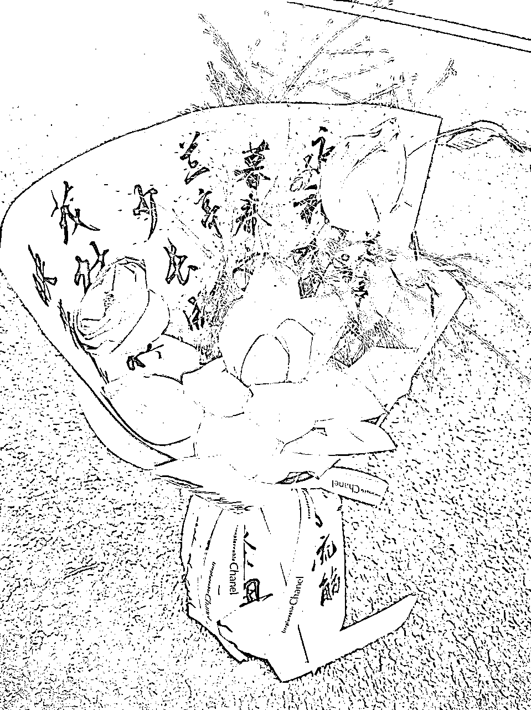
3. 蓬莱松 寓意“放青松”
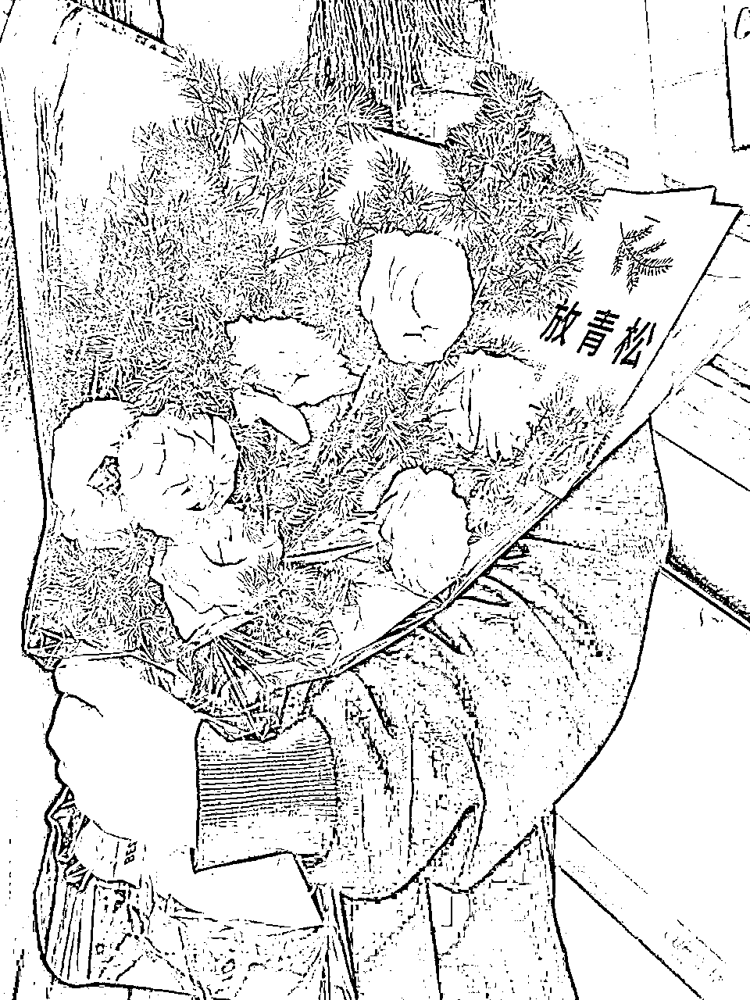

综合销量来说，还是向日葵最稳。别品种走得慢，想稳妥就主推向日葵，配点尤加利、蓝星花提色。

我直接选了“一举夺葵”向日葵，搭配尤加利叶、满天星、小雏菊。

# 4. 进货渠道

两种方式。

网购：美团或多多买菜，价低速度快，第二天能到。但淘宝拼多多跨城店不建议，闷热易损，理赔麻烦，物流三四天赶不上。

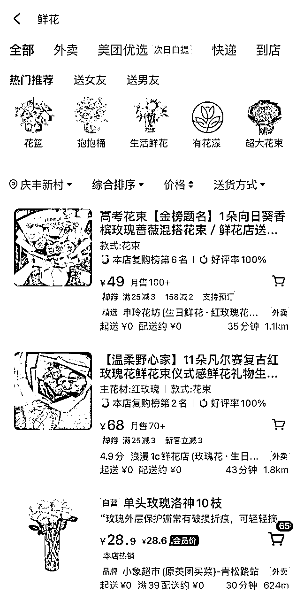

本地：挨家花店问价比价。高考期间需求暴涨，向日葵容易涨价缺货。问价时要问清楚供应量与价格波动，并多留几家备选。

本地花店价格偏高，想压价可以去花卉批发市场找经销商。

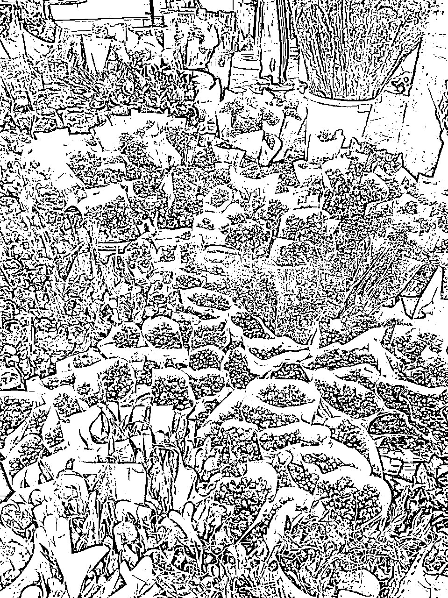

怎么找经销商？多问几家花店，总有人透露。实在不好意思就网上搜或问熟人。

我直接线下跑了三家，当晚付定金。

# 5. 进货量

建议300支左右，多了不好摆不方便搬运。

我第一次没经验，口头说要50支，实际只拿到32支。提前三小时到场，家长少，白等。最后一个小时别人收摊，人潮涌入立刻清空。第一单还是在厕所门口撞上的。

太早去没车位，只能借隔壁公司门口等。我爸搬花工具人还在借位，我上完厕所出来就遇到砍价家长，靠话术守住原价完成首单。

# 6. 成本预算

以柳州批发价举例：
300支起步单支约3元，900元。包装费100元。水桶10个约100元。贺卡、喷壶、收款码等杂项100元内。合计约1200元启动。

# 7. 定价策略

成本3元时的参考：
单支9.85 引流款，利用从众心理，寓意985。
两支21.1 配尤加利，寓意211。
六支98.5 整束主推利润款。

我的实际定价：
时间紧没法等网购，午休跑公司附近三家花店询价。
第一家单支28，第二家单支8，第三家单支9-10。
选了性价比合适的第二家。

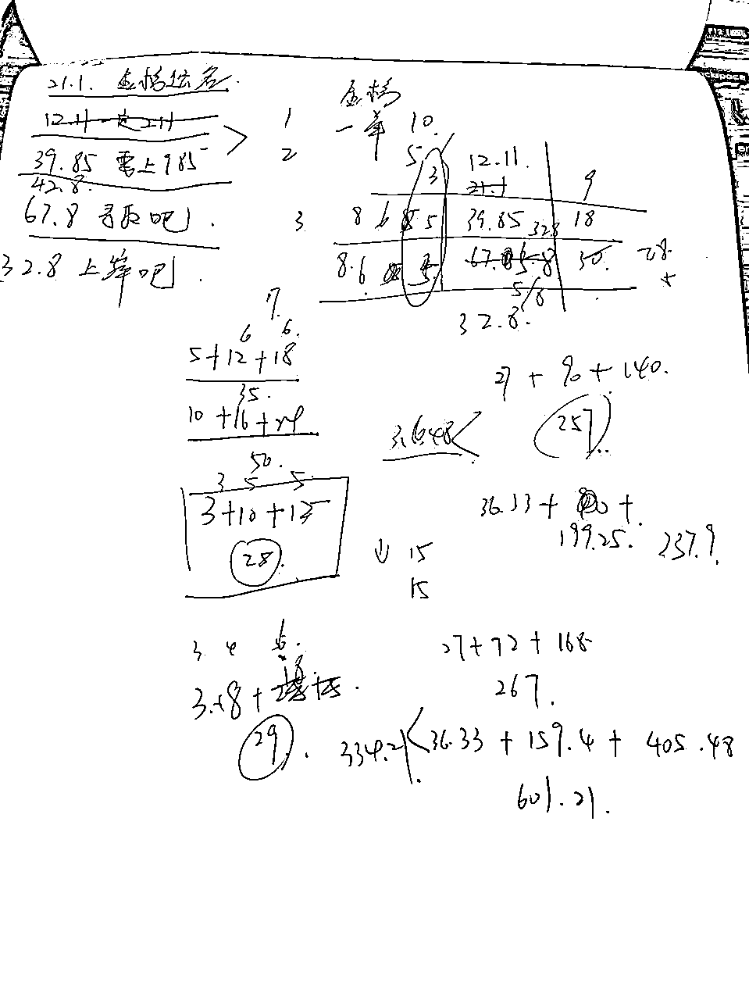

算下来9.85基本没利润。结合📕搜到的寓意，我重新定价：
单支12.11 寓意一定211
两支39.85 寓意上985
三支67.80 寓意录取吧

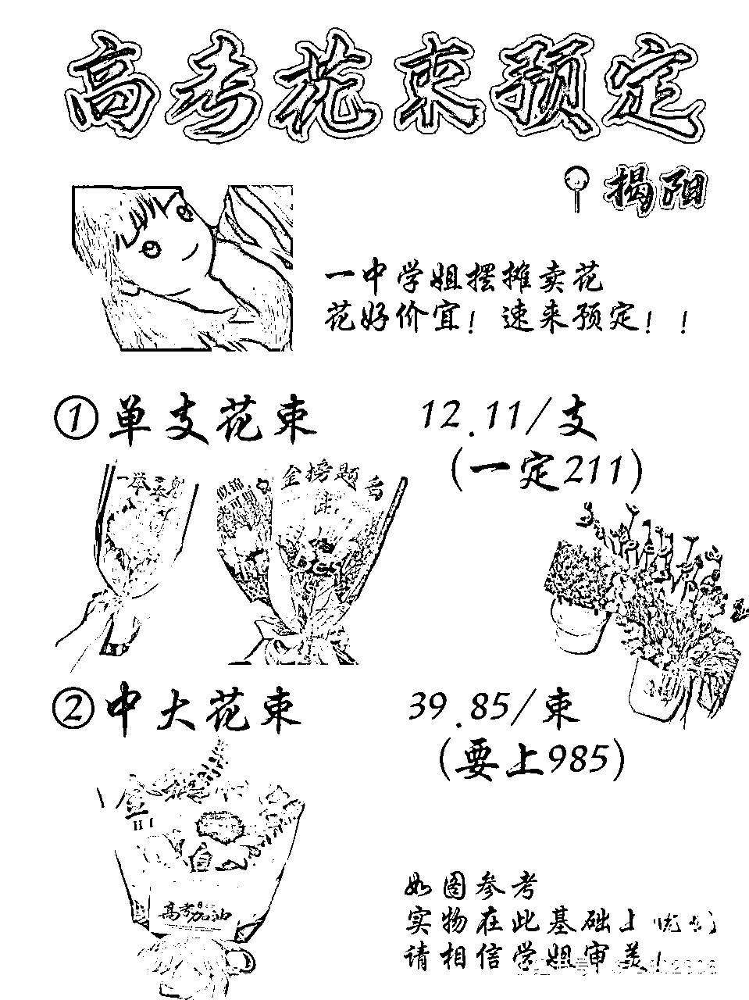
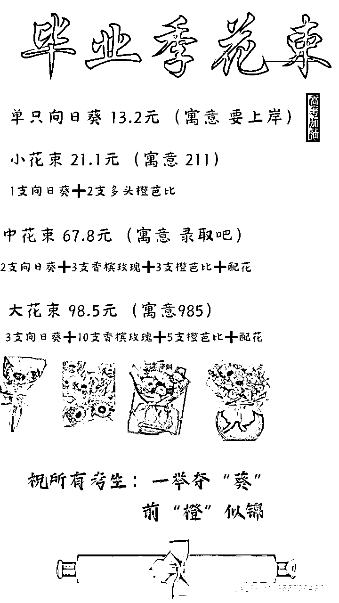

# 8. 选点

选当地知名考点门口或对面马路。高考当天交警城管在维护秩序，需提前踩点。

建议多备几个备选点，不让摆可立刻转移。别选在垃圾桶旁。

我的经历：城管来过一次，因货多搬不动就没走。最后冲刺时城管让我收拾一下就行。最后一天城管较严，好在考试快结束了。

# 9. 售卖时段

首场结束后是黄金期。第一门考完家长情绪最紧绷，花钱图吉利拍照发圈。也有家长自带花，没带的会因尴尬产生购买冲动。

实战下来，每场结束都有机会，但最后一场尤其是主科最后一场，家长涌出最快。

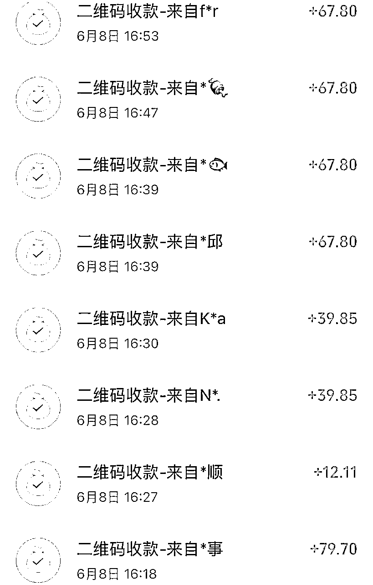

最后半小时最猛。

# 10. 摆摊物资清单

收款码：文印店打印🛰️支付宝码，私域引流可多加一个好友码。

喷壶：闷热天保持花新鲜。

剪刀：现场修枝。

包装纸：牛皮纸或透明纸。

花桶：菜市场买水桶或花店借桶。两天后可闲鱼转卖。

折叠桌：有条件带。

贺卡笔：提前备好祝福语，尽量让家长自写省时。花店赠送小卡片可直接用。

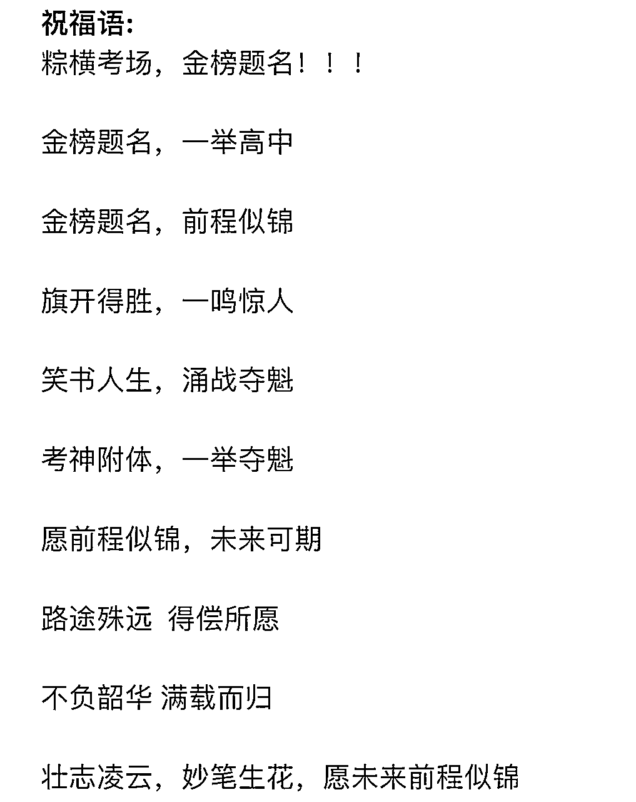

广告牌：废纸皮或速写本写上价格或祝福语，双色笔更显眼。

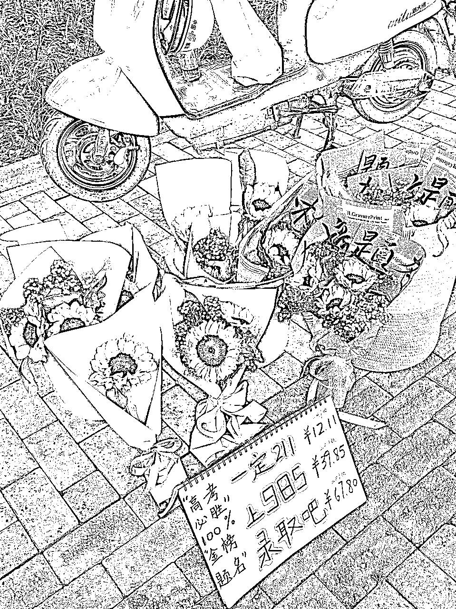

透明胶：多备。

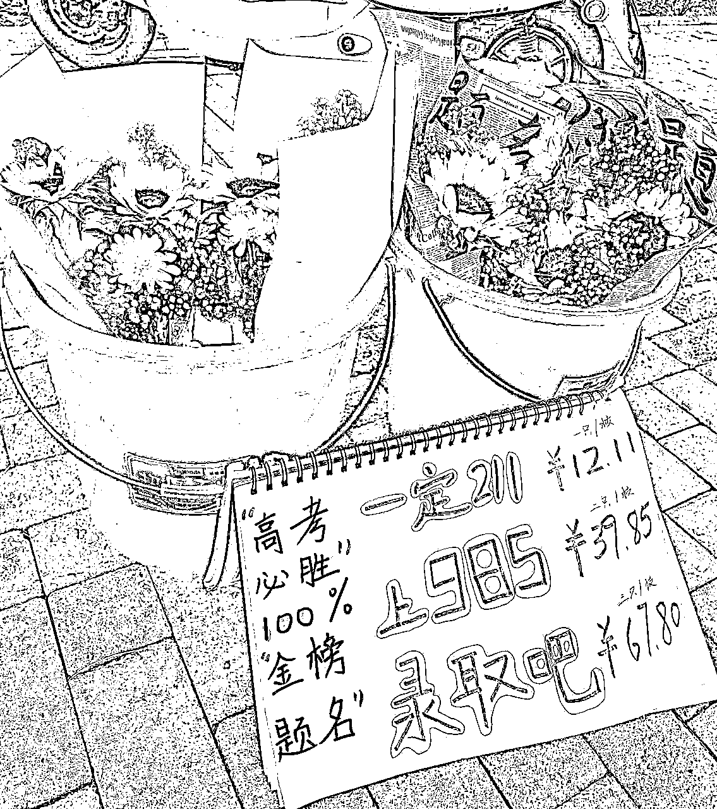

# 11. 砍价应对

大概率不会砍价，价格带寓意家长接受度高。真遇到保持镇定：
强调寓意好、新鲜、带花泥保湿2-3天、手写贺卡有心意。

# 12. 销售话术

“叔叔阿姨你好，花是刚现包的新鲜货，祝孩子一举夺葵金榜题名，您看看哪束合适我帮您包上。”
“98.5这个价寓意花心意，让孩子考上985放松心态，您看中哪束了？”

# 13. 应对同行

主动打招呼、嘴甜共情、提前占位。位置决定客流，去晚销量腰斩。

# 14. 降低损耗

避开直射阳光，选树荫下。桶里放水加几滴84保持清新，喷壶保湿。

# 15. 卖剩处理

没遇到大剩。剩几支可送人自养，多了朋友圈低价清或闲鱼出。

我因时间判断失误最后剩四把。花店不回收，老板好心成本减30收回一把，其余自养。合影只剩三把。

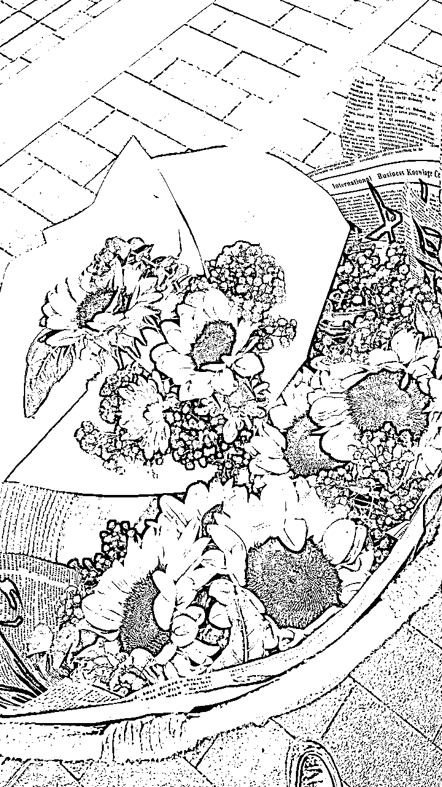

# 16. 扩散渠道

朋友圈预售、闲鱼上架、抖音直播蹭热度、📕写经历、线下引导加🛰️沉淀私域送小礼物。

第一次准备仓促，没做这些。0到1完成，接下来想的是0到10的放大。

# 总结

关于赚钱：别指望一次发财，降低预期。
关于心态：能赚是赚，赚不到就当练手，别因亏损否定自己。

有惊无险的一次摆摊，核心是行动快。机会留给立刻动手的人。

高考这场大戏落幕了，但留给我这个“卖花人”的，是一串值得反复咀嚼的经验。复盘那两天，我发现，花束在考场外早已不只是花，而是家长和亲友们说不出口的鼓励与祝福。这种情感力，是任何普通商品都给不了的。也正因如此，那几天花束需求远远大于供给，稳稳成了好卖的热门单品。再加上之前偶然看到的拍立得合影，我更确信，鲜花与合影一旦组合起来，绝对能炸场。

不过，高考一年一次，时机踩准了才有效。最好提前把所有准备工作做扎实，别像我一样，事到临头才手忙脚乱。家长和考生的情感需求是即时的，错过了那个情绪点，生意也就悄悄溜走了。

在卖花时，多提供一些个性化选择，往往能让人眼前一亮。比如按顾客喜好搭配花束、附上一张暖心的励志卡片，都会提升整体价值感，也更容易吸引顾客。当时我给两枝装或三枝装花束定价时，自己都觉得价格忽高忽低，没什么把握，索性又加上了鼓励贺卡和手工书法字（因为店里没有现成包装纸），结果顾客反而觉得很值，基本没人再来讲价。

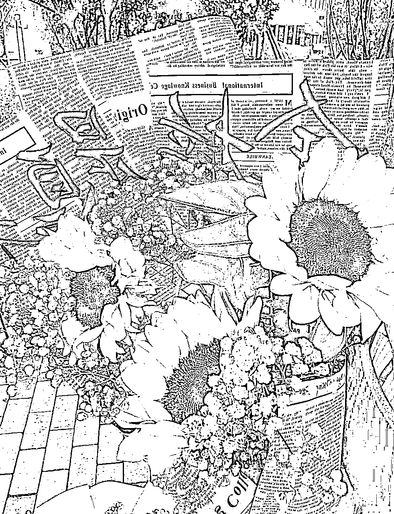

这个卷得不行的市场里，创新往往才是突围的关键。不论是营销玩法、产品设计，还是服务细节，只要肯动脑筋，就能把顾客目光吸引过来。这一回，我对自己的广告牌和花束包装设计还蛮满意的，审美终于派上了用场。

另外，别只盯着高考这一波生意。情感价值在很多场合都需要，要想想怎么让它在其他场景里延续下去，把盘子做大。比如清明节祭扫用的花束、情人节专属定制、生日花束，这些都是能长期走下去的模式。

一路走来，最大的收获其实是能力的成长。每个环节都要做判断、做取舍，无形中锻炼了决策力和解决实际问题的能力。过程中当然也有过焦虑、内耗，但最后还是选择用积极乐观的态度，把一个个问题收拾利落。

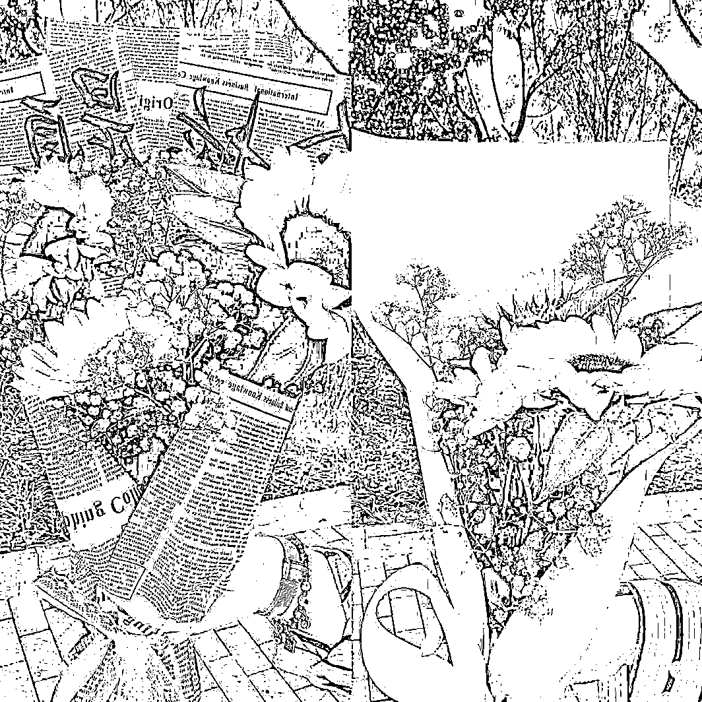

（超好看的搭配 而且每束都不一样）

最后，祝你，也祝我，旗开得胜，一举夺“葵”。愿我们都在赚钱路上不断前行，不断学习，不断成长，也愿每一位圈友，在这个充满机遇的时代，都能找到属于自己的财富密码。