# 小红书店铺/笔记违规避坑与自救指南

各位朋友好，我是小刀。

聊点实在的：抖音半无人直播方面，我名下加上合作的伙伴，总成交额已经干到了3000多万。去年春末我开始试水小红书电商，陆续跑出了好几个百万销量的款。

今天这篇，专讲【小红书违规】那些事儿。

从去年5月随赚钱航海计划入局小红书，到现在一年有余，我折腾了不少店铺，也打造出了好几个矩阵里破百万的爆款。对比其他平台，小红书电商目前仍有红利期，对小商家或者新手朋友比较友好。只是平台规则调整得勤快，实操时很容易踩到线。

我把自己踩过的、见过的常见违规状况整理了出来，真遇到了可以对着排查。

先说两个定心丸：遇到违规首先不是删，而是去申诉，尤其是“原创度低”这一挂的，套模板过审率还是可观的。再说了，单个笔记、单个商品的违规，并不会拖累整个账号的流量权重。

# 一、商品详情页违规怎么破

这一块的违规集中在标题和图文信息、品牌栏填写以及类目选择上。轻则提醒整改，重则强制下架，但不会伤及账号流量，改完就没事了。

## 1. 标题/详情图踩线

多半是页面里出现了竞品平台的水印，带出明星相关形象，或者安排了敏感词，被判定为夸大、虚构宣传，或暗示需要资质。处理起来不难：自己把图文和文字过一遍，按系统提醒的违规点删除或替换掉有隐患的图就好。

## 2. 类目放错位置

这类违规系统通常会在旁边标出建议修正的类目，顺着提醒改就行。要是确实摸不准自家产品该进哪一类，直接在公司类目搜索框输入产品名，就能看到对应归属。

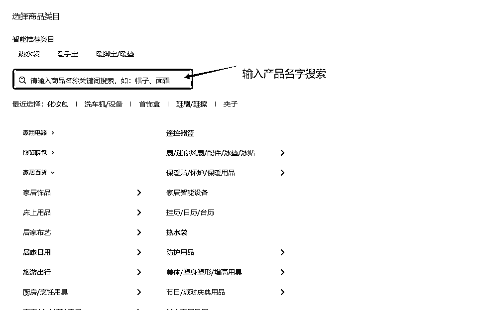

再说句悄悄话，有些需要特定资质才能卖的东西，不少个人店铺其实是在钻空子。上架的时候可以试着放进百货或者美妆个护这类大范围类目里，把标题和详情页里刺眼的词也顺手改掉。比如卷发棒挂到百货-造型件下面，滴眼液挂到美妆个护-其他眼部护理，亲测能过。每个平台对敏感词的拿捏尺度不太一样，这种产品最省力的操作是直接找一个小红书个人店的同款链接，用妙手一件搬家工具原样搬过来就行。

## 3. 品牌栏怎么填

看清品牌栏后面有没有红色的*号，就能确定这块是不是强制项。

如果没有*号，但你顺手填了“其他”“3E”这类内容，把品牌信息清空就可以了。可如果是带*号的必填项，能搜到对应的就正常选，找不到的，选“3E”一般不会出岔子。

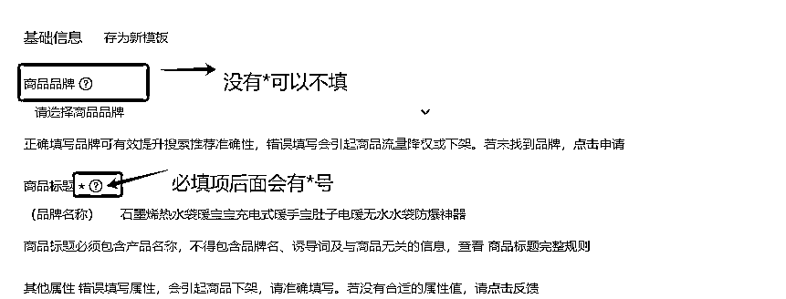

## 4. 属性乱标被判违规

产品属性里写了防晒、去红血丝这类特殊功效词，就会被判违规。跟着系统提示，把属性改成普通一类就行，比如“水润”这样的词。

因为类目问题被冻结下架的话，你改完类目重新上架，审核一过就自动解封，也无须申诉，不产生违规记录。要是实在挂不上架，等14天的申诉期悄悄过完，违规记录便自动消除，不会有别的副作用。

提醒一句：用电脑操作时，系统会对不对的地方给出红色方框提示，一目了然。

# 二、笔记违规遇到别慌

笔记一旦被提示违规，先别急着删掉——看清违规理由，对症下药去修改和申诉。申诉没有通过的，再考虑删除也不迟。

## 💥违规情形1：用到别人的原创素材

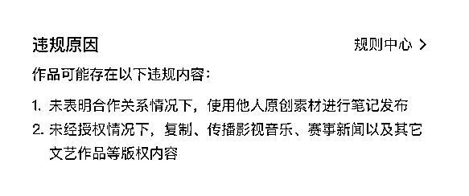

说白了就是去重没做透，被系统检测出来了。封面图的违规则可以直接换封面，可要是视频画面内部出了问题，基本没有修改的空间，只能走申诉流程。

### 申诉法一：

打感情牌+认错态度放到位。操作上是从剪辑界面截取三张操作过程的图片，注意别暴露去重环节。

话术参考：尊敬的小红书客服团队，我是一个二胎宝妈，想申诉理由:在小红书这么优秀的平台做兼职带货，帮家里承担些生活费，给孩子生活质量更上一个台阶!这个作品是我自己拍摄并剪辑的，希望尊敬的小红书客服大大麻烦对我的账号进行重新审核。

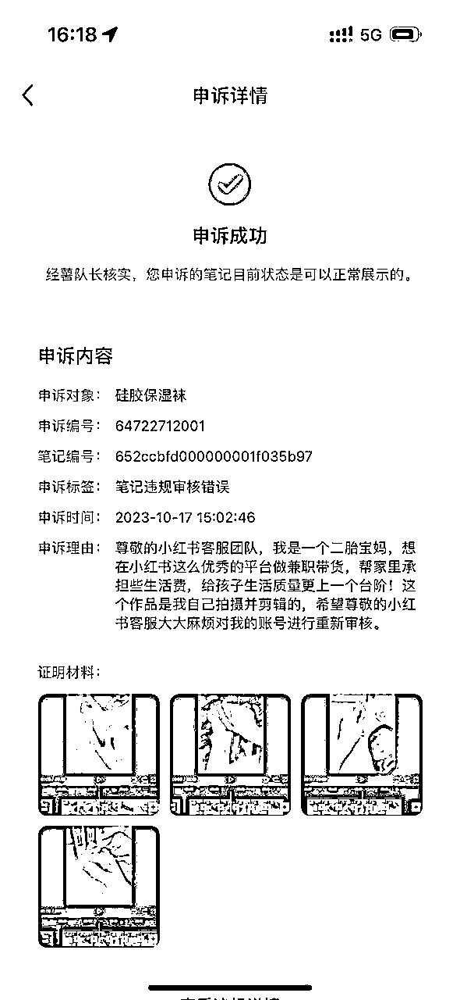

头一次申诉没过，别灰心，重点笔记可以在24小时后再提二次申诉，这次换一套截图和理由。

### 申诉法二：

这招讲究证据：翻出相册里日期更早的截图，要那种带拍摄时间的；再从笔记视频里提取两张画面，把它们组合进带时间的相册界面里，一起提交申诉。

话术参考：尊敬的审核员，你好！该内容为自己原创实拍内容，拍摄时间为2024年3月11日，为我本人原创，绝没有搬运！！因为该内容之前在其他平台发布过，不知是否被其他博主达人搬运过导致违规提示，希望审核员重新审核一下，感谢！

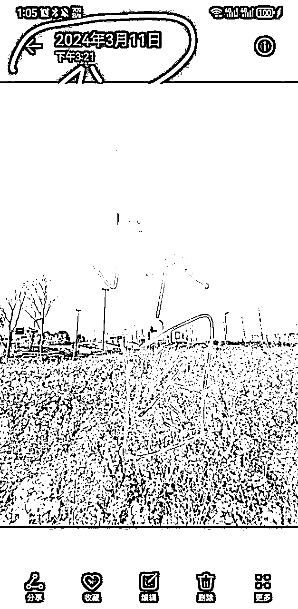

## 💥违规情形2：内容撞车或被认定编造人设

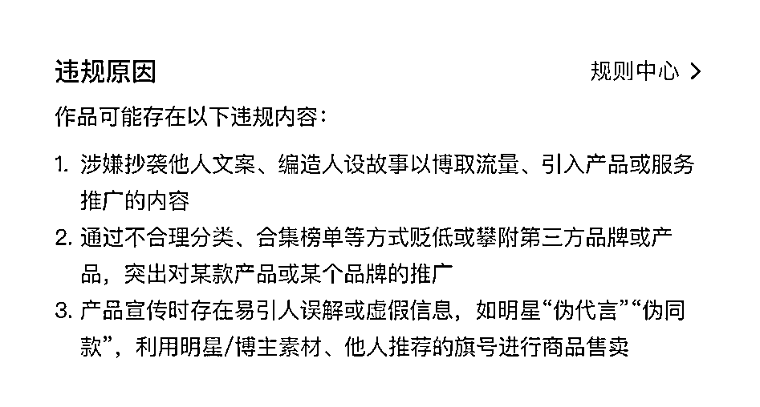

看到这类提示，分四个方向自查就没跑。

其一，跟对标笔记的相似度是不是太高，高到近乎复制，就得考虑重写内容了；

其二，有没有捏造故事线？商品笔记不能拿具体人设去编排生活情景，这是硬伤；

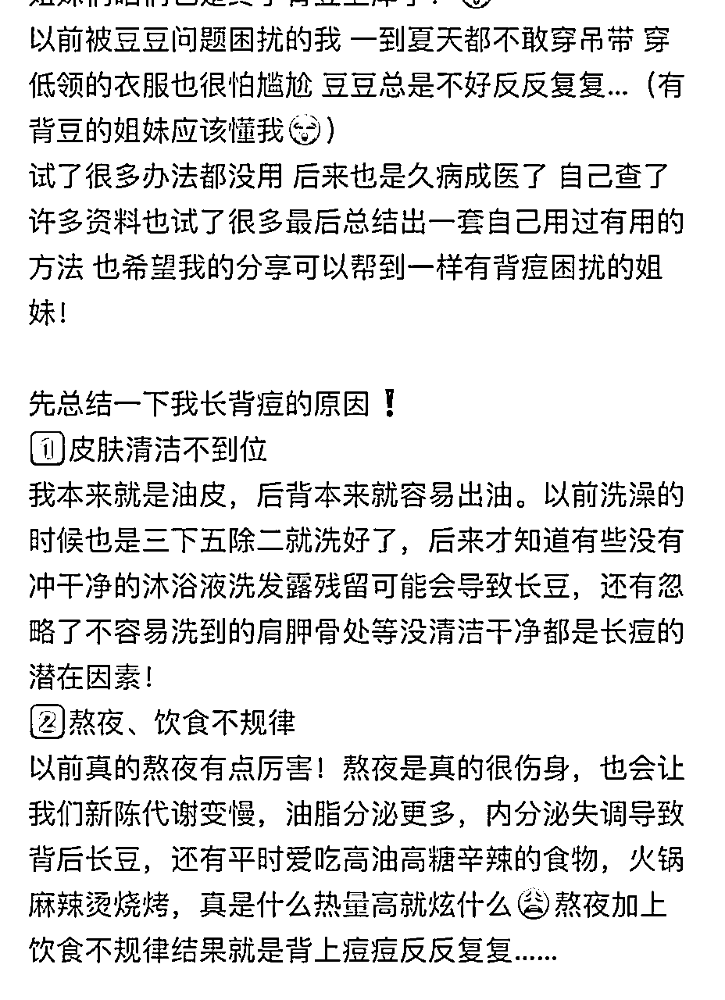

其三，注意笔记里有没有漏出别的品牌信息，有就得删改；

其四，明星相关元素一个都不能有！图片、文字、视频、音频全部包含在内。

排查完毕，修改掉问题内容后就可以发起申诉。

申诉话术：已自查无相关违规内容，符合小红书平台社区规范，请重新审核。

还有个小提醒：笔记支持修改的只有封面、标题和文字正文，视频里的内容是锁死的。要是问题出在视频内部，只能删除这条重发，以后注意避开雷区。

## 💥违规情形3：商品描述措辞出事

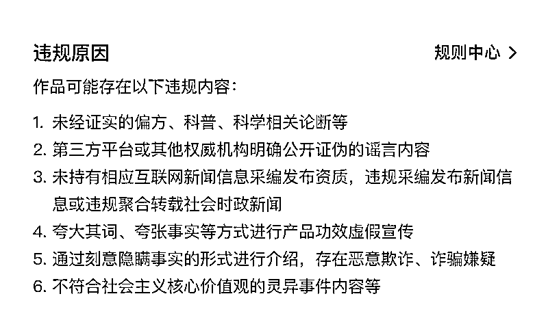

凡是功效类产品，只要涉及到使用前后的对比展示、使用周期带来的变化承诺、医学用途词汇等等，都是高发区。

*   虚假宣传：包括过分P图、展示使用前后反差极大的对比图，使用“绝对有效”“保证解决”之类的承诺性表达，或者拉踩别家产品来抬高自己，让消费者对功效产生误解；
*   虚假体验：假装成真实买家，以消费者口吻推荐自家的货，干扰他人对产品实际效果和整体服务的判断；
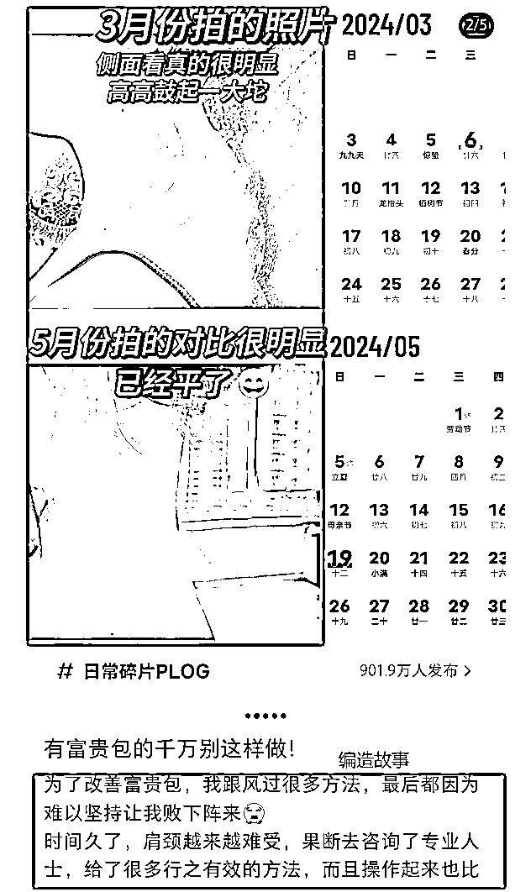
*   伪科学标题：借着冷门知识、夸大其词的功效说明来做包装；
*   硬广植入：笔记前后文风完全不搭边，前面是科普知识、娱乐八卦、影视剪辑或者个人经历分享，突然无缝插播跟主题毫无关联的商品推销。
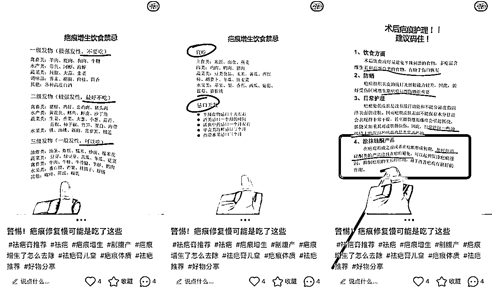

这里列一批高频敏感词，大家留意避雷：彻底/完全解决，抗菌，抑菌，除菌，灭菌，防菌，消炎、减肥，瘦身，瘦脸，瘦腿，燃烧脂肪，生发，育发、增发、有助毛发生长、密发，染发，脱毛、除毛、祛毛，美乳、丰乳、丰胸、使乳房丰满、预防乳房松弛下垂，健美、减肥、燃脂、除臭、除腋臭、消除腋下异味、去狐臭、抑制腋臭，祛斑、淡斑、减少色斑产生、减少皮肤色素沉着、破坏黑色素细胞、阻碍黑色素的形成、去黑(祛黑)、美白、增白、亮白、变白、焕白、嫩白，防晒、吸收紫外线、抵御紫外线、减轻因日晒引起的皮肤损伤、全方位，安全，无毒、医学护肤品，药妆、表皮生长因子，食品级/料理级，可食用，纯植物，防脱发、防掉发、减少脱发、减少掉发、减少落发，中药，中草药，中药精华，刷酸治疗，黄褐斑/肝斑/蝴蝶斑/妊娠斑，有效，去斑，素脸，刷酸，提高肌肤抵抗/免疫等

### 处理方案

笔记里有这类词的话，就改变讲法。可以用谐音、emoji或者拼音去替换，修改后即可去申诉。

申诉话术：已自查无相关违规内容，符合小红书平台社区规范，请重新审核。

## 💥违规情形4：笔记整体观感出问题

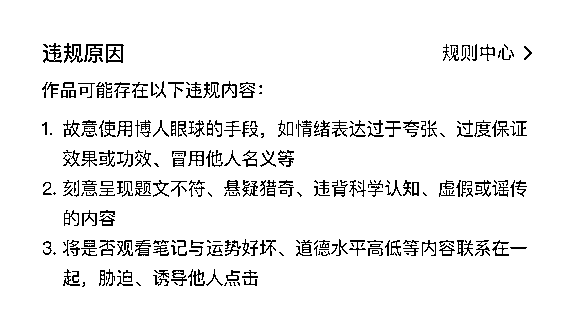

这种大多是封面标题太能整活，搞得太过夸张，或者内容质感显得廉价、画面混乱、人物出镜形象不佳、有擦边嫌疑等。百货类产品尤其容易被点。另外封面和标题里出现“申遗”“谢谢沈月”“中国速度”这些词，拉响警报的概率也很高。

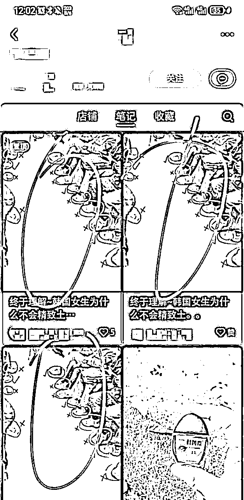

### 处理方案

完成修改再申诉就行。把封面换回正常展示产品的样子，标题中除掉那些可能引火烧身的字眼即可。

申诉话术：尊敬的审核官您好！笔记内容已全部自检自查，无任何违规内容，符合社区规范，麻烦重新审核，非常感谢！

## 💥违规情形5：被判定为不走心的营销

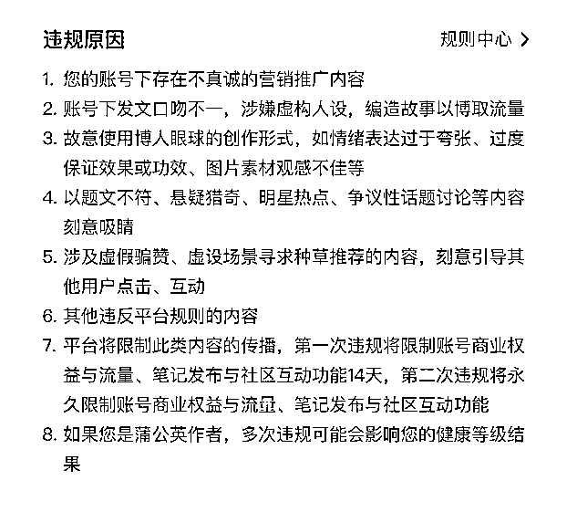

这一条大概涵盖了几个可能：

封面图片太过于猎奇，或者用了不真实的对比效果（比如祛痘前后面面观、富贵包前后、健身瘦手臂之类），也包含前面说过的标题敏感词问题；

正文是否存在虚构人设，拿一个具体人物角色去编体验故事；

再检查评论区：有没有自家店铺账号留下的“惊喜盒子”信息，有的话先清理掉。

### 处理方案

自查有没有以上情况，先修改或删掉有风险的内容，再去申诉，申诉时勾选“笔记审核错误”节点。

申诉话术：尊敬的审核官您好！笔记内容已全部自检自查，无任何违规内容，符合社区规范，麻烦重新审核，非常感谢！

## 💥违规情形6：遭人举报

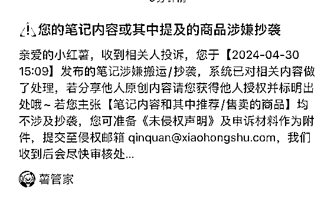

被举报这一类，翻案难度相对高。要是内容本身就是照搬别人的，不如直接删了干脆；但如果是参考对标自己拍的，还留得住证据，那就可以试试发邮件去申诉。不过处理周期会比较长，不重要的笔记若是被举报，建议直接删掉，省得费神。

### 处理思路

打开相册，截图带有拍摄日期和拍摄设备信息的图片详情页面，发到小红书站内提供的申诉邮箱就可以了。

### 模板参考：

尊敬的小红书审核官您好，收到平台消息提示，我的笔记被举报搬运抄袭，对此举报，本人表示十分意外，因为笔记所有图片内容均为本人实拍创作，拍摄时间为X年X月X日X时X分，有截图为证，经得起任何方式的验证。

在我拍摄图片之后，经过添加产品说明制作后上传至平台发布，不存在搬运抄袭的情况，若举报者为售卖同一商品的同行，应该知道产品功效、受用人群，其实是特定的，我方认为，对产品特点、功效、适用人群进行说明并不存在侵权抄袭行为，若这属于侵权抄袭行为，那么平台应该允许同一产品只由一个商家售卖，但此行为明显不利于小红书平台电商的健康发展本人非常感恩能在小红书平台上进行创业,也感恩该商品目前也取得了不错的销量，本人始终遵循平台的核心价值观，尊重原创，希望他人也能尊重我的原创成果，也希望自己通过原创给自己及平台创造更大的价值收益由此望审核员大大重新审核，驳回举报者的侵权投诉!感谢万分!同时，请求审核员大大恢复笔记正常展示!

最后，本人所有实拍图片均接受法律验证,，目前由于举报者的行为，目前已造成我方实际的经济损失，若由于举报者的行为，造成对本人的投诉成立，本人也会拿起法律的武器捍卫我方正当权益。

平台在各个时间段严查的侧重点是不一样的。一边咱们要紧盯平台的动向，另一边也不必因为害怕违规而捆住手脚什么都不敢干。风险和收益永远是孪生兄弟。账号这东西本就是消耗品——能赚到钱就值，就算废了，接着换新号照样干。