我是慧敏，一个在电商路上跌跌撞撞走过来的人。如果你也像曾经的我一样，天天看别人晒收益、自己却迟迟落不了地，那这篇关于小红书无人直播的完整玩法，应该能给你一点方向。

我最初接触直播是视频号。第一次开播，三四个小时就卖出一万多，差不多三天赚回过去一个月的工资，二十天抵上一年收入。可惜那是应季品类，过了季节就没法继续播，于是我就想着多学几个平台、多找几条路。那时候从头到尾是我和老公两个人，也就是大家口中的夫妻档。不敢招人，怕带不好，也没底气管团队，只能自己慢慢磨。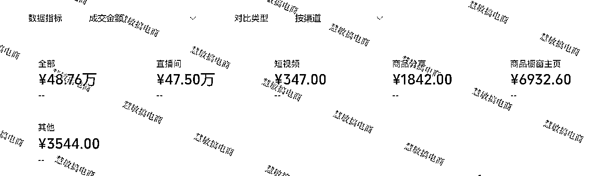

前年12月，有朋友说起小红书短视频带货。女生都爱刷小红书，当时卖的是酒精消毒喷雾。我特意查了一圈，发现几乎没人写这个方向，便一直留意着。去年3月初，我开始正式做。一周内起了两个店，百货、玩具、图书、女装都试了一遍，也都跑出了成绩。有的笔记流量破百万，产品销量过万，直到现在还有长尾出单。相比直播，发笔记可以兼职做，来钱不如直播那么直接；大多数账号一个月能爆两次大流量已经不错，我们的账号倒是能反复爆，而且真不用养号。两个店铺加起来，两周时间就赚了十几万，确实很香。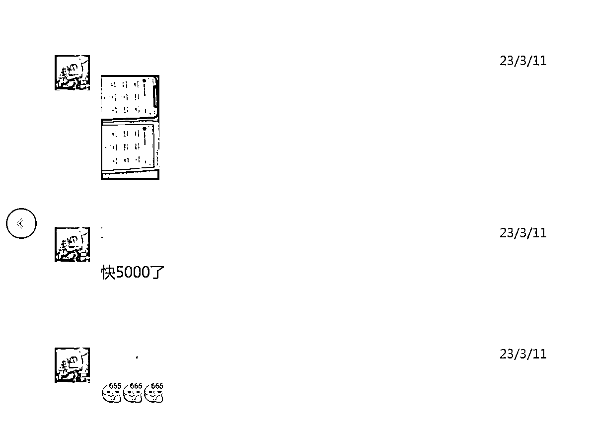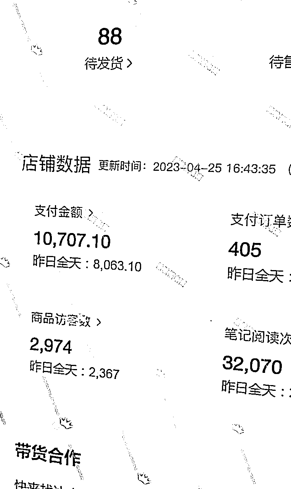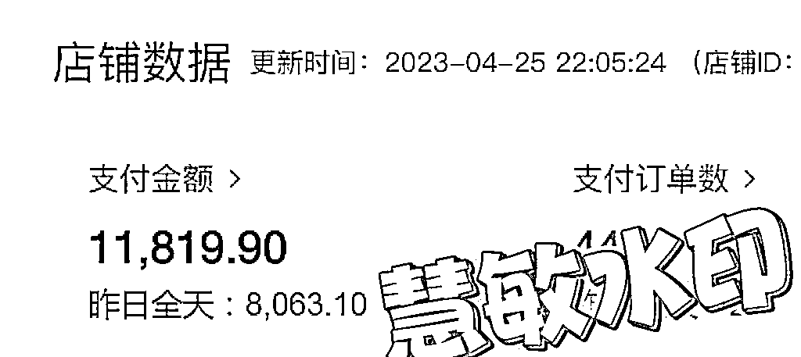

今年过完年，我开始做小红书无人直播。因为以前踩过坑，我很少对外讲具体项目。去年越影大哥跟我说过，有些人只是缺一个机会。所以今天直接上干货，把这套无人直播的SOP大纲全部拿出来分享。下面这个账号是带了一个月的新人做起来的，差不多20天左右的数据。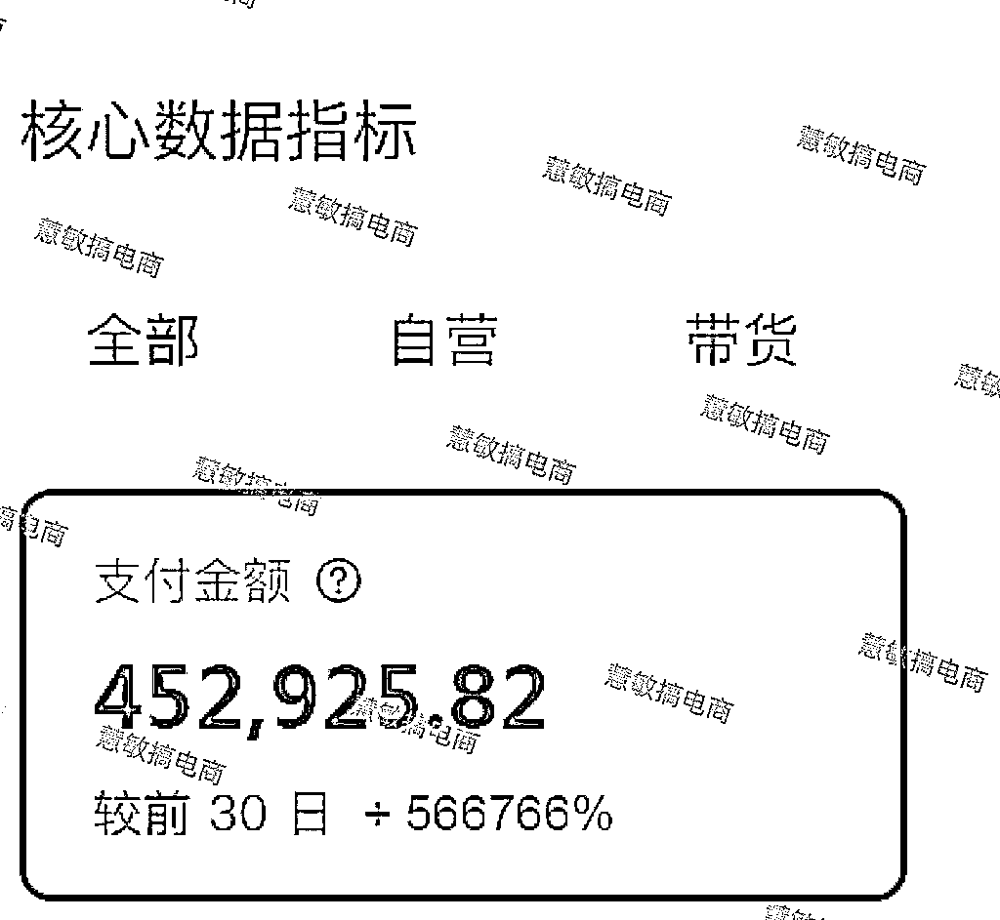

先看账号矩阵怎么搭。

个人起号，就是去移动、联通、电信分别办卡，或者用亲戚朋友的实名多办几张卡注册。实名方面：个人店铺，一个身份证能开一个店，目前可以用别人的实名、绑自己的银行卡，但要注意对方随时可能解绑；企业店铺，一张营业执照能开两个店，每个企业店能绑3个主理人账号。开店流程不复杂：点右下角的“我”，左上角三条杠，进“创作中心”，找到“更多服务”，选“开通店铺”，再点“立即开店”，按要求提交资料即可。个人店铺就是用自己的实名开；个体工商户要营业执照，并且可以下面挂3个子账号。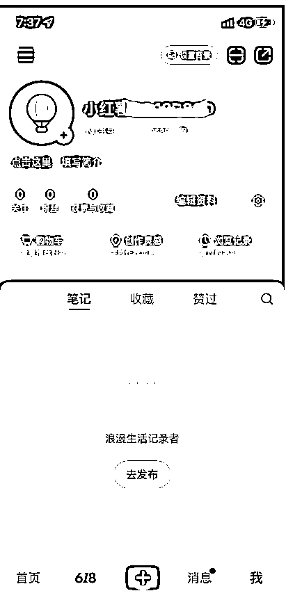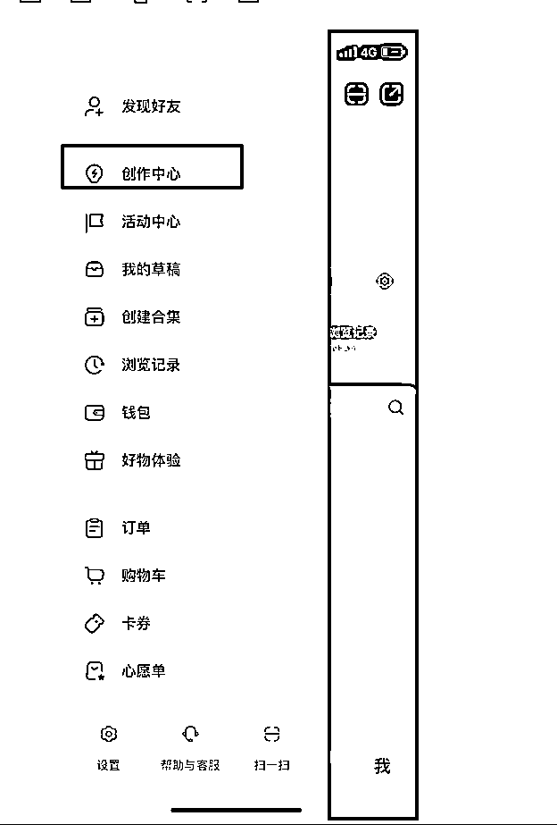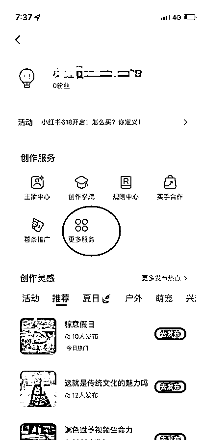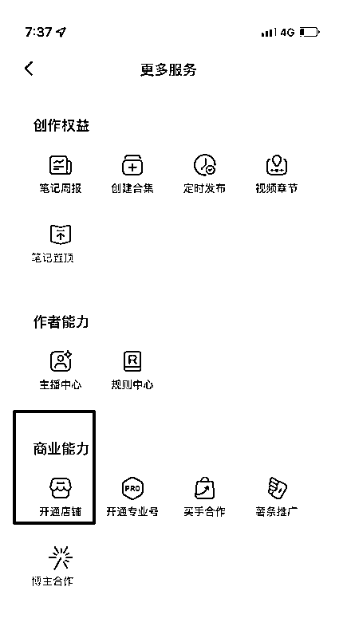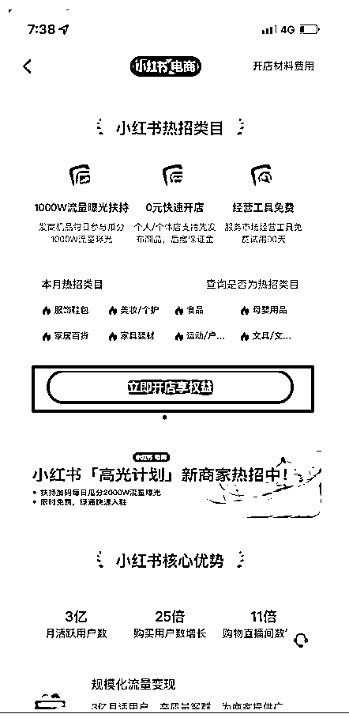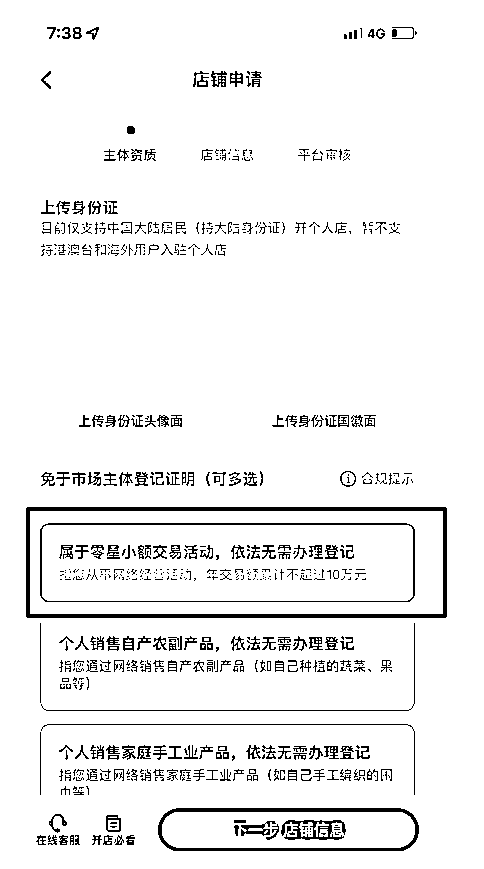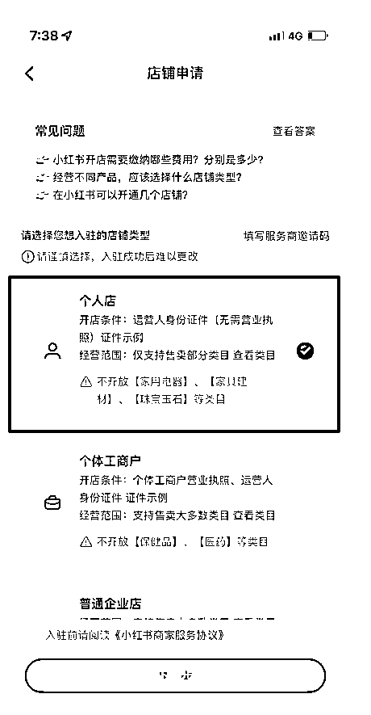

设备方面，我更推荐iPhone X，二手大概800块。以前我也买过安卓机，结果一年不到连机都开不了。想长期做，iPhone X更耐用，不想用了还能转手卖掉。

小红书主要的变现方式有四种：一是短视频/图文笔记带货，店铺开好后发笔记挂商品，最常见；二是导粉引流到私域，很多行业在这样玩；三是接广告，美妆、穿搭、母婴、好物分享、测评这类达人比较常见；四是直播变现。想看同行怎么播，直接点首页最上面的“直播”，就能看到当前正在直播的账号。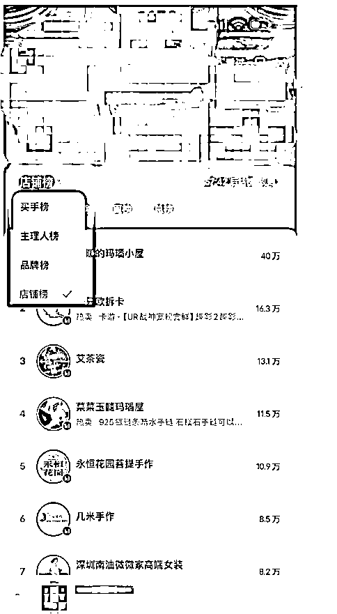 里面分买手榜、主理人榜、品牌榜、店铺榜。我们要重点关注的是主理人榜和店铺榜，因为这两个榜单里大概率都是同行的无人直播间。主理人是指一个营业执照下绑定的3个主理人账号，店铺榜则对应个人开的店铺。

新手操作要注意几个点：

第一，账号基础搭建不用太花心思，名字、头像、简介简单包装一下就行，有些人名字都不改，素材好一样跑得起来。

第二，选品找素材，核心是“以品推品”。每天多刷同行的直播间，找最近开播、销量高的品，挑那些自己打得过的直播间，再顺着这个品找类似直播。有些抖音号自己也在做矩阵直播间，素材别只盯着抖音，快手、视频号都可以挖。

第三，找对标。小红书上就刷店播榜单和主理人榜单；抖音上就看一周内新起来的号：销量不错、是素人自己播、不是大V、讲解产品细节清楚。这种新素材同行还没在小红书跑过，可以马上跟进。

第四，直播时可以多发笔记引流直播间。当然，也有不发笔记就能播起来的账号，笔记更多是增值玩法，能带来额外曝光。

第五，直播间封面非常关键。笔记封面会影响直播间点击率，封面可以大胆做钩子，参考同行或者这个产品爆文笔记的封面，然后用到直播间上。

第六，素材的产品转化能力要强。优先选那些在别的平台播得好的直播素材，另外注意主播情绪会受在线人数影响，人少时容易低落，人多时更饱满。直播间场景搭建也是参考因素。

第七，矩阵要提前准备。新手至少用一个店铺加3个账号来测，或者开3个个人店铺。类目优先推荐女装、食品、百货、女鞋。新号开播有新手流量扶持，别浪费。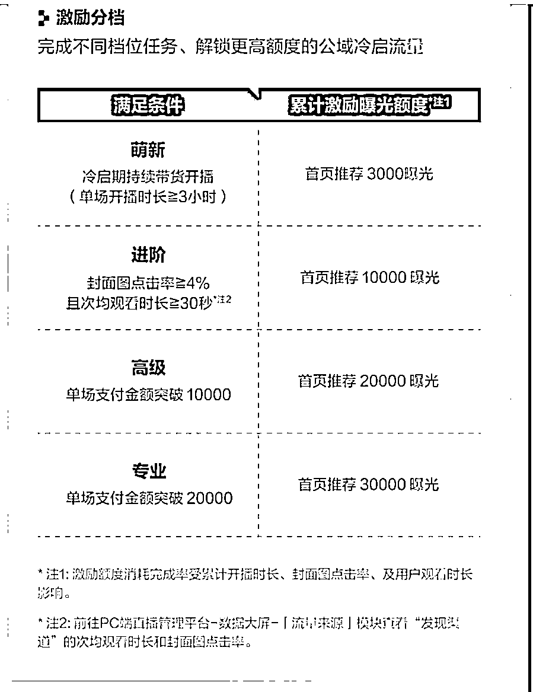

选品方面，我会先做人群分析。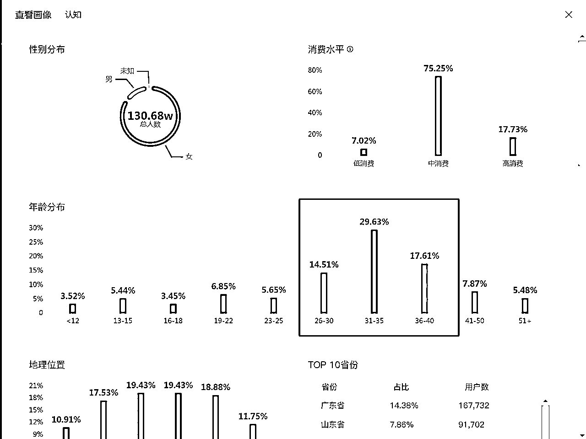 再做类目分析。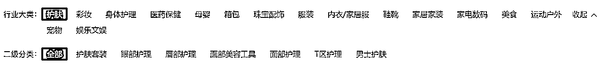 综合下来，选品建议是：目标用户集中在26到40岁，一线和新一线城市较多，主推30岁左右女性用品；类目要高佣金、利润50%以上，具体品项再细看。因为无人直播不考虑复购。

常用选品工具也分享给大家：

抖音类：抖店（https://fxg.jinritemai.com/）、蝉妈妈（https://www.chanmama.com/）、考古加（https://www.kaogujia.com/）、巨量算数（https://trendinsight.oceanengine.com/arithmetic-index）、巨量百应（https://www.douyinec.com/）

小红书类：千瓜数据（https://app.qian-gua.com/#/data/category）、蝉小红（https://www.chanxiaohong.com/login）、有米有数（https://console.youshu.youcloud.com/recommend/goods/10601）、灰豚数据（https://xhs.huitun.com/#/home）

不过这些数据只能当参考，因为别人也在看，一群人跟着用同样的素材，号死得就快。我现在基本靠每天刷直播间来找品，速度最快，已经很少打开数据平台了。

直播素材怎么处理？

下载录制直播间的软件有很多，这里不挨个放了。播放端用OBS推流，配合小红书直播助手的电脑端即可。去重方面，主要是剪辑：把价格、平台极限词（比如“最”）剪掉，主播吐词不清楚的地方也剪掉，免得官方误判。再去水印、镜像、变速，这几个手段最常用。

直播间流量来源有哪些？主要就是直播间上下滑、发现频道、视频内流直播卡、直播广场、搜索。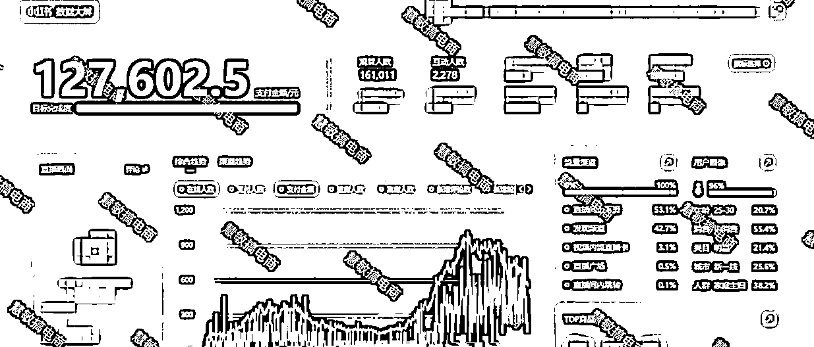

最后说几个重点：

第一，别跑和别人一样的素材，同一个素材在两个号上都会违规。别人正在跑或者已经一堆人在跑的素材，不要上，还是用“以品推品”的思路（偶尔也会跟同行抢素材）。

第二，开播时长至少3小时，前期测品至少测3场，把时长拉起来。如果没成交、场观也低，马上换品，不要在一个品上死磕。

第三，既然玩的是短期快钱，账号就别太在意，废号很正常。

第四，会有违规通知，严重的直接永久封禁，也有15天处罚，还有提示录播。提示录播问题不大，继续播，看流量正不正常，只要不是15天处罚就没事。

第五，素材里的违禁词要剪干净；评论区可能出差评，录播、盗播要提前设置好；在线人数多的时候多做直播间互动；店铺客服做好承接。

第六，违规的最终原因，多半还是素材不行。

第七，为什么我会选这个短期项目？因为带团队、招员工都不适合这种玩法，管理上我也嫌烦；没有资金壁垒，也没什么门槛，招了员工大概率也留不住，所以短期能赚到钱就行。说实话，这些数据都是熬夜熬出来的——凌晨三四点睡，早上六点又要起来接流量。以前我也觉得自己的执行力不差，但为什么就是拿不到结果？后来才明白，比你努力、比你拼命、执行力比你强的人多的是。做视频号的时候，我和老公四点半起床，在田边直播，户外体感温度40多度，从小白一步一步做到开播3000多人同时在线。看到成交数据的那一刻，觉得一切都值了。

发笔记带货也一样，一直发，一直优化，再发。电商这条路上我踩过很多坑，但至少拿到了结果。现在我也在测试新项目，非常感谢贵圈让我开阔了眼界、弥补了信息差，也认识了各位优秀的大佬。