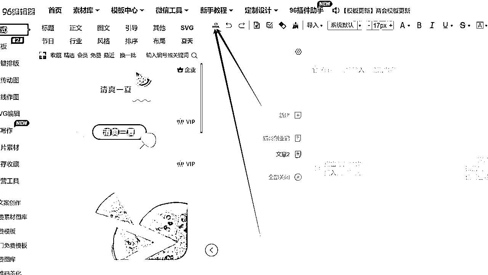

# HTML格式文章怎么安全发到公众号？全流程拆解

# 先把HTML还原成可编辑的图文

你手上拿到的大多数文章，其实都是保存成 html 的 txt 文件。这种原始代码直接复制到公众号后台是会乱掉的，所以第一步一定是先做代码还原。

打开 96 编辑器：
注册登录地址：https://bj.96weixin.com/register?register_code=JZA74aXNOcwnxbl4fLtG7OT8lLNeB

进入后点一下顶部的 html 按钮，界面就会切到代码模式。把整篇 html 文本全部粘贴进去。

提醒一下，这里的粘贴口不支持右键菜单操作，只能用快捷键 ctrl + v 来完成。

代码粘贴完毕后，再点一次 html 按钮，就会自动解析成可视化排版，文章就能正常阅读了。

还原成正常排版后，需要做的精修工作有：

1. 清除AI创作指令。如果原文里带了这类提示词，通常会出现在开头或结尾，直接删掉。
2. 处理英文段落。能删就删，不能删的就顺手翻成中文，保证阅读流畅。
3.通读全文，剔除逻辑不通或语义僵硬的句子，适当润色。篇幅超过2000字的话，建议精简掉冗余部分，提升阅读体验。
4. 统一二级标题样式。很多文章虽然写了二级标题，但样式没加载。这时可以去任意一篇已排版好的文章里，右键点击一个标准的二级标题，选择保存样式，下次就能直接调用了。

这一轮处理完，内容就可以直接复制到公众号后台发布了。

另外一个小细节是，文章底部通常要加一个文章回顾的模块，可以手动挑选相关链接插入进去，增加关联阅读。

# 封面图快速制作方案

封面图可以用稿定设计来生成：https://www.gaoding.com/
第一次用记得先注册，基础功能免费使用，下载时会有水印，追求无水印的可以开通会员。

进去后点【智能设计】，在模板里找到公众号封面这个分类。

把文章标题粘贴进去，标题过长的话先自行精简一下，点击生成后会出多套配色方案，挑一个视觉舒服的下载即可作为封面。