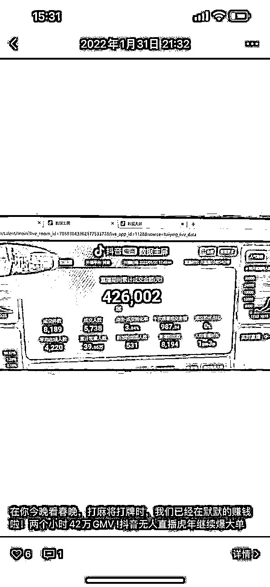
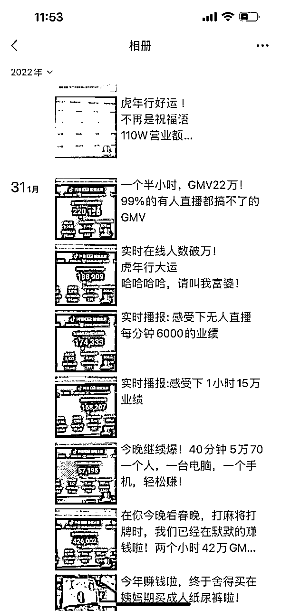
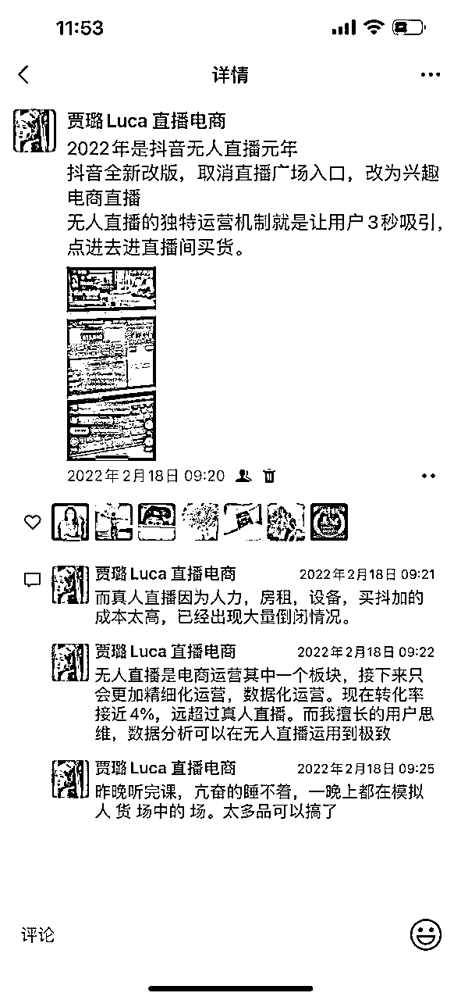
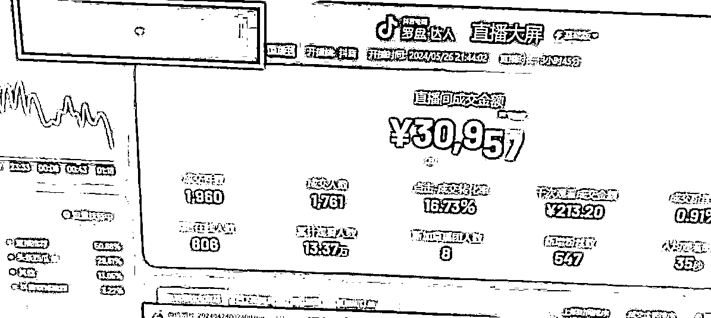
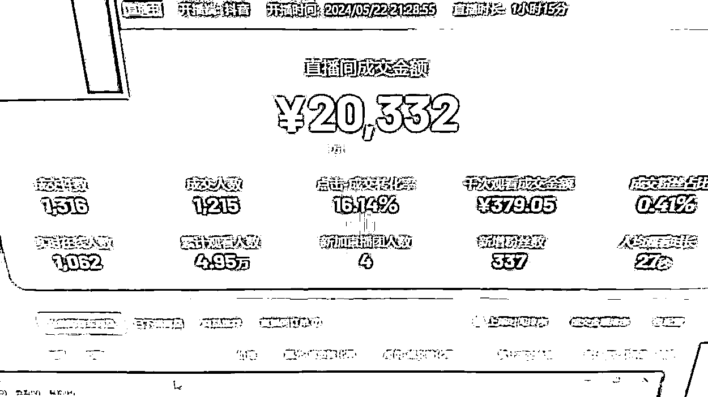

# ('无人直播2024年还能做吗？4年的操盘手用6大观察点告诉你', (2, 31))

无人直播2024年还能做吗？一个4年老玩家的6点真实观察

我是贾璐，圈里常叫我璐姐。2019年开始做无人直播，算是第一批吃这只螃蟹的人。从音频无人直播到短视频卖惨引流，从快手又折腾回抖音做纯自然流，无人直播的各个阶段我基本都趟过。现在在杭州做规模化运营。这几年学费花了大几十万，虽然没实现财富自由，但广州一套房和两个孩子的教育基金还是赚出来了。

很多人问我：2024年了，无人直播还行不行？先给结论：是个好项目，但不是人人都能做好。

经济环境大家有目共睹，地产、教培、游戏这些昔日大池子都在缩水，被挤出来的人一窝蜂涌向短视频。门槛低、启动快、不用大资金，这是最直观的吸引力。也确实，现在满屏都是素人直播。那么无人直播、半无人矩阵电商还有戏吗？我的判断是：有，但玩法已经彻底变了。

回看2022年，随便一个号跑出50万、100万GMV都很常见，现在一场直播能稳定做几万就算不错。为什么我还愿意做？因为成本实在太低：电脑月租200，二手手机600，电费200，软件300，加起来千把块投入，比起其他行业依然是很稳的生意。

先放几张2022年的高光图，感受一下当时的疯狂。

那年真是无人直播元年，十几个小时就能做出几十万GMV，佣金能拿25%。

再放两张数据对比，看看现在的情况。

现在一场直播大概几万GMV，虽然缩水明显，但在无人直播这个圈子里，我们的技术依然算top级，很多同行做不到。

作为一个经历过完整大周期的人，我对2024年能不能做，有几点比较深的观察：

观察一：新手只盯着流量，不懂变现
很多刚入行的人，思维还停在五六年前：做内容、涨粉丝、接商单。天天琢磨打光、运镜、设备，想先做个大号再想办法赚钱。可问题是，今天平台最不缺的就是内容，普通人平地起大号的概率低得可怜。变现路径拉得这么长，最后大概率是血流成海。

观察二：大主播被限制，流量重新分配
2021年，薇娅和李佳琦是绝对的直播电商王座，两个人一年卖货总额超过1000亿，收入预计超100亿，而当时淘宝第三名连10亿都不到。后来罗永浩、辛巴、小杨哥轮流坐庄，又一个个退场。他们退场，不是嫌赚钱太累，而是监管和平台的双重压力。背后有国家监管思路调整、地方财政压力、平台想搞多元化内容等复杂原因。也正因为头部被压住，释放出来的交易流量让中小玩家机会前所未有地变大。这也是我还敢all in直播电商的核心底气。

观察三：变现方式就那几种，带货效率最高
短视频粉丝经济走到今天，变现路径其实很清晰：

第一种是带货，本质是当渠道。传统玩法是先做IP、立人设、建立信任，再靠平台流量机制转化，路径长、成功率低，属于普通人能参与但不一定走得通的路。无人直播的优势，就是把这套路径大幅压缩，跳过养IP的漫长环节，更直接地卖货。

第二种是观众直接掏钱，比如打赏、订阅。这相当于传统杂志报纸的付费阅读，盘子不大。你回想一下自己给几个主播刷过礼物？有多少是刷给女主播的？就知道这条路有多窄。

第三种是商单合作，本质是代言。这种机会只属于极少数品类头部主播，而且现在消费疲软，品牌方预算也紧巴巴。

第四种就要格外谨慎了，比如预付费福袋、抽奖、介绍信息赚通道费、卖理财等灰色玩法，合规风险巨大。以前没人管，不代表以后没人管。靠这些手段收割的钱，早晚要还回去——要么法律逼你还，要么自己主动还。话就说这么多。

观察四：无人直播的底盘不但没松动，反而更扎实了
电商的底层逻辑永远是“人货场”匹配。无人直播的本质是卖货，和线下零售、传统电商没有本质区别。结合流量特点和观众画像，把合适的商品挑出来推出去，仅此而已。直播电商里，便宜、不用深思熟虑、买了不吃亏、适合普通人的商品，一直是刚需。无人直播因为内容形式有限，受众天然是价格敏感型人群。经济越紧张，这个群体越强大。所以我们对这个项目一直有信心。

观察五：低质内容被严打，对合规玩家反而是利好
有人看到头部主播被锤，就以为做垃圾内容的机会来了。别想太多。平台和监管收拾巨头，绝不是给垃圾内容腾地方。诈骗、争议、恶意营销一样被重拳打击，最近几个大主播停播甚至被司法处理就是活生生的例子。无人直播虽然内容不算精美，但胜在合规，没有实质风险。别人被打掉，腾出来的市场自然归我们。

观察六：无脑开播已经没戏，综合能力必须跟上
行业变化和监管调整，让无人直播的打法全面升级。我梳理了几个关键变化：

第一，内容质量的门槛上来了。画面清晰度、布光、造型、中控都不能敷衍，内容最好还有点趣味性，能把留存时长稳住，平台才愿意持续给量。以前玩家少，没人讲究这些；现在不认真做就是死路一条。

第二，纯无人直播变少了，“真人+无人”组合成了常配。以前扒条视频就能开播，靠品类红利就能爆。现在最好开场有真人主播带一带，提升内容质量和独特性，平台更愿意信任你。我们也因此沉淀了一套方法论，帮真人主播快速启动，把关注和兴趣稳住。

第三，品牌方也开始下场做无人直播了。以前基本是个体户在玩，现在一些乐园、酒店、美妆品牌都在做。优化后的无人直播，效果不输真人直播，成本却比养固定团队低得多，自然成了新选项。

第四，暴力起号的路子废了，“鱼塘+投流”才是主流。纯自然流已经跑不动，开播前期得靠鱼塘和投流助力，让平台更快给你流量。在哪个环节投、投多少、看哪些指标、怎么调整、何时放弃，这些变成了真正的技术活。好在我们的投流ROI一直还不错。

第五，账号寿命变长了，不再是“一次性耗材”。合规准备确实变重了，开播前要处理账号迁移、公司注册、审核一堆事。但好处是，过了合规这关后，账号可以长期经营使用，不用再靠新号红利期、玩一周就废。找号的压力小了很多。

第六，数据分析和操盘能力成了分水岭。抖音大盘给的参考很多：场观、留存时长、千人转化、投流节奏、广场流量和搜索流量的特征。以前这些数据我们也看，但只停留在“知道哪项好就能爆”的程度，本质靠天吃饭。现在我们的团队能理解指标背后的含义，知道它对成交的影响，一旦成交不够强，还能通过调整内容和投流来救场，把命运握在自己手里。

第七，选品的重要性被放大了。无人直播电商的本质还是人货场，内容一旦泛滥，选品就是最核心的差异化优势。以前可以无脑跟风追热点，现在必须形成爆品方法论，靠团队信息共享、结合自己的判断，卡住风口期，快速放大成交。

第八，技术底座总算稳了。经过几年迭代，基于OBS的推流方式，在防封禁、直播稳定性、账号安全上都形成了成熟打法。以前常见的断连、封号问题，现在基本都能控制在最低范围。

总的来说，经过这一轮行业洗牌，无人直播依然大有可为。但门槛已经变了：直播技术、操盘能力、运营和数据分析，这些将成为新一代无人直播操盘手的标配。接下来我也会持续把这些经验整理出来，愿我们都能用更安全、稳定、可持续的方式赚钱。