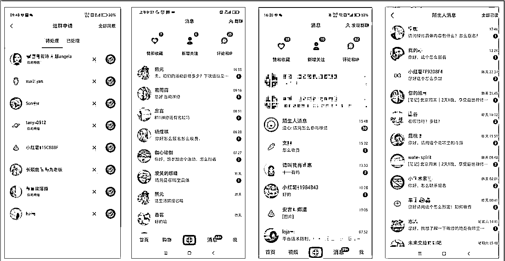
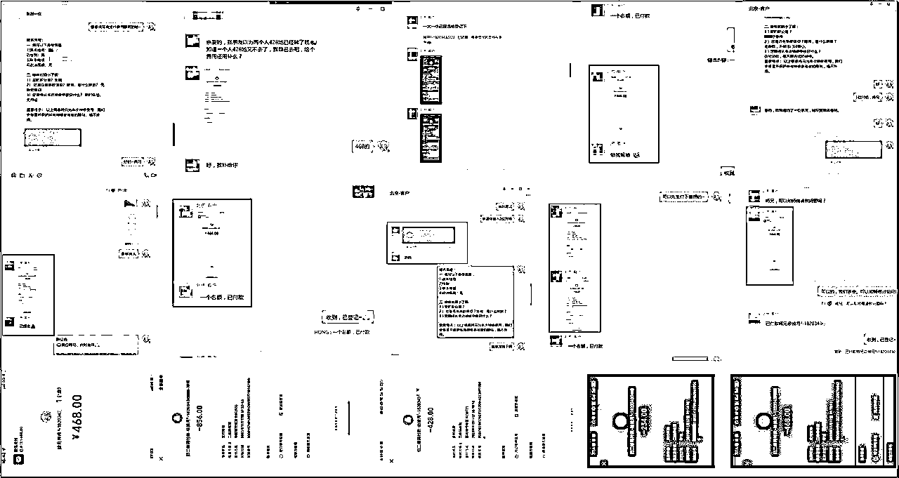
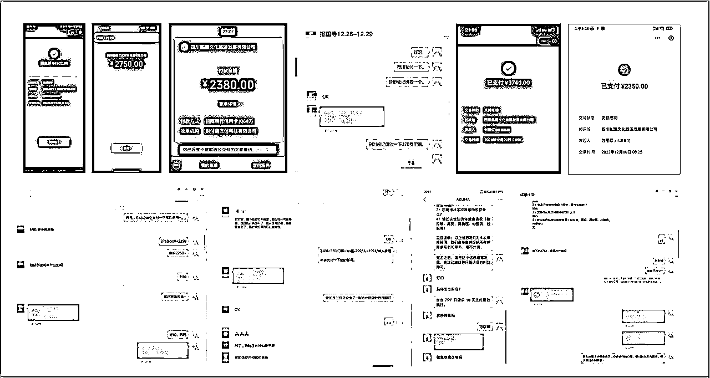
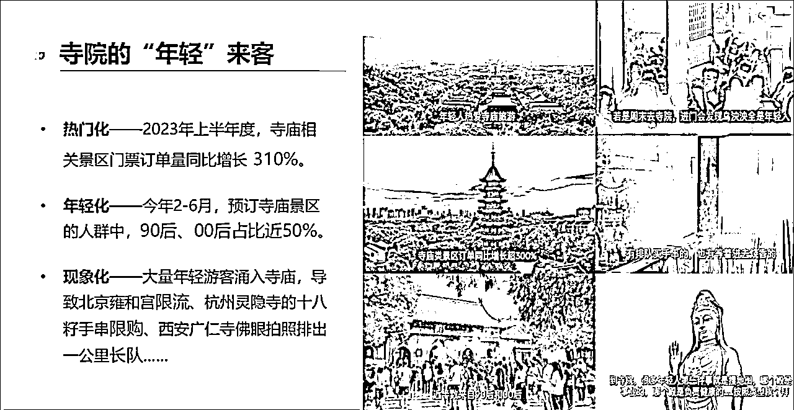
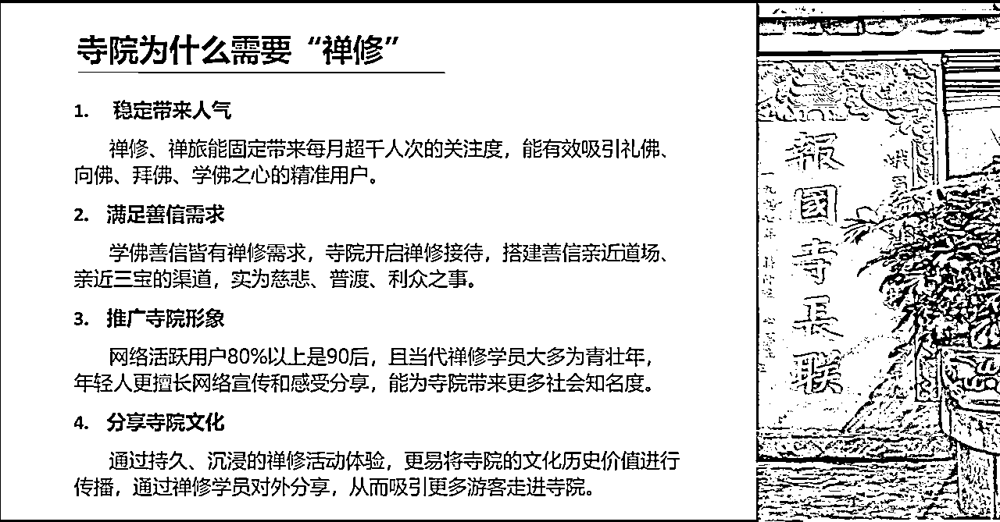
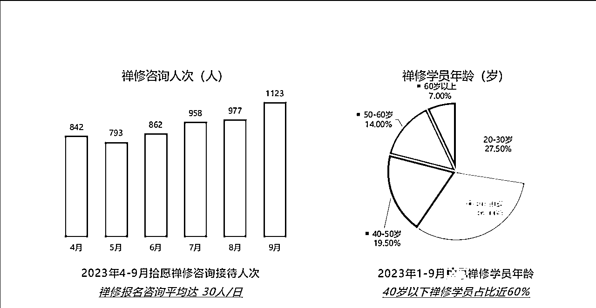
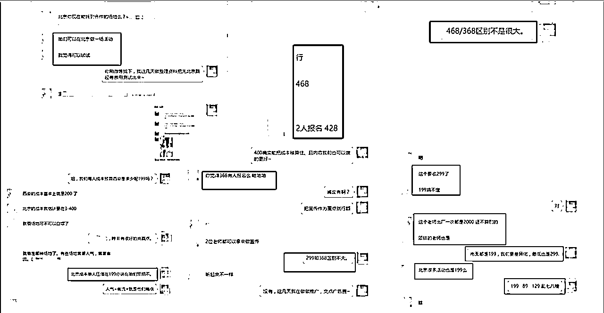
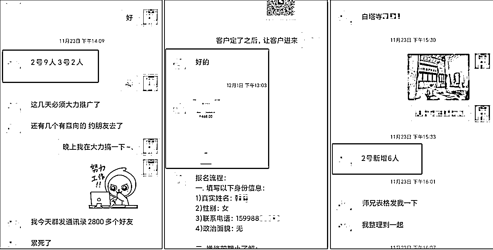
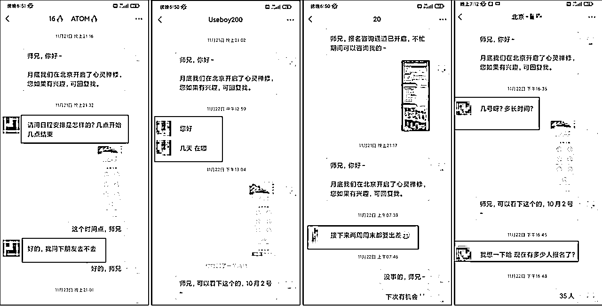

# 1周变现7w+，小红书禅旅赛道从0-1玩法揭秘

小红书禅旅赛道，从0到1一周变现7W+的玩法拆解

我是拾月。上个月在星球分享过一篇关于30天在小红书做禅修旅行引流、变现5W+的复盘，里面也聊了不少谈单技巧。这次要说的，是我们团队在实战基础上跑出来的又一个结果：小红书精准引流200+，一周成交额突破7W+。先放几张当时的数据图和成交记录，大家感受下。

为什么今年禅修旅行突然好做了？疫情放开以后，旅游行业开始报复性回升，“寺庙游”也跟着冲上热搜。那句“上班和上进之间选择了上香，做题和作弊之间选择了做法”虽然只是网络梗，但确实说明年轻人压力不小。再加上互联网让人的节奏越来越快，注意力越来越难集中，很多人都想找个地方安静几天，好好沉淀一下自己。这种需求一旦放大，禅修商业化的机会就出现了。下面这些是我们团队整理的客户调研和数据，分享给大家。

大家应该都知道寺庙游，但真正要做的，是“把禅修从寺庙搬到城市里”。当时我们也没有成熟方案，就决定先搞一场活动来测试。```
2.产品规划
```

先选城市。我们主要在考虑北京、上海、广州这三座城市，消费能力摆在那里。最后定了北京，一方面资源渠道更多，另一方面我人就在北京，做起事来更顺，其他城市没有优势。时间上，从10月底开始策划和改稿，开营定在11月25日，原计划40人，结果最终交付68人，大大超出预期。

筹备过程中，真正让人纠结的问题其实很集中。我挑几个重点讲。

第一，寺院师父怎么找？  
这是很多同行最大的卡点，也是整场活动的核心。如果你直接跑去寺院找师父，很可能连人都见不到；就算见到了，师父也不一定愿意出来。本质上是信任问题。我们试过两个方法还挺管用：一是借助熟人引荐，第一次去拜访师父不要带任何商业目的，单纯聊一聊；第二次再去的时候，可以适当提一下自己的计划，但一定不能显得太功利。只要师父有一点点意愿，这件事基本就成了一大半。二是站在帮助寺院推广的角度去沟通。现在不少寺院都有禅修营、祈福周边这些项目，也有志工负责公众号官方渠道。你可以先顺带帮他们卖点产品，哪怕利润很薄也没关系，目的是把前期的信任关系建立起来。

第二，活动方案怎么设计？  
我们最初想了三套方案。第一套是两天一夜，沿袭之前旅修的做法，客单价高，但调研后发现，没有用户积累根本很难转化，民宿、寺院、活动三者也很难打通，成本还超出预算，直接否了。第二套是一天活动，看起来可行，结果午餐素食报价把预算打穿了——我们预期14-20元/人，场地方直接报80-100元/人，只能重新做方案。第三套是半天活动，既然住宿和午餐都是坑，干脆避开，换一条时间线来提供超预期交付。下午1点到6点刚刚好，不短也不长，如果现场需要还能延后2小时。最后比下来，这套方案和预算、收入最匹配。

第三，价格定多少才合适？  
定低了没利润，甚至赔钱；定高了又转化不动，活动做不起来。我们后来是综合三方面来定的：第一，人群定位和后期转化；第二，市面上竞争对手的定价；第三，自己产品的核心竞争力。一开始没做调研，拍脑袋定了199元/人，核算完发现亏本；第二次和西安团队碰了一下，他们说268元才能覆盖成本，我们定了368元，但利润很薄；第三次认真摸了一遍竞品，发现360元以下的团队扎堆、竞争最激烈，最后决定定468元/人。这个价刚好，还能筛出一批高净值用户，方便我们做后续转化。有当时的定价沟通记录为证：199、268、368，最后落在468。

价格和日期都定了，接下来重点就是流量。我们用三条线同时推：小红书公域、私域朋友圈+私信、代理分销。

先说小红书。这一块没有太多花哨的技巧，更讲究前期账号沉淀和对用户的理解。10月底我们就开始发招募笔记，内容主打咨询和引流，没有刻意追爆款。差不多20天过去，引流200多人，中途有一个账号被限流一次，后期转化了30多人。

代理分销也可以算一条补充渠道。我们产品线比较长，单靠自己的账号发内容，人手根本忙不过来，所以就专门组了一个分销团队。11月15日开放代理，到月底已经成交了大概18人。分销商从哪里找？无非是三波人：老客户推荐、同行推荐、创业者。老客户维护得好，比如一些瑜伽疗愈老师，自己在禅修里感受到价值，就愿意推荐朋友来做，同时也能赚点分销佣金。同行就更不用说了，在小红书或者线下多认识一些做同类活动但不同赛道的搭档，时间一长大家都成了朋友。还有很多找项目的创业者，也会主动凑过来。我一开始也是从分销开始，慢慢搭建团队的。

最后是私信沟通。朋友圈其实不直接产生转化——就算客户刷到了，也很少有人会主动私信你。它的作用只是给对方留下一个印象。关键动作是：朋友圈发布之后，一定要私信回访活动所在城市的客户。对方可能在忙，但忙完之后大概率会回复。只要活动当天有时间，报名的可能性就很高。我们靠私信沟通转化了15人左右。这里也提醒一句：如果客户加了微信，但你手头没有足够多的活动让他立刻下单，就先别急着推，把他们放进统一的流量池里，在群里做预热和集中发售。

接下来说转化。当时我们有2个精准用户群，一共200人左右，每个群100人，计划在11月18日前后集中转化。正式转化之前，安排几个自己人先在群里烘托氛围，当天上午陆续发一些提前准备好的话术，例如“几点开始报名”。公告发出去之后，所有下单截图我们都会同步到群里。这个动作效果非常明显——就像评论区的从众效应，只要有一个人先动了，后面的人就会跟着来，这就是人性。

线下交付是真正让人头疼的部分。当天实际到场38人，其中有老客户，目的很明确，就是来找师父聊天。所以我们干脆开两个场地：一个做初级体验，一个做VIP客户体验，既能把人流分开，又能保证每个人更深度地参与。在交付过程中，我们也遇到不少突发状况，主要集中在四点。

关于师资，这其实是我们目前最大的护城河。当时想把禅修和疗愈结合，原本考虑在北京当地找师父，但第一次做，怕师父们没有信任基础，最后还是用了团队内部资源，请了“彭州佛林寺弘法利生会副会长”和“加拿大大觉精舍国际颂钵师”两位老师来交付。

关于摄影跟拍，素材真的很重要。本来想让同事跟着拍，结果同事那几天阳了；再考虑找合作摄影师，差旅费又严重超标。为什么一定要找专业摄影？因为我们要多机位和固定机位，普通摄影爱好者没有那么多设备，效率也差很远。后来联系了摄影圈的朋友，从2600元谈到了1600元，多机位双拍摄6小时，性价比很高，又是熟人，沟通也顺畅。

关于室内场地，我们当时安排了接引、签到、沐手、主持人等5位师兄，人手完全没问题。但准备再充分，还是漏掉了空调问题。第一天去布置场地才发现没有空调，临时借了3个暖风机。做禅修的时候温度还扛得住，做疗愈就明显不够。后来继续和场地方协调，点了壁炉才把温度问题解决。

关于室外场地，室内问题解决了，以为能顺利走完流程，结果疗愈刚开始，园区施工队就在门口做园林维护，噪音很大。没办法，只能再出去和师傅们沟通。好在那边的师兄很通情达理，说先不打扰我们，这里真的非常感谢。

活动结束后，怎么继续产生营收？这次的总收入主要来自三个部分：门票、祈福卡、禅修营。门票前面已经说过了，重点说说祈福和禅修转化。

祈福其实是一条独立的产品链。抄经结束后，志工会统一介绍祈福产品，对外售价是298元，参加本次禅修的学员可以198元拿下。内容包括学业、事业、家庭、姻缘、健康、财运六大方向，解决的痛点就是客户没法经常跑寺院。不少人因为觉得新鲜而下单，也有不少是看到身边人买就跟着买的。最后祈福产品卖出28份。

禅修转化靠的是后续反馈。活动不是办完就结束了，还要做客户回访。只有真正参与过的人，才能给出最真实的数据，同时也能在互动中建立深度信任，方便后面优化产品。那几天陆陆续续沟通下来，有10个人报名了12月到1月的禅修营。

最后分享一份我们的避坑指南，都是真金白银换来的经验：  
第一，刚开始找师父或者同行合作，千万不能太功利，否则很容易适得其反。先去了解对方有没有什么痛点，顺手帮对方解决，最后才有机会共赢。  
第二，如果自己搞活动，一定要把身边的资源拉到极致。比如几十人的疗愈活动，光瑜伽垫就要大几千，身边有同行互相借一下，就能省一大笔开销。  
第三，和场地方合作，一定要挑配合度高的伙伴。因为活动前期准备得再完美，现场也一定会有突发事件，配合度高的场地方可以帮你挡掉很多不必要的麻烦。  
第四，把客户当朋友，在专业的基础上用温度来推动转化，时间长了，还能和客户做跨领域项目合作。  
第五，在转化阶段提前设计好退费机制。这样做既能提高转化率，又不会得罪客户，更不会影响口碑。

那今天的分享就先到这里吧，师兄们。顺便说一句，今年文旅行业里其实藏着很多小众细分赛道，尤其是年轻客户对新事物的接受度越来越高，这本身就是我们的机会。如果你手里正好有资源，也在往这个方向靠，就是不知道资源怎么对接，欢迎随时来找我聊聊。如果你流量能力很强，也对我们的项目产品感兴趣，那就更欢迎来合作。我们也在持续迭代新产品，比如禅修结业证书、轻断食禅修文旅、路游禅修文旅、寺院文创IP开发等。之前分享过的“30天变现5万+，禅修文旅如何做爆小红书”“手抄经书如何快速跑通0到1”这些内容，大家有兴趣也可以再回头看看。感谢大家花时间看到最后，谢谢！