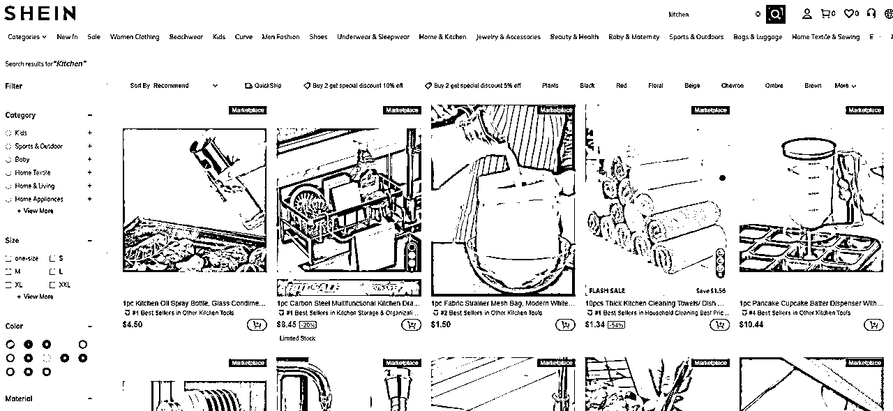
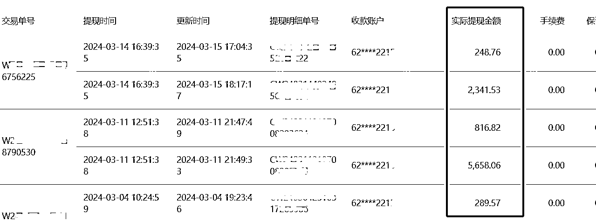
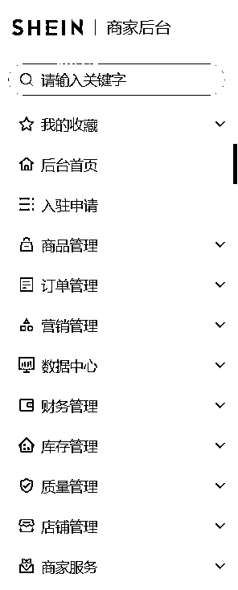
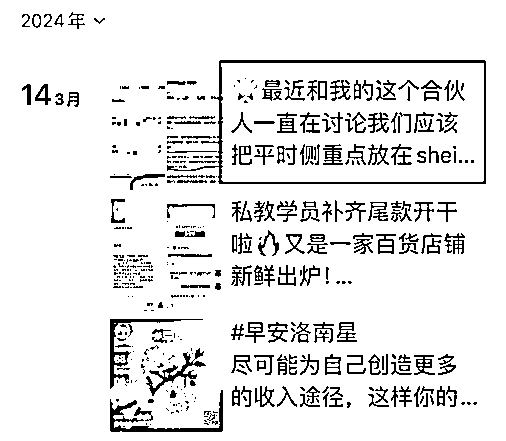
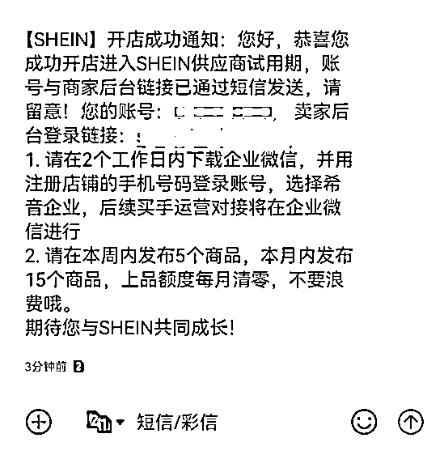
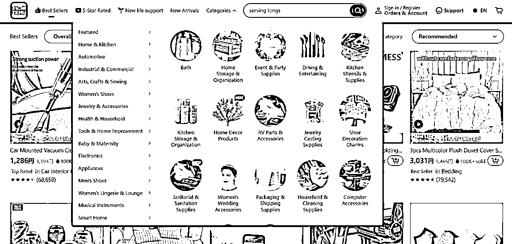
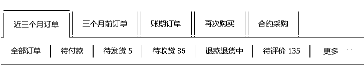

# 从0起步，用一年时间把跨境电商做到千万业绩的实战复盘与全流程拆解

各位朋友大家好，我是秋白。去年在义乌跑市场时，我感受到跨境赛道机会很多，于是和我的搭档南星一起深耕这条线。

我的搭档南星，是一名 SHEIN 选品变现的操盘人，她在跨境领域深耕三年，自建团队从0到1，两年内业绩突破1000万+，主攻 SHEIN 开店与变现指导。

下面我会以南星的视角，聊聊我们是怎么玩转跨境电商的。

21年我一毕业就扎进了跨境行业，在这个赛道沉淀了三年，一路从基层往上走，负责 SHEIN 项目的全流程。现在 SHEIN 的入驻、运营、选品、采购、发货、收款已经打通闭环，真正实现了无货源开店全环节自走。

今天复盘的就是我亲手从零起步、创业起店的这个项目——跨境平台 SHEIN。

# 一、个人经历

21年我在义乌实习，待了两个月后，我对做电商的决心更坚定了。

毕业后我直接选择跨境，一方面疫情前跨境就已火热，另一方面我学的是电子商务，对行业盘面比较熟悉，所以没想过另选赛道。

接触到这个宝藏平台后，我马上开始建店。当时还在摸索期，每天忙着选品上架，同时要从公司层面压缩成本，包括产品成本和人力成本，所以我既当运营也到仓库打包发货。

运营期间需要和买手频繁沟通，明确选品方向和策略。早期 SHEIN 的上架审核非常严，每个品都要层层把关审核，通过后才能上线。

这从 SHEIN 前端产品也能看出来，早期上架的品基本都有1000+评价，对图片、标题的要求也极高。

仓库发货阶段更辛苦，因为项目很新，前期没有专人支援，单量暴涨时基本靠我找两三个临时工一起处理。

这段经历让我受益匪浅，虽然体力消耗大，但每个环节我都亲手走了一遍，发货的每个节点和细节都清楚。

除了品本身，发货流程也有很多坑，必须全程把控才能确保订单顺利发出。

我印象最深的是条码断帧的问题，导致十几箱货被退回。平台不承担运费，商家原因造成的退供损失要自己扛。那单直接亏了几千块运费，订单也没发出去。这是下手时踩的较大坑，发货过程中的各种小坑我也踩了无数，只有全流程打通了才敢把项目拿出来分享。

职场里我也吃过不少亏，刚起的店铺被截走，搭好的团队被迫解散，普通人职场上会遇到的种种问题我都经历过。

正因过程残酷，才说明 SHEIN 的成功经验是可以复制的。

我看重 SHEIN，一是信息差，海外近90%的女性都在 SHEIN 购物，但在国内认知度很低，甚至跨境圈内两年前都不敢轻易入场。

因为前两年 SHEIN 入驻门槛极高，必须有线下仓库、工厂或强货源等硬实力证明。

但随着跨境行业加速发展，电商全球化已成定局。不仅供应商在卷，平台也在卷，最卷的就是 TEMU。TEMU 直接复制 SHEIN 模式，并和各大电商平台正面冲突。

SHEIN 为了应对市场竞争，入驻门槛直接下调，现在几乎不需要验厂、不需要现货、甚至无需经验，有个体户即可入驻。这是这些年来我听过最好的消息。

于是我在23年底迅速抓住窗口期，创立了自己的 SHEIN 店铺，不再为别人打工。

# 二、项目前景

世界经济全球化加深，科技发展推动跨境电商在全球范围快速扩张，电商全球化已不可逆。

电商平台是全球电商的核心载体，已落地200多个国家，涌现出大量新秀，如 SHEIN、TEMU、TikTok。

很多人知道 TEMU 和 TikTok，却不知道两者都是模仿 SHEIN 的全托管模式。SHEIN 作为国内较早做全托管的平台，已形成成熟的全托管合作体系。

平台运营十多年，和商家共同成长。任何规则调整都会先做市场调研，提前公示，确保商家充分知晓后再执行，平台基本没有突发动作，尤其是货款结算，始终清晰透明。

这正是我最看重的一点。很多平台随意出台强制条款，让商家被迫内卷，累而赚不到钱，SHEIN 不会。

简单对比三家：

## TIKTOK：

全托管模式，类似国内抖音，目前更偏向达人带货和直播带货。商家上架的款式成本相对更高，单品价格要偏高端。

低客单难以达到达人带货标准，更别谈直播抽佣获取流量，高客单则无此顾虑。

发货：包装要求高，部分产品需里三层外三层，不然会被退回，包装成本偏高。

## TEMU：

拼多多出海平台，全托管模式，沿用国内拼多多打法，极致低价，对客户非常友好，甚至推出180天无理由换货。

对商家则极不友好，售后扣款多，不平等条款多且强制签署。有流量时能赚回来，没流量时新手心态很容易崩。

发货：包装要求不高，只要不碎即可，发货方式简单，但商家需承担一半运费。

贴标过程很痛苦，一个产品最高十几种标签。以百货为例，一个款10个标，10个款就是100个标签，人力成本大幅增加。

所以做 TEMU 建议做细分类目，只做单一品类，贴标人力可省一半以上。

## SHEIN：

国内最早一批全托管平台，对商家友好。发展十多年一直与商家共成长，规则发布前都会调研并公示。

账单结算精确到每一单，出现错误可及时调整。光这一点就打败很多平台。

即便是新手小白，按正确方法操作一个月，出爆款概率很大，更不用说有国内运营经验的电商人了。

发货：SHEIN 发货非常简单，平台有多家合作物流，均可上门取件，且无需商家承担运费，除非因商家原因导致退供，如前面提到的条码断帧。

包装只要保证不碎即可，所有产品可集中发出，无需拆分包裹。

从全球趋势看，B2C 跨境电商交易规模持续高速增长，年增速维持在10%-20%之间，预计到2025年全球规模将突破2万亿美元。

如果你对跨境感兴趣，SHEIN 无疑是最佳切入点。

我自己在24年新开的百货店，不到三个月就实现盈利。中间春节耽误了一些时间，流量却未受影响，提现随时可提，我基本是看到钱就提。现在只要把经验复制即可。

# 三、跨境项目的常见痛点

1、看不懂英语，不知道如何回复海外语言。
2、没有货源，不知道从哪拿货、怎么拿。
3、没有跨境电商经验，不懂 SHEIN 店铺如何操作运营。
4、选品困难，没有具体的开发方法。
5、物流问题，不懂如何发货到海外。

这些都是新手做跨境时最典型的难题。但经过多年实战沉淀，尤其是 SHEIN 平台，这些问题都有成熟解法。

# 四、问题解决方案

先说全托管模式是什么：

全托管是指商家将产品的销售和运营完全交给平台处理。这种模式对新手极友好，无需自行运营、无需对接海外客户，只需负责选品和发货。

## 1、语言问题

①后台全部是中文操作，根本不需要看懂外语。
②全托管平台无需客服对接海外买家，语言障碍几乎为零。

## 2、货源问题

①国内大量工厂和供应商急需出货，我们需要货源，这就是双赢。可直接在1688等国内供应平台拿货，货源不用愁。
②团队里厂家不断加入后会形成圈子，叫做“南星的圈子”。圈内供应商可优先供应线下货，实现低价进高价出赚差价。通过不断找圈子，能拿到更多优质货源。
③已有货源的厂家和供应商优势更大，起步更快。

## 3、运营选品问题

我把运营经验分为初阶技巧和进阶方法。

①初阶运营技巧

面向小白或有国内电商经验的人，一周内可快速上手 SHEIN，最快出单，学会打造爆品并变现。运营中可能遇到的坑我都提前规划好，学完即可规避。

②进阶运营方法

上品一段时间后出现瓶颈时使用。长期在同一类目选品容易陷入思维误区，进阶方法可帮你实现单量爆发。

很多人觉得不会运营所以放弃，其实只是缺少方法。掌握正确方法后，选品爆单是自然结果。

运营、选品本质上都属于运营，熟练掌握技巧后，店铺就能轻松运转。

就像我前两天在朋友圈说的，我有近一个月没上品，当天上架依然能把握逻辑，当天通过率达80%，这就是跨境运营的基本功。

## 4、物流问题

做 SHEIN 即全托管，物流无需过度担心。只需选品，出单后将订单发往 SHEIN 在广东的仓库即可，用国内快递寄到广东就行。

国内快递谁都会发，更何况 SHEIN 还有合作物流，发货后直接上门取件，除了大年三十不上班，其他时间均可取件，服务非常贴心。

做 SHEIN 的好处就是大部分你能想到的难题，平台都已解决，小白也能轻松变现。

# 五、店铺运营全流程

SHEIN 作为跨境电商载体，店铺流程可概括为：入驻—运营—采购—发货—收款。

## 1、入驻环节

我会手把手带你走完 SHEIN 入驻流程，提前准备资料，避免手忙脚乱。

需要准备的资料：

①一本营业执照，公司户或个体户均可
②一张可正常收款的银行卡、一张手机卡
③一个不带数字的邮箱，网易或阿里云邮箱均可
④一个款式资料附件表格，准备20个以上与类目相关产品
⑤仓库、办公室、样板间、车间、公司全景/入口的照片各一张

## 2、运营环节

运营是重中之重，七分靠选品，三分靠运营。运营并不复杂，掌握方法即可。

SHEIN 无需自己运营，平台买手负责销售到海外，我们只需选品。

选品是核心，店铺能否起来看选品。不同阶段选品方式不同，掌握选品底层逻辑和上新发布全流程才是关键。

我自己做百货类目，选品就围绕百货展开，思路和方向都很清晰。

新手可用的5种选品方法：

①参加站内跟卖活动
②基于跟卖活动拓展平台爆款
③关键词选品
④1688选品法
⑤自身优势款选品法

有时一个小灵感就能带动流量，选品过程中哪怕一个小想法也可能带来意外收获。

我还准备了多种进阶选品方案，可直接把单量拉满，再也不用眼巴巴看别人爆单。

## 3、采购环节

无货源商家重点，有货源工厂可直接跳过，只需核对信息即可，这是有货源商家起步更快的原因。

大部分普通人没有货源，像我一样，需要去1688采货。

正常情况下，新手或操作三年的运营，除非后期想自建工厂，否则都不会囤货。

SHEIN 有急采和备货两种订单，无货源商家为急采订单备10-20个货即可，后续订单现买现发，几乎无囤货压力。

## 4、发货环节

发货是每个人都必须做的，我称之为磨练心性的过程。很多人到这一步就不做了，觉得是底层体力活。

前期准备一到两个货架就够。

但实际上，一个负责的仓库人员能最大程度避免掉货不对板、质量不过关等稽查问题。

SHEIN 仓库为保证口碑，稽查非常严格，很多问题在发货前就能避免。

包括产品体积重量、包装方式、质量检查等。不然最低罚款300，最高10000，新手难以接受。

## 5、收款环节

提现是我们最喜欢的环节。SHEIN 提现简单，出单后客户收货并确认收货15天后，款项自动进入钱包。

对账不清可单独挑时间点、挑订单核对，每笔货款、每次罚款原因都清清楚楚。

这是我最喜欢的点，有问题会及时告知，不会不清不楚。

尽量避免产生罚款，提前规避风险即可。钱包里有钱可随时提现，每天一次提现机会。

以上就是运营店铺的完整流程。对比国内平台，SHEIN 虽是跨境平台，操作逻辑几乎一致。

我从0开始时也是全透明小白，甚至刚进跨境圈时不了解 SHEIN，后来实操才发现这个平台真的香。

新手做跨境只要先做两件事：①入驻 ②选品。就这么简单，其他你担心的问题平台都已解决。你只需入门、上品，其他自然会顺起来。

当初我作为小白，入驻后无经验直接上品，三个月就把一个百货店做到20万+业绩。目前来看，SHEIN 是最适合小白的跨境平台，人人可做。

# 六、SHEIN 的优劣势

任何平台都有优劣，SHEIN 也不例外。

## SHEIN 的优势：

1、近期入驻门槛大幅放开，从严格要求降至几乎无门槛，有个体户执照即可，新手小白无经验也能做，对跨境感兴趣即可入场。
2、账单稳定，平台基本无突发动作，尤其是货款结算，合作核心就是账目清晰。平台反馈清晰明了的账单，也会听取商家意见建议。平台稳定，用户体量大，结算周期快，小单快返，流量大，性价比高，为商家提供广阔市场。
3、成本低，无需费用。开店成本低，可选全托管或独立店，无保证金，平台不扣点不抽成，只需供货出海，为中小卖家开辟新渠道。
4、投入精力少。供货平台，上架后无需自行经营，也无需专门运营团队，只需对接货物。
5、优质物流服务。全托管模式，平台负责将货物运输到海外客户手中，我们只需发往 SHEIN 仓库即可。

## SHEIN 的劣势：

想在希音上分一杯羹的朋友，现在可能是最好的窗口期。这个平台的商家入驻通道并不是一直敞开的，它本身就是奔着和源头工厂深度绑定去的，咱们这些做无货源供货的角色，能赶上这波开放已经算运气不错了。说实话，这阵风能刮多久没人说得准，等市场格局稳定下来，这个入口很可能就悄悄关闭了。所以趁现在还有优势，先卡位进去才是正事。

再聊聊它的订单节奏——希音是个“温性子”，不会像某些平台那样，流量一来就突然甩给你一整柜的大单。它的逻辑是每个单品都有自己清晰的生长曲线，涨有涨的过程，降有降的路径。比如今天15件，明天35件，后天50件，起量是阶梯式的，回落也是渐进式的，每笔订单都有迹可循，你完全可以根据数据来做预判。

不过要提醒一句，虽然前期投入门槛听着低，但“低”不等于“零”。打个比方，你第一个月铺了50个款，按最低的备货标准来算，每个款都得准备10到20件的库存。假设每件货成本是X，那这笔账就是50乘以10再乘以X——铺得越多，压的资金就越重。所以具体要砸多少银子，完全取决于你铺货的规模，谁也没法给你一个一口价。

最后说说物流这个容易被误解的点。平台宣称不收物流费，但并不代表你一分钱运费都不用掏。要是有任何一个环节出了岔子——比如条码打印不规范、订单发错货、或者货不对板，希音仓库拒收入库，那你的货就会被退回来。这种情况下，从你发货到仓库再退回你手上的两趟运费，都得你自己买单。

以上就是我对希音这个跨境平台的全部心得。如果你也正在琢磨跨境这事儿，欢迎随时来找我聊聊~