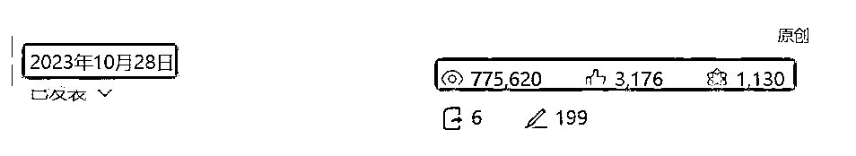
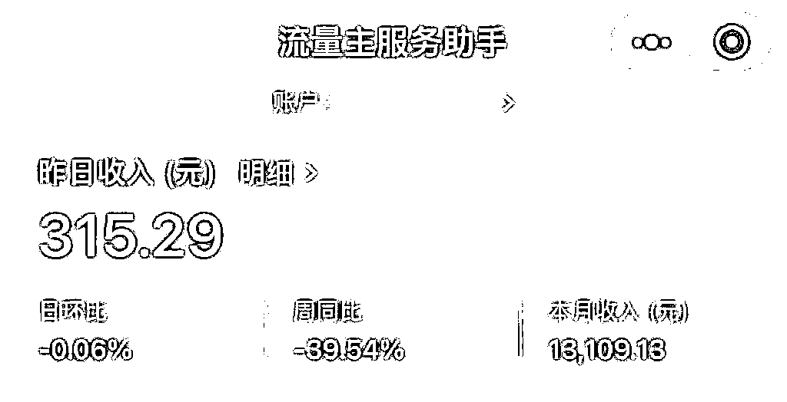
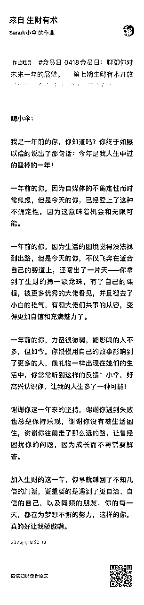
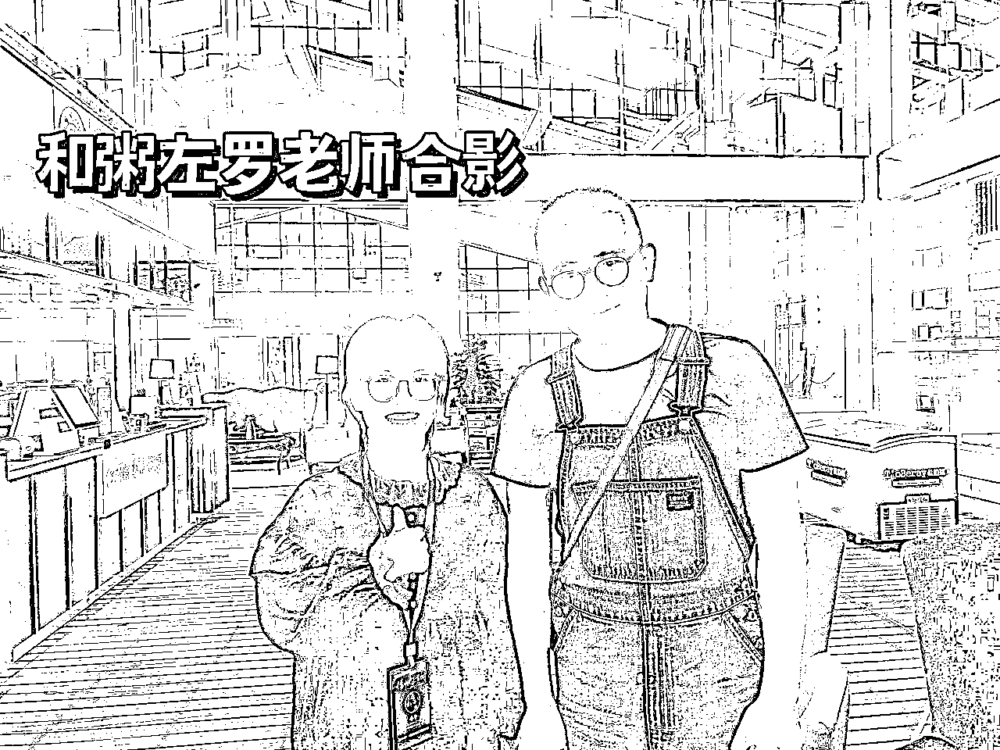
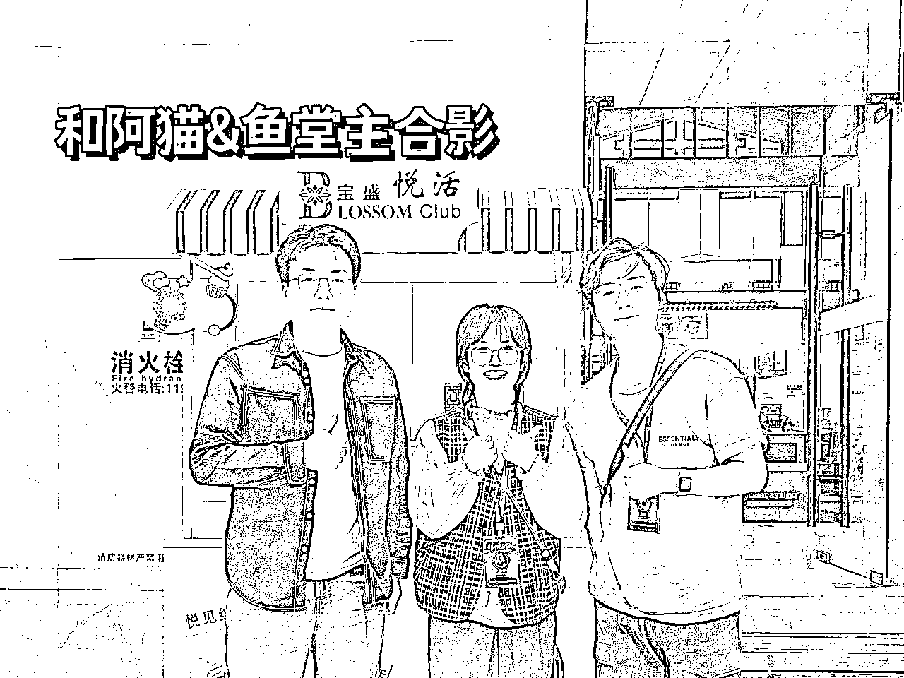
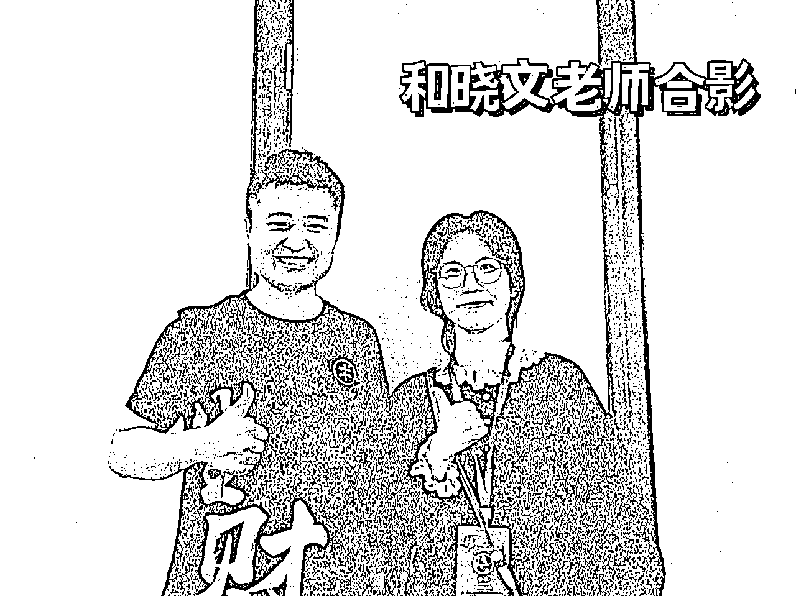
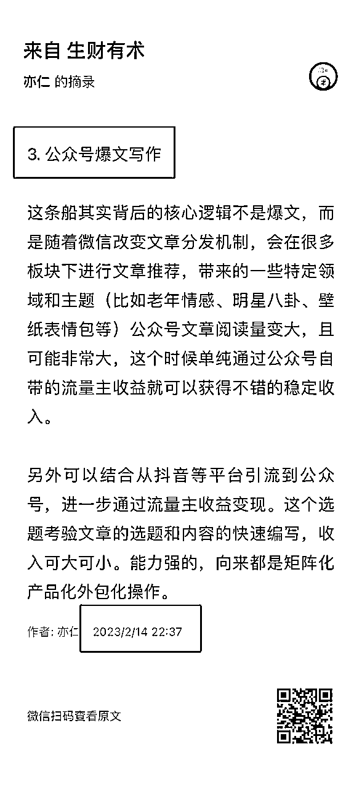
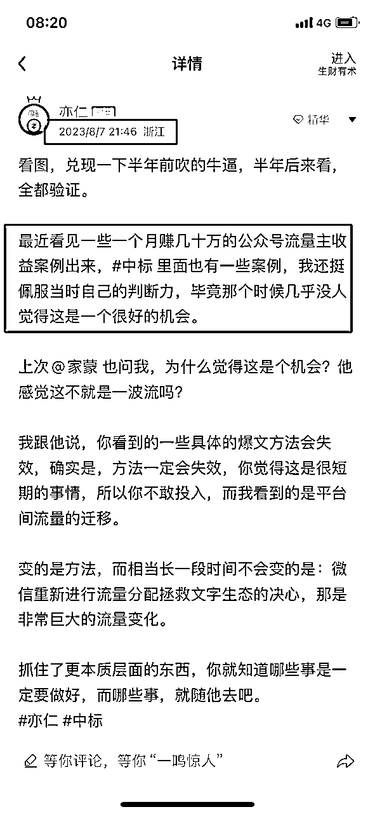
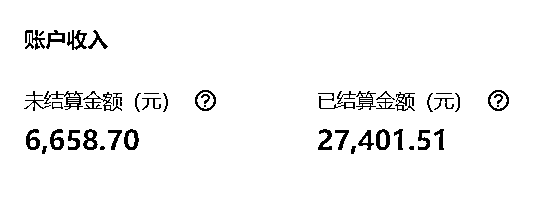
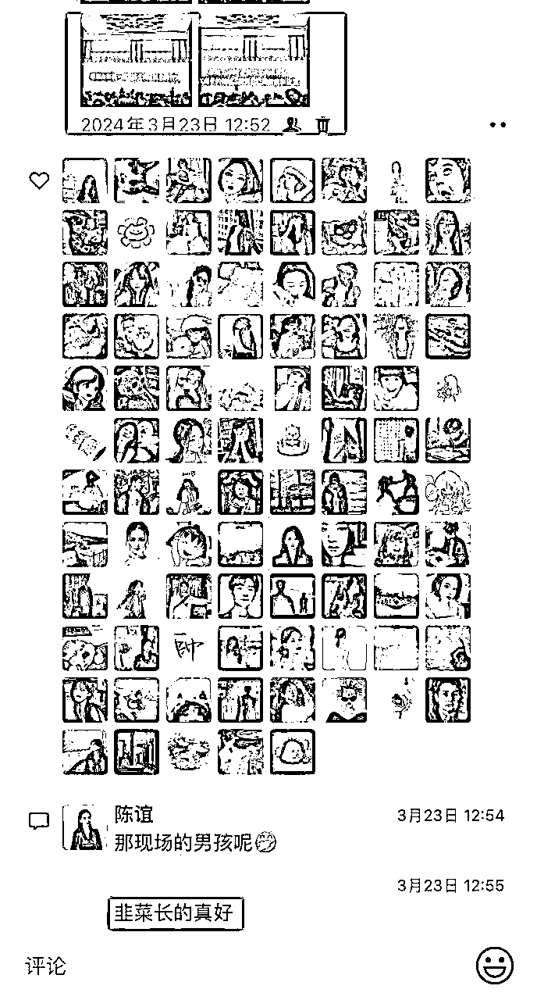

# 从职场宝妈到月入五位数：我在生财一年多的真实突围笔记

> 来源：[https://vnng84yf44.feishu.cn/docx/Y6I0dhenpoS3x8xsRvwchjKznznmd](https://vnng84yf44.feishu.cn/docx/Y6I0dhenpoS3x8xsRvwchjKznmd)

生财的伙伴们好，我是小伞。

一年多前我还是个全职带娃加班的职场宝妈，现在则以自由职业者的身份在做自己的事。很长一段时间我都在生财里潜水，觉得自己的成绩还不够格发声，是闺蜜李慢慢一直推我一把，说可以把过程讲出来。

所以我来了，谢慢慢的“鞭策”。

这篇不讲神话，只讲经历。希望对那些想从体制里出来、或者刚要踏上副业这条路的伙伴，有一点点踏实感和走下去的底气。

先说半年多以来的一些硬指标，我目前主攻公众号爆文+个人IP，全部自己上手：

半年内涨粉4万+，私域沉淀近1万，付费用户超300人，月收入稳定在五位数。

而在此之前，我的人生是白天上班、晚上哄娃、凌晨挤时间折腾副业。去年28岁的我，甚至会因为工作压力而掉眼泪。

自媒体还没稳定时我选择了裸辞，事后回想既莽撞又决绝。副业断续探索了快两年，我给自己立了个门槛：只要自媒体每月能赚到2000块，这条路我就一直走。一个人扛着不甘和一点点勇气出发，路上挺慌的。

结果裸辞第二个月就迎来了大反转，我做出了10万+的爆文，靠流量主单月过万，正式迈入自由职业。现在一条广告的收入就能顶过去一份工作的月薪，我的生活终于有了喘息的空间。这一切的起点，是我加入生财有术。

今天想聊聊，生财到底给了我什么，让我对这个社群有这么强的归属感。

# 1、我在生财许下的愿望，基本都兑现了

2023年4月18日，我正式加入生财。

当时我还在职场里焦虑地打转，一边上班带娃，一边做内容，却找不到解题思路。状态很急、很乱、很不起眼，像个撞墙的苍蝇，也像个不敢抬头的鸵鸟。

现实偶尔把我打得鼻青脸肿，但内心始终有个韧劲——身处泥泞，仰望星空，说的就是那个阶段的我。

我相信未来会好，因为生财里有太多普通人的真实逆袭样本。娃睡着后失眠的夜晚，我常在黑房间里打开生财，搜“100万”，一篇篇刷别人从0到1的记录。草根翻身的故事自带力量，看完之后总会觉得自己还能再扛一轮。

为什么不能是我？我开始想做那20%。加入第一天，我给自己写了一封信，画了个长远的饼。

回头看，那个还没赚到钱的自己，其实已经走了很远：

一年前的我，常因自媒体的不确定性焦虑；一年后的我，已经找到了适合自己的赛道，虽不算飞奔，却在稳步前行。

一年前的我粉丝寥寥，发圈无人点赞；一年后的我，公众号有4万+读者，陪伴群里有300多个温暖的朋友，经常收到私信感谢，我真的像自己承诺的那样，成了某些人生活里的微光。

一年前的我不敢加大佬微信，加了也不敢自我介绍；一年后的我，不说合作自如，至少已经敢去加好友、要合影了。

一年前的我没有自己的产品和课；一年后的我，已经有了。

一年前的我是彻头彻尾的新手，连一点积累都没有；一年后的我，龙珠还是没凑齐，但我觉得今年或许真的能拼出来。

2023年4月18日我在生财发的愿望帖，一年后竟大体都实现了。生财确实有点神奇的效果。

# 2、生财本身就是一种希望的具象化

我很认同那句话：因为看见，所以相信。

对我而言，生财就是希望。

进生财前，我甚至不知道赚钱的路径有这么多。刷帖子时常有拍大腿的冲动：原来还有这种打法？

以前连猪肉都没吃过，猪跑什么样也不知道。进生财后，猪肉还没吃到，但至少知道猪长什么样了——也就是见识到了大量可行的赚钱方式和机会。

学生、宝妈、失业后在星巴克写稿的中年人……无数普通人用非常规的方式走出了自己的罗马，赚到了第一桶金。他们的存在本身就是希望，而希望是稀缺又珍贵的东西，每个人都该守住心里那点火苗。

我举个不太合适的例子。几年前我想考公务员，那条路的残酷在于岗位可能根本不开放。尤其是冷门专业，再怎么准备，如果连三不限的岗位都被地域卡死，这条路就等于断了，只能等明年。

当时最大的痛点是：我连有没有资格竞争都成问题。但在生财，我看到职业发展的版图被从“进体制”这个窄口子里解放出来了，人生不是轨道，是旷野。

原来我不必依赖职场，通过副业和自媒体也能实现自给自足。生财那些活生生的案例一直在告诉我：这条路是通的。

我的希望之火从此被点燃，一直烧到现在。我坚信，如亦仁老师所说，每个普通人都有机会赚到100万、1000万。

# 3、生财是我的前置商学院

生财是个能聊钱也不伤感情的地方，信息通常领先市场至少半年。

每年有上百场航海实战，我基本每场至少报一艘。正是通过航海，我才知道公众号爆文这条赛道——

原来推流机制变了？原来流量主能这么变现？原来有人靠它日入五位数？

领先的信息就是时间红利。信息在小圈子里流动时早早入场，用时间堆出壁垒。

所以生财不仅给我希望，还给我地图和罗盘，不仅给我鸡汤，还给我勺子。

有图为证：2023年2月14日我在生财看到公众号爆文航海项目

2023年8月7日，公众号月入几十万的案例被公开。

我到2023年10月才all in，也取得了不错的回报。

除了实操项目，我还特别爱看心态、认知、人生原则类的帖子。亦仁常说，看不清是常态，要在模糊中更勇敢地走；要绝对确定性的话就回家躺着，赚钱是勇敢者的游戏。

这些认知层面的东西，比技巧更长效。就像笑来老师说的，价值观决定命运。生财慢慢帮我搭建起了对赚钱的底层认知。

# 4、生财带我进入了更好的圈层和人脉

生财给予我的还远不止信息，它让我遇到了真正的人。

感谢我的朋友们。李慢慢不断给我信心、帮我破圈。二爷教我做课程和交付，解开了我内心的结。宇宙让我更主动更敢冲，八个字“干就完了”的力量我切身体会到了，也学到很多商业模式的思考。

因为身边人的能量，我有了更多底气和勇气。

我们接触的人都在重塑我们。生财的圈子让我遇到了很多贵人。去杭州线下见面会后感触更深。

出发前家人担心我进传销，我笑笑。现场几百位圈友从各地自愿汇聚，只为聊怎么把事情做成，台上分享台下鼓掌，能聊到深夜，这种场景很少见。

朋友圈里有人评论“韭菜长得真好”。

我只能替他惋惜，错过了一次转动人生的机会。

一年下来我确认了，生财不是传销，我们是自愿掏钱学习的。连续三年60%+的续费率就是证明。

更关键的是和具体的人产生深度连接。我的合作伙伴基本都来自生财，价值观一致，还能给我情绪价值，告诉我坚持下去就能看到灯火。

对一个在迷雾中前行的人，有人说“这条路是对的，大胆走”，就是定心丸。减少犹豫，减少内耗。

之前带朋友做公众号，她问我阅读量两三正常吗？我说是，分发机制就是这样，持续更，基本能进池。她坚持不到一个月就出了七八万阅读的爆文，从零开始。

她说，是我告诉她可以，她才没在0-3阅读时放弃。事先知道结果会确定，就不怕过程的挑战。

能让你在迷雾中坚定，能指点方向、加速成长的人，就是贵人。时间是红利，早就是优势。在生财保持成长、大胆发声、主动链接，就一定会遇到朋友和贵人。

也有人因生财遇到爱人组建家庭，每次看到我都由衷祝福。

# 5、结语

亦仁老师的那句话我记很久：不管怎样，先赚到第一块钱。第一块钱是质变，有了实打实的反馈，你才会真正相信，除了打工领工资，还有别的赚钱方式。

我刚加入时以为有经验很快能变现，结果连续两场航海都没赚到，因为心浮气躁。后来把预期降到1块钱，以1块为目标躬身入局，反而在公众号这条船上赚回了几倍门票。

所以给新圈友的建议：把预期压低，把耐心拉长，把执行力拉满，该来的都会来。

自媒体很公平，没有性别歧视，甚至没有对手。我坚信女性有巨大的力量。虽然职场会被生育等客观因素限制，但女性的力量远超想象。

我们不必只能做职场的螺丝钉、家庭的后勤，我们完全可以做主角。自媒体是普通女孩逆天改命的通道之一，借着这个杠杆，我们都能赚到打工之外的第一块钱，甚至100万、1000万。

感谢你看到这里。