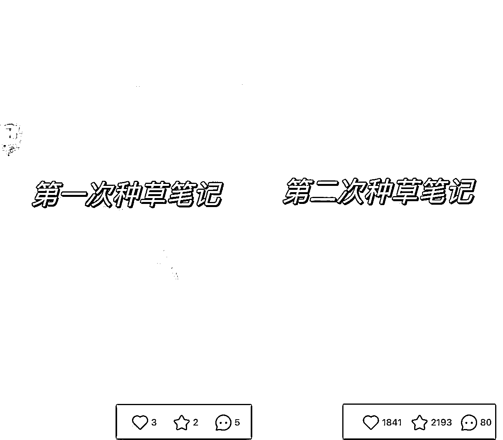
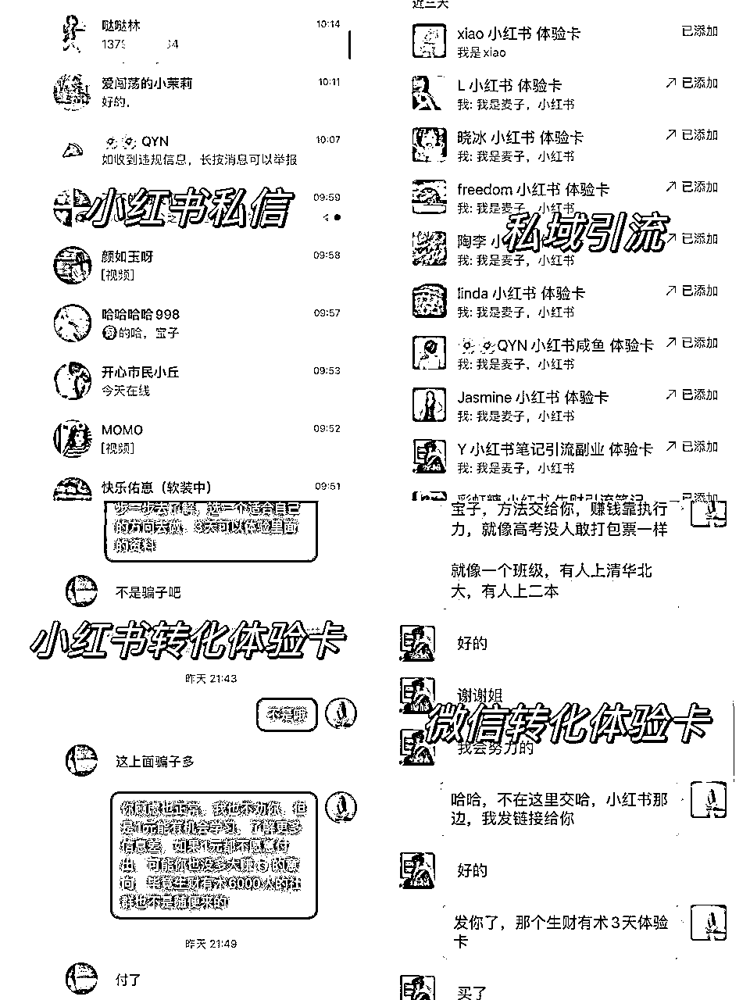

# 从3个赞到1800+赞，我的📕种草笔记翻身实录

大家好，我是麦子。今天用亲身经历告诉你，一个📕小白是怎么靠两篇种草笔记，完成从3个赞到破1800赞的逆袭。

先说结果，给大家一个直观感受：笔记发布3天拿到1800+赞，评论区私信36条，成功拉到微信11人，体验卡成交2单。

和那些头部大V比起来，我这点成绩不算什么，但对我这个刚入门的菜鸟来说，已经是质变。先简单自我介绍一下，我34岁，海南三亚人，做运营做了7年，33岁的时候裸辞出来做自由职业。2024年1月30号正式加入赚钱。

说说我之前的坑，真的是一地鸡毛。

📕账号我坚持日更三个月，粉丝依旧破不了千；3月份参加📕航海计划，我直接把娱乐、热评分享、女性成长三个号都玩废了；更扎心的是龙哥盟第一期种草笔记任务，我一次发了两篇，结果加起来才3个赞。那次真的打击很大，我一度觉得自己可能不适合做内容。

第二期活动报名时我内心很挣扎，怕又被打脸。但最后我还是决定死磕一次。好在我反复把比比老师的📕课又刷了一遍，这次我不再盲目量产，而是彻底换了打法。

我的调整思路分四步走：

第一步，倒推找选题。我不再自己瞎想，而是去搜爆款。关键词就锁定“副业”“搞钱”“不上班”“裸辞”，只看万赞以上的笔记。筛下来发现“副业”是我能吃到的赛道，而且最近正好有两篇同类型爆款在跑，我就以它们为参照。我的经验是，爆款一定要万赞起步，并且同类至少有两篇在同时间段发酵，这样复刻的成功率才会高。

第二步，学会精致模仿。我把对标博主一年做的副业全部捋了一遍，发现一个关键点：她只写自己做成拿结果的项目，失败的试错一个都没放。我之前写的笔记也爱堆案例，结果平平无奇。这次我只敢写自己真正跑通的副业经历。标题也做了降调处理，教练提醒我别用月入几万这种容易被判定焦虑营销的词。我最后用的参照是《救命！裸辞快一年的我真的做了好多事啊！》这种更真实的表达。

第三步，把封面和配图当主角。我把80%的精力都放在了封面和图文上。封面直接照搬经过市场验证的款式，文字类、白底黑字，简单直接。内页图片则用自己的实拍+真人照，把我的收获、过程和干货都放在真实照片里，提升信任感。

第四步，内容结构闭环。开头一定要和标题对上，快速讲清我的个人背景，然后落到副业的心得和可操作的干货上。整篇笔记我大概是晚上10点开写肝到凌晨，第二天继续抠封面，教练帮我改完标题就直接发了。

效果出乎意料。数据起来后我还顺手做了两个纯文字账号，一个12天起号，一个3天起号，都接到了广告变现。

这次也踩了不少坑，复盘出来给大家避雷：

1、赚钱的核心价值在笔记里体现不足，用户注意力全被副业吸走了，对龙哥盟本身认知很少，后续沟通成本很高。
2、私域引流话术没提前准备。我当时以为评论区@一下赚钱体验卡就够了，后来被小助理提醒，引导到私域才能更好跟进转化。
3、前期准备的资料不全。来咨询的人副业类型五花八门，我手忙脚乱应付不过来。

如果你现在在📕也卡在没流量，我的建议就三条：

1. 别追求量产，先把一篇笔记打磨透，复盘比堆数量重要。
2. 别给自己设限，你的潜力远比你想象的大。
3. 认真学，踏实做，结果一定会跟上。

最后分享一下我的私域沟通流程，希望能帮到你。

📕端：用户一般会在评论区留【求带】，我会先引导到私信。先问他想做哪个方向，了解需求。如果他回答具体项目，我就针对性介绍；如果让他推荐，我就挑上手快的项目，介绍完最后埋一个“我这里有资料” 的钩子，让他主动询问怎么发。这种主动留微信的用户，意向度普遍更高。之前我直接发微信截图/视频，效果很差，还容易违规。

微信端：先打招呼，问想做哪个项目。用户通常会问怎么做、或者讲自己的困惑和期望。我会先根据项目简单介绍，优先推荐闲鱼、📕、客服这类入门门槛低的，每一句结尾都留一个反问，促使用户继续聊。

如果用户问怎么做，我就会讲我自己的实操路径，顺带说这些方法都是在龙哥盟里学的，必要时配上精华帖目录截图或我的副业成绩单增加说服力。

如果用户聊自己的经历和痛点，我会先肯定再点痛点，再把话题连到龙哥盟的项目上，比如“你能这样想已经赢在起跑线了，你的经验做xx项目会很快上手，我们新手做一个月基本能拿xxxx”，再自然过渡到我的加入经历。

聊到这里用户基本都会问入口，我就会先塑造赚钱的价值和跟着做的收入预期，再发1元体验卡链接。

以上就是我的全套实操，希望还在迷茫的你不要因为一两次失败就放弃。放开自我设限，拿结果只是时间问题。

今天的分享就到这里，有不足的地方欢迎各位前辈指正。最后感谢教练的账号指导，@梁靠谱文章指导，感谢赚钱给我的学习机会！