# ('大龄职场人/互联网小白，如何做一门ChatGPT在细分领域的应用课程，卖了10w+', (2, 43))

有一个人的故事，我想讲给你听。她不是天才，也没有资源，更不是年轻貌美的网红，而是一位在期刊编辑部工作了多年的80后。她叫迪娜，在SCI期刊做编辑，属于大家眼中“稳定”的体制内工作。但稳定之外，是晋升无望、工作重复、越来越卷的现实。她参加过TikTok航海、小红书个人IP等项目，涨过粉，也出过爆款，但一直没找到稳定的变现路径，最后都不了了之。她甚至自嘲：“只要我不行动，失败就找不到我。”

直到ChatGPT横空出世，她才看到了光的裂缝。她跟着生财和AI风向标星球学到不少干货，也慢慢找到了方向。

她本职工作的日常之一，是给论文做语言润色。学术文章有固定格式，讲究逻辑严谨、用词精准。一篇5000字的研究论文，人工润色至少一天，遇到写得差的，甚至要耗上两天。她尝试让ChatGPT帮忙，一开始只是给AI设定角色，后来用上结构化提示词，效果突飞猛进——5000字的论文，半小时就能改完，而且质量可以达到商业润色服务的中高档水平。

她把自己的经验做成了课程，定价999元。4个多月，卖出了100多份。对于微信小号只有300人、公众号加知乎不到1000粉丝的“互联网小白”来说，这已经是惊人的成绩。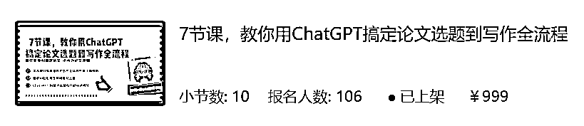

后来，她又应学员要求，做了一门针对中文毕业论文的AI辅助课程，几乎没怎么宣传，999元也卖出了20多份，其中大部分是老学员复购。

看看学员怎么说：

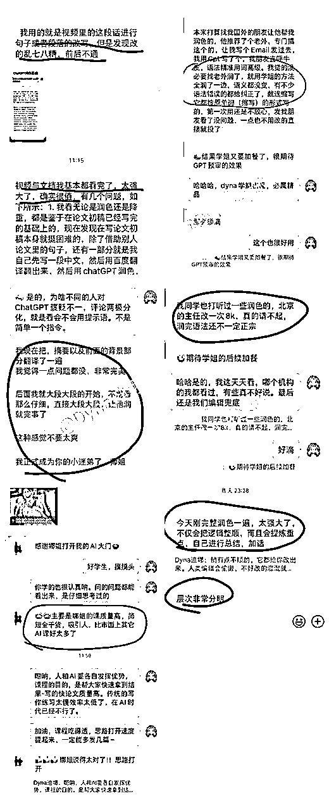

有学员用她教的方法顺利发表了论文，专门来感谢：

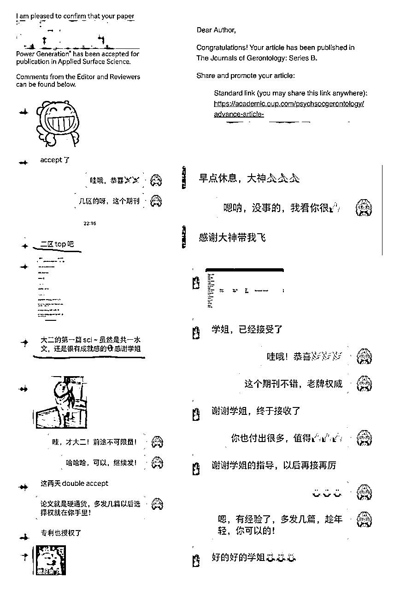

但你可能会问，她是怎么发现这个机会的？

原来，论文润色本来就是被验证过的刚需市场。ChatGPT还没出现时，非英语母语的科研人员投稿前，几乎都会把论文送到专业公司去润色。Nature、Springer、Wiley、Elsevier这些大出版社都有这项服务，也有大量独立润色机构。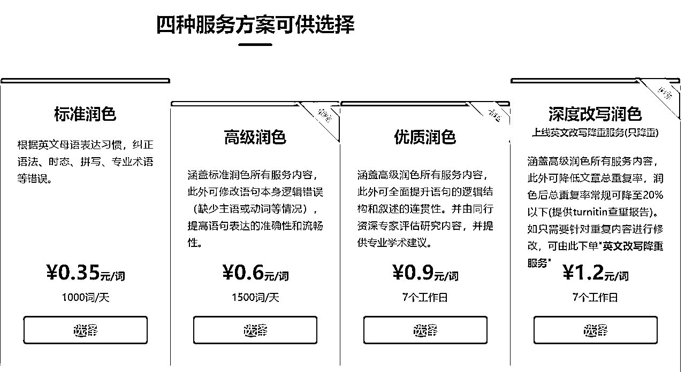 来看商业润色的价格：一篇三四千字的论文，通常收费在两千到五千元之间，具体看深度和是否加急。而她调试出的结构化提示词，成本几乎为零，还能在一小时内完成。

她一下子看到了价值。于是写了一篇6000字的干货发在知乎。当时她的知乎只有300多粉丝，但那篇文章爆了，评论区、私信全是求资料的人。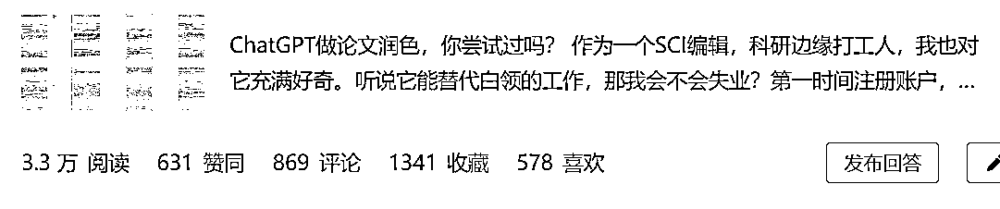 她的策略很简单：ChatGPT使用文档免费送，润色提示词文档卖99元，前后卖了十几份，而且口碑不错。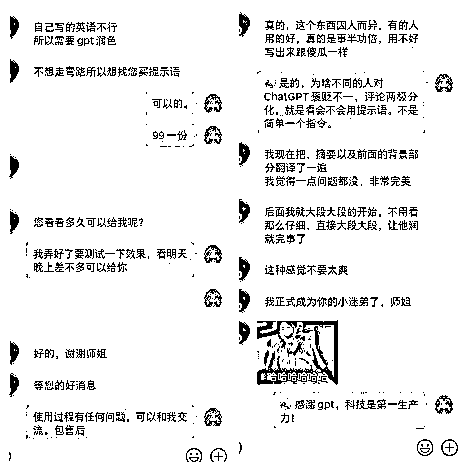

这个小小的成功，让她开始思考更大的可能性：如果把论文写作、润色、选刊、投稿、回复审稿意见这些流程，全部做成一套结构化提示词课程，是不是可以把客单价提上去？于是，她在朋友圈预告了新课程：每周上线一节，一个半月全部更新完。有人提前付费，她硬着头皮逼自己在deadline前完成。最终，这套课程预售599，全部上架后799，再后来恢复原价999。有趣的是，卖得最好的恰恰是原价999元——因为有了学员好评、真实案例和持续的公众号内容输出，用户认可的是价值，而不是价格。

除了课程本身，她还逐步延伸出论文1v1陪跑（收费1万+）、1v1润色（收费2000）、论文预初审和回复审稿意见把关（收费499）等服务。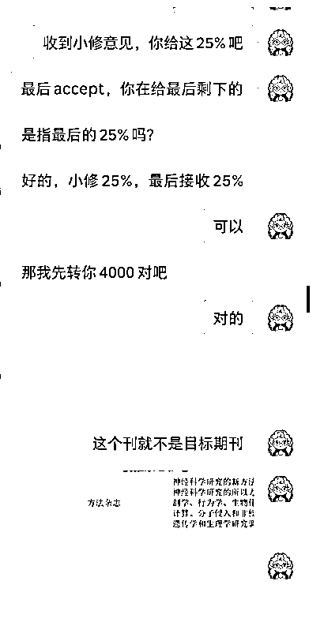

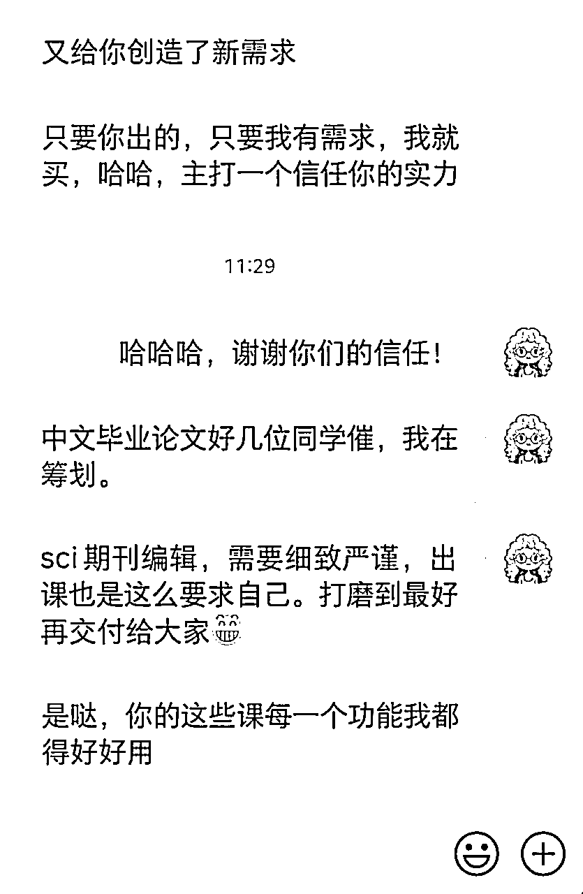
而第二门《AI辅助毕业论文撰写》课程，正是在学员的建议下诞生的。

公众号也从年初的400个粉丝涨到3700+，因为持续分享AI应用，还接到了天工AI的广告，报价四位数。

说到这里，更值得学习的是她的做课方法论。她把自己走过的路拆解成一套可复制的模板，适用于任何行业。

第一步，把工作流程拆开，让AI嵌入每一个节点。职场人最大的优势，就是清楚一件事从0到1要经历哪些环节，每个环节做到什么程度算优质。比如论文发表，从写作、投稿、审稿、修改到最终发表，中间有无数细节。针对每个环节写出提示词，让AI帮小白也能达到80分以上的完成度。于是，单个提示词卖99，全套解决方案就能卖999。

第二步，每个环节再做二次拆解。不要指望AI一口气输出一篇3000字的论文，那不现实。先搭框架，确认框架，再按框架逐段生成。又比如写论文前言，就拆成“搭框架—填充内容—补充论据”三步。每一步设置一个检查点，人及时纠偏，AI的输出才会可控。

第三步，制作提示词。简单任务用BRTR原则；复杂任务强烈推荐结构化提示词。角色、画像、目标、约束、规则、技能、工作流这些标签，按需填入。其中Rules、Skills、Constrains、Workflows是决定复杂任务表现的关键。制作提示词时，先投喂优质材料让AI提炼特征，再编写初始版，然后在不同场景测试，效果不好就换模型对比。实际上，这个优化过程并不复杂：你知道好东西长什么样，你就能判断AI输出哪里不对，然后去微调提示词。

这里顺便推荐一下鱼丸之前整理的“AI提示词合集”，调教方法和模板都很全，值得学习。

工具上，新人完全没必要追求昂贵设备。录制课程用Bandicam，麦克风选罗技H390，95块钱，PPT用Mindshow，课程上架用小鹅通。AI工具也不是只有ChatGPT：长文本输入输出用Kimi，内容总结提炼用Claude，中文长文本润色试试Cohere，英文文献检索用Perplexity，中文文献搜索用秘塔AI。

说完了做课，再说说卖课。

她的公域引流路径非常清晰：知乎/小红书 → 公众号 → 个人微信。知乎那篇爆文之后，她持续在知乎更新，把读者导到公众号。后来发现有人搬运她的文章，她又开始写公众号。每周更新2-3篇，粉丝从400涨到3700+。她还发现“一鱼多吃”的方法：把公众号文章同步到CSDN。CSDN是程序员社区，但搜索引擎排名极高。比如你在Bing搜某些论文写作问题，排在前面的往往就是她的回答，其中不少就来自CSDN。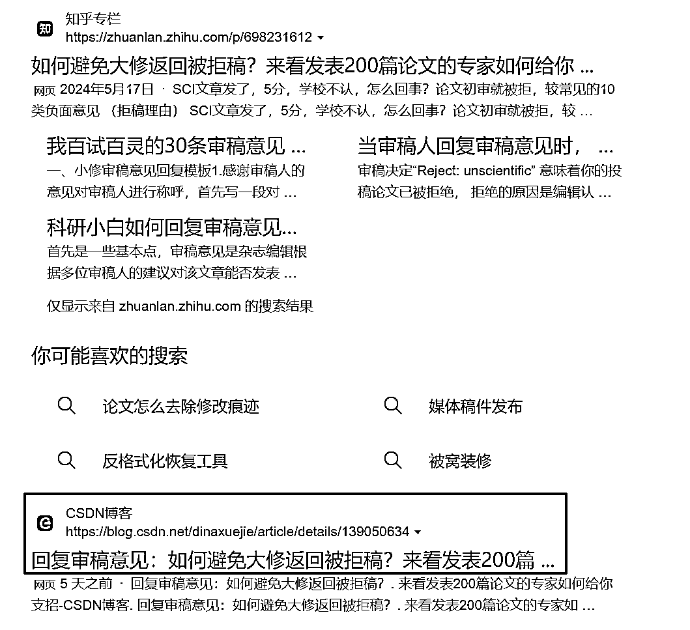 靠这个方法，她同步了28篇文章，访问量2.5万，还吸引了人民邮电出版社的编辑来约稿出书。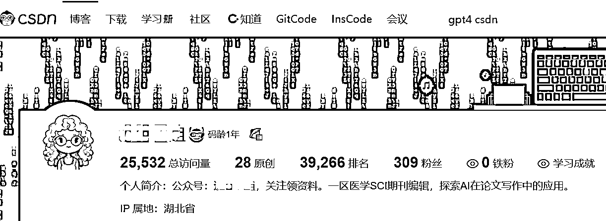

微信公众号文章也会在文末带上微信号，引导有需求的人加微信。加人后的破冰话术，借鉴了很多大佬的经验，核心就是“个人介绍+赠送资料+引导对方开口”，目前看效果不错。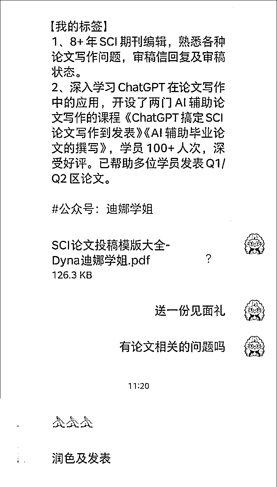

转化主要靠朋友圈。持续发专业知识、学习群讨论、学员反馈截图。频率虽然一天5条对内向的人有点难，但贵在坚持。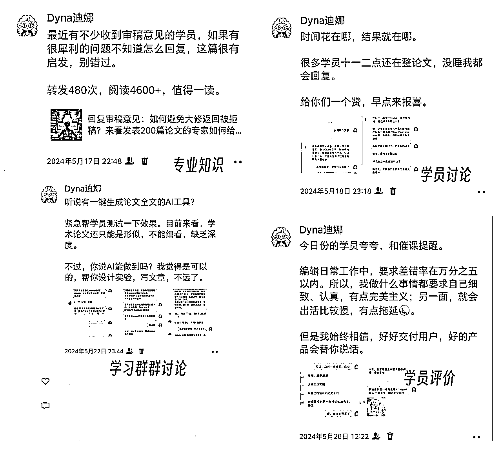

一对一沟通时，她从被动回答变成主动挖掘需求，学着给对方规划愿景。慢慢地，一些在朋友圈躺了大半年的人也来私聊买课。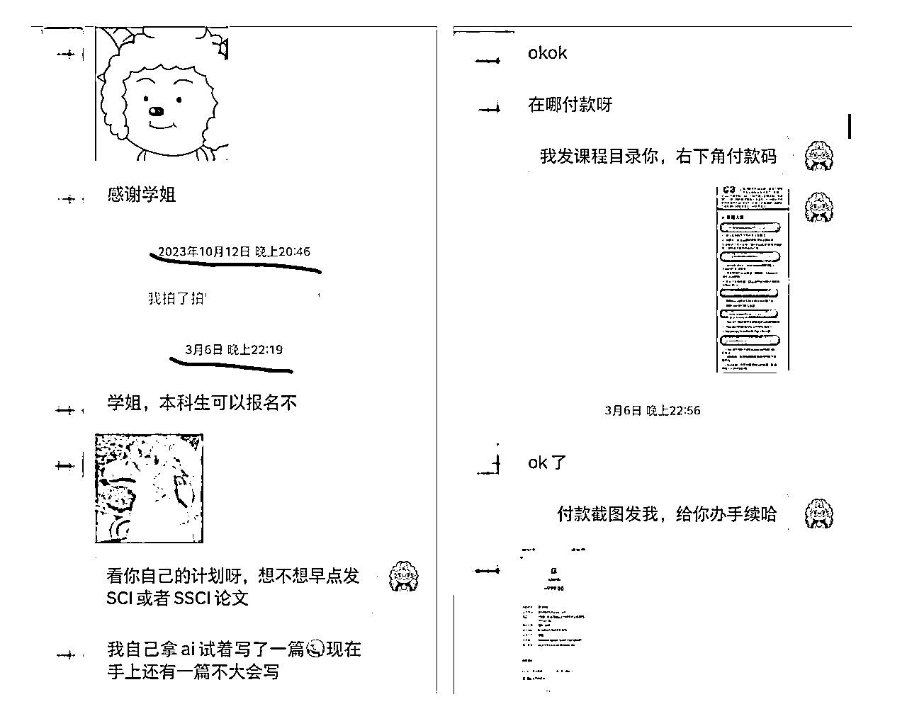

当然，她也赶上了风口。比如今年3月，一位大学教授发表在1区期刊的论文，前言里赫然出现了“Certainly, here is a possible introduction for your topic”，一眼就能看出是ChatGPT的痕迹。她第一时间写了公众号文章分析这件事，顺带介绍了自己的课程，一篇文章带来几十个转化。这就是时代的推背感，自带热度。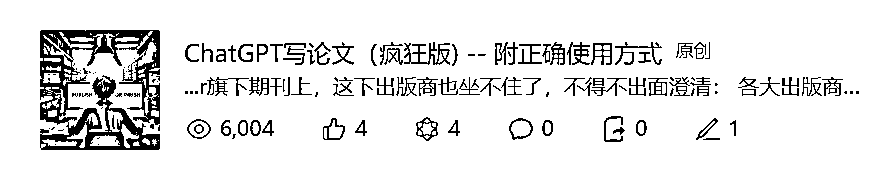

故事的最后，她给了同样迷茫的职场人几个忠告。

第一，别小看自己的行业积累。大龄职场人做AI细分课程，有天然优势：因为稀缺，所以可以卖高价。通用AI课卖19、199，她敢卖999，因为单是润色服务，市场价就要两三千，课程显得超值。也因为副业，她的人生有了更多选择，不再被体制内的天花板困住。学员客客气气喊她“老师”“学姐”，这种被认可的感觉，是金钱换不来的。

第二，先卖课，再做课。她第一次尝试做课，是先写逐字稿、录PPT，结果因为没有反馈，信心崩塌，项目烂尾。后来她学会了先预售。只要有人付钱，说明需求真实存在；收了钱，也会逼自己交付，克服拖延和完美主义。

第三，把时间留给付费用户，对他们好一点。她曾经免费帮一个学生改提示词，对方用完就把她删了。这件事让她明白：免费的建议不会被珍惜。你应该用专业赚钱，而不是用免费换存在感。

如果你也在一个行业里深耕了几年，别急着看轻自己。经济环境越是不好，泛知识越不值钱，而细分领域的刚需解决方案才是真正的护城河。借助ChatGPT，做一门属于你所在行业的高客单课程，或许就是一条摆脱内卷的路。

做知识付费这几年，我慢慢想明白一件事：精力就像一条满格的电池，必须优先耗在已经购课的同学和课程社群里，帮他们拿到真实的数据和反馈。另外，AI技术更新换代的节奏实在太快，我如果不跟着往前走，很快就会被落下。所以我也得持续更新自己的知识库，才能给他人创造更多价值。这个循环走顺了，比什么都重要。

我身边就有一位“元老级”用户。早在我的内容产品连雏形都谈不上时，他掏钱请我帮他精修过学术论文。后来我每推出一个新版本的课程，他几乎都是第一个下单，平时遇到难题来问我，还会顺手甩个红包表示感谢。我制作课程的过程中，他也给了不少方向性的反馈。他迄今孵化的第一篇正式论文，其中的图表是我亲手调校的；投稿流程、回复审稿人意见、线上核对页码，每一步我都及时提供参考，帮他躲了不少坑。最终文章顺利上线。这件事一直提醒我：把善意花在合适的人身上，回报迟早会来。

做内容创业，难免要面对来自四面八方的询问和求助。你的时间永远有限，而需求是零散且无穷的，所以必须做出取舍。我的原则很朴素：不靠“你可能会买单”来绑架自己的付出，不把所有人放在同一个优先级上。我真正要去成全的，是那些已经把信任交给我的同学们——他们才是我必须全情服务的对象。

把高价值时段留给关键任务。

其实做课程的持续营收，离不开稳定的精准访问者。我目前最依赖的，就是微信公众号和知乎这两个公域窗口。我把自己的节奏调成：每天早上先腾出一到两小时，完成一篇千字长文，推送出去，再处理其他杂务。清晨这段时间没有外界噪音，是我用来推进核心事项的专用场域。但我也栽过跟头——有一阵子，我睁眼第一件事就是摸手机，先通过一波好友申请，然后东聊一句、西扯一句，一晃两三个小时过去了。回过头来，文章没落笔，订单也没增加一个，整个人只剩一片空虚。

后来我意识到，晚点通过好友、晚点回复留言，天塌不下来。真正要紧的是在状态最饱满的时段，先把那件决定业务走向的事做完。其余的琐碎工作，放到精神涣散的碎片时间处理就好，效率反而更高。

复盘这个项目，我坦诚地说，它还没达到我的心理预期。作为第一次尝试互联网创业，我的思维格局确实有局限。我心底给它的估值是七位数起步。为什么这么笃定？AI在内容生成上的能力有目共睹，而对于那些需要靠发表论文来毕业、求职、评职称的非英语母语研究者而言，英语写作既是刚需，也是绕不过去的痛点。你看那些专门做语言润色的机构，光靠一手中间商信息差就赚得盆满钵满，市场的厚度可见一斑。

所以我觉得自己还有几个可以优化的方向，列在这里供自己清醒审视：

第一，借力合作。一个人吆喝容易累，我应该去找那些手握高校学生、硕博生、科研人员流量的渠道伙伴，用利益分成的方式把课程铺开，把蛋糕做大。

第二，突破视频和直播。目前我的内容表达几乎都停留在图文阶段，虽然稳定，但触达效率跟视频相比还是有差距。尤其是直播，我心里盘算过很多回，可就是跨不过“露脸”那道坎，迟迟没有迈出第一步。

第三，拓展分发渠道。曾有人邮电出版社的编辑建议，把课程放到他们的平台去卖，我打算等这一轮内容迭代完成再去对接。此外，小红书、B站这类聚集年轻学生与学术人群的内容社区，也是不可忽略的阵地，值得逐个深耕。

最后，我想真诚地表达感谢。

加入生财这个圈子不短了，直到现在才拿出这点成果，想想自己的行动力也算不上快，哈哈。但仔细回头，之前那些断断续续的折腾并不是没有意义。再加上大量帖子看下来，我对内容的敏感度、对商业的嗅觉都在慢慢变好，像是推开了一扇新的窗。跟体制内按部就班的生存方式相比，这里完全是另一套逻辑。最让我心里踏实的是，在还没赚到什么钱的时候，我就已经想明白了：收入路径从来不只有职场那一条窄路。这个认知，替我省去了许多不必要的焦虑。

还要特别感谢靠谱和芷蓝姐。这门产品从零到一，能走到今天，离不开她们二位在前面引路。从方向、方法到资源、信心，我得到的支持是全方位的。

谢谢你耐心读完，正文到此结束。对AI辅助做课的话题感兴趣的伙伴，也欢迎在评论区继续交流，我都在。