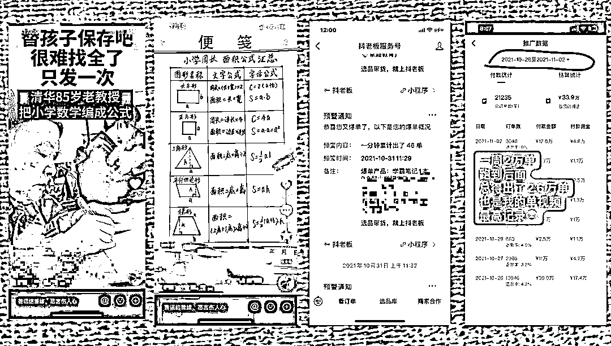

# ('新手航海 普遍存在的 3 个问题！', (2, 19))

圈友们好，各位参与六月视频号航海的小伙伴们好！我是豪叔（猎音狮），这次很荣幸作为这条船的教练陪大家跑完全程。

这几天我翻了不少群里的提问，发现新手朋友们踩来踩去就是那三个坑。大家不妨对照一下，有则改之，无则加勉。

**第一个坑：求多求快，缺乏耐心**

别以为视频发得够多就能爆——量再大，也得建立在质量上。很多人张嘴闭嘴就是“批量”，恨不得啥都流水线生产。可做一个视频，花一个小时就坐不住了？爆单视频是慢工出细活，哪能这么浮躁。

批量生产的玩法只适合工作室。个人玩家，尤其是新手，我真心不建议碰。我为什么能把一个赛道撑到今天？说白了就是耐得住性子，重质不重量，精细化去磨。我讲过自己那个11秒视频卖了2.6万单，相当于一分钟成交46单——

讲这个不是秀成绩，是想让大家明白“专注”的杀伤力有多大。可你知道那条11秒的视频，我花了多久做吗？差不多一整个白天，八个小时。自己写字、画图、剪辑，字写丑了就把纸撕了重来，一直写到满意为止。当然，那种形式现在已经淘汰了，去年我就转做真人口播了。

所以啊，咱们得顺势而为。有条件的船员，我特别鼓励做口播。混剪这条路我是走过来的，技术上甚至摸到过天花板，为什么不再做？因为口播更稳定，剪辑起来也省事，无非加加字幕；混剪呢，各种去重、各种修整，折腾得多。当你静下心来把一支视频做透，还没发出手，心里就涌起满满的成就感，潜意识里已经觉得它会爆。有这股自信在，哪怕一次没爆，只要你次次都拿出这个劲儿，离爆单真就不远了。

**第二个坑：道理都懂，落地很难**

这个问题主要出在新手身上。很多朋友看航海手册，基本是走马观花，翻完就忘，然后跑来问“我到底该从哪一步开始”。就拿选品来说，手册里不仅把方法掰开揉碎讲清楚了，还在最后附上了选品案例和具体建议。

这些东西你要去外面学，少说也得花两三千。赚钱把航海手册（也就是咱们的教科书）备好了，还安排了教练，有不懂的直接在群里问。说实话，这种机会真得好好珍惜。你看，上岸就退保证金，相当于白给你学。可退保证金不是目的，有些人就为了拿回钱硬着头皮打卡，那就完全失去了航海的意义，也不是赚钱的本意。赚钱这么做，本质是监督你，希望每个船员都能拿出成绩。

视频号带货是门技术活，还是脑力技术活。就算你认认真真学了，不动脑子，碰到新问题照样抓瞎。它不像拧螺丝——就那么几个动作，学会了就能一直重复。所以还有一件顶重要的事：学会举一反三。

**第三个坑：选品拍脑袋，不看市场**

选品永远是带货最核心的环节。你不能凭感觉觉得“这东西能卖”就上，得去研究视频号用户群里的供需关系。

这里给新手三条建议：

**第一条：优先选视频号里已有对标、已有案例、已经卖爆的品。** 视频号里没人卖的品，试错成本太高。测品是大佬们才有资本干的事，真不适合新手。

**第二条：要有单品思维。** 选好一个品，只要转化不错，就把它死磕到底。它已经能给你带收入、带转化了，还测别的干嘛？一来浪费时间，二来卖得太杂会拉低账号垂直度。做精了，你才有机会在这个品上深耕。我自己就是例子，教辅做了好几年，硬是做成行业标杆。现在我想找对标都找不到——因为我自己就是别人的对标。

有句话说得妙：不想当元帅的士兵，不是好士兵。选定一个赛道，往死里做，做到你这个小圈子里的第一，大钱自然就来了。我用的一直是单品思维，不同季节火不同的品，每一波都把流量薅到极致，再换下一个。

**第三条：不要选高危品！不要选高危品！不要选高危品！** 重要的话说三遍。新手按部就班地做，能不出违规就已经很难了。这几天看群里，一会儿有人医疗禁言，一会儿碰宗教，一会儿又踩了夸大功效的线……新手本来就不容易，有些朋友还是玻璃心，再去碰高危品，我真怕你做着做着就放弃了。

所以，新手阶段不妨先选个安全赛道深耕，等跑通闭环，再考虑挑战高危行业也不迟。高风险高收益，那是以后的事。当下先把带货闭环跑通，先完成从0到1，再慢慢走向100、1万、100万。

以上，就是我这周蹲群里总结出来的问题。各位看看自己踩了哪一条，有则改之，无则加勉。

最后，送大家一段话：

不要等着被照亮，要努力去让自己发光。

老实做人，踏实做事，保持学习，细心耐心，多换位思考，多做利他之事，定有所成。

要相信自己，也要允许自己慢慢变富，不要追求赚快钱。学到位，做到位，结果必然到位。

