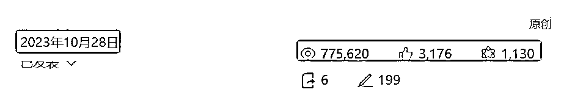
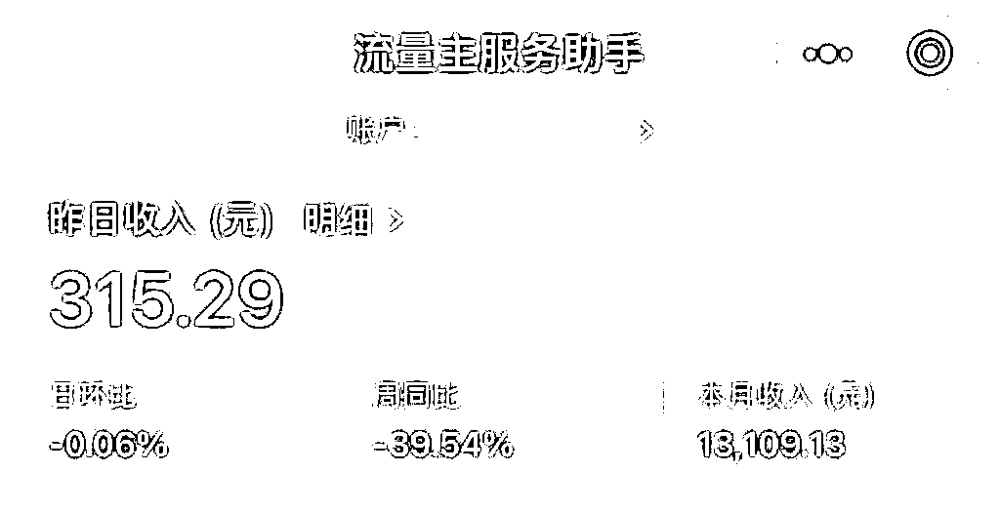

# 从28岁会偷哭的宝妈，到公众号77W+爆文作者：我只用了一年多

各位赚钱圈友，我是小伞。今天来聊聊我和赚钱的故事。

关注赚钱其实已经有一年多了，但之前我一直在“水下”默默围观，总觉得自己的那点成绩不够份量，没勇气出来分享。多亏好友@李慢慢 反复催我，说这段经历或许能帮到一些同样纠结的人。所以，我这才鼓起了勇气。

先说说现在的结果：自由职业半年多，公众号写出了单篇77万+阅读的爆款，流量主收入让我可以月入过万，现在接一条广告，甚至能超过我以前上班一个月的工资。而在这些光鲜数字背后，去年的我，28岁，还是一个在公司忙一整天、回家还要带娃、趁孩子睡着后拼命折腾副业的职场妈妈。老实讲，那时候我经常因为工作偷偷掉眼泪。

我是在副业还没稳定收入的情况下选择裸辞的。现在回想，确实又莽又勇。但在这之前，我已经断断续续摸索了一两年。当时我告诉自己：只要自媒体一个月能赚2000块，就坚持下去。于是，一个人带着一点不甘和微小的勇气，慌慌张张地开始了。没想到，到了第二个月，我就被一个大惊喜砸中——写了篇10万+爆文，流量主收入直接让我月入过万，我也就顺势踏上了自由职业这条路。

如今，公众号一条广告的收入，已经能抵得上过去一个月的打工薪水，我终于可以活得从容一些。而这一切的起点，正是赚钱有术。它究竟带给了我什么？为什么我会对它这么死心塌地？我把想说的话都写在飞书文档里了，感兴趣的朋友可以点开看看：https://vnng84yf44.feishu.cn/docx/Y6I0dhenpoS3x8xsRvwchjKznmd

如果你也正考虑从职场跳出来，或是刚加入的新圈友，希望我这段经历能带给你一点信心和勇气。潜水一年多，这是我第一次发长文帖。如果读完有收获，记得给我点个赞，比心。