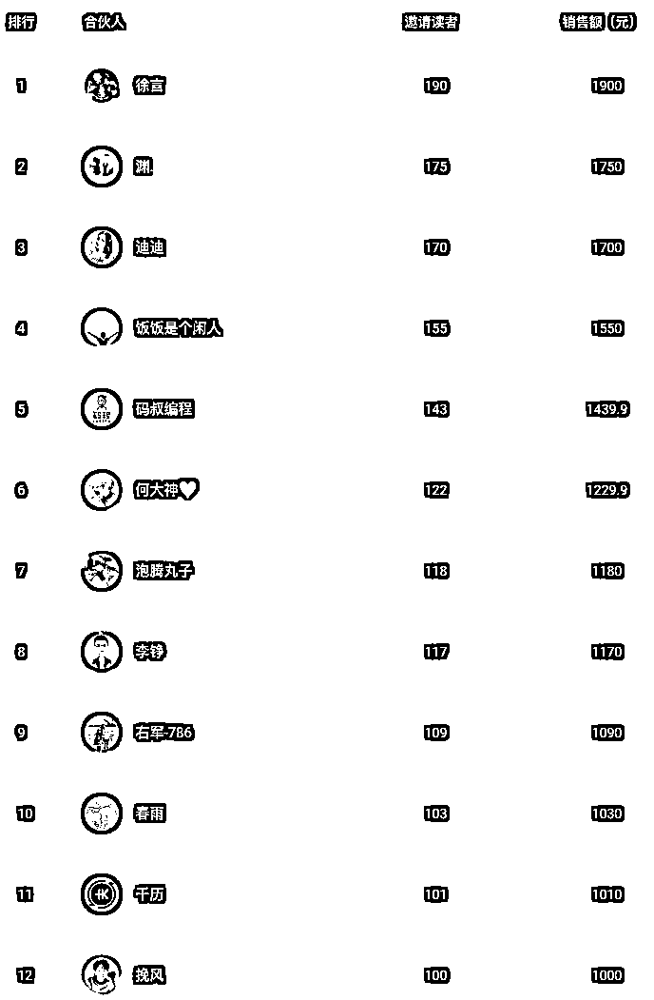
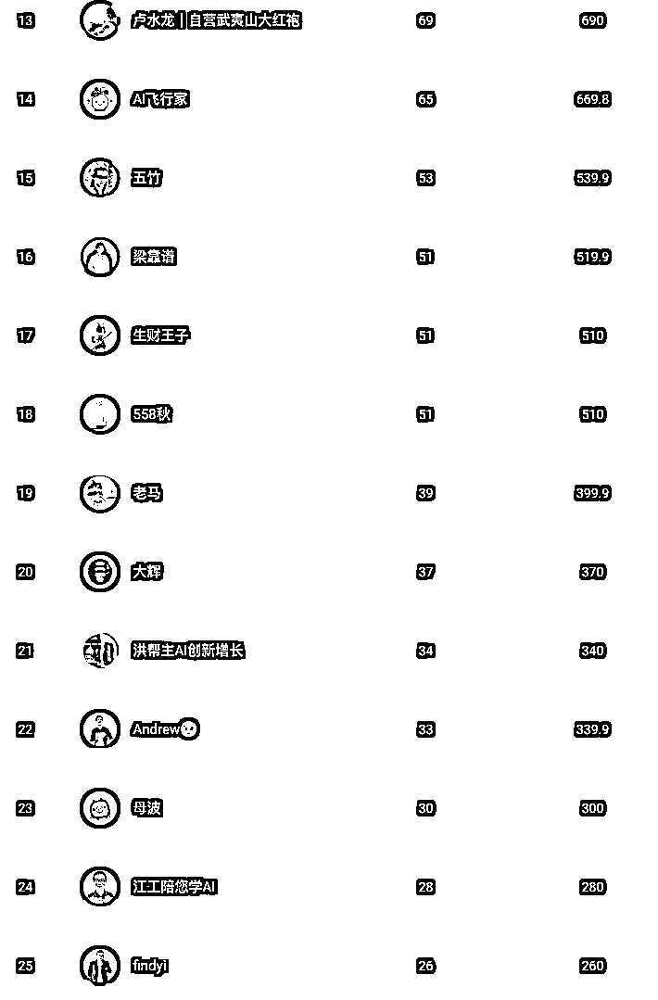
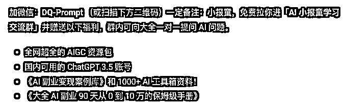
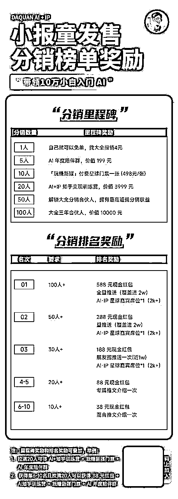
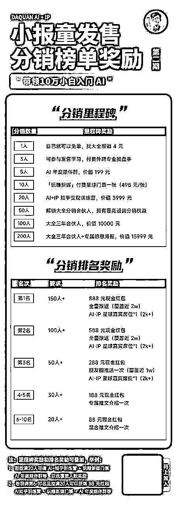
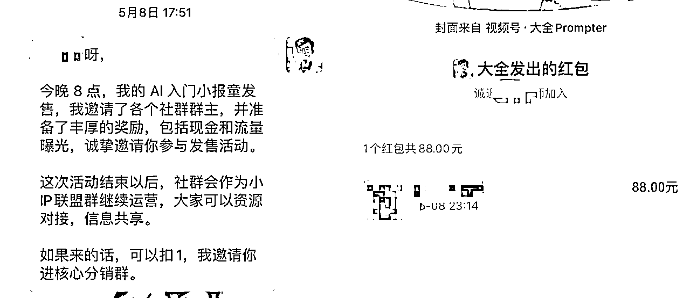

# 两周3500+订阅，近10万GMV：一次小报童爆款发售的完整复盘

> 来源：[https://eqsdsj0h4eo.feishu.cn/docx/DqOBdxYfOowFxkxZmOzcUT9gnxf](https://eqsdsj0h4eo.feishu.cn/docx/DqOBdxYfOowFxkxZmOzcUT9gnxf)

大家好，我是大全。90后两个孩子的爸爸，曾经的BAT大厂架构师，现在是AI万人实操教练。入行AI不到90天就做到月入10万，AI自媒体全网粉丝3万，累计付费学员超5000人，半年副业流水接近40万。

今年5月中旬，我做了一次小报童的集中发售，从内测到正式上架，总共花了十多天，订阅量就冲破3500份，GMV逼近10万，至今还在持续上涨。今天把整个打法拆开讲清楚。

先说结论，小册首先是获客工具，不是主营利润点。打榜期定价以10元为主，核心是靠后端的高阶产品承接。做这种引流品，既要保证声量，又不能亏本，花钱要花在刀刃上。

另外，小册还能迅速放大个人势能。这次发售后，有相当一部分新朋友是通过小报童认识我的。发起一次发售，就是一次总动员，必须把手头能用的资源一次性全部打出去，把流量一次性打穿。

特别要感谢这次幕后操盘的水龙老师，帮我把控了整个节奏的关键节点，输出了大量执行物料，没有他，很难拿到3500+这个结果。

看完这篇复盘，你可以带走：

1、爆款小册怎么设计
2、小册定位的思路
3、发售阶段的具体操作

# 一、这场发售的数据表现

1、小报童最终订阅超过3500份，整体GMV接近10万元，额外成交10个3999元合伙人席位。
2、累计有239人参与分销，朋友圈持续刷屏两周，个人IP曝光量大幅提升。
3、分销效果集中：50人卖出10份以上，12人卖出100份以上。
4、沉淀私域付费用户超2000人，建了4个小报童陪伴群。

# 二、发售时间轴与增长曲线

## 一）关键节点回顾

1月15日，《AI破局》通过审核，进入排队期。
1月15日-5月4日，靠自己冷启动卖出500+份。
5月2日22:13，决定找水龙老师对接发售事宜，并着手搭建分销KOL群，合伙人先行内抢。
5月6日，与水龙详细沟通发售方案，正式邀请其操盘。
5月7日，敲定大红包打榜激励机制，目标一次性击穿。
5月8日，内测启动，当天开始以每天50人的速度扩KOL，分销群规模升至150人。同时联系了徐言、洋哥、右军、朱胜、赚钱王子、江工等付费合伙人头部大咖，预约社群与朋友圈支持。下午邀请洋哥、右军、饭饭、码叔等嘉宾入群，以大红包形式开启内测发售。
5月13日，内测收官，订阅破2000份，发放第一阶段奖励。
5月14日，准备正式发售，继续按日扩KOL，水龙同步补充50位，最终分销群达305人。
5月15日，正式发售启动，邀请靠谱、老马等嘉宾进群，延续大红包机制。

## 二）订阅增长节奏

5月9日 内测第1天，订阅破1000份
5月10日 内测第2天，订阅破1300份
5月11日 内测第3天，订阅破1500份
5月12日 内测第4天，订阅破1600份
5月13日 内测第5天，订阅破2000份
5月16日 正式第1天，订阅破2300份
5月17日 正式第2天，订阅破2600份
5月18日 正式第3天，订阅破2700份
5月19日 正式第4天，订阅破2800份
5月20日 正式第5天，订阅破2900份
5月21日 正式第6天，订阅破3000份
5月22日 正式第7天，订阅破3500份

# 三、发售全流程拆解

### 一）发售前的准备工作

#### 1、名称要直奔用户痛点
目前跑通的爆款小册，基本都围绕小白入门或具备变现方法的主题。名字最好是“xx从入门到变现”这种结构。可以直接降低理解成本。

另一个细节别踩坑：名字里避免生僻概念。我最早想叫“AI提示词”，后来发现很多人连提示词是什么都不清楚，自然不会下单。

#### 2、钩子要提前留好
小册定位引流，就要把钩子设计好，精准匹配目标人群，方便后续加微信进私域。

我的AI入门小册钩子是：

学AI的人最缺的就是可用工具，而国内用GPT3.5比较麻烦，我直接包了工具使用权，单这个账号价值就超过小册10元售价，很多人冲着这个就来了。

另外，发售期间置顶一篇只讲福利领取的钩子文章，转化会明显提升。文案里只放赠品说明和两个微信号，因为加人高峰期单号容易被限。

#### 3、分销SOP必须清晰
第一次接触小报童的人很多，分销SOP要写到能直接上手。包含：产品介绍、分销流程、图文操作指引、分销话术模板、思维导图、用户认可截图。

话术要简短，一次只点一个痛点，信息太多用户会直接关掉。

#### 4、打榜海报要提前做
我准备了内测版和正式版两张海报：

海报里有几个小技巧：

1）把里程碑奖励和排名奖励分开。排名奖只有前几名能拿，里程碑是达标即领，人人有机会，参与度更高。
2）里程碑奖励设计要点：
- 偏虚拟产品为主
- 阶梯至少翻倍递增，跨度别太大
- 设计新用户首单报销，刺激用户自己去分销
- 奖励要够重，比如年度陪伴群、知乎训练营、万元级的三年合伙人权益。这次冲着三年合伙人分销100份以上的就有12人，史无前例。
- 奖励可叠加，高等级自动包含低等级。
3）排名奖励设计：
- 以现金+曝光+荣誉为主
- 奖金参考梯度：888、588、288、188、88，按每10人50元奖金模型估算
- 排名要有数量门槛，不然奖金池扛不住
- 可设阶段奖，预期销量5000+时可提高金额。

#### 5、软文要提前写好
提前3-5天写好推广文，既能发公众号，也能直接拿去社群分发。内容涵盖个人成长历程、入行心路、写小册动机、价值点。

结尾可准备两个版本，一个纯IP输出结尾，一个带购买引导结尾，方便不同群主接受度。

#### 6、KOL邀约
成员来源：老朋友、自己的合伙人群和陪伴群、打榜认识的高分销KOL、付费进群的群主、付费合伙人里带货强的。

邀约方式别群发，一对一私聊，诚意拉满。开门见山讲清楚产品、打榜机制和福利。

小技巧：先给对方报销一单，让他先体验认可再推。重点KOL可发88元红包邀请，懂人情世故对方更愿意站台。

欢迎语要定制化，体现被重视感。对有知名度的KOL额外加介绍。贵人到场要隆重欢迎并配大红包。

#### 7、嘉宾邀约
发售前一周就开始对接助阵嘉宾，确认朋友圈+社群支持时间。社群分享内容直接用准备好的软文。
尽量做到每天都有分享，周末也不停，形成持续声量。我单日最高一天开了9场群分享，后续用合伙人小楠做的群分享RPA分担压力，但核心大佬群仍手动分享更稳妥。

加好友高峰期，我也用了RPA自动加人、自动打招呼、自动拉群，节省大量人力。

发售当天邀约嘉宾进群是士气关键。KOL总量到200左右再放人，仪式感要足。嘉宾坐镇能让普通分销者信任度提升，也给他们在圈内曝光的机会。

### 二）发售中的执行细节

1、提前预热
发售前一天先放风说要搞大事，吊胃口。直接上效果不如预热效果好。
参考文案：最近，大全要做一件个人大事，参与的人都能赚到钱。感兴趣的点赞或回复1，我私聊你。

2、素材日更收集
每天搜集朋友圈优质文案，奖励红包鼓励大家写。用户视角的文案共鸣更强。汇总到飞书文档或群里，方便复用。

3、自己带头发圈
每天主动发朋友圈，内容包括：分销文案、分销群进来的大佬晒单、里程碑进度晒单、小册内部内容小样、个人IP故事、大佬转发截图。

4、阶段性激励
设置里程碑红包，比如订阅到1000、1500、2000时，给订阅者88元、给邀请人66元。临近节点时大家发圈动力会猛增。

5、里程碑报喜
突破关键节点后，到合伙人群里报喜复盘，让更多人感受到势能被放大。大IP往往会在节点上给你二次助推。报喜时带上复盘心得，别只报数字。

6、陪伴群激活
新用户进来马上建群并激活分销。大量一单分销用户就来自陪伴群转化。也挖到几个单日分销50+的隐藏高手。
返现4元建议在群内发放，大家看着别人拿钱，分销冲动更强。

参考欢迎文案：
欢迎来到大全小报童交流群[庆祝]，群公告有福利领取。
❗目前处于发售期，欢迎分销，CPS60%，首单额外补贴4元，可进核心分销群～
分销流程和素材在群公告。

7、榜单公布节奏
前期别全公布，前3名尤其不要露，让大家保持冲刺心态。2-3天后可公布3-20名。
最后1-2天再公布完整榜单，这两天是疯狂冲刺期。
另外持续提醒临门一脚的用户，比如私聊或群内@，告诉他差几单拿什么奖。打榜末期还可以激榜：说A快超过B了，能有效点燃两人。

# 四、最后的思考

1、小IP最适合做小报童，60%佣金+裂变机制，能快速起量扩大影响力。
2、小册内容要做到超预期交付，保持更新频率，并把交流群运营好。
3、一定要有三阶/四阶产品体系，10元小册是筛选信任的入口，快速积累付费用户。

这次发售很多数据都超出预期。水龙老师最初定目标3000，我一度觉得不可能，结果做到了3500+。最初只想邀请300个KOL，结果最终扩到306人。原本以为加1000个微信就不错了，最后近2000人加我，转化率约60%。

对我来说，这又是一次全新的尝试：第一次公开课、第一次群发售、第一次直播发售、第一次用浪潮式发售小册。每一次突破都在逼自己跨过内心的恐惧和犹豫。只要持续行动，惊喜会越来越多。