# 裸辞all in视频号带货，入局2个月打出12w+佣金

> 来源：[https://jght4vza92.feishu.cn/docx/EMKKdBcYQoCVNnxi8HJcw3FSnqd](https://jght4vza92.feishu.cn/docx/EMKKdBcYQoCVNnxi8HJcw3FSnqd)

各位赚钱的朋友大家好，我是夜风，四月份才加入赚钱的新人。从一开始的迷茫观望，到后决心全职押注视频号，前后一个半月左右做到了销售额二十万以上，佣金到手十二万多，几乎等于我过去一整年的薪水。当时的我万万没想到会这么快。感谢赚钱，感谢龙哥老师提供的平台、项目和利他精神，也感谢路上遇到的伙伴和前辈的真心指点，才让我在视频号上拿到第一份像样的成绩，走了自己的路。

此刻我正坐在开往上海的高铁上，把从小白到上手这段经历记录下来，也把这段时间对项目的一些体感整理出来分享。赚钱吸引我的不只是项目本身，更是这里的氛围。作为刚入局的全职新人，我希望这份记录能给后来者一些鼓舞：只要用心操作，赚钱里的人都能把钱赚到。也希望未来能像大佬们一样，保持利他，让一盏灯点亮更多灯。

以下是部分数据截图：

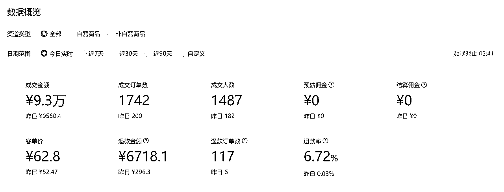

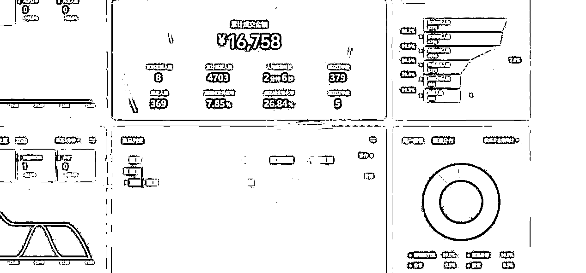

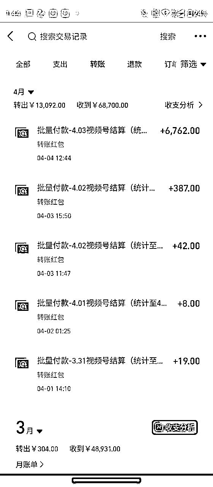

# 一、被生活反复锤炼的过往

## 1. 创业试错的坎坷

我今年29岁，家里几乎全是体制内。按常理，我本该考个小镇公务员，端上铁饭碗，延续家里的稳定路线，在老家平淡度日。

但我向来不爱循规蹈矩。想到一成不变几十年，我就觉得人生还没启程就结束了。大ده时代，我就开始瞎折腾。做过拉新、开过游戏工作室、也搞过劳务派遣，把酒店小时工和寒暑假工往工厂输送。慢慢财务独立了，租了小写字楼，带了几十个下游，最高峰一次月入13万。那段时间我以为找到了终身赛道。

现实很快打脸。上游劳务公司卷款跑路，我没牌照只能挂靠，现金流瞬间断裂。好在手头积蓄勉强覆盖亏损，我便回到校园，安稳读完最后一学年。

## 2. 硬闯互联网

毕业后我对体制产生了抗拒，同学都去考银行、公务员时，我一个人去了上海，加入了一家互联网公司。学的是金融，基础操作都不熟，连复制粘贴的快捷键都得现学，只能从客服起步。

同一届同学要么在银行要么在体制内，看起来体面稳定。我偏偏选了条不确定的路。当时并不焦虑，因为我知道自己想要什么。

随后三年里，我换了三份工作，从客服到运营再到产品。城市也换了三次，上海、杭州、成都。薪资也一路向上，从不及同学一半，到后来翻倍还多。我慢慢悟出一个道理：慢即是快。

可工作多年后，大环境下行，涨薪几乎停滞，身边人一批批离职，裁员名单的阴影始终存在。我不想被动等待被优化，于是提前递交了辞呈。在交完最后一版方案的那个阳光早晨，我正式开启了从零再起的旅程。

## 3. 离职后的韭菜期

离职后我先躺平了两个月，把之前透支的精力补回来。休整结束，焦虑随之而来：接下来干什么？

我开始到处找项目。那时还不认识赚钱，主要在抖音、知乎上搜。结果自然是被割。第一个买的课是TK带货。付完钱得到的是一份三百字左右的文档、两段模糊的重剪视频，外加一台装了VPN的五手iPhone6。付费前秒回，付费后随缘。

靠着执行力拼一周，也卖出几百刀，隐约觉得脱离公司也能活。但按照教程的粗暴去重，没几天账号就被封，佣金被锁。联系老师发现人已离职，工商投诉发现公司地址都是假的。我这才明白自己被当韭菜割了。

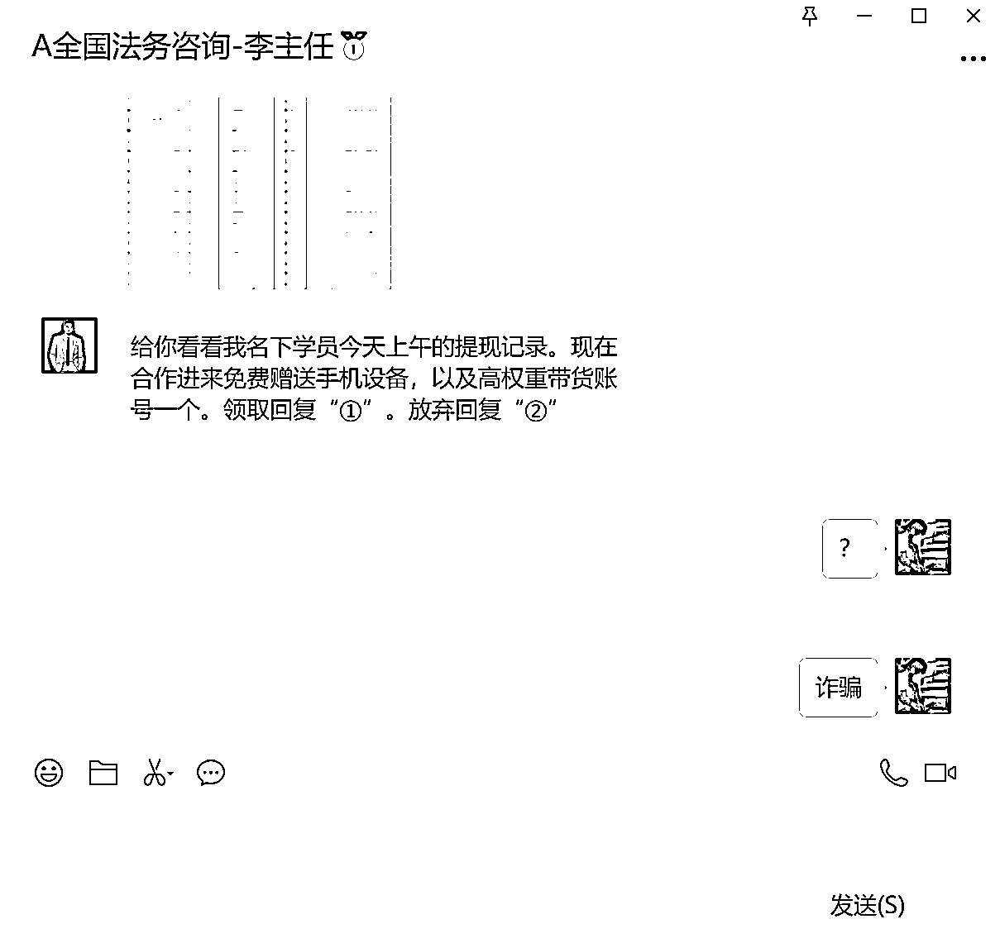

TK之后又研究快手无人直播，选了零食赛道，花了一千多买软件，播了一个月只卖出一份臭豆腐，净赚3块2。连续踩坑后，我一度怀疑自己的判断力。正当迷茫时，出现了转机。

## 4. 遇见赚钱

去年12月，朋友转给我一篇《赚钱有术最短的一篇精华》。文章很短，但“利他是最大的利己”这句话深深击中了我。当时我正需要一个灯塔。

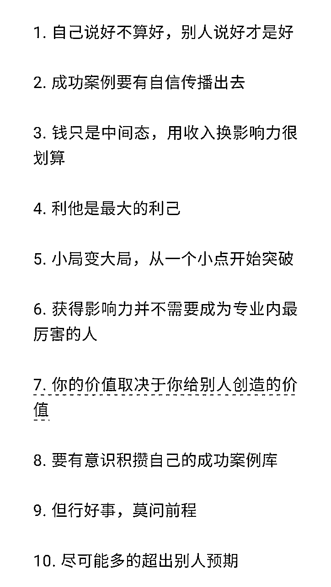

问朋友才知道他是赚钱两年老友，辞职后做小红书带货，收入远超上班。听他描述后，我既好奇又谨慎。手头紧、半年没收入，我先借用他的账号进去看看。进去后我被震惊了：即便是免费分享的项目，细节和完整度都远超外面收费课。联系的大佬们也都很认真解答。那份真诚利他的氛围感很强。

借号期间我每天狂扫项目，小红书电商、二手书、卖卡，感觉每个都能月入百万。卖了几张手机卡后，收益从几块涨到几百。但我问自己：辞掉月入2万的工作，就为了每周赚几百吗？

于是我停下盲目试错，开始一篇篇翻精华。看到一篇关于视频号带货的深度帖，我觉得有戏。早期我也玩过视频号，只是没做成。现在视频号正处风口，我决定再试一次。连上帖子里提到的孟总聊完后，我下定决心只做视频号一条线，不再分散。把一米宽挖一千米深。

## 5. All in视频号

我其实很早就碰过视频号。之前自拍没流量，开播卖不动，就放弃了。

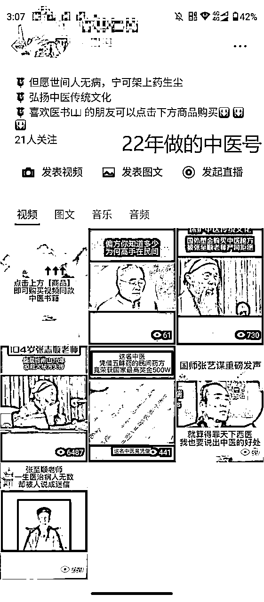

这次决定死磕后，我把操作手册反复看了两天，随后一天内找亲友注册了五个视频号。报名时间是二月中旬，正逢春节。2月17日，我开启了第二次尝试。

那天我剪视频到凌晨四点，睡不到两小时就上线开播。因为经验告诉我中老年用户起得早，第一波流量很重要。运气不错，第一条视频就小爆，销售额和播放量同时上涨，困意全无，直接继续制作。

可惜经验不足，遇到异常没及时处理，高峰期违规下播，损失几千。但至少尝到了互联网赚钱的滋味。

新打法首次见效，信心大增。群里每天都有爆单案例，我更不敢休息，总觉得睡觉是浪费。那段时间我几乎在不断提问，群友和孟总都会及时回，我对视频号的理解也在快速加深。

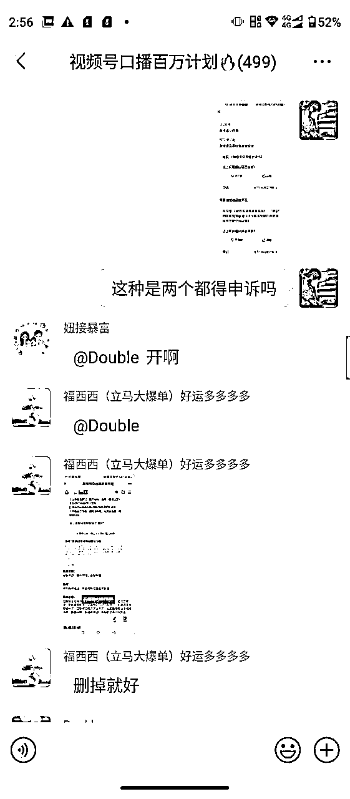

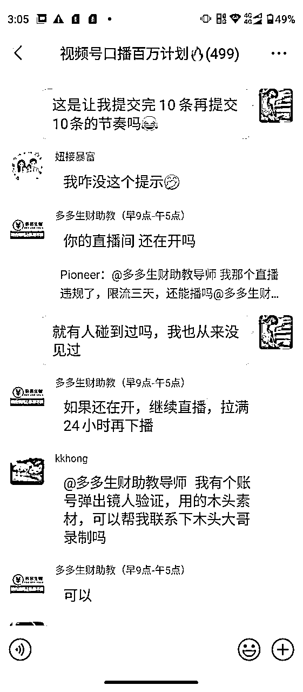

吃透口播带货的流量逻辑后，浪费减少了。随后我每天三点睡六点起，睡眠经常不足三小时。数据也开始攀升，从三千、五千、八千，到某天突然爆单，单日佣金破两万，第一次感受到日入过万的刺激。慢慢我也从新人变成了老成员，并开始解答新人的问题。

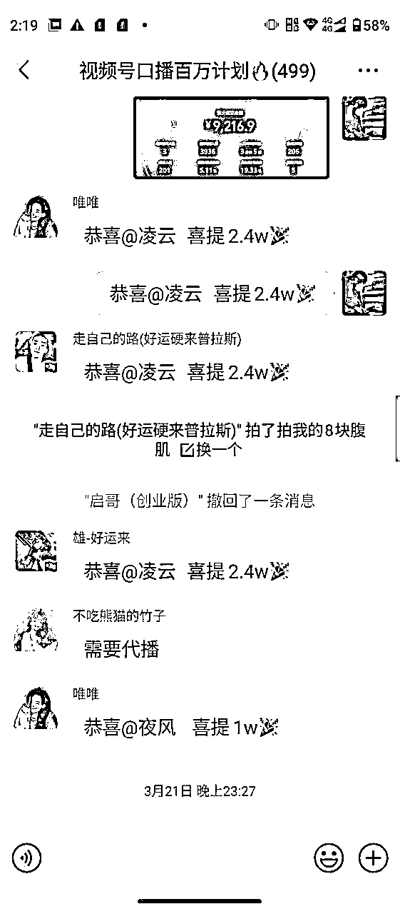

理清规律后，日均产出稳定在几千。十天累计下来赚了三万，孟总让我在群里分享。虽然比不上日入十几万的大佬，但也在圈子里有了点存在感。

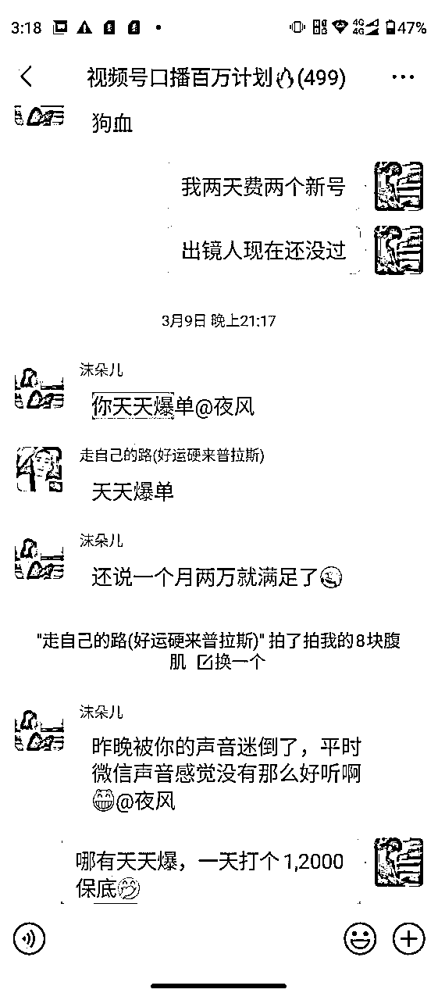

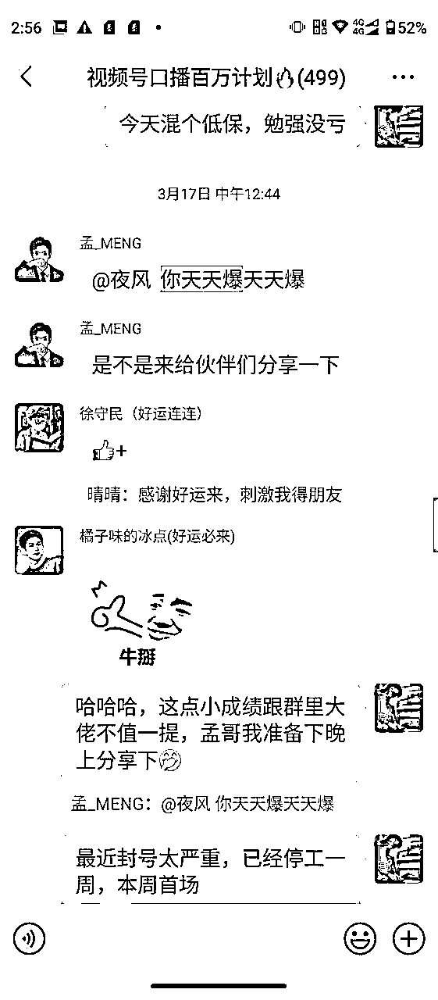

在这种几百几千的日常里，号死了救、救了死，周而复始。4月20日，我迎来了第一次真正的大爆发。

这次靠的是一个新品——急救毯，就是那种像塑料布的应急毯。

群里有很多人都在卖这个品，销售额动辄几万。我闻到了爆品的味道。仔细观察广场上的直播间后，我确认这是一个现象级品。它完美契合中老年怕意外、爱囤货的心理，一下子买五件十件很常见。我半夜看到信息立刻起身剪视频。爆品的生命周期短，速度比什么都重要。第二天一早发出去，多数视频数据都不错。

于是我持续拉时长，首24小时成交1万6，佣金约八千。

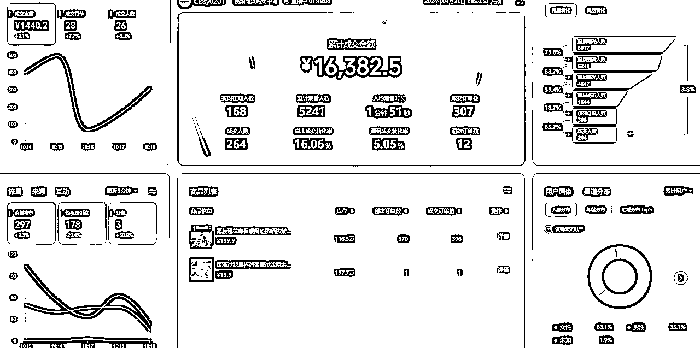

一个月前的我可能就满足了，但凭一个多月的实操经验，我知道这个品还有空间。群里有人单场十万二十万，我差距明显。我赶紧找群里的实拍大佬合作，谈好分成拿到优先素材。在天时地利人和下，后续打出了GMV十万加、佣金六万加的大单。

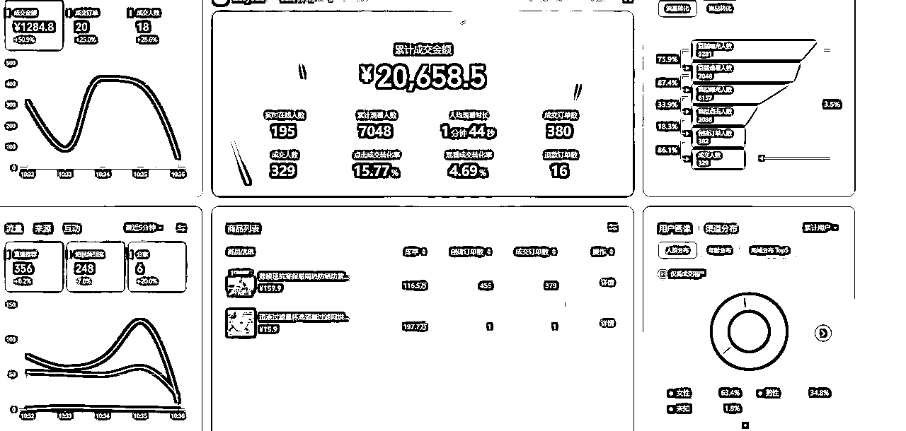

日常几千靠坚持，大爆靠的是运气叠加执行。好品是天时，好素材是地利，执行拉满是人和，三者凑齐才能打出来。爆品需要等待，但等来了不抢就等于放弃。果然，急救毯连续爆几天后违规率飙升，随后迅速降温。

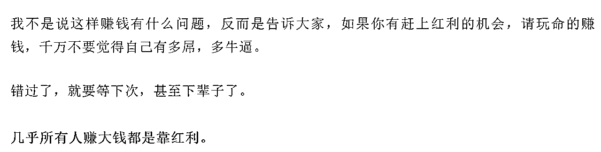

就这样，一个月多点的时间累计销售额二十万加，佣金十二万加，都是佣金率50%到70%的品。在家待两个月挣到了一年工资的钱。

回头看，这一切像冥冥中安排好的。感谢朋友的那篇文章，感谢赚钱和一群同路人。这次我终于在创业路上迈出了第一步。

既然受了这么多帮助，我也把自己的实操方法整理出来，希望能帮到后来人。

# 二、视频号口播带货的实战框架

两个多月的摸索，我把逻辑归纳为三句话：账号打底，素材定胜负，直播做承接。

## 第一，账号就是子弹

号越多越好。现在一个人能实名五个微信、两个视频号。视频号就是你发射的子弹。每天至少五号同时发，坚持一周，总有爆的可能。自媒体本质是概率游戏，爆一次就可能过万。所以前期囤号养号很重要，后续还要持续扩充。

## 第二，素材是核心

素材是流量来源，也是直播成败的关键。选对脚本和素材，直播基本就赢了一半。表现力强的实拍者单场十万GMV很常见；表达一般的可以做搬运去重，这也是平台早期规则不严时的红利。

现在月入十万的选手里，搬运派占比也不小。因为爆过的老视频自带爆的基因。可以根据自己的表达能力选路线，当然原创收益天花板更高。

## 第三，直播是转化

视频和直播是互哺关系。平台推来的流量承接好，质量达标，就会获得更大流量；视频数据好，直播流量也跟着涨。链路打通后就是螺旋上升。

直播本身只是最后的转化环节，甚至是相对轻松的。点进来的用户已经被视频洗过一遍，购买意愿已有，你只需要把摇摆的大爷大妈再推一把，对着文案念就行。

## 第四，关键提醒

拉时长非常有效。有流量时不要轻易下播。视频号爆不爆看号、看时、看命。爆了就死守，拉时长、补视频，把流量榨干。补的过程中往往能带动其他视频，整体GMV会水涨船高。

# 三、入门实操

这部分面向刚接触视频号的同学，已有经验可直接跳过。

## 第一步，选品与对标

直播能不能打爆，品和素材排第一。别指望新手自己造爆品，成本太高。跟随成功者更实际。

平时多刷直播广场，看哪个品卖得好就研究它的视频结构和脚本。翻拍也好搬运也好，手速要快。好素材晚一天就是吃土。培养多刷广场的习惯。

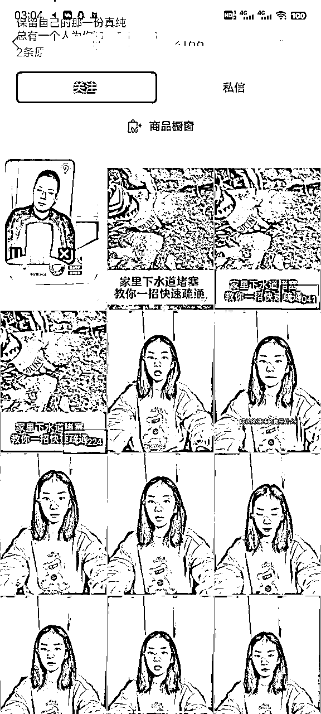

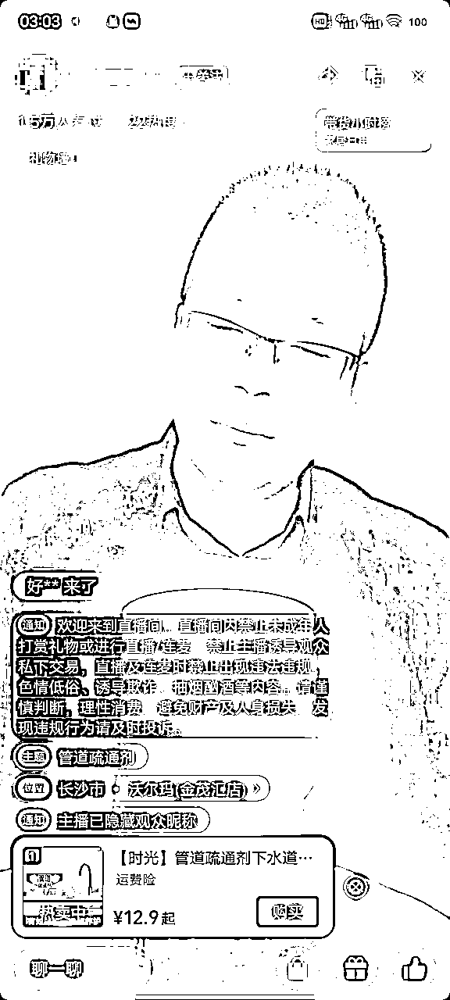

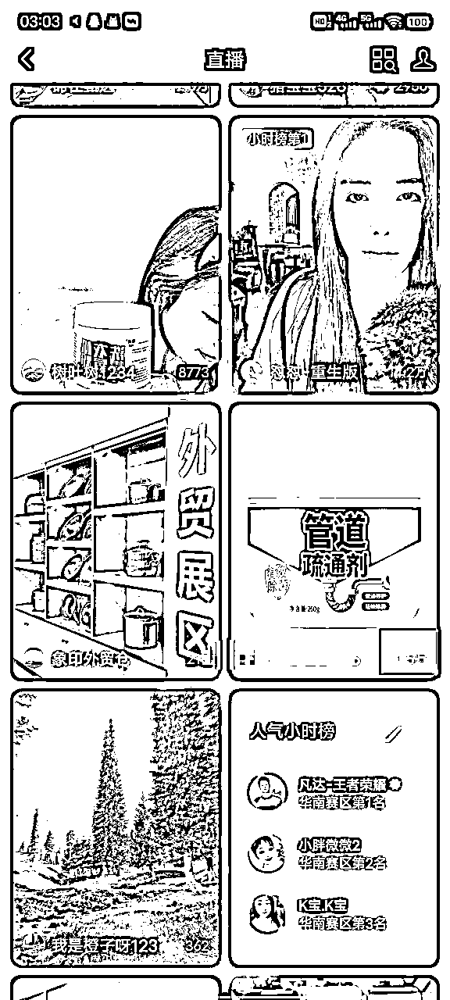

抖音和视频号都一样，优先对标近期起来的账号。越新的账号方法越新，模仿成功率越高。

## 第二步，剪辑

我目前主要是搬运混剪，也在往实拍走。混剪套路大同小异，就是画中画、变速、贴纸、镜像等操作。工程图一看就懂。

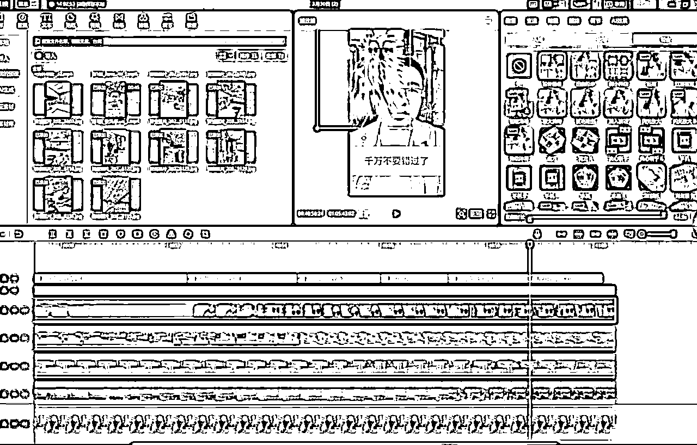

建议尽早向实拍转型。随着平台规范，搬运空间会越来越小，实拍收益更高。

## 第三步，直播

口播连怼玩法其实技术门槛最低。我们靠短视频引流，直播只负责成交。用户进直播间就是想买，直播表现好坏只影响转化率几个点。对着台词念即可。

须注意：直播间必须有人在线，否则易被判定违规下播，严重会封橱窗。视频在跑却不能成交，那种痛苦最难受。

1.  完全沉默不动，系统一样会把你当成录播或者无人直播来处理，结局都一样糟糕。

1.  另外要防着那些敏感词，出现频率过高同样会触发限流被封。

说到底，直播这件事其实并不复杂，照着已经跑通的爆间话术照本宣科，就能稳稳拿下，不翻车就算赢。

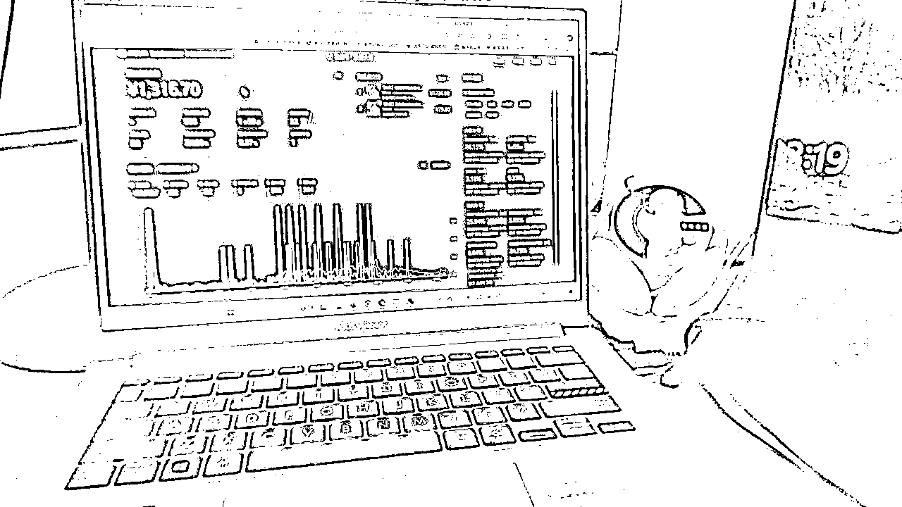
# 四、【视频号带货】提效方法论

接下来分享的，都是我本月实操下来摸索出的效率提升打法，供同样在视频号赛道冲刺的同行们参考。

## 第一，账号溯源，做好数据分析

数据分析这一步，真的不能省！（表格我放下面了，嫌麻烦的朋友直接找我拿模板就行）

此前在互联网公司做过产品经理，习惯做项目管理，所以我把旗下所有账号的各项数据、归属关系、当前状态全部拉进一张表里，效率直接拉满。表格示意大概长这样：

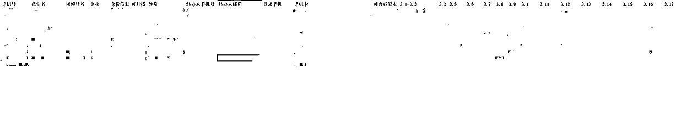

之所以要做这张表，核心有三点：

*   1.能快速判断账号健康度，当天就能筛选出能用的、明天可以继续打的账号。哪些号刚结束需要冷静期？哪些号过去有过成绩，只是沉寂一段时间，很可能再激活就能爆发，一眼就能看出来。

*   2.异常情况能秒定位，并且表里都标注了实名主体、卡片归属等关键信息，出问题时能马上找到对应的实名人、微信号、授权企业去处理，响应速度极快，最大程度保证直播不掉链子。

*   3.便于做复盘与品类匹配，根据不同账号的历史出单表现，快速确定人品适配，比如A号带A品效果好，换品就拉胯。也是靠这套方式，我筛出了真正的王牌号，20个号里就它一个贡献了超过一半的GMV。还有一些很久没开播的老号，偶尔试一播，说不定就撞上爆场。

## 第二，找准重心，把控运营节奏

运营端的配合，同样是成败关键。

我本人嗓子条件有限，长时间开麦比较吃力，所以选择用代播来上台，自己退居幕后负责剪视频、热场、控评和场控辅助。盯着后台数据实时补短板，告诉主播当前流量体量，让他立刻调整话术和场景。流量高峰期还会配合上水军矩阵，帮主播把单子逼出来。

扬长避短，比硬刚短板更划算。如果你某个环节短板严重且短期内难提升，除了砸钱砸时间去补，也完全可以靠流程和人手去绕过去，效果一样。代价就是我的代播成本成了最大头，一个月差不多要小一万，妥妥的重资产投入。有能力的朋友当然可以自己上，如果实在驾驭不了，也可以外包代播，只是成本和ROI一定要算清楚，别打了水漂。

# 五、天赋不够，努力来凑

视频号就是个拼耐力的战场，想进来混，护肝片得常备。我是个犟脾气，觉得别人能做到的我一定也能做到。靠的就是这股信念，天赋不占优就靠堆时长，凌晨四五点还在剪视频，刚躺下两个小时看到数据回暖又爬起来开播，一天睡不到三小时。也是硬扛下来，才换来一点点成绩。不得不承认，好的社群氛围真的能上头，看着身边人都在变现，自己躺着都觉得对不起自己。

最后，再次感谢赚钱有术，感谢龙哥大佬搭建了这个优质平台，让我能高效链接到真正有结果的前辈，成就了这段折腾的旅程！也感谢孟总一路的陪伴与支持，未来仍将在赚钱的土壤里一起奔向更好的自己。祝愿每一个伙伴都能找到适合自己的赛道，在这个遍地金矿的赚钱星球，挖到属于自己的第一桶金！2024，一起暴富！