前几天，一位做赚钱航海家的朋友问我：你这些年的创业经历，为什么不写出来？我想了想，确实该写写了。我是镕升师兄，见字如面。无论你我是线上神交，还是线下老友，能在此相遇，就是缘分。

先交代一下背景：我做私域八年，主业面向C端客户，副业是律师。手头这个“万粉私域母盘”，已经连续三年营收做到八位数，峰值超过1600万。这些年最深的体会是：私域最大的价值，在于它是行业利润的放大器；但放大器也有脾气，只有精细化运营，它才愿意把利润变成你的长期收益。

八年里，我19岁赚到第一个百万，又曾每天开着奥迪去学校，后来却跌到身无分文、流落街头，最后再靠一口气爬回千万营收。这中间的故事，今天一次讲完。

## 第一桶金：废纸堆里的生意

2016年高中毕业，父母让我把书和笔记当废纸卖，书贩子只出几十块。我看着那堆东西想：这些笔记，对高一高二的学弟学妹来说，也许很值钱。于是我跑遍县城，找学霸回收笔记，一本5到10元；没钱给，就承诺卖出后统一结账。全校第一的笔记，拿到复印店复制，一份变多份；其他尖子生的笔记，当成孤本卖高价，定价从30到200元不等。一周时间，我赚到2000多块。

赚钱的劲头一上来，就停不住。听说学霸们暑假都要考驾照，我跑去找他们：每周来上两个半天的课，一个月算四天，每人给800元。连我在内，凑了11位“老师”，办了个“向日葵自习室”。家里正好有套空房，我把卖笔记赚的钱全部印成传单，到高中刷楼地推。卖点是：十人以内小班制；只有学生，才最懂学生。收费500元一人，当时市场价是800到1200。最后招来36个学生，发完工钱，我和那位后来考上清华博士的合伙人，一人分了7000多，美滋滋过完高考暑假。

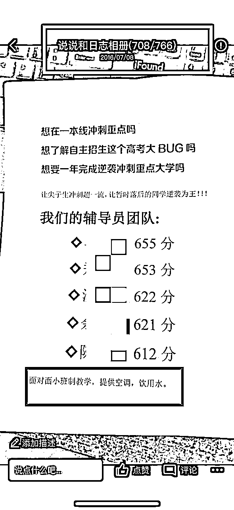
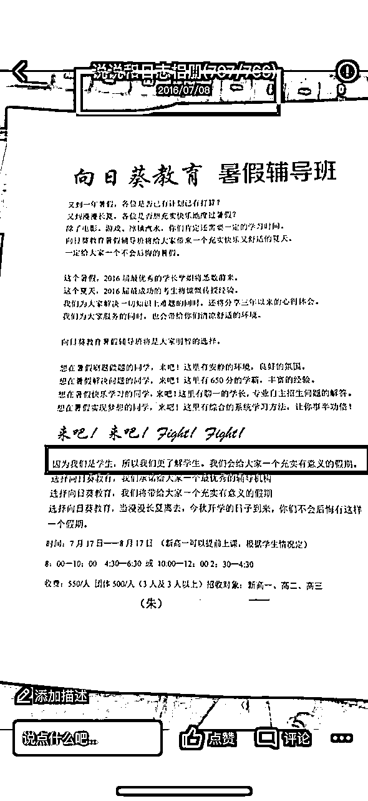
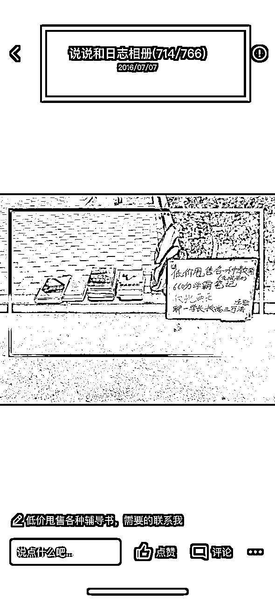

带着7000多块进了大学，父亲让我上交，我没听，他气得不给生活费。我回嘴：不给就不给，我自己能赚。军训站军姿时，我满脑子都是怎么找事做。暑假认识的那位学霸老师跑来问：我舍友家里有鞋厂，你要不要做代理？没错，就是莆田鞋。那时候科比的鞋、杜兰特的鞋、詹姆斯的鞋，专柜价贵到没边，普通学生只能眼馋。微商正火，大学生都泡在QQ上，我也做起了“Q商”，这大概就是私域最早的形状。

我的地推方式很直接：抱着鞋盒冲进宿舍，说自己刚创业，宿舍里就有现货，欢迎课后过来看。起初零售还行，但品质不过关，三天两头开胶，售后缠身。没做多久，我就不碰莆田了。那次经历让我明白：信誉比利润重要。你的客户就那么多，圈子也就那么大，名声坏了，生意就断了。

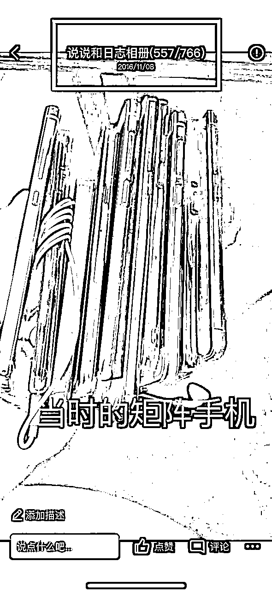
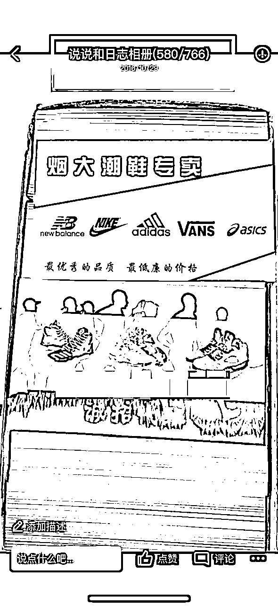

既然假货口碑做不起来，那就转正品。17、18年，AJ1禁穿、TOP3、椰子冰蓝、白斑马陆续发售，球鞋圈进入排队抢鞋时代。我手里本金有限，就拉上国外同学、圈内同行，一起原价或加价囤货，后来也卖奥特莱斯折扣、原单衣鞋。不管从哪个渠道来，我都把客户引到私域成交。到了17年寒假，一个月稳定赚一万多，好的时候能到两万，温饱解决了，我开始想怎么谋发展。那阵子，我还试过淘宝、无货源电商，甚至搭过校园外卖团队，试错试了一大圈，但始终没离开私域。

2018年，从大二下学期到大三上学期，我完成了百万营收。第二年，买了人生第一辆奥迪A4L。

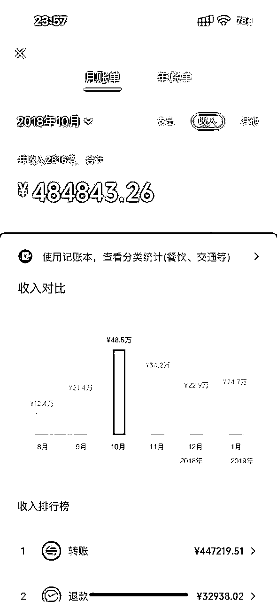

当时没有团队，只有我和女朋友，她拍照上图，我做运营。产品出问题，我挨个给客户道歉，厂家不退我也退，就这样把口碑一点一点拉了回来。可回头看，那段路顺利得过头。我后来才懂，创业就是不断拿到正向反馈，人会越来越自信，但真正决定你能走多远的，是选择和判断。更扎心的是：靠运气赚来的钱，迟早会凭认知还回去。

## 跌落：从学校里的奥迪，到街头的落魄

人在顺的时候，容易觉得全是自己厉害；人在低谷的时候，又总抱怨生不逢时。两种心态，其实都反了。

2019年，我拿着第一桶金，投资了一家泛娱乐传媒公司。那时抖音泛娱乐直播板块刚刚打开，妥妥的风口。公司刚成立，两个比我大五六岁的兄弟在一线做运营，还有两个40岁的投资方出钱。我和合伙人负责去大学招人，模式很清晰：招聘—艺人运营—直播打赏变现。那个阶段，只要情商在线、外形不错的女大学生，一个月流水几万很轻松，头部主播一个月能到几十万。我们三个月招了40多个艺人，月流水稳定在50万左右，毛利一半，第三个月当月利润就有25万。

这么好的局面，为什么还亏？对我个人来说，是一个字：贪。对公司来说，是财务模型混乱。三个合伙人，人心不齐；公司账和个人账混在一起；2000平的场地租下来又装修，全是浪费；艺人本质是学生，流失率高得吓人。项目撑了半年就停了。再好的项目，落到不行的人手里，照样烂。更讽刺的是，项目还没黄，合伙人已经换了保时捷，我还在拿每月2000块的工资。

接着，学长找我合开酒吧。大学城的位置，200平，层高够高，还能搭二楼。听着不错，但它是毛坯房，连水泥地都没有。算上租金、装修、设备、酒水，要30多万。19年开业，20年疫情黑天鹅来了，学长转身去考公务员，店面不了了之。

那段经历让我死心塌地明白：环境会重塑一个人，商业环境更是时代的产物，硬要逆着来，最后吃亏的是自己。就像上世纪的“大哥大”，时代不要你的时候，连招呼都不打。我们能做的，不是对着环境硬刚，而是审时度势，选对位置。

2020年，毕业，疫情元年，所有业务几乎一夜归零，赚来的钱也被折腾得所剩无几。沮丧、失意、怀疑、自暴自弃，这些情绪我全尝过。但奇怪的是，我心里一直有个声音：你还能起来。

## 重生：先认栽，再翻盘

先放两张近两年的创收截图。它们不是炫耀，而是想告诉你，低谷真的能走出来。

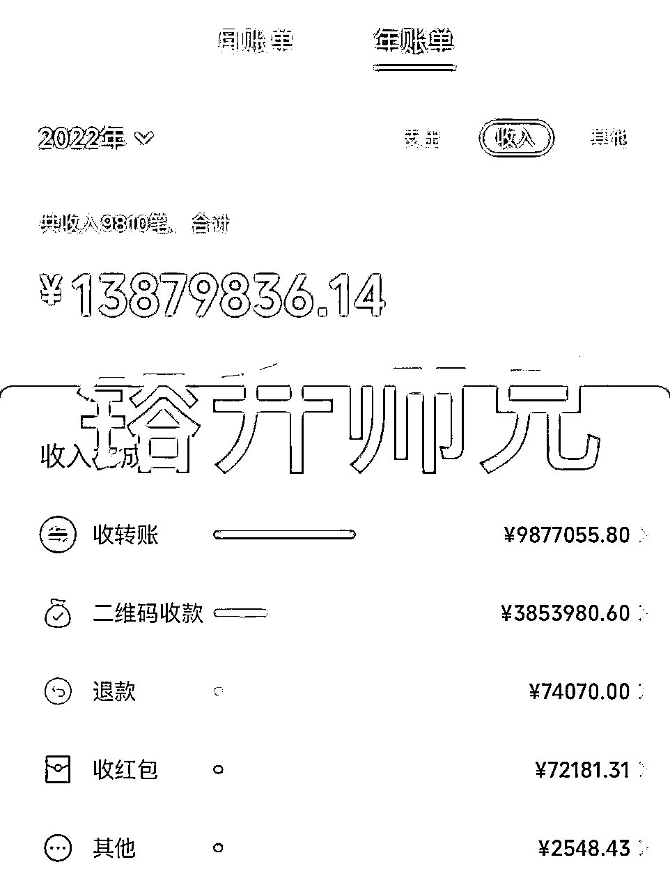
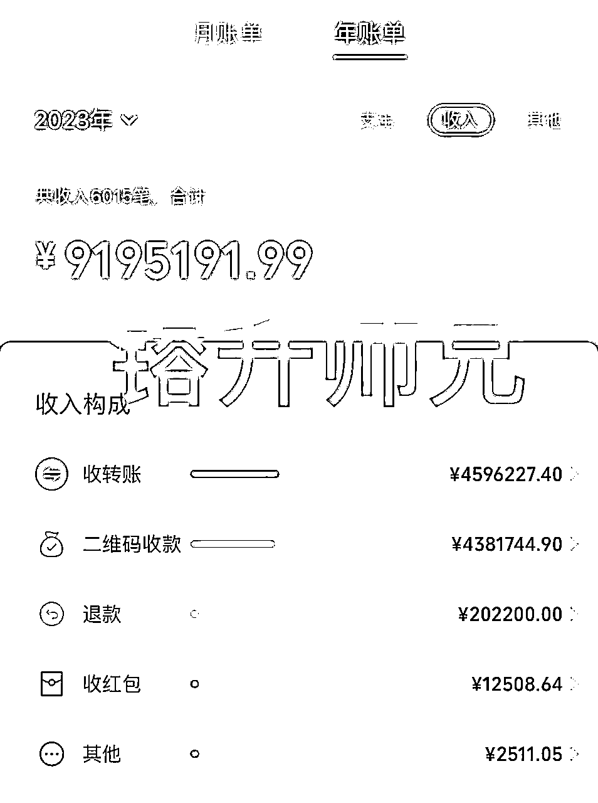

现在翻出2019年的朋友圈，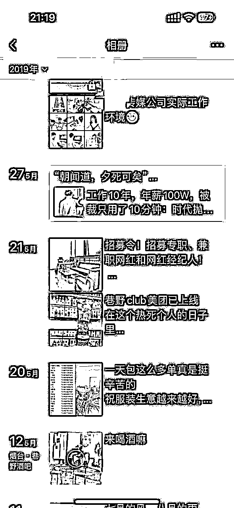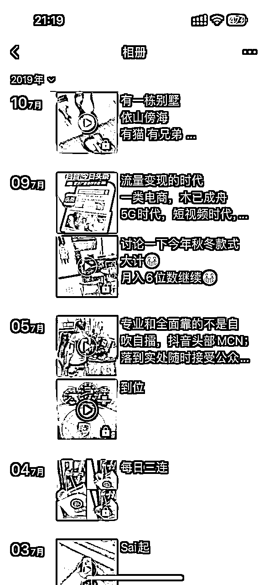满屏都是酒吧、传媒、服装，还有保时捷和“别墅靠海”。那时候的我，确实飘得厉害。别人还在担心能不能毕业，我已经开了好几家公司；别人抢不到回家的票，我已经开着奥迪回老家。人是从什么时候开始飘的？就是在最顺的时候，以为自己能一直顺下去。于是天天喝酒、社交、混圈子，慢慢脱离了业务一线。等发现问题，想收也收不回来了。

我反复复盘，把失败总结成四条：
第一，不聚焦。摊子铺得太多，每一个都没有做足功课。酒吧更是荒唐，纯粹为了面子，想有个地方跟人说“这是我开的店”。
第二，人和没跟上。天时、地利都占到了，但合伙人这关没过。靠谱的合伙人，比找一个能过一辈子的伴侣还难。
第三，心态浮躁。老板把酒局当主场，KTV当办公室，舞池当会议室，底下人哪还有心思去一线干活？
第四，缺乏预见性。我从没想过准备Plan B，也不考虑读研或考公来托底，只是天真地相信，运气会一直站在我这边。如今我不敢再犯这个错，每天都会问自己：万一主业务垮了，我的Plan B在哪里？

想明白这些，我开始行动。2020年，我从广西、浙江、山东喊来一帮兄弟，没有基础工资，大家一起聚在烟台做服装，只做私域。团队最多时十多个小伙伴。我们重资本押注供应链，私域、淘宝、拼多多同时铺，为了压缩成本，把价格卷到极致。可服装最大的痛点是售后率太高，加上我们根本不熟这个行业，面料、辅料、织布、拉链、卡扣、内胆、吊牌，全是现学。干到年底，团队平进平出，最后的利润是“赚了一仓库货”，自己兜里没落下钱。无奈解散。

服装做不下去，那做什么？答案是不知道。不知道，就出去闯。我问当时的女朋友（现在的老婆）：愿不愿意跟我去广州漂？她只说了一个字：走。这件事我感激一辈子。我的那些天马行空、不切实际的想法，她全都陪我扛过。没有她，我可能真的会在高压力下垮掉。

说走就走。叫来货拉拉，把烟台的尾货和货架全部拉回农村老家院子，然后三个人开一辆车直奔广州。2200公里，两天一夜。到了广州，一位漂了多年的老广朋友把我带到他的服装档口，又帮我们在城中村安顿下来。白云区石井服装市场的尾货，便宜到什么程度？论斤称。

那还等什么？继续干服装！这一次，又赶上抖音店播刚兴起，我们再次踩中风口。三个月时间，我们一边直播，一边把成交的客户都加进私域做复购。当时平台还不隐藏手机号，这一招让我们攒下了一大批真正的老客，直到现在他们还在下单。

运气好吗？好，每次都能踩在风口上。但运气也有代价。跟我一起去的那位硕士老大哥，快30岁，和未婚妻长期异地，天天吵架。爱情和事业，就像鱼和熊掌。抱起砖头，就没法抱你；放下砖头，就没法养你。21年3月我们到的广州，21年6月一天就能发600多票，电商利润、私域利润都稳住了，老大哥却决定回家。我表示尊重，虽然心里并不好受。

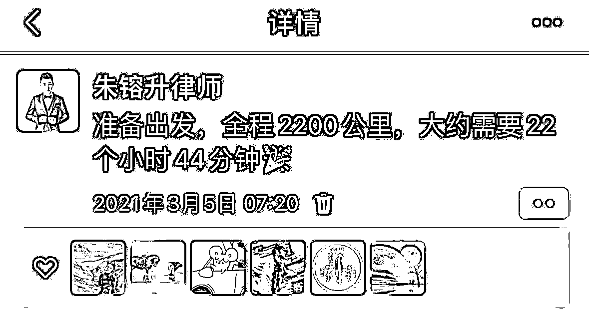
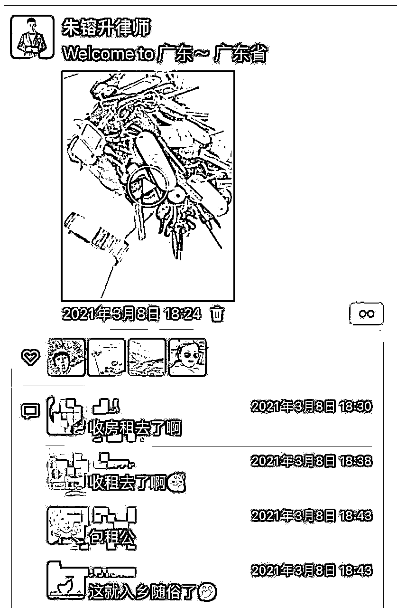
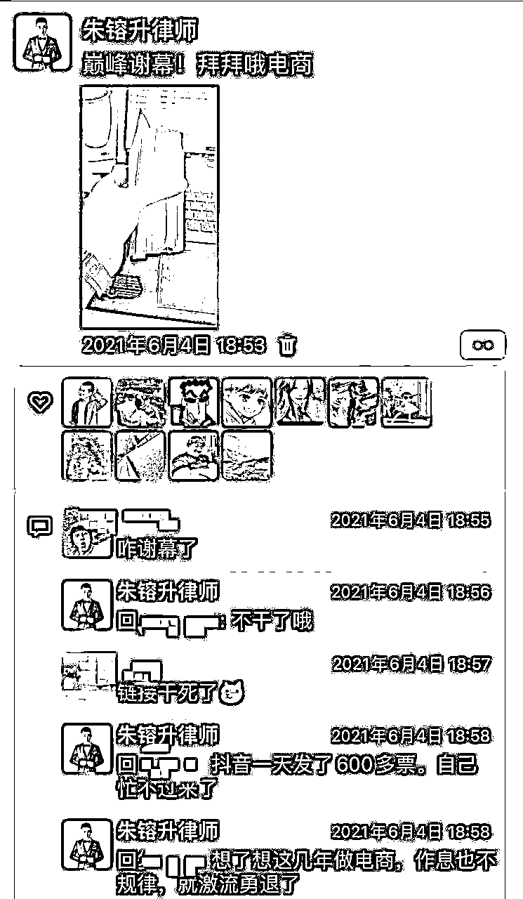

我们到现在关系还很好。每次我去烟台见商业朋友，都会喊上他。有一次他半夜打来电话，说如果当初再坚持一下，会不会不一样？我笑了笑：哥，我现在也是两个孩子的父亲了。以前我总不理解，为什么有人不愿意趁年轻多拼几年；现在明白了，有些遗憾，错过了就是一辈子。

兜兜转转，我又回到私域，但这次做的是大健康。没有对比就没有伤害。服装项目供应链不稳定，出货周期长，售后率高，项目周期短；大健康项目供应链稳定，客单价高，客户买了会复购，几乎不用售后——就算有，也只是产品不合适，换一款就行。复购率做到80%以上，这才是一门能长久做的生意。

关于运气，我越来越信一句话：走运走运，你得先走起来，运势才会来。所以我学会了聚焦，做一件一厘米宽、一万米深的事，坚持十年，远远好过一年做十件事。生意经也不是赌运气，而是像做实验一样，小成本测试，拿到反馈再放大。看清自己，找到热爱，然后深挖下去——这条路，其实并不挤。

这篇长文，是我八年的创业复盘，也是写给还在路上的你的心里话。如果有一点启发，记得点个赞，让我知道你在看。我是镕升师兄，愿我们都在各自选定的路上，越走越亮。

结婚生子之后，我才真正读懂了人民日报那句戳心的話：

人这辈子要扛两份责任，社会和家庭。

日出时就该把自己投进事业里，去承担社会的分量；
日落时就该收心回家，和爱人抱在一起，守好家庭的责任。

当年我只是照单全收，现在我才算是真懂了。

刚挂掉那位大哥的电话，我心里一直转着一个念头——要是在那个节点再多坚持一下，结局可能就不一样了。

世上所有可说的成功，本质上都是选对了方向，然后用时间跟韧劲把它熬出来。我现在仍是这么认为的。

服装这一摊是铁了心不碰了，那接下来又该往哪走？

### 【3】用三个月学法考，我把躁动的心沉静下来了。

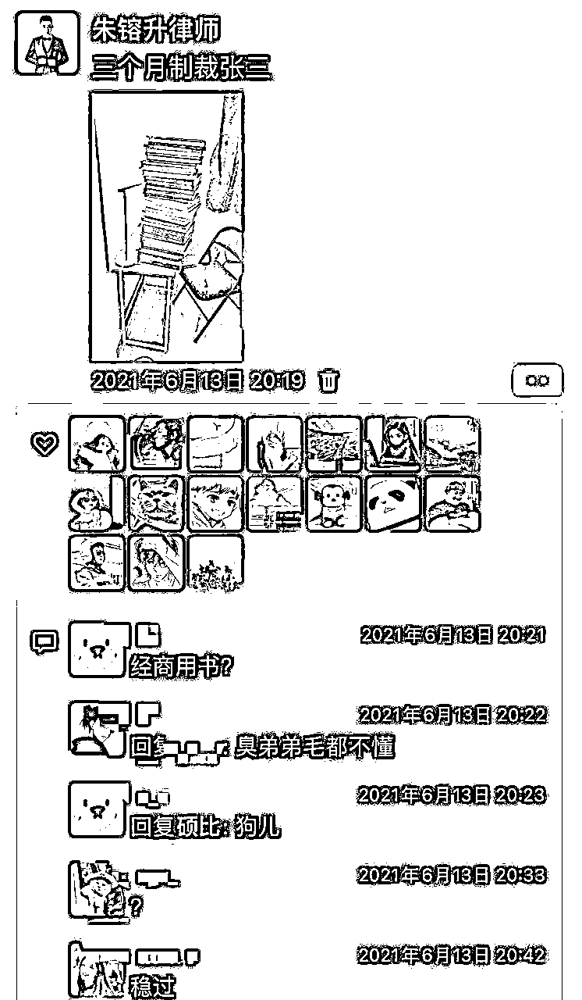

2021年6月4号，手里只剩下三个月的活钱时，我又开始盘项目该盘什么。

老婆说了一句很实在的话，你本科学的是法学，为啥不去试试法考，最差也没坏处。

一琢磨，好像有道理。

随手查了下报名时间，6月9号截止，9月份开考。
于是抓紧拍了证件照、买了教材、填了报名表。

6月13号我还雄赳赳地发了条朋友圈：三个月要去制裁法外狂徒张三！

要特别鸣谢罗翔老师，我的刑法基本上都是跟着他一路听完的。没有他的幽默，我估计早就弃坑了。

底子本来就薄，大二大三忙着做生意，课都没怎么上过，只能硬着头皮补。

没想到备考的这段时间，反而是把我从浮躁里拽了出来。

总书记讲过，每个人在闪光之前，都有很长一段缄默期。那段时间你付出很多却看不见回報，我们管它叫扎根。

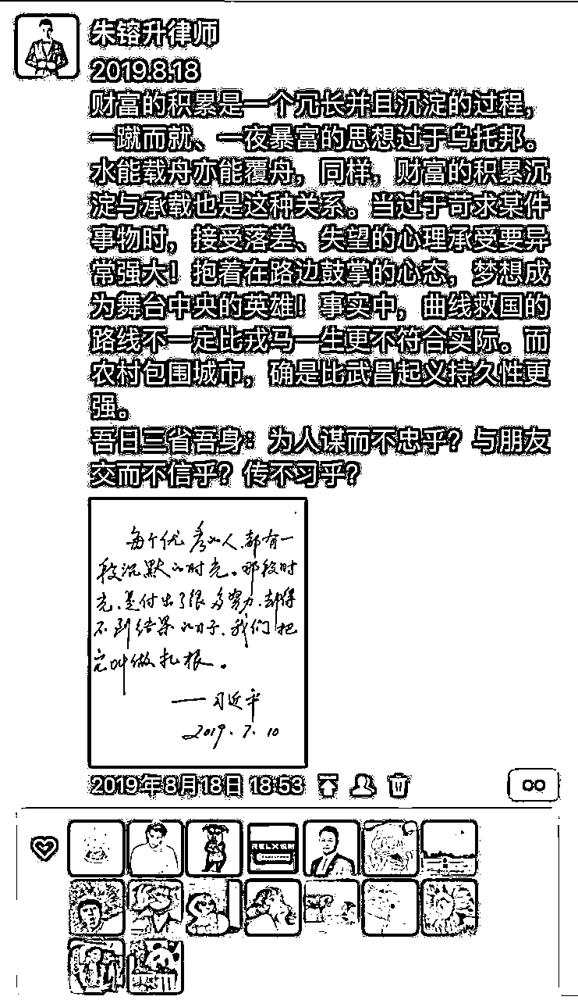

写到这儿，我翻出了一条2019年大学时发的朋友圈。真正让我沉淀和扎根的时刻，其实是在21年的广州。那间城中村的小屋，蟑螂很多，北面采光几乎为零。

备考说不上煎熬，我自认学习还算可以。谈不上过目不忘，但跟着书本听一遍课，七七八八就能记住，剩下的时间就刷题、偶尔开黑一把。

（备考期间我把英雄联盟从青铜一路打到了铂金）

学习本身枯燥，可你会慢慢发现，这些知识居然挺有趣，以后自己再做生意也能用得上。

于是我在一个个张三粪坑案、张三杀人案、张三制假案里，莫名其妙度过了几个很充实快乐的月份。

当时身边没人看好我，包括我老婆。毕竟对一个整天打游戏、还时不时开车去珠江新城看广州塔，甚至因为违反限行被扣满12分的人来说，考过法考才是最大的不可能性。

多亏司法部把我捞上了线。当时我还自豪地跟老婆说能超线20分，实际也就超了十来分。对我这种只求及格的考试来说，能过就行，我大学四年最擅长的就是及格。

还有个小插曲，在广州认识了一位做抖音内容的老大哥，后来他去了大杨和小杨哥那边做编导。

公司里的伙伴一个比一个强，抖音人均单条千万播放，努一把劲就破亿，全是自然流量。

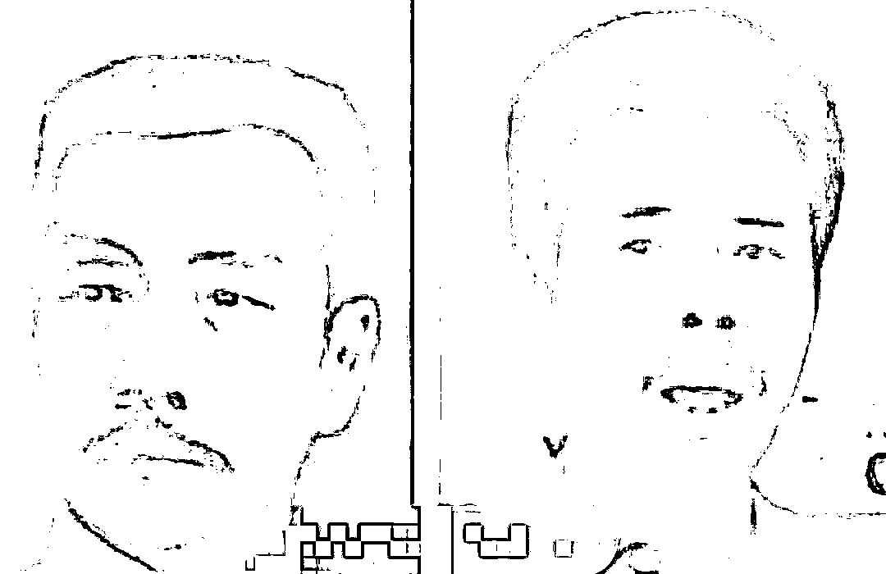

最近大家有没有刷到过那个收破烂的儿子和爱吃槟榔的爸爸的视频。

这就是我们当年一起做过账号的伙伴做的号，半年150万粉，我去看的时候已经快300万了。

这种形式的号，我们广州团队当年前后做了几十个。团队散了之后大家各自单干，全都做成了现象级IP。

那段经历在我心里埋了颗种子。事情其实没有想象中难，有一个好的创业土壤，有一群肯冲的小伙伴，是多么幸福。

所以我之前说过，人是环境的产物。现在我想补充一句，商业环境是时代的产物。

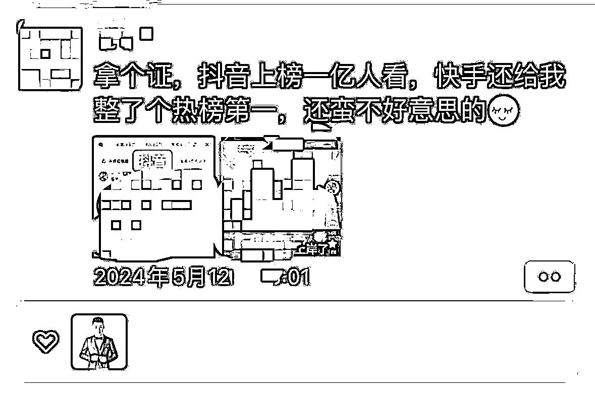

这是当时广州公司老板自己做的个人IP。

死磕内容、研究爆点，向他致敬。

他对我说得最多的一句话是，我要把公司的兄弟都做成合伙人。

参哥那句认真分钱，一起走十年，一直在影响我，我也会把这套做人做事的方式坚持下去。

法考通过后喜上加喜，老婆怀孕了还是双胞胎。

随后就迅速订婚结婚，结束了我们的广漂生活。

现在人在山东，但我一直怀念广州的那种从商氛围。等时机到了我一定还会回去。

广深两地，镕升对你们有执念啊！

### 【4】是金子在哪都会发光。

婚后回到山东，一边做律师实习，一边用私域继续做老客户的服装生意。

实习律师到手两千块，真的是被压榨。

可我这人就是打不死的小强，穷则思变，变则通，通则达。

大学创业的老友，这时候不少都跑出来了，有人喊我一起再创业。0到1他们已经跑通了，现在只需要放量。

里面有带百人团队的老板，也有三五个人一年几千万的小而美团队，还有投资人。

说实话，我起初一个都没答应。我觉得律师实习虽然不赚钱，但凭我自己的努力也能成为一个小富即安、能守护公平正义的小律师。

但有时候你想躺平，生活根本不给你机会。

2021年底，我拿着创业最后一点积蓄，家里也掏空了，我爸还帮我借了一圈亲戚，全款买了婚房。

房子都封顶了，谁能想到会烂尾。

得，本来想歇一年，结果一年没到又得拼了。

于是又去联系一批商业朋友，看看有没有人愿意收留，最起码工资比两千高点。

大概也是看在颜面和过往经历上，前合伙人给我递了橄榄枝。

底薪直接翻十倍，还加项目分红。

就这样开始了前端他做流量、后端我做转化的配合，也就是现在的大健康主盘。

干大健康之前我的想法很偏见，这不就是割韭菜中老年人的东西么，保证没有副作用才怪。

真正干了之后，我觉得应该全国推广。

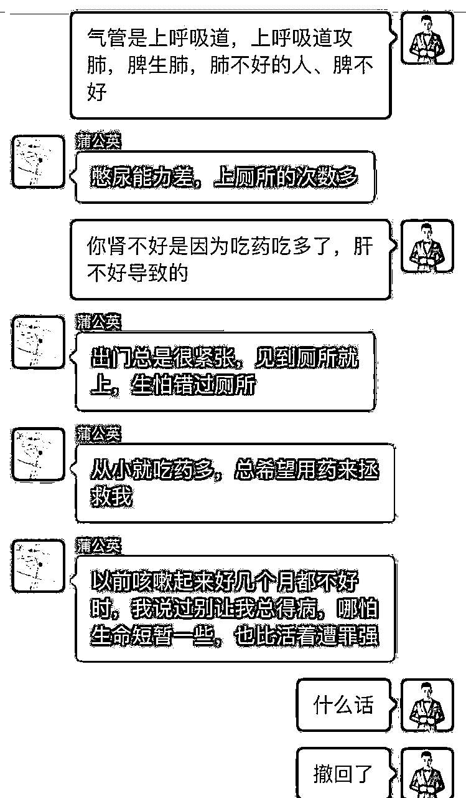

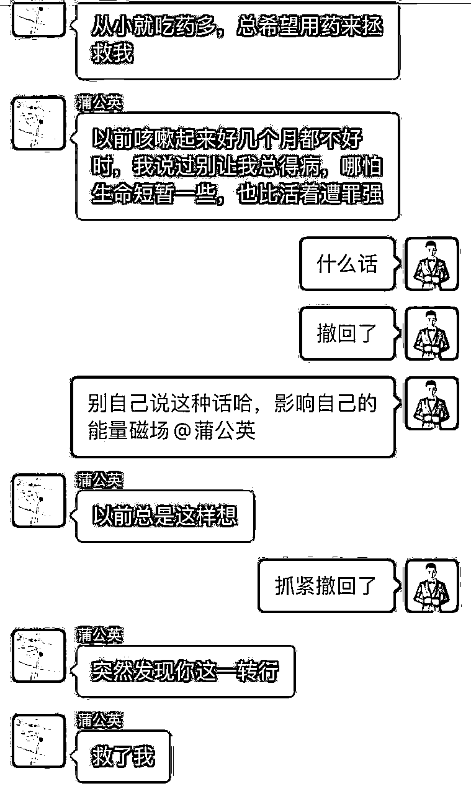

（如图是我家庭群里母亲跟我的聊天记录，我妈从小体弱，换季必感冒咳嗽，家里常年囤药无数）

这可能是站在她立场的表达，但我不想让她再这么说了。祝天下所有的妈妈长命百岁，身体康健！

爸爸们也一样！

（不招商不加盟，我们卖的是跨境保健品和药食同源的产品，淘宝都能买到）

后来我又在私域里做起了大健康网络销售，而且越做越顺。

起势靠流量，终局在供应链，成败看品牌。

所以上篇文章我才说我的运气爆棚，也希望能把这份好运分给屏幕前的你。

做服装那会儿，流水最高一年也能到八位数，但都是批发TO B，供应链利润薄得可怜。

做大健康后，这个行业真的能帮到人，客单价不低，利润率也不低。同样是八位数，利润能差好几倍。

品牌、营销、供应链、生产制造这四块，最赚钱的一定是品牌，有溢价在。品牌我们暂时做不了，那就做营销，营销板块的利润是最高的。

回头看2020年口罩元年，我们十几个人的团队为什么没赚到钱，因为我们做的是供应链，而不是利润最大化的部分。

这一点我非常认同参哥的观点：80%的利润，来自10%的动作。对大健康赛道来说，就是在供应链扎实的前提下，不断做流量、做转化，让客户复购、不断上新SKU。

客户体感好，慢病得到改善，老客户裂变、新客户进来，私域就成了真正的睡后收入。

当一个业务体量足够健康，你又真的在帮助人，财富只是顺带的自然结果。

从商业角度拆解大健康：

一、盘子足够大，万亿市场。
二、客单价足够高，有钱人最怕死。
三、客单价高，利润率自然高。
四、体感好，裂变强，调理一个人的时候，家人朋友都会跟过来。
五、富人的钱好赚。我们每年消费5-10万的客户有一百多个快两百个，这部分贡献了我们业务80%以上的利润。

我的初心很简单，我能帮我妈改善慢病，我也想帮天下妈妈解决健康问题。

我们这一代人，二十岁就出现脂肪肝三高，富贵病都是富足带来的。现在人口老龄化加剧，健康和亚健康是全民刚需。

商业周期就像人生，有起点就有终点。我经历过多次失败，这次我想抓住这个周期，做一份真正能帮到人的事业。

我的梦想是能做一个真正有价值的大健康品牌。

赚钱圈的大佬很多，如果你是做大健康供应链的，认可镕升的想法，给我一个机会，我愿意在这个赛道深耕下去。

给正在坎坷中的哥哥姐姐们一句心里话：

伸手摘星，即便一无所获，你的手也不会沾满污泥。朝着最好的方向去做，怀着最真诚的心愿，无论此刻多难，都能扛过去。

花会再开，春天一定会来，你要做的只是安静等待它到来。

### 【5】写在文末，说点心里话。

这三篇文章更多是流水账，学生时代的内容偏多，因为那段日子相对滋润。毕业成家后压力其实很大。

我尽量用开玩笑的口吻和主观反思来聊过去，以及我对商业的理解，只是想传递一些积极向上的力量。

屏幕前的你如果也遇到了困难，别借网贷，别去赌。

财富是对认知的补偿，不是对勤奋的奖励。

穷则顺势而为，富则因势利导。

我也曾无数次失眠，也曾抱怨命运不公。

但无论怎么想，明天的太阳都会升起，所以在乐观和自信里，我们只能选择更相信自己。

最后谢谢我老婆，谢谢她陪我度过懵懂的少年，陪我走南闯北，谢谢她给我生了两个宝宝。

一定要多听老婆的话，特别是膨胀的时候。

爱妻者风生水起，亏妻者百财不入。

以后我会在龙哥盟分享一些流量、私域运营的经验，如果你觉得有用，点个赞就行。

我们素未谋面，但我希望我的文字能温暖到你。

又写到凌晨12点多了，这种流水账我自己都不想看，感谢看官能看到这里，给你鞠躬了！