# 50多场私域群发售操盘实战复盘，累计业绩破400万，整个发售方法论全拆给你

> 来源：[https://pqu5cbjcjoy.feishu.cn/docx/NsmTddUE4oMS0HxApSLcAdpLn4d](https://pqu5cbjcjoy.feishu.cn/docx/NsmTddUE4oMS0HxApSLcAdpLn4d)

赚钱的伙伴们好，我是彩卉。非常感谢赚钱这个平台给我分享的机会，也要特别感谢理白老师、靠谱老师在我定位梳理和内容打磨上手把手的托举，感谢芷蓝姐在思路上不断点醒和答疑，感谢小鹿协助润色和传播。

从去年10月开始转做私域群发售操盘，到现在正好半年时间。累计操盘50多场私域社群发售，累计业绩已过400万。今天把我做发售的底层思路和完整执行路径全部摊开，希望能帮圈里的朋友少走弯路，实现转化。

很多老板都在做知识付费或者卖货，产品虽不相同，但决定结果的往往是渠道。现在带货的渠道有公众号、朋友圈、直播间、社群。群发售的价值就在于能把这些触点串起来，短时间内占据用户心智，先用社群公开课把产品讲透，再通过直播和社群互动拉近距离，把转化率拉满。

群发售可以说是每个IP的标配技能。哪怕一年只做1到2场，也能把沉淀的私域一次性激活。卖实体还是虚拟，方法论都通用，都能助你完成业绩目标。

今天的分享框架如下：

一、什么是群发售

1、什么是群发售
2、为什么要做群发售

二、群发售全流程总览

阶段一：预售+筹备
阶段二：预热+发售
阶段三：追售+复盘

三、预售+筹备阶段
四、预热+发售阶段
五、追售+复盘阶段

话不多说，直接开始。

# 一、什么是群发售

### 1、群发售的本质

群发售就是用一场公开课来聚拢用户，把自己的产品集中在社群里批量成交，形成爆发式出单。简单说，就是我有一个产品，用一场公开课活动一次性卖给我的用户池。

### 2、为什么必须做群发售

1、 对知识付费：能把成交和交付拆开，一场活动把一年的业绩先锁定，活动结束后安心带交付，学员出结果更聚焦。发售期和交付期并非完全隔离，只是比例会调整。
对实体产品：一年四个季度，规律做促销节点，比如门店会员卡、减脂套餐集中发售，都能为全年业绩添色。

2、批量成交会形成圈内事件，势能起来更快。一次性几十万上百万的体量，远比一年平摊100万来得有影响力，更容易造势。

3、发售过程中自带流量裂变机制，活动结束后还能持续带来新用户增长。

4、业绩体感极强，3到5天的活动，很容易拿到3万到100万的成绩单。

5、快速激活私域。发售会用高频私域触达，让用户在几天内全面认识你和产品。朋友圈里一个新用户要一个月才能从0到1了解你，发售5天集中输出就搞定了，大幅缩短决策周期。

6、有利于案例沉淀。一次收30人，总有人能出结果；一次只收2、3人，样本太小，变量太多。大数据出来，后续招生会顺滑很多。

弄清楚价值后，就来看怎么落地。

# 二、群发售流程一览

发售分为前后中三段：预售+筹备阶段、预热+发售阶段、追售+复盘阶段。

### 阶段一：预售+筹备阶段

要明确三件事：
1、这次要卖什么产品？卖点是什么？卖点说清才能有的放矢。比如卖赚钱有术社群，卖点就是课程丰富、小白友好、赛道覆盖全。
2、为了卖产品要做一场社群公开课，要定好主题和大纲。比如卖赚钱有术，大纲可以是开营仪式、互联网变现指南、6个变现案例、航海介绍、结营仪式。
3、物料筹备。
4、私域预售宣发，不是直接卖，是预热铺垫，比如分享“我靠社群拿到的成绩”“我是如何通过社群变现的”“我的学员跟着我学社群后有什么变化”。
5、人脉布局，发售需要多方托举，需要运营、互动、kol/koc拉新裂变，提前链接好，关键时刻互相扶持。

### 阶段二：预热+发售阶段

核心分两块：预热+发售。
预热：建好公开课群，并通过朋友圈、私信、公众号、视频号等渠道把人拉进来。
发售：在群里按计划上公开课，边讲干货边把产品讲透成交。

### 阶段三：追售+复盘阶段

活动进入尾声，重点做追售谈单，询问用户对公开课的感受、是否加入；同时开复盘会，复盘业绩好的原因，比如产品利他、老师专业、服务负责等，变相二次强化卖点，再收一波转化。

框架有了，下面逐项拆解。

# 三、预售+筹备阶段

### step1：确认发售产品，采用2-3个梯度

建议做2到3个梯度，比如社群运营私教年度9800、社群运营标准课899、社群运营陪伴群199。产品要相关，别混赛道，比如小红书标准课+小红书私教可以，小红书+公众号就难讲。一定要设一个主产品，其余作补充。

不同梯度能承接不同需求和付费能力。

产品呈现离不开海报。

#### 1、知识付费私教产品海报通常包含：
课程标题、讲师介绍、课程体系、交付权益、附加福利

重点说课程体系和交付权益，很多人会混。
课程体系好比学校的语数外理化生。是学员能学到什么。用户问“孩子能学到什么”，你答“语数外理化生全程辅导”。对应到产品，用户问“跟我能学到什么”，你答“从A/B/C/D/E五个维度全方位提升xx能力”。比如私域运营私教，我会设定位、产品、流量、转化四大体系。
交付权益好比学校提供的一对一咨询、器械使用、实验室开放、随时约老师。对应课程就是一对一不限次数咨询、渠道佣金、平台背书共享等。

把这两块打磨好，产品就完成90%。下面是我为美业客户做的海报分镜：

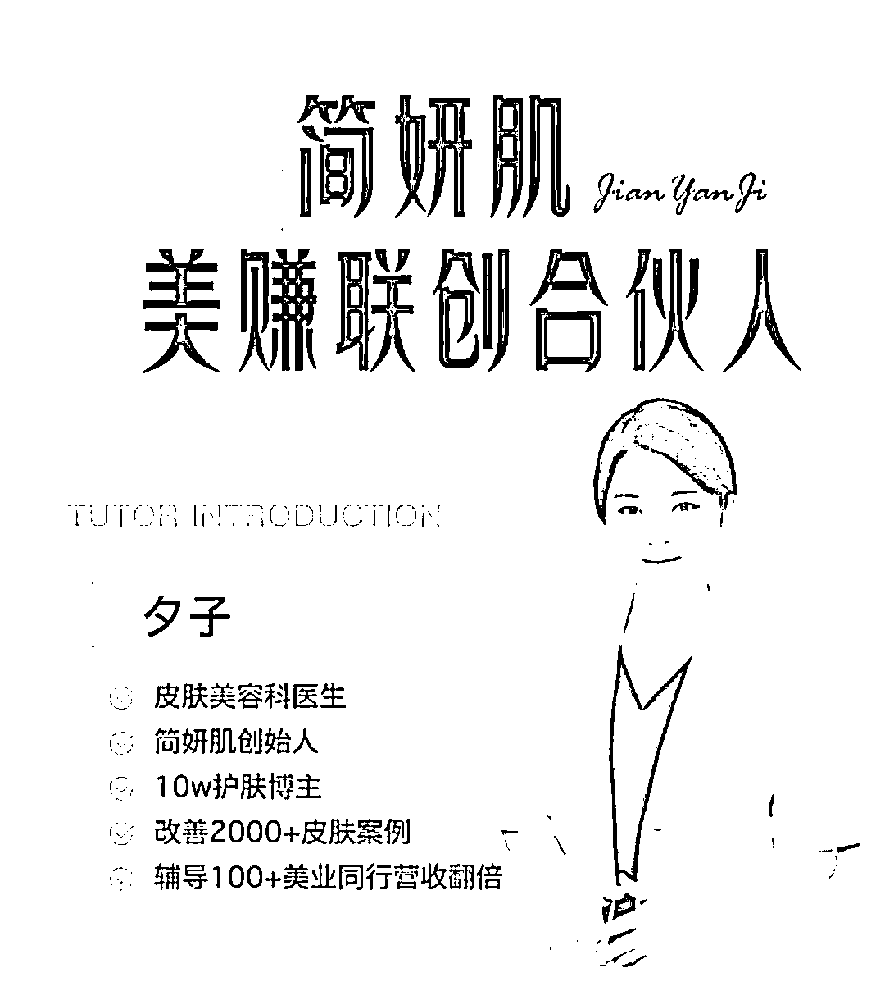

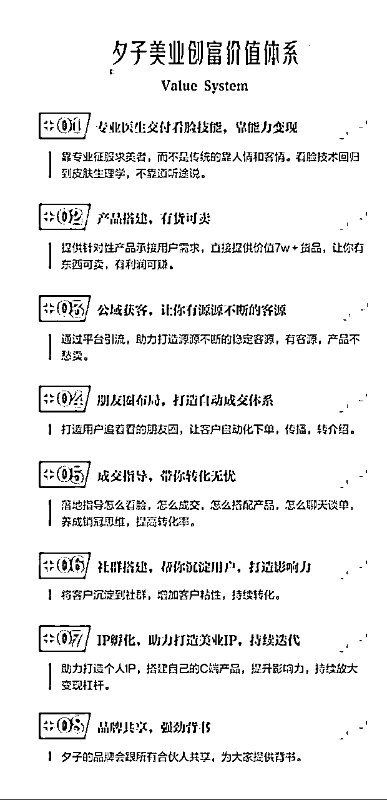

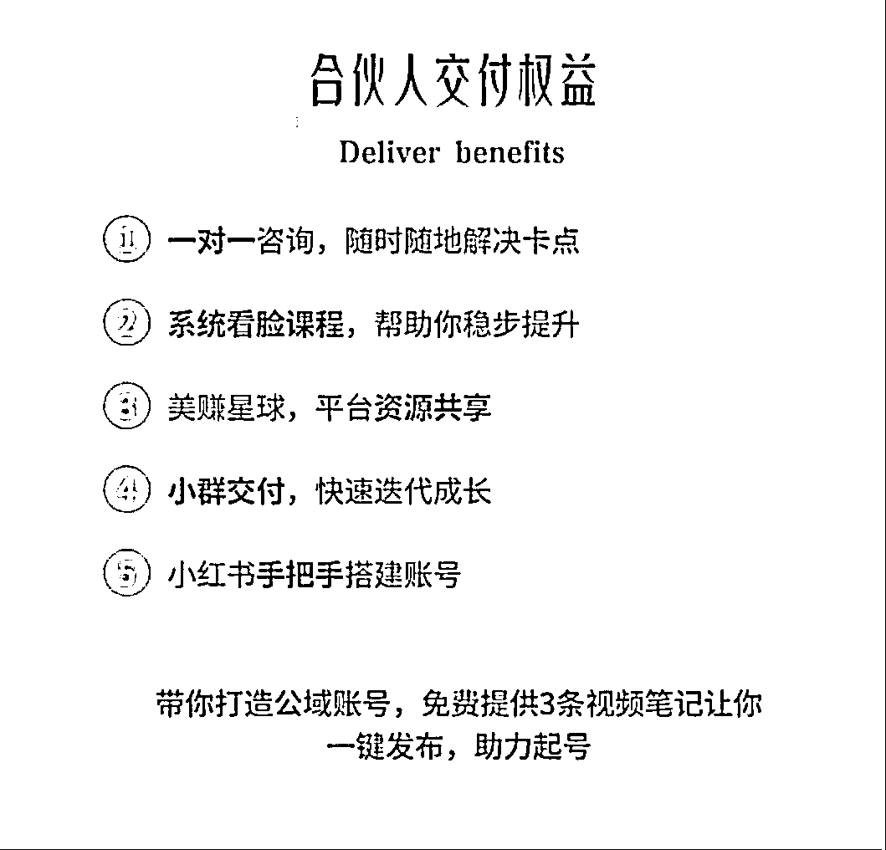

#### 2、知识付费标准课海报包含：
讲师介绍、适合人群、课程大纲、价格

#### 3、咨询类产品
讲师介绍、解决什么问题、购买权益

#### 4、实体产品
产品介绍、功效、购买权益/福利、适合人群

产品确定后，就要筹备公开课。

### step2：筹备公开课标题和大纲

社群发售的核心是公开课，公开课要有主题和每日大纲，注意是公开课大纲，不是产品大纲。

筹备思路：
先确定围绕产品讲什么。比如产品是私域运营课，公开课就围绕私域运营展开。

标题规律：主标题+副标题
主标题：突出人设和故事，拉近距离。如《99年无资源无背景的女研究生，如何通过做社群赚到第一桶金》
副标题：直述课名。如《IP私域社群变现公开课》

课程框架围绕“能帮用户什么”来设，常用模板：
DAY1：个人经历破冰。如《99年无资源无背景，靠社群赚到读研学费，请所有人都要去做社群》
DAY2：赛道卖点输出。如《人人可做，10种社群变现模式大揭秘》
DAY3：学员分享+干货1《5大维度，打造最适合你的社群定位》
DAY4：学员分享+干货2
DAY5：学员分享+干货3

举例参考：

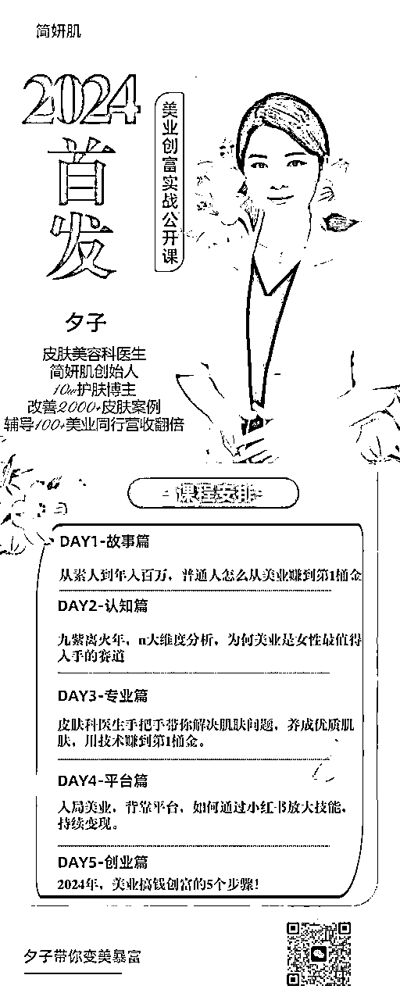

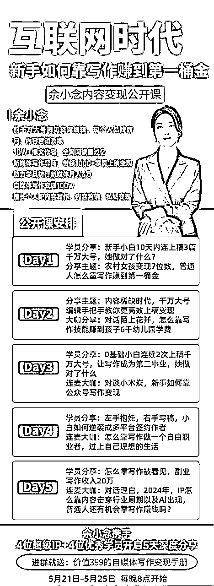

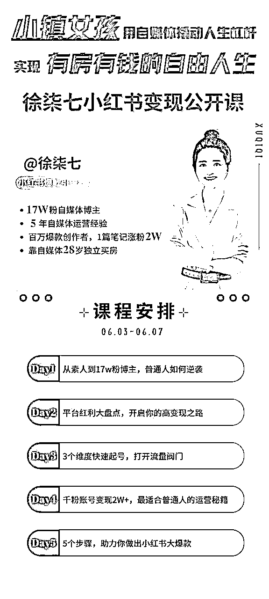

补充：新品内测方法
公开课里学员分享很关键，用来给用户看结果。如果是新品，记得先内测。

内测方法一：直接拿发售当内测，首发低价测试市场反馈
内测方法二：稳步测试
Step1调研意向：先问身边朋友和目标用户是否感兴趣，期待什么交付形式，用问卷或私聊。
Step2小范围邀请内测：设名额/时间限制，筛选执行力强的成员，给福利和折扣。
Step3交付+收集案例：交付过程中做回访收集反馈，及时调整流程和交付方式。

多数产品市面上已有参考，内测可省略，除非是小众蓝海。

公开课要像试吃装蛋糕，干货才有人买单。标题里一定要有方法、结果、案例三个元素任意组合。比如《99年无资源无背景，靠社群赚到读研学费，请所有人都要去做社群》=案例+方法。

到这里，产品和公开课两大核心就定了。

### step3：预售

预售就是提前锁定。像双十一付定金锁产品。

作用：
1、提前出业绩，降低发售期压力。比如目标20万，预售走10万，压力减半。
2、发售期业绩好看，产生羊群效应。运营官会在群里发成交喜报：“恭喜xxx成功加入xxx私教班”，别人看到就会跟进。

玩法围绕内容维度和平台维度：
内容维度：从不同角度为产品做铺垫。比如卖小红书私教，可以发你在小红书的成绩、学员变现案例、日常运营、接商单变现等，最后在朋友圈或评论区透露大事件：“我在筹备小红书大事件，想要了解的私信我~”
平台维度：公众号、星球、社群、视频号直播、朋友圈多渠道复用内容。

### step4：准备福利矩阵

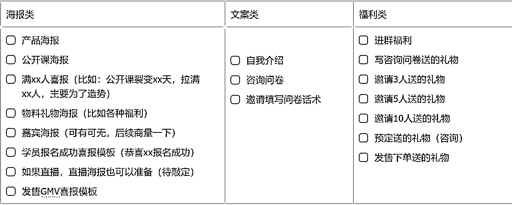

把图存下。营销本质是社交，想让用户做动作，就要给好处，自来水不可靠。

进群给进群福利、填问卷给问卷福利、裂变给裂变福利、下定金给定金福利、下单给下单福利。福利尽量是零编辑成本的电子书、标准课等，送1个和送100个成本一样。

福利也是破冰工具，发福利时顺势了解需求，精准成交。

### step5：社交布局与联盟打法

一场好的发售不是单打独斗。联盟打法很常见：主理人负责分享和成交，老师一起直播连麦拉新、做社群分享、带团队。下面提到的彩卉、靠谱老师、理白老师、芷蓝老师就是互相托举的典型。

多链接、多社交、线下见面，提前透露大事件，邀约朋友帮忙，是必做动作。

至此，预售+筹备阶段全部就位。台上一周，台下半年，事前筹划决定成败。

# 四、预热+发售阶段

进入实战阶段。

### Step1：人员分工
主理人：拉新、分享、承接流量、成交
运营官1-2人：拉新、群内维护
分销成员：若干

### Step2：建群预热
预热只做三件事
1、往公开课群里拉人

新一轮扩量启动，先把拉新的责任压实到每一个节点上。主理人、裂变团队、分销伙伴、KOL，谁在场谁就要去动。参与的人越多，种子进来得越快，最后能转化的盘子自然就大了。

用什么方式去拉？朋友圈、公众号、1对1私信，都可以轮着上，而且要一直发、反复触达，让用户在不同场景都被碰到。

群里人数每到一个小里程碑，就立刻发战报、造势。这种喜报会形成羊群效应，后面的人看到热度会自动跟进来。

喜报和倒计时如下：

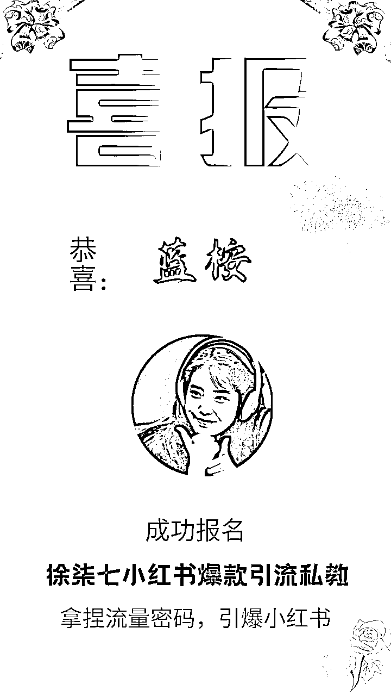

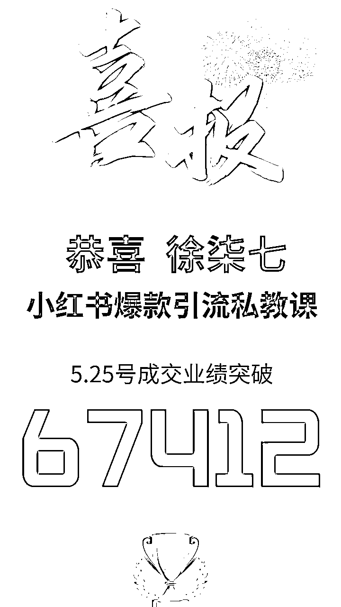

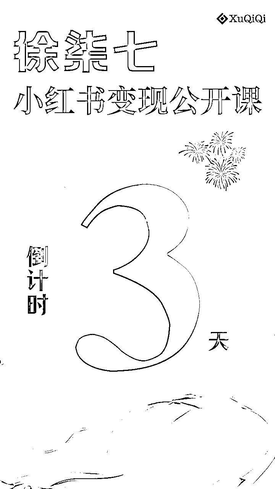

一场接着一场，浪潮式推进。

4、开群的标准要统一

（1）群名：简洁清晰，直接点明活动属性，比如【彩卉丨社群变现公开课1】

（2）群公告分三块来写
欢迎语+讲师介绍+课程安排+课程福利+课程规则

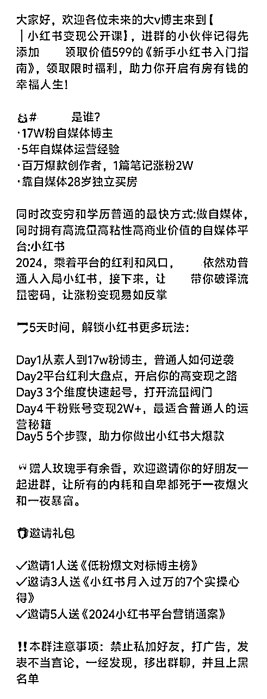

（3）欢迎私信文案：先欢迎，再做裂变引导，再引导加老师一对一

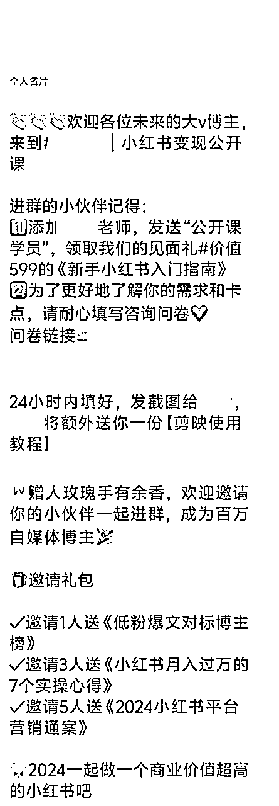

预热期的动作到这里就收尾了，接下来进入正式发售阶段。

### step3：正式发售，分两条线来看

方向一：整体节奏规划
方向二：每日执行细节

方向一：整体节奏规划

公开课的上课形态大致分两种，一种是社群图文分享，一种是直播发售。这两种形态的投放节点是不一样的。

图文分享，建议从第三天开始才露出产品。
直播分享，则可以在第一天就开始露出。

原因很简单，直播是面对面的，你的人设、状态、信任感会被直接感知，用户觉得真诚，更容易接受推销。
而图文是看不见人的，只能靠文字感召，太早硬推会让用户觉得上来就卖，体验很差。

所以图文和直播何时切硬广，记准时间点很重要。

第3、4天要加大宣传力度，主攻促单。预热期主打的是拉人进群，发售期核心就换成成交转化。私域的内容策略也要跟着切换。

最后一天用倒计时来制造紧迫感，每发一张倒计时海报，都配一段认知升维或促单话术，从多角度做好植入。

方向二：每日细节安排

第一步，每天早上先做当日预告。告诉群友今天会讲什么，为什么要讲这块，引导大家晚上来听。

举例：

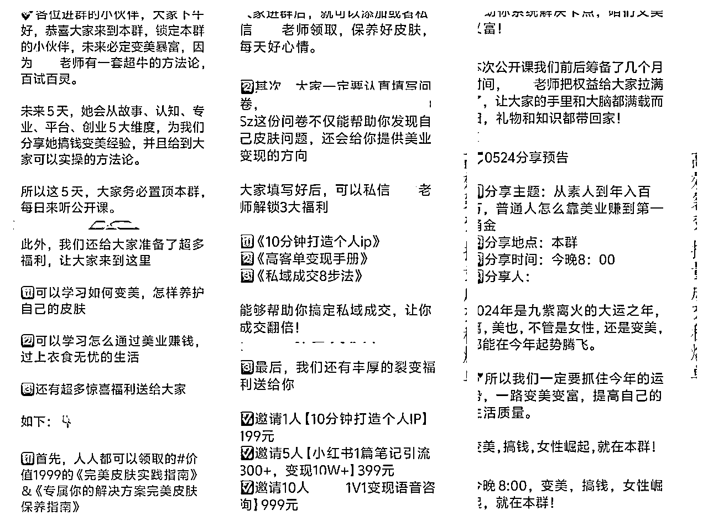

第二步，分享开始前做一次热场。像主持人开场一样，先做一个柔和的引入，避免分享突然开始，让人猝不及防，要做到丝滑过渡。

举例：

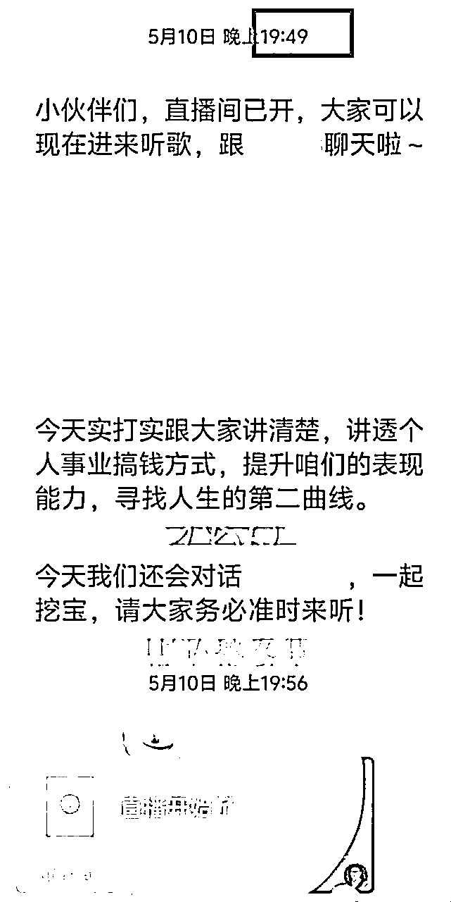

第三步，进入正式发售环节。社群就按社群流程走，直播就按直播流程走。内容提前准备好，稿子和大纲都要成型。

老师讲完后要有收尾谢幕。收尾环节要做到：

（1）引导提问、复盘、下单
（2）给用户完整、舒服的观感，有始有终
（3）在收尾话术里自然做一次销售动作

举例：

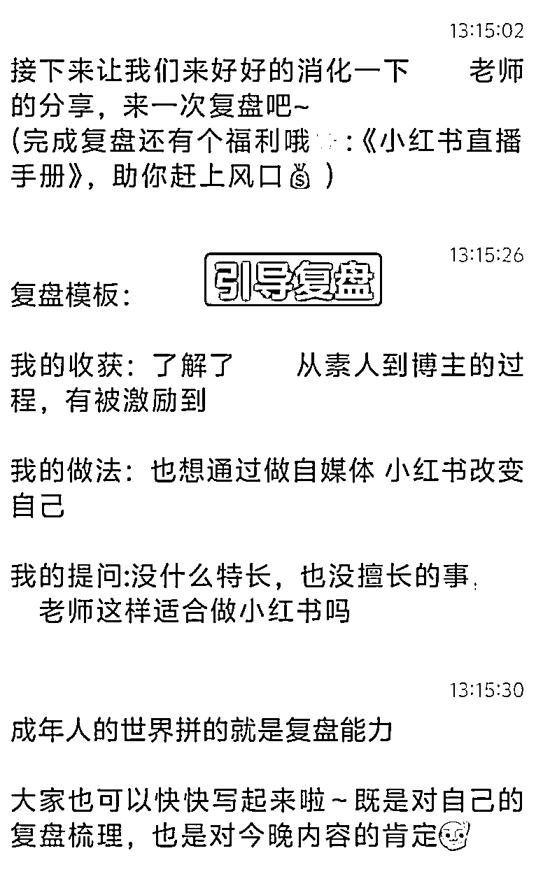

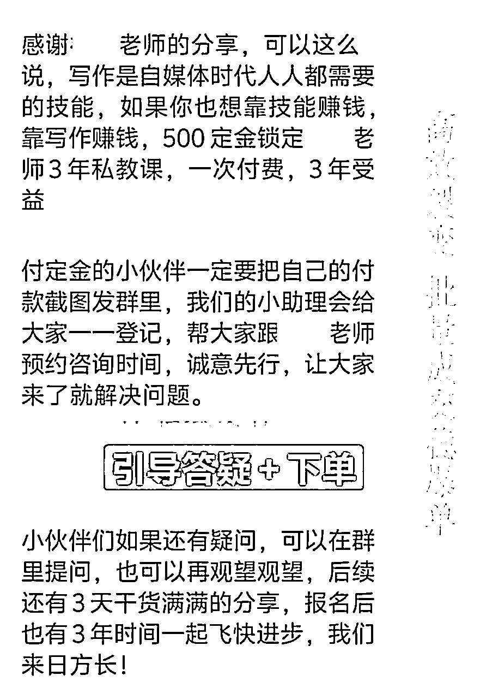

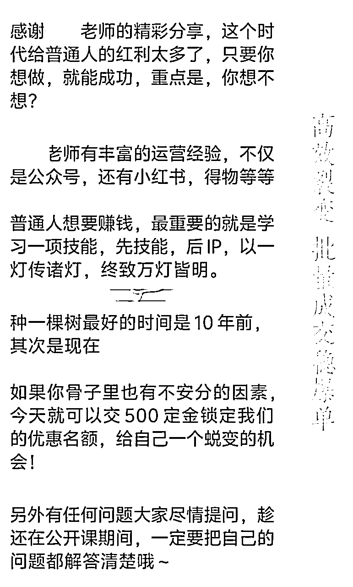

这时候就会有用户陆续下单。立刻在群里报喜，恭喜新加入的小伙伴。目的有三点：

（1）制造羊群效应，避免群里冷场
（2）给新伙伴仪式感
（3）给团队打鸡血

举例：

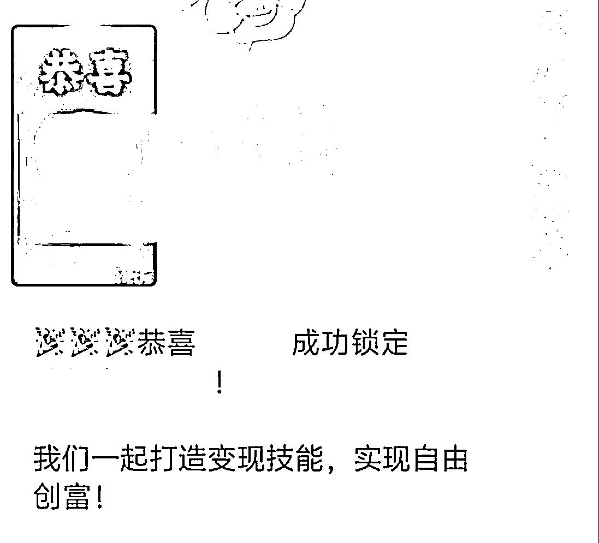

### step4：私信谈单成交

私信跟进是贯穿整个发售周期的，不是只有后期才用。预热期也有成交机会。下面不讲销售技巧，只讲埋钩子的方向和可用的方法。

（1）铺垫大法
想让用户买单，就要多维度反复展示产品价值。

a：写内容和讲内容时多放真实案例
例如：“标题方法1，要会用数字对比……比如我之前一个学员，改前标题是A，改后标题是B，这里就用了数字对比，改完直接进池……"

b：答疑时也要多举例，多讲能交付的部分
例如用户问：“老师，孩子青春期逆反，坐不住写作业，您的家庭教育咨询能解决吗？”
答：“可以的，这位家长，这个问题比较常见。我很多学生最开始来找我时都是这个问题，是因为……后来通过……方法调整了学习习惯和态度，现在已稳居班级前10。您可以先付定金，我马上给您和孩子做一次咨询……”

c：控评时顺势植入
例如有人在群里乱发广告引流
你可以回：“不建议用这种恶意引流的方式，大家都来学习，你不想学也别影响想学的人。不如用内容吸引人，就像我们一样，如果你不会做内容引流，建议跟我们系统学，别用这种招人骂的方式了……”

（2）成交流程
第一步：肯定用户，站同一阵线
不要为了成交否定用户。
比如卖健身卡，可以说“小姐姐身材已经很好了，再练一点点肌肉会更健美”。
比如卖家庭教育咨询，不要说“孩子情况很严重不学就完了”，要说“孩子的问题很常见，是能解决的，而且这孩子看起来很聪明，从言行能看出他很想改变”。

第二步：深挖需求，找本质
用户问：“老师，这课能保证变现吗？我做过几次账号都没做起来。”
表面问的是保证不保证，本质是：他想知道怎么把账号做起来。
所以不要只回能或不能，要回：我猜你问这个是因为之前没成功，所以想知道我会怎么带你。账号做不起来不代表你不够努力，反而说明你有韧劲。问题更可能在方向和方式，我会从这几个路径帮你……

第三步：规划路径
例如：你现在先调整定位，目前方向可能不太适合你；我建议你把封面和标题先改一下……把这几块调整好，账号很快就能起来，后续引流或接广告都会顺畅。

第四步：给案例
我之前有一个学员问题跟你很像，按这个调整后现在8000粉，广告报价7、8千了。

第五步：引导下单
如果用户认可了，就可以说：“您可以先付500定金，我给您做一次一对一诊断，觉得合适再补尾款，不合适定金原路退回。”

私信成交+群内发售=组合拳

预热+发售到这里基本完成，接下来进入最后一个环节。

# 五、追售+复盘阶段

公开课结束不代表结束。很多意向用户还没被私信跟进，交了定金的尾款也要收回来。

课后通常有1-2天追单期，主动私信用户，帮他解决问题，在解决问题的过程中自然推荐产品。

发售期是你一年里私信别人最不会被怼的窗口，话术方向给你几个参考，别照抄，根据用户和产品调整。

（1）你好呀，公开课已经结束啦，你有做复盘吗？说说你的感受，我送你一份xxx
（2）您好，公开课结束了，您对xxx也有了解了，做好这一块不仅能帮你xx，还能帮你xx，如果想深入了解我们的产品，想约一次一对一咨询，可以回复1哦
（3）您好呀，看您在群里提过一个问题，现在解决了吗？您也有兴趣接触xxx赛道吗？
（4）您好，看您在公开课期间很活跃互动很多，为感谢您的支持，送您一次一对一咨询，您看什么时候方便约一下。

等等……

私信追售的成交量通常能占前期发售的30%-50%，绝对不能忽视。

追售告一段落后，就要正式收尾了。

收尾倒计时如下：

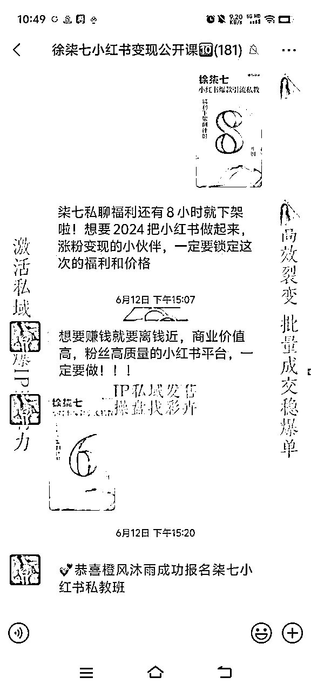

这时给本次发售画个完美句号，开启复盘会。

复盘会案例如下：

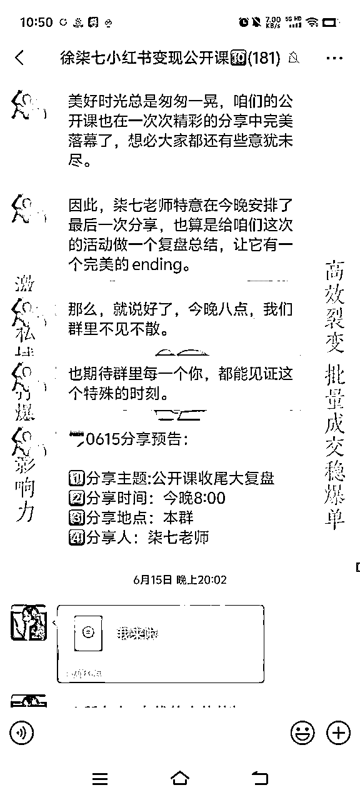

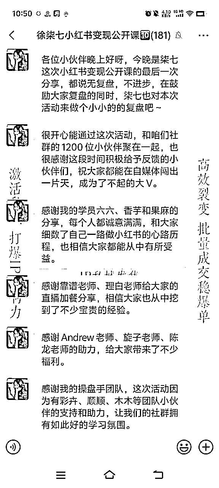

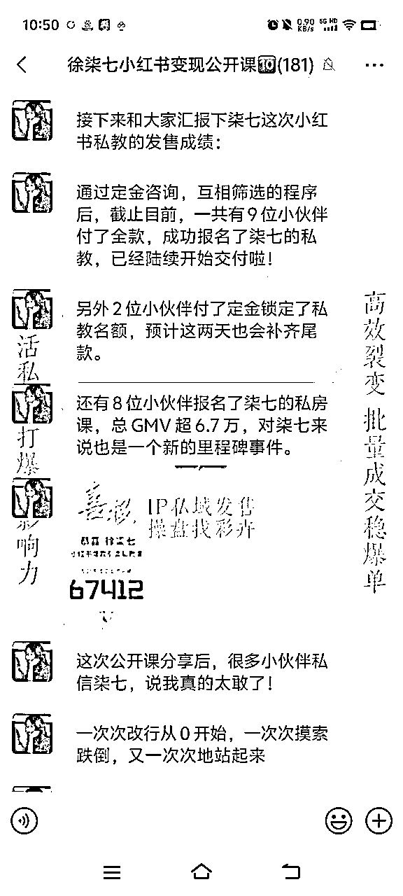

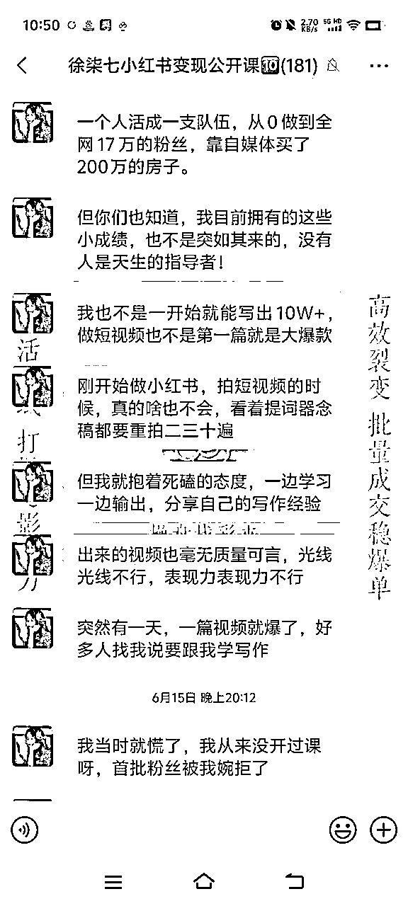

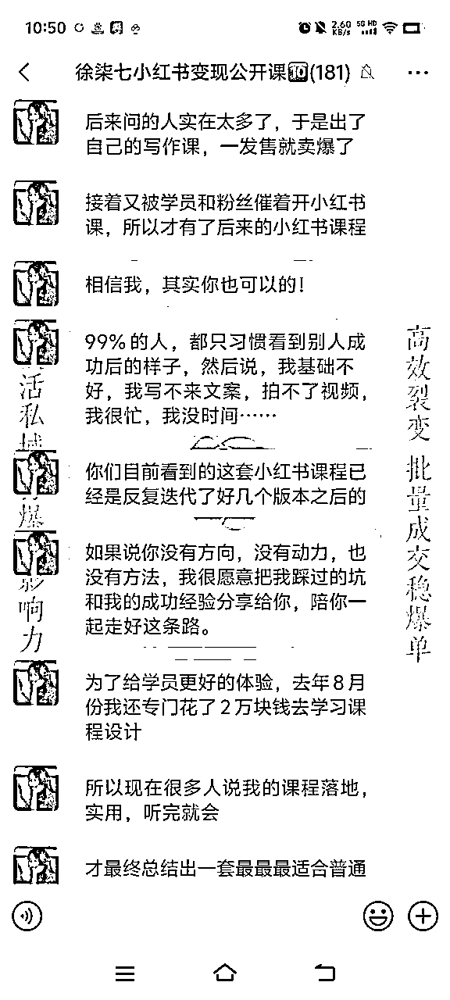

复盘会的核心作用是追售+二次成交

通过总结本次发售，再次强化产品优势和价值，同步公布战绩。

part1：报喜造势，公布本次发售的成绩
part2：复盘成功原因
a：产品过硬
b：交付过硬
c：团队朋友助力托举，人缘好
part3：感谢参与的小伙伴
part4：再做一波收割

最后用一句仪式感的收尾语结束本次发售，接下来安心带人、安心交付。

我的分享就到这里，希望对大家有帮助，也祝大家在6、7月能筹备一场轰轰烈烈的发售，批量成交，稳稳爆单！