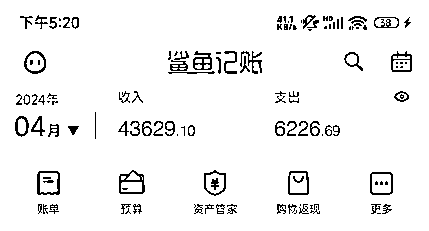
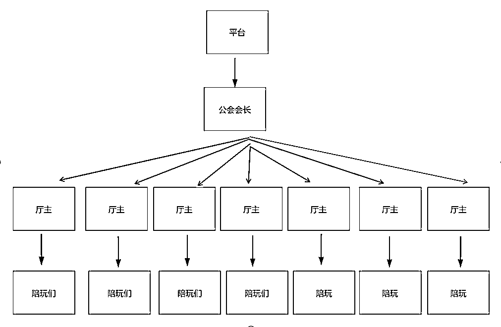

哈喽，各位圈友，我是XX。现在我的主要方向，一头是AI写作，另一头是线上游戏陪玩。

疫情刚来的那年，我从一家上市公司的亚马逊运营岗辞职，回到长沙发展。辗转做过游戏陪玩，也当过语音厅的厅主。收入嘛，低谷时一个月只有几百块，高峰时也冲过月入8万，可最后却背上了20万的债。去年会员日，我一身债进了赚钱圈子，折腾了一年，总算在今年踩准了适合我的路子。年后从零入手新方向，没靠任何人，独自扑腾了不到100天，还掉了6万欠款，现在还欠14万，最高一个月做到了4万多。

今天想把这些年的弯路和收获都摊开讲讲，有认知上的反思，也有实操层面的经验。真的很感激赚钱这个平台，在这里见了太多项目，最终也让我找到了与自己契合的那一个。写得不够好的地方，大家多多包涵。

# 一、从陪玩小白到语音厅厅主

我是个重度网瘾少女，早在17、18年就试水过陪玩圈。那时候比心平台需求旺盛，基本注册就有单可接，可当时我白天还得上班，经常接了单又低价转出去，让别的大神代打。回长沙后找工作不顺，索性在家做起自由职业。最初的打算很简单：一边做陪玩维持基本生活，一边搞搞自媒体。

可现实是，我高估了自己。打一天游戏下来，什么副业都不想碰，自媒体还没开始就夭折了。之前“胖猫”的事闹得沸沸扬扬，很多人觉得陪玩代练挺赚，确实，这行收入不低，但也很挑人。男生要么技术过硬，要么情商高且声音好听——这种人其实也多多少少得有点技术；女生呢，对游戏段位要求不高，会聊天、声音甜一样能赚到钱；要是技术、声音、情商都在线，那就更吃香了。

可我是个典型的i人，不擅长跟陌生人搭话，又不会来事，游戏技术还菜——我玩游戏从不爱动脑——所以一开始做陪玩，基本没赚到钱。后来偶尔看到陪玩公会的会长在招管理，我主动去聊，这才阴差阳错地当上了某平台的派单厅厅主。

通俗点讲，派单厅就是一个语音直播间。里面有个接待，客户想点陪玩，就上麦说出需求——比如玩什么游戏、要男陪玩还是女陪玩、声音什么风格——接待把单子派出去，全平台符合条件的陪玩都会收到提示，感兴趣的就进厅试音，老板挑中谁就下单。

厅主靠什么赚钱呢？平台会从每笔订单和礼物中抽取一定比例，这一部分再按抽成给到公会会长，会长再按比例分给厅主。因为直播间挂在我名下，厅里任何人收的礼物，我也能拿到一份提点。

作为厅主，核心工作是招人和管理，要让陪玩们愿意留在我的厅里，也多在这儿收礼物。我这是派单厅，比普通厅要省心一些。

做了大概一年多，每月稳定在两万以上，我整个人就开始飘了，于是又开了第二个厅。新厅和原来的派单厅玩法不太一样，难度更大，但当时满脑子只想：一个厅最低两万，多开一个岂不月入五六万？谁知每个厅都有流水考核，一个月要达到60万礼物流水。接手太仓促，招人来不及，新人培养更费时间，前两个月我硬是自掏腰包补考核。债就是这么欠下的。当时觉得前期亏点没事，做起来总能赚回来，结果没能做起来。说到底是我性格不适合做管理——不爱主动聊天，又心软，老员工犯错我也总是睁一只眼闭一只眼。再加上新厅模式和原来的派单厅打法完全不同，对管理能力的要求高得多，我根本顶不住。

2023年五六月后，有关部门出手规范平台的抽奖行为，厅里的流水一路下滑，我原有的派单厅一个月只剩三五千收入。这时我开始认真找新出路。

这段摔摔打打，让我攒下几条感悟：

1. 朋友归朋友，别轻易绑在一起做生意，除非你俩三观高度一致。我看这行来钱快，还拉过朋友去别的平台开厅，结果双方处事风格差异太大，最后散伙，友情也差点不剩。

2. 挑项目得看自己实际情况，不能看别人赚钱就闭眼冲，也别想当然。

3. 别把平台的红利当成自己的真本事。现在回头看，我在派单厅赚到的钱，更多是运气好，碰上了好平台和愿意带我的会长。我不是没试着去别的平台开花厅，都起不来。

4. 带团队一定要有制度、赏罚分明，不能因为是朋友或老员工，犯错就轻拿轻放，否则迟早反噬。我就是这么被反嗜的——几个跟了很久的陪玩犯错，我没认真处理，最后他们挤走了别人，自己也甩手走了，整个团队分崩离析，我不得不重新招人，费时又费心。

# 二、背着债进赚钱，一路跌跌撞撞

去年进赚钱的时候，我已有负债，但还没到20万那么多。那时想找新项目，就先后试了一堆：短剧、小说推文、抖音图文带货、小红书电商、小红书商单、视频号带货、小红书无人直播……

具体说说这些坑吧：

- 短剧：刚火起来时我就碰了，也是刚进赚钱那阵子。最开始剪辑发布第一波视频，账号就出了一单，可我重心还在语音厅上，出了单也没深挖，白白浪费。

- 小说推文：做了三个号，发了一星期，除了自己花钱推的那两条有播放量，其他全都卡在100以内，直接劝退。

- 抖音图文带货：做了一个多月，只出了几单，卖的还是女装裙子，最后全被退货，卒。

- 小红书电商：这个我坚持得最久，报了好几期航海。其中一个账号出了1000多单，但因我自己决策失误，后面没把账号接续好。加上当时手头有债，每月还款比收入还高，一直在拆东墙补西墙，连进货的本金都要靠借。到头来，利息比我赚的利润还多。资金链不稳，又看不到起色，今年年初就放弃了。

- 小红书商单：做了好几个号，试过影视剪辑、公务员考试等赛道。影视三个号涨了几百粉就突然违规没流量；考公号涨粉慢得离谱，坚持了半个月每天三条，也没一条爆。最后做了两个“章鱼哥语录”号，倒是两个都火了，做到几千粉，可只接到两个广告，一个我自己谈的，一个MCN给的单子——还没拿到钱！

- 小红书无人直播：我觉得这项目没起来跟运气有关。刚入场爆了一场，销售额过万，结果播着播着店铺被封；第二天换号又爆一场，小区却断网一周；等我收拾好再杀回去，怎么播都不行。

以上这些，基本就是我在赚钱里的摸爬滚打。整体没赚到钱，反倒花出去不少。由于我眼高手低，总盼着找一个项目，几个月就能把债还清，没踏踏实实赚小钱，结果负债滚到年底时足足20万。

# 三、从零做AI写作，三个月还掉6万

今年过完年，我彻底想明白了：不能碰实物电商，因为我连本金都没有。起初还想回去做游戏陪玩，但实在不想捧着客户唠嗑，于是又在赚钱里找机会，就这样撞见了AI写作。

一看这个项目，几乎不用本金，接一单赚一单，淘宝店的单量又大，哪怕当成“黑奴”苦干，只要不停手，收入也能稳定下来——这正好匹配我当时的负债情况。于是2月22号起，我全力All in。

其实我当时连课程都没细看，只买了个GPT-4账号，以前虽听过GPT，从没用过。然后就加了淘宝店开始接单。头一单叫写文献综述，我根本不会，硬用AI糊弄过去，也多亏那两位客户赶着交作业，让我混到了首单。

派单群里很多单子我都看不懂，看不懂就不敢接。头几天每天接不了几单。后来我一咬牙，和朋友商量：她去淘宝店接单，我来写，收入三七分。就这么干了不到两个星期，写得我头晕眼花，真觉得难到爆棚。可人家接了单我又不能撂挑子，更不好意思退款——毕竟骂的是我朋友，我硬着头皮也得写。

淘宝店单子大多千字10元，我分到手千字7元，黑奴中的黑奴了。朋友一开始也劝我别接，太亏了，可我当时没路可选，就当练手。

那一个星期地狱式磨炼之后，我开始一边写稿，一边试着上闲鱼。没想到闲鱼一发就有咨询。很快我就发现，闲鱼的稿子根本写不完，淘宝那边也就没有精力再接了，朋友的合作自然停了。说句实话，经历过淘宝店的毒打后再做闲鱼，简直像在捡钱——单子简单、单价还高，根本没时间emo，每天就是回消息、写稿子。

闲鱼做到后面，又发现私域是真香。总有人问我每个月AI写作赚多少、有多少个闲鱼店铺。我现在写稿全自己来，这块收入差不多两万上下，毕竟个人精力有限。店铺么，说实话我有12个闲鱼号，家里人的身份证都被我借来开了店，可真正在用的只有一个，其余都因为没时间打理吃灰去了。

成绩单的话：3月从零第一个月，收入2万+。想细看的话，可以翻我之前的帖子。

现在除了自己写，我还在和小伙伴搞RPA，想把闲鱼店和小红书店铺都运转起来，写不完的单就发出去给群里的朋友接，我从中赚点差价。目前自动发布商品的RPA已经跑通。一个号做好了能赚2万，多做几个号，收入应该还能再往上涨。