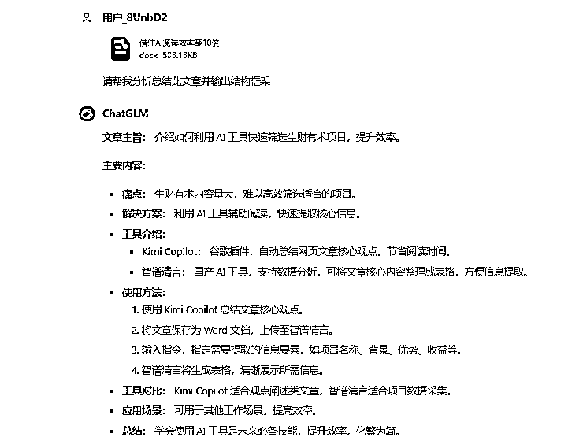
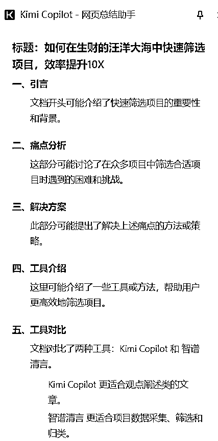

# ('如何在赚钱的汪洋大海中快速筛选项目，效率提升10X', (2, 27))

在这个信息爆炸、项目多到看不过来的时代，你是不是也常觉得：赚钱的内容太丰富了，每天刷也刷不完，精华帖一篇接一篇，想好好研究却又怕时间不够用？别急，这条分享正是为正在找项目的你准备的，帮你把筛选效率翻上好几倍。

先说说痛点。我进赚钱也快一年了，最大的感受就是：圈里的大神实在太多，干货帖子、风向标更是目不暇接。虽然我基本天天都会上来逛逛，但一天就那么多时间，光靠肉眼一篇篇读，真的很难把内容消化完。就算有人能做到，那耗费的时间成本也太高了。最近我自己想找合适的项目，结果面对海量信息，整个人都有点懵。于是我就琢磨：现在AI发展得这么快，能不能找个工具，帮我把想要的资料快速捞出来？

再来看解决思路。这两年各种AI工具就像雨后春笋一样冒出来，到底有没有能直接用的？我的需求其实很明确，需要它能做到四件事：抓取信息、提炼核心、匹配需求、给出结论。按我之前使用AI工具的经验，这四点并不难实现，说白了就是：“小助理，几秒钟内把这篇长文的核心要点给我讲清楚。”于是我开始全网搜罗，翻了不少网站，也看了很多博主测评，发现有好几款号称能做到。是不是真行，还得自己试。我就挨个注册体验，好在免费。折腾一圈之后，终于遇到几款比较接近预期的。

先说说第一款，叫Kimi Copilot。这是个谷歌插件，需要科学上网，在谷歌应用商店装好就能用。它相当于一个网页总结助手：你打开要读的赚钱精华帖，点一下插件，不用写任何指令，它就能自动识别并提炼出这篇文章的核心观点。哪怕文章有好几千字甚至上万字，它也能在几秒钟内给你几百字的摘要，阅读时间一下就省下来了。当时我拿最新的一篇圈友精华帖做了演示，效果确实快。

不过，用了几次就会发现它的短板也很明显：太多关键细节被精简掉了。对找项目的人来说，光来一个总结还远远不够，我们真正需要的是有价值的信息和数据，用来判断这个项目适不适合自己。

于是我又找升级版方案。经过一轮测试对比，终于遇到了合心意的——智谱清言，网址是 https://chatglm.cn/main/alltoolsdetail。这是一款很能打的国产AI工具，它有一个“数据分析”功能，正好补上了前一个工具的缺口。它的玩法是这样的：你可以把含大量数据的表格或文章直接上传，支持不少文件格式，然后输入提示词，它就能帮你做数据总结，还能用文字或图表的方式展示，非常直观。

具体怎么用在项目筛选中呢？我们判断一个项目，通常不会只看一两个点。以我自己为例，一篇精华帖，我至少要读到以下信息才能做决定：项目名称、项目背景、项目优势、项目收益、可持续时间、变现方式、适合对象、启动资金、启动材料、获客渠道、获客方式、产品定价、客户转化方式、转化率、注意事项、作者总结。大家也可以按自己的情况增减。操作很简单：先把精华帖保存成Word，上传给智谱清言，再输入指令，让它按这些要点分析文章，并且做成一个“要点在左、总结在右”的表格，方便快速阅读。

接下来就看它表现了。几秒钟之后，一份包含所有关键信息的表格就出来了。原本要花十几分钟甚至几十分钟读完的长文，现在一分钟内就能掌握全部核心内容。我这边还有操作视频，看看就懂。

两台工具对比下来，Kimi Copilot更适合观点类、论述类的文章，智谱清言则更擅长做项目数据的采集、筛选和归类。大家可以结合自己的实际情况来选，也可以双管齐下，搭配使用效果更好。

既然它们能帮我们快速筛选项目，那其他繁琐的工作是不是也能借用？不管是整理冗杂的资料，还是想快速得出结论，只要你觉得手头的活儿又碎又费神，都可以试着用这两款工具来做。大家不妨开开脑洞，想想还有哪些场景能让它们发光？

最后想聊点自己的感受。AI并不会取代人，但一定会淘汰那些不会善用AI的人。在这个信息过载的时代，学会借力AI来提升效率、把复杂的事情变简单，正在成为每个人的必备技能。大家趁早练起来吧。读到这儿，你已经花了不少时间了吧？要不拿智谱清言把这篇也总结一遍？其实我写这篇文章时，也分别用了智谱清言和Kimi Copilot做了总结，大家看完可以再巩固一下。甚至这篇文章的框架，也是靠AI帮我搭出来的。

最后的最后，特别感谢赚钱这个平台，让大家有机会在这里相遇和成长。也真心希望赚钱以后能结合AI把产品做得更好，让圈友体验越来越棒（一点点不成熟的小建议）。分享这篇内容，就是希望大家能更快找到自己的项目，或者在更多合适的场景里用起来。只要不违背咱们赚钱的价值观，分享的意义就会一直延续下去。感谢每一位耐心读到这里的圈友，祝大家早日暴富，一起赚钱有术！我是进击的大郑，下次见！