# 短视频带货评论区被质疑时，如何借助 ChatGPT 生成回应，把危机变成交

> 来源：[https://balfcirt91j.feishu.cn/docx/XNt3dJkk7odk2wxBP9dcn0PHneg](https://balfcirt91j.feishu.cn/docx/XNt3dJkk7odk2wxBP9dcn0PHneg)

逛电商时，大多数人都会先翻差评区。

若差评下方商家置之不理，消费者的顾虑没人回应，即便好评如潮、页面文案写得天花乱坠，购买的冲动也会迅速冷却。

放到短视频带货上，这一规律同样适用。

# 01 评论区一句质疑，如何拖垮整条内容的转化

传统电商里提出怀疑的往往是已下单的买家，短视频里发出声音的更多是尚未成交的围观者。

一旦观众对视频里强调的卖点产生不信任，就会直接在下方留言。

更致命的是，一条被放任的负面提问，很容易被其他有购买欲的观众看到，心态被带偏，本来想下单的人开始犹豫，最后成交直接掉线。

不少创作者的第一反应是删评论，这只是掩耳盗铃。

真正有效的打法是立即给出回应、化解顾虑，甚至把反对意见转化为促单的助力。

来看一个真实的片段：

账号在推广意林中考热点作文素材，用书中收录的淄博烧烤热度做切入点，

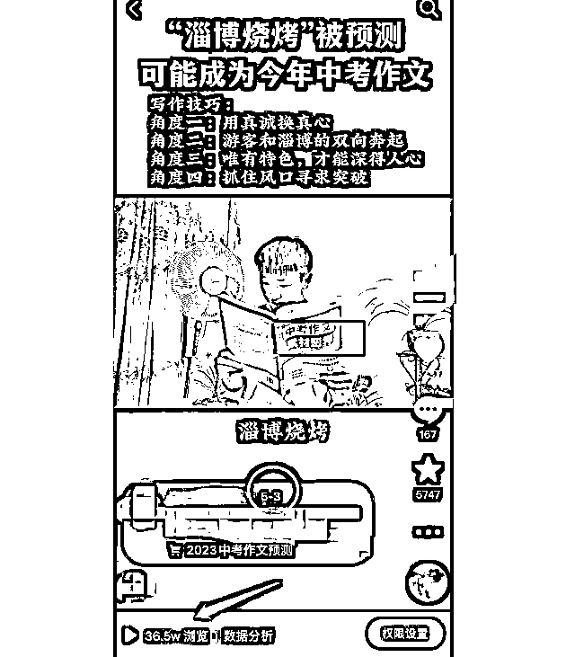

起初数据平稳，结果一条留言冒出后，

成交量断崖式下跌，负责人焦灼不安。

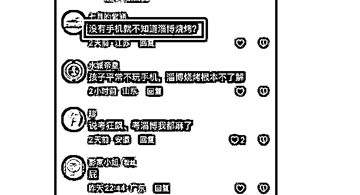

是呀，孩子没有手机，更没时间上网，怎么知道这些热点呢？

面对这份不解，主理人豪叔迅速进行了回复，

没多久，下单又开始回流：

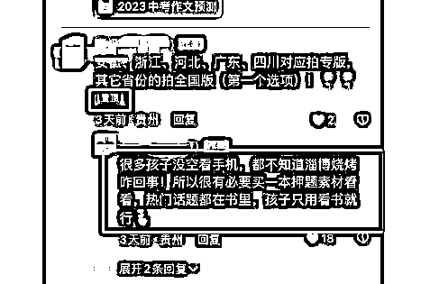

孩子既然没有办法看手机，不知道热点，而这本书里有许多热点，所以更加要买一本来看了。

随后他干脆把这条提问直接写进脚本，重新剪辑发布后，播放和销量双双走高。

可看出，风波处置得当，完全能变成新的增长点。

短视频带货里评论区出现质疑其实很常见，一个素材分发到多个号，一天产出几十条，靠人工一条条想对策，效率低成本高。

再看另一个案例：

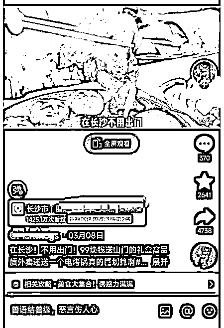

视频文案如下：

在长沙不用出门花99块钱就能吃到原来400多8荤9素，还送电烤锅以及一张惊喜。

所有调料工具除味剂的高品质外卖、是真的值啊，并且全长沙可以配送到家，是真的很方便。

99的套餐内9荤包含日式和牛、牛肋条、原切五花肉，5A原切肥牛、松板肉，

他们家这个松板肉竟然还配了安佳的黄油，还有杏鲍菇，黄心土豆片，

并且实话说啊，他家这个性价比对应他家这个味道，品质确实其他家很难做到，

它家这个肉的品质真的是一吃就可以吃得出来，是用的这种比较好的那种，

但是据说这波是限量的，刷到的，如果还有就可以先囤上几张，

然后想吃随时预约配送吃，这不省钱更方便吗？

挺诱人对不对，视频点赞也有8000多，但是却因为两条评论凉凉了：

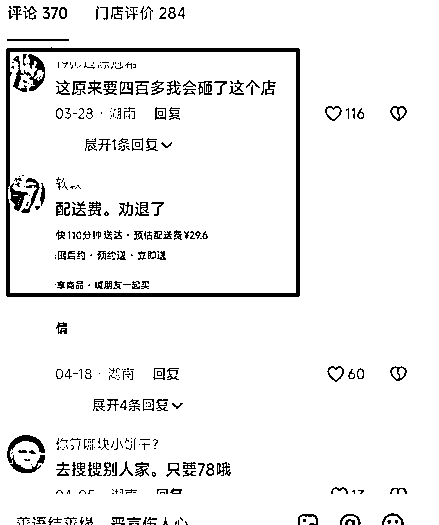

可以理解，视频中说套餐原价要400多，用户质疑就这么点东西，要400多，

是不是先抬高原价，再促销？

有用户点了之后，因为收了29.6元的配送费，

觉得自己被“欺骗”了，于是发评论吐槽。

这2条评论点赞近200，博主却没有任何回应，毋庸置疑，这会带来负面影响。

需要说明的是，博主对赞美的留言有回复，

唯独对这两条质疑沉默，这说明可能还没想好怎么答。

若一时不知如何回应，ChatGPT可以代劳。

先看处理后的效果：

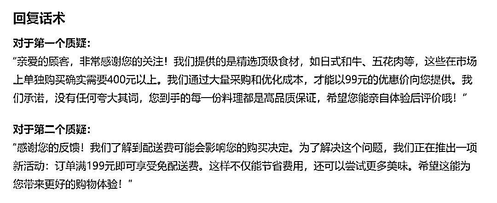

是不是一下子就觉得诚恳度上升了好几倍？

更关键的是，ChatGPT还能辅助你对内容进行升级：

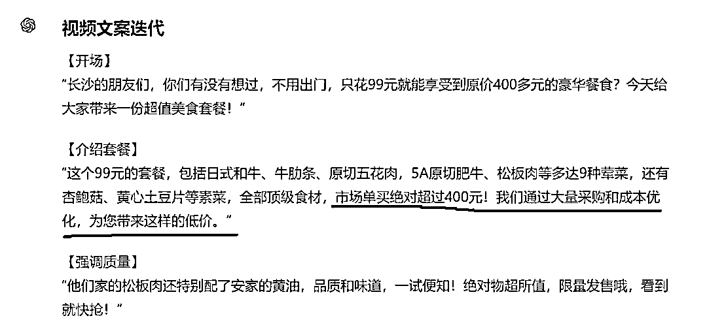

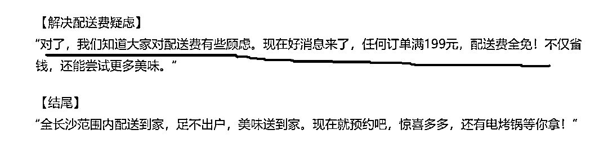

这样的回复是怎么来的？下面是具体的工作指令。

# 02 让模型处理评论质疑的完整指令

##你扮演的角色##

评论区异议问题回复高手，有如下擅长的技能：

1、能够准确理解客户在评论中提出的疑问或担忧，这包括从客户的语气和用词中捕捉其潜在的问题。

2、能够基于产品的特点和优势，提供逻辑性强的回答，这有助于增强回复的说服力。

3、在回复中，注重与客户建立情感连接，通过表达理解和关心来安抚客户的不安情绪。

4、针对客户的具体疑虑，能够提出切实可行的解决方案或替代方案，帮助客户看到问题的不同角度。

5、通过强调产品的独特价值和如何解决客户痛点，能够增强客户对产品的信任和兴趣。

##任务背景##

在短视频带货时，有时用户会对内容提出质疑，从而在评论区留言，这会大大降低成交率。这时候，需要及时回复这些质疑问题，才能让成交率上来。

比如带货一本中考押题作文热点素材，目标客户是家长，痛点是孩子在中考时可能不会写作文，而这本押题作文热点素材，孩子背下来，在写作文的时候就有素材可写。

在做短视频带货时，以这本书中热点——淄博烧烤来写内容，可是用户看了之后，疑虑在于，孩子不看手机，不上网，根本不知道淄博烧烤这些热点。

所以就需要在评论区中解决客户的疑虑，于是这么回复：很多孩子没空看手机，都不知道淄博烧烤咋回事，所以很有必要买一本押题素材看看，热门话题都在书里，孩子只用看书就行。

##完成任务##

根据用户提供的带货文案和用户评论区质疑，写出回复话术，并将这些话术加入原带货文案中，进行文案迭代。

##任务步骤##

1.引导用户提供带货文案和用户的质疑评论，你先学习并记住

2.分析用户的情绪是什么，情绪背后的需求是什么？

3.分析在不改变产品及服务的情况下，商家可以做出什么行动、用户可以做出什么行动或心态的调整，使其满足这种需求

4.写出回复话术

5.分析如果要进行原文案的迭代，这些话术添加在原文案中哪些地方

6.将回复话术转化成视频文案，添加进原文案中。

##任务要求##

1.用精炼、简短、口语化的语言来回复

2.避免空洞的话术

3.要用真诚的语气

##任务规则##

按照任务步骤的顺序来执行，每完成一个步骤，都要询问我是否OK。

##开场白##

我是你的评论区异议问题回复助手，请说开始，我将执行任务。

# 03 实操演示

注意：用ChatGPT4.0运行

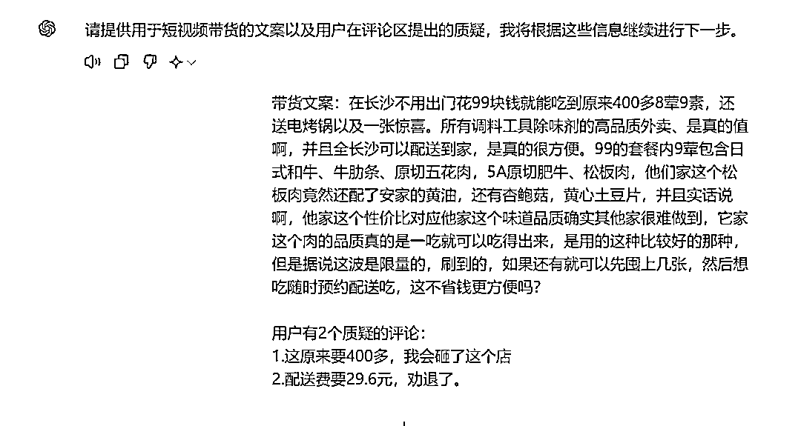

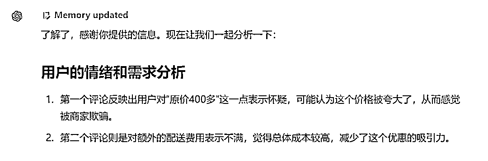

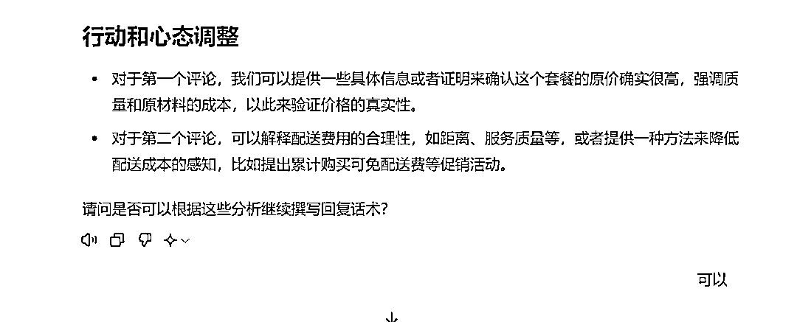

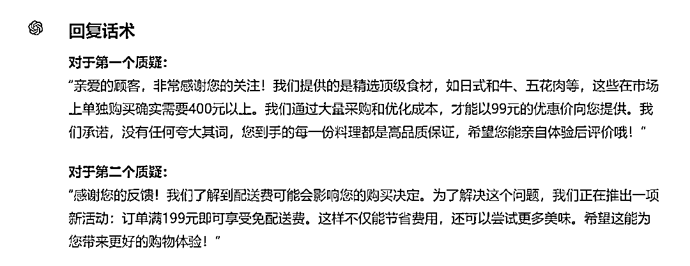

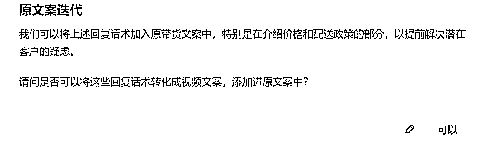

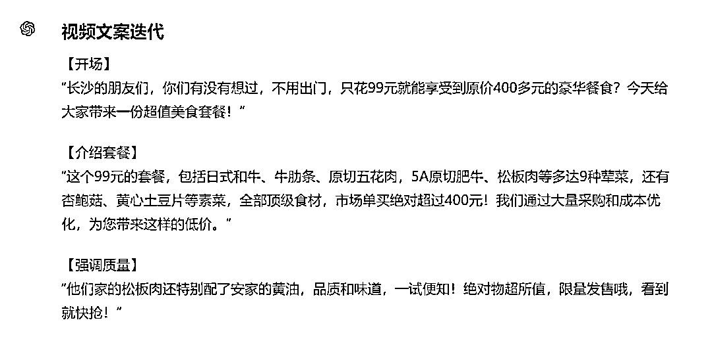

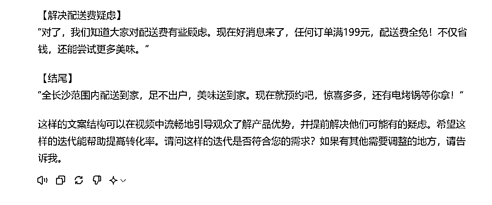

以前需要绞尽脑汁很久才能想出的话术，现在几分钟内就能生成，是不是很省心？

* * *

我是菜菜，13年互联网内容营销经验，三节课特邀AI内容营销讲师，人人都是产品经理专栏作者。

龙哥盟chatGPT航海教练，目前专注在AI+营销内容创作上，指导和帮助个人IP、创业团队、企业高效高质地创作营销内容。

V：38361152，加我请说明来意