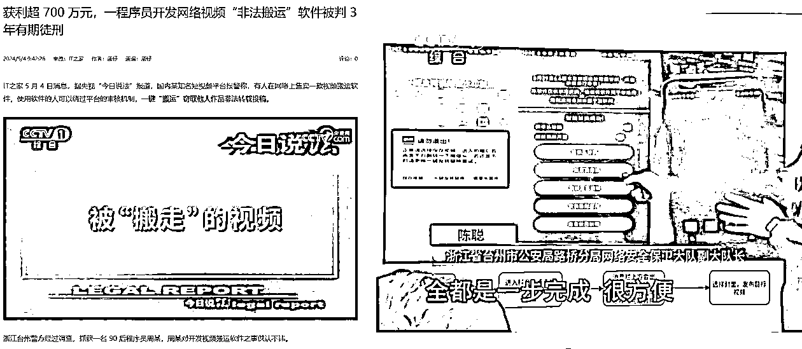
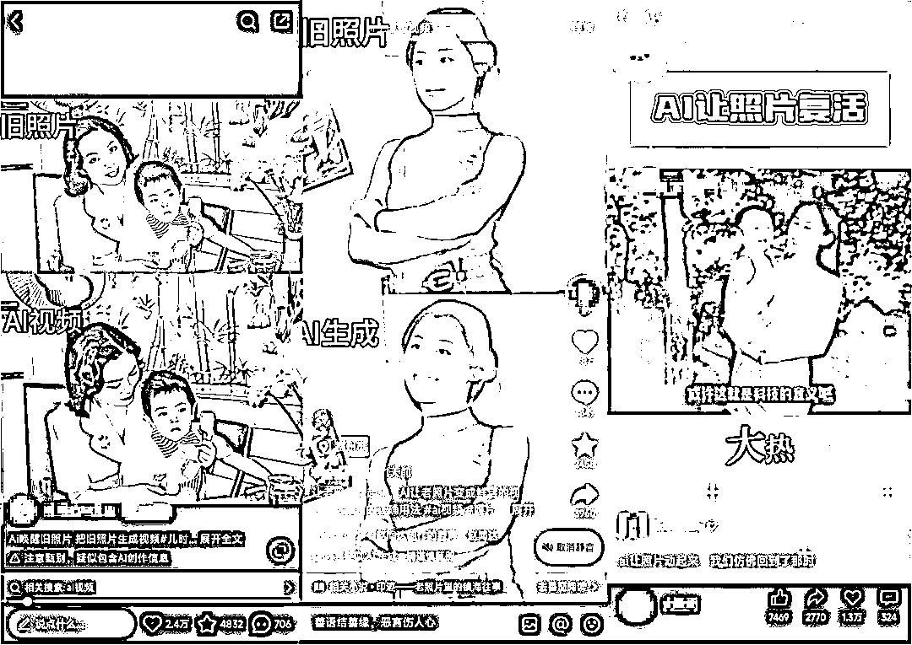
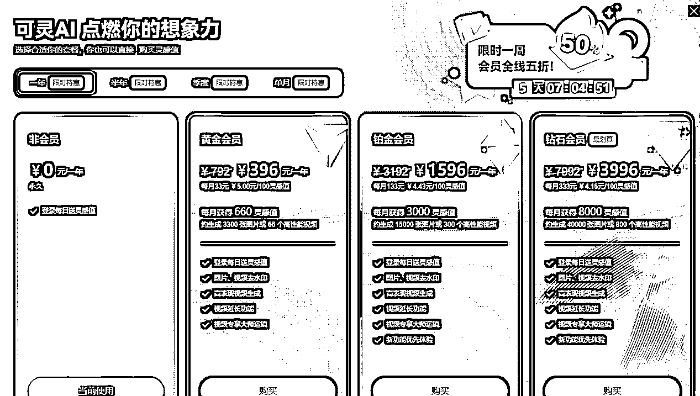
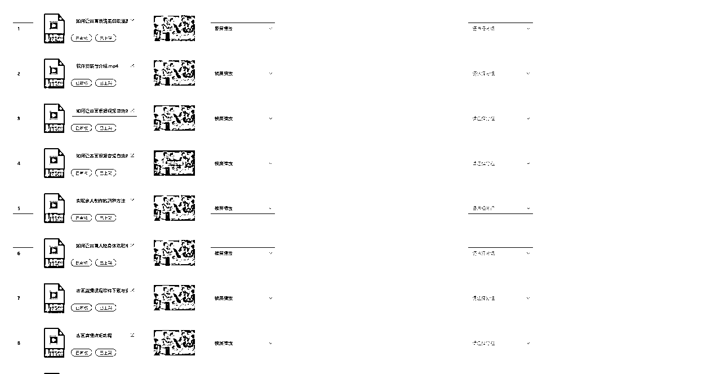
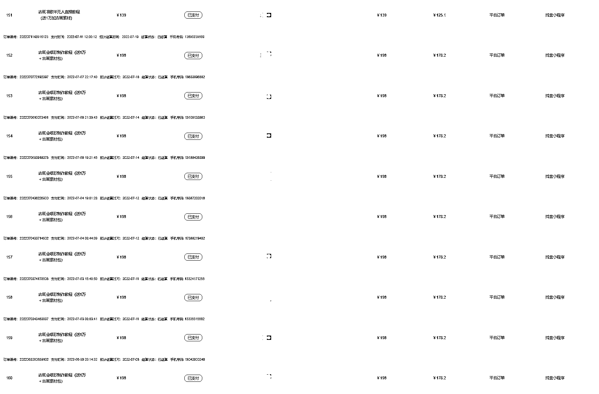
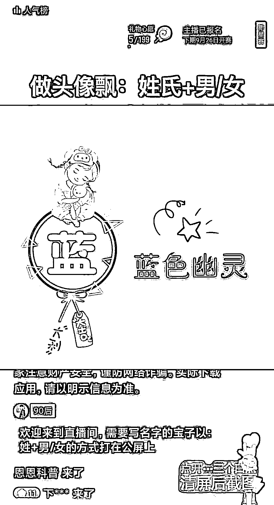
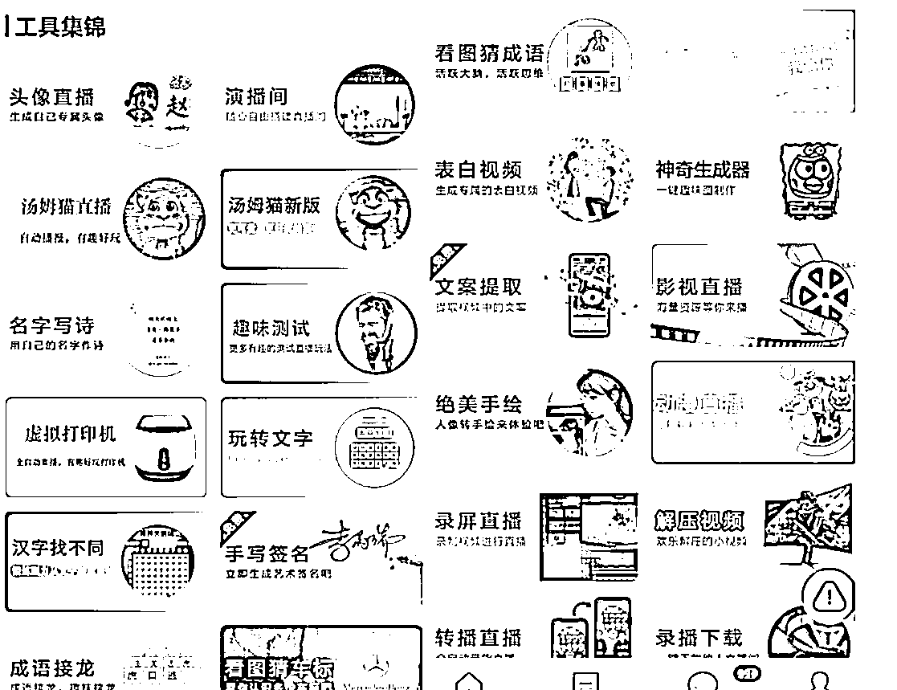
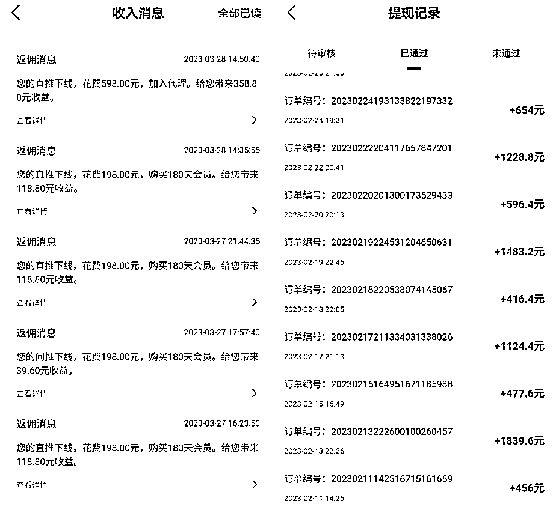

# 卖铲子一年搞了几百万，不是你不够努力，可能是方向没找对！
作者：龙哥

他靠“卖铲子”年赚近800万，却栽了：你缺的不是努力，而是方向

前阵子刷到一条旧闻，发生在5月，可能不少人见过：一个90后程序员开发了一款号称“一键混剪去重”的软件，拿去网上卖，一年不到进账近800万，后来被抓，判了3年。

据说他和我一个合伙人住得很近。以前家里条件一般，做了这个软件后，一年内买房换车，妥妥的人生赢家剧本。我们本来还想去拜访，结果还没来得及，人就进去了。

很多人看到这消息，第一反应是：卖这玩意居然这么赚？没错，真就这么赚。为啥？需求摆在那。前两年短视频全面爆发，大量网创新手涌进来，想分一杯羹，但又不肯花精力拍视频、剪视频，总盼着轻松挣钱。这哥们儿精准抓住了这种心态：你懒得做内容？我教你怎么搬现成的；你怕平台查重？我帮你把素材处理成查不出。用户只要把别人的视频下载下来，丢进软件，自动混剪去重，然后发布就完事。一个月只要几十块，你会不会动心？大部分人恐怕都会冲个会员试试。

于是你几十、我几十，不到一年，他愣是攒出七百多万。至于用这个软件发视频的人赚没赚到钱，八成没有，但卖软件的人确实赚麻了。说白了，他就是懂“卖铲子”，只是产品不合法，不然还能赚更多。

这就是我反复说的卖铲子思维：一个行业站在风口上，能上车吃红利当然好；可一旦赛道挤满人，你未必非得去淘金。换个思路，给淘金的人卖铲子、做配套，可能更容易赚到钱。自己挖矿，既拼努力，又拼运气，结果不确定；卖铲子的人则不同，挖矿的人越多，铲子越好卖。

互联网也是这个道理。普通人获取项目信息的渠道很有限，而且往往滞后。等你听说某项目，早有一堆人做了很久。这时再一头扎进去，全是竞争对手，再加上各种不确定，很难做出结果。但如果你转换思路，不直接做项目，而是围绕项目提供上下游服务，成功概率会高很多。

比如前段时间，用可灵AI做“会动的老照片”项目很火。真正去做这类视频的人，绝大多数没赚到多少；可灵AI官方倒吃得非常饱，已经开始收费了。

还有小说推文，真正赚到钱的只是少数，但做推文工具的那家公司，一年赚的可不止800万。市面上各种AI生成、文案改写、短视频制作、直播辅助的软件，也大多靠卖铲子赚得盆满钵满。

你可能会说：这些都太远了，我又做不了平台。别急，举这些例子是为了帮你理解逻辑。普通人确实没能力做平台、做软件，但照样可以借卖铲子思维赚钱。铲子不一定是个软件或平台，而是“问题解决方案”的总称。

就拿AI老照片视频来说，一个小白要完成，得走完收集图片/AI作图、申请工具账号、学教程、发布、变现这一长串流程，每一步都可能卡住。不知道去哪找老照片、嫌麻烦、照片不清晰——如果你能整理一批高清修复过的素材包，会不会有人买单？这个素材包，就是铲子。想自己AI作图，AI绘图工具和操作方法就是铲子。要做视频但没工具、通不过内测，工具和快速过审的方法就是铲子。自己不会写提示词、效果差，一份高质量教程就是铲子。做出来不知道怎么变现，一份整理好的变现方案和教程，同样是铲子。

你会发现，铲子不是固定指某种工具，而是随用户需求变化的。它可以是一个软件、一份教程、一个方法，也可以是一批素材。能不能卖好铲子，关键就看你能不能发现用户需求。

怎么发现？细心观察，多问自己，找现有方案的不足。我拿自己的两个例子说明。

第一个，古画唱歌。所谓古画唱歌，就是让古画里的人物照片开口说话。

这技术放现在不算稀奇，很多AI工具都能做。但2022年AI还没这么普及，只有个别软件能实现，这里面有巨大的信息差。当时多数博主都用一款叫Muglife的苹果App，还必须iPhone X以上才能用。可很多粉丝没这条件，也想玩，这就是需求，而且没人解决。我找了好久，发现有个同行用电脑端软件CTA做，效果不错。于是花一周研究技术，再花两周录了9节共3小时视频课，定价198。发了几条抖音，卖了500多份，到手10万+。

第二个，2023年初直播撸音浪很火，像头像直播、表白视频直播、电影直播等等。

这些玩法以前没电脑开不了。我在评论区看到很多人问：手机能不能做？有没有手机版？立刻意识到这是大需求。现在人用电脑少，不是人人都有。如果能手机开播，肯定抢着要。我翻遍各平台，找到一家小公司做的App，把爆火直播形式都整合进去，一部手机就能开播，还能自动回复弹幕。会员制：年费298、代理598、合伙人1280，有推荐奖励。

我直接开了合伙人，拿到60%的下级分成。随后发了几条抖音，视频爆了，网友纷纷来问，一个个不墨迹，直接充会员。每充一个我就拿60%。最后推了1000多个会员，到手10万+。

这两个案例的资料，感兴趣的朋友可以找我发你。后来我还卖过许多类似的东西，都赚了些钱，算是我互联网第一桶金。这种玩法反馈快，来钱快，对新手很友好，容易建立信心，比闷头做项目强。

现在依然有很多人专门做这种生意。你在朋友圈看到今天推这个、明天推那个，哪个风口火就卖哪类工具的，基本都是卖铲子的。他们靠的不是信任，而是需求：你需要什么，我刚好有什么，成交就像超市购物一样简单。

当然，卖铲子也有局限。生意能做多久，取决于项目周期；项目一凉，铲子就卖不动。所以要追着风口走，经常调整。敏感度高的话，确实很赚钱，但也累。我自己不喜欢这种状态，后来慢慢转型做个人IP，把短期暴利换成长久复利。

讲到这里，你应该明白那个90后小伙为何能赚800万了吧。这篇文章不是劝大家都来卖铲子，而是想给你一个新思路：网赚不等于只能做项目。大多数人都觉得对的事，恰恰最难做出结果。选对方向，才算事半功倍。所以，真不用满世界打听什么项目火了。

