# 从2000月薪到百万身家：一个草根创业者的互联网复盘

一个在三线城市拿2000月薪的年轻人，后来却在互联网上赚到了第一个100万，甚至开上了跑车。这不是鸡汤，而是一位互联网创业者十几年的实战复盘。他是“铲哥”。内容可能有点长，但信息密度很高，建议耐心看完。

铲哥出生在洛阳，一个算不上繁华的三线小城。刚毕业那会儿，他和大多数普通人没什么两样：没有背景，没有资源，钱包也没有底气，一个月工资不到两千块，日子一眼就能望到尽头。他笑称自己是合格的“三无人员”。正是这种处境，让他把互联网视为唯一的翻盘机会。后来的事实证明，这条路确实改写了他的人生。

### 兴趣是最早的起点
这份改变，最早始于兴趣。13岁那年，他对电脑极其痴迷，尤其崇拜黑客，可以说到了废寝忘食的地步。同龄人还在QQ农场“偷菜”时，他却在研究编程。折腾许久，终于把“易语言”装进了电脑。人生的第一段代码长这样：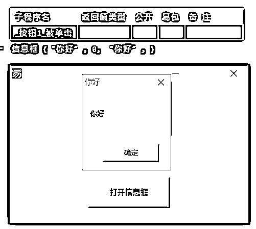

其实那只是极其简单的脚本：按一下按钮，弹出一句“你好”。甚至连程序都算不上，但“能看到结果”这种感觉很重要。如果没有那种快速反馈，他可能不会坚持到今天。从那时起，他养成了一个习惯：无论做什么，先想办法得到正反馈，比如第一单、第一块钱。有了这种反馈，人才会持续投入。很多人做项目不是死在方向上，而是死在反馈太慢上——没撑过一周就开始自我否定，最终放弃也就成了必然。

17岁那年，他已经闯进网络安全领域，并凭借钻研拿到了全国年度贡献银牌。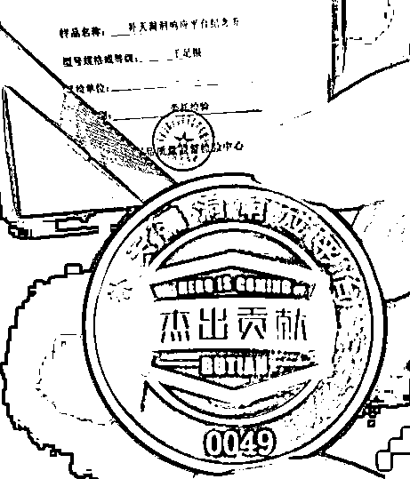 但这份荣誉没有让他飘起来，反而让他清醒：光靠兴趣和热情，撑不起人生。他开始认真思考怎么用互联网赚钱，也是从那时起，他才慢慢明白——选对方向，往往比盲目努力更重要。为了吃透这句话，他花了整整四年。

### 第一桶金：从PPT模板开始
18岁，他选择头条号作为起点。摆在面前的是两种模式：一是靠内容播放量分成，二是靠产品/服务赚钱。他毫不犹豫选了后者。原因很现实：靠播放量分成，必须不停输出优质内容，而持续创作恰恰最耗人心血；同样时间的付出，卖产品/服务的性价比高得多。所以，做对事，永远比做很多事重要。

带着“卖什么”和“流量从哪来”这两个问题，他开始了实战。第一个动作就是找同行：刷到文章就点进主页，观察对方发过多少内容、数据如何、有没有留下引流线索。一旦发现，就扮演客户加过去咨询。这个动作看似单调，却让他挖出了几十个正在赚钱的对标账号。在互联网上赚钱，就像一场开卷测验，答案大多摆在明处，你要做的，就是找到优秀同行的答题思路，再优化出自己的版本。

当然，同行不能乱选，要选自己能打得过的。他那时白手起家，实体产品直接排除，需要专业技能的也排除。筛来筛去，PPT模板成了理想目标：年底将近，不少人要做年终总结，自己却不会做PPT，这是刚需；虚拟产品不用发货，卖一单就是纯利润，还能快速带来正反馈。

为了验证需求，他又去头条搜“PPT模板”等关键词，发现同行数据很不错，评论区满是求模板的人。既然有人已经把路蹚出来了，干脆参考现成玩法，边模仿边优化。很快，第一篇内容就爆了。 那篇只有几万播放，却带来了上千个精准🛰️好友。那段时间，消息列表的数字天天满格，最多时刷新半天都点不进后台。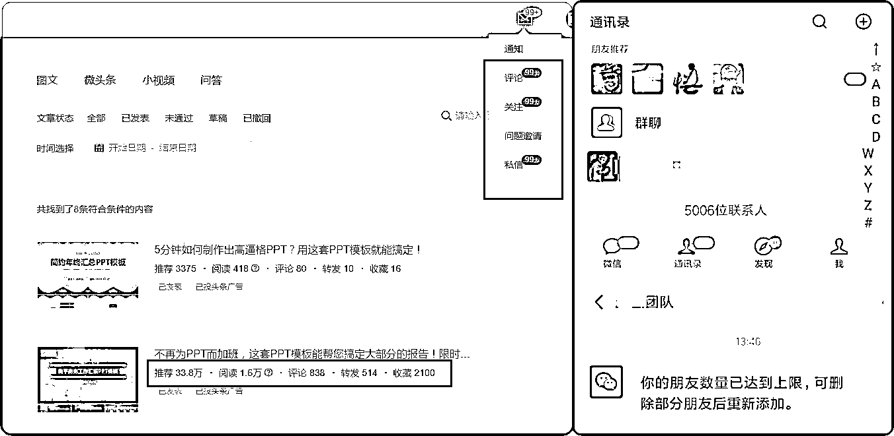

为什么几万播放能引出上千条留言？关键在文末设计了一个钩子：引导读者点赞、评论并私信关键词，就能免费领PPT模板。用户一互动，系统就会把内容推荐给更多相似人群；新人群再互动，系统再推荐，雪球越滚越大。至此，整个项目的最小可行流程已经跑通。

但是，跑通小项目不值得骄傲。很多人其实都能跑通，只是没有继续放大，最后只赚了点小钱。他很清楚一个账号的流量和收入有限，于是开始思考复制到更多账号、更多领域。

刚需有了，内容生产效率也得跟上。他靠编程底子很快解决了这个问题：写了个小工具，可以批量生成PPT模板缩略图。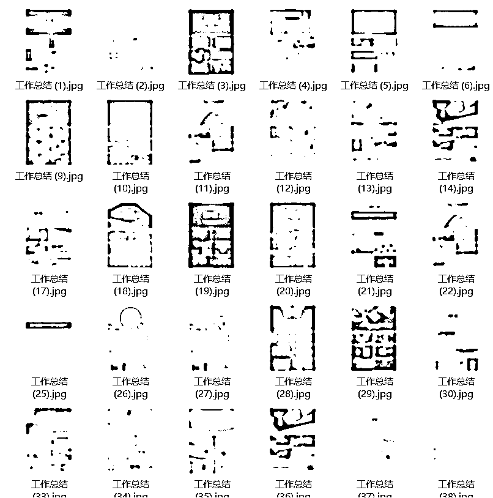 然后每10张图发一条图文，标题塞满相关关键词，让推荐更精准。内容结构也非常简单：先抛痛点，再给解决方案，最后用钩子引导互动。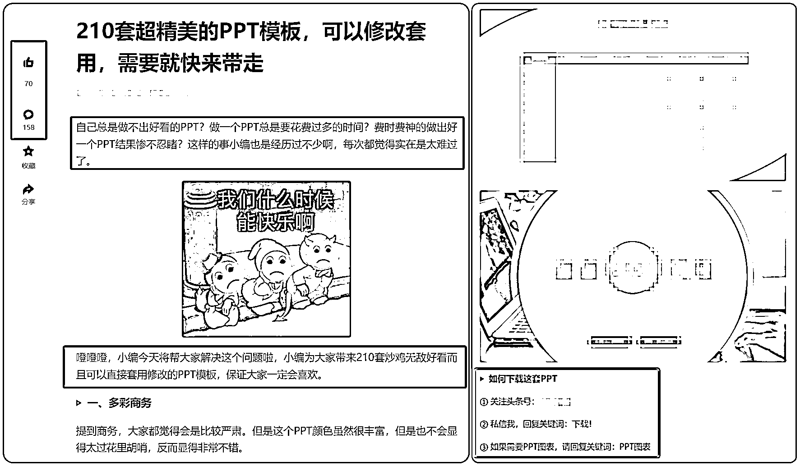 这招到今天依然管用。你打开抖音、📕，还能刷到大量的“评论区回复关键词领资料”内容。本质上都是在拉互动，让算法给更多推荐。方法不高级，但真的很有效。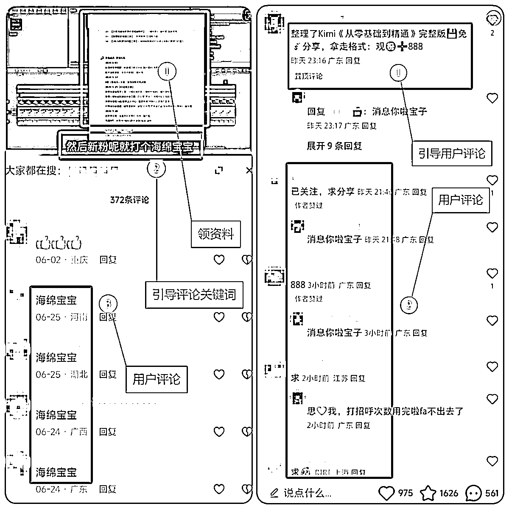

虚拟资料有个天然短板：客户上一秒是买家，下一秒就可能变成卖同一份资料的同行。只卖资料，很难有竞争力。于是他又做了波升级：既然用户需求各不相同，有的人要年终报告模板，有的人要扁平风格模板，一次性给几千套反而不知道该选哪个。他就开发了一款小软件，让每套模板的内部效果直接可视。这样一来，用户能轻松找到自己真正想要的款式，付费意愿也高了一些。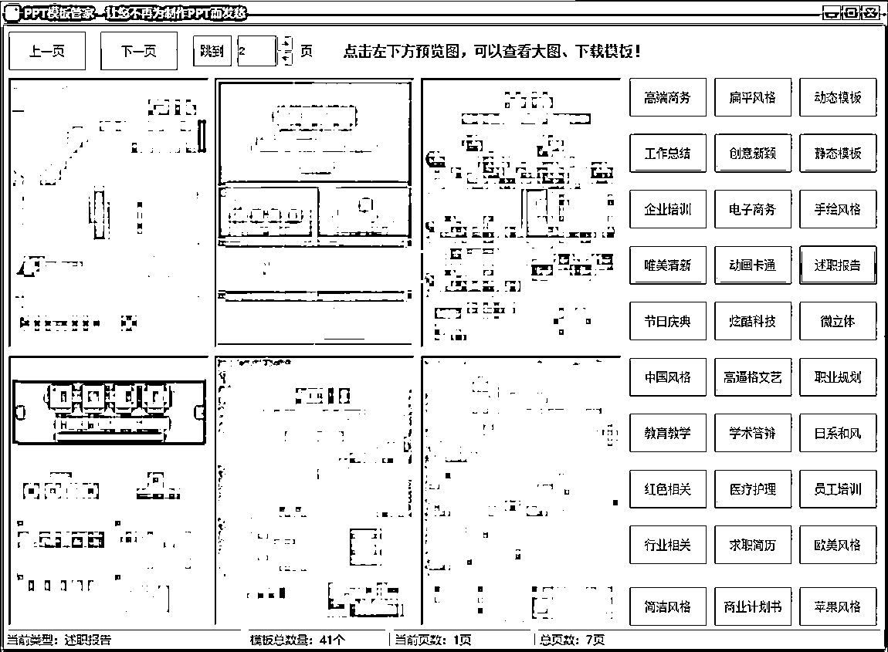 这个工具不但拉高了客单价，还形成了护城河。同样是卖PPT模板，别人卖9.9元，他卖39.9元，依然能卖得更好。

用户买的不是几千套模板，而是几千套中最匹配自己需求的那一套。你提供的价值，决定了价格天花板。这软件没有黑科技，对同行来说却是降维打击。很多时候，赢不靠你多强，只要你比对手强一点点就够了。

他还提醒：别因为表面数据一般就忽略一个玩法。抖音上有的直播间平均在线只有几十人，一个月却能卖出几百万的货；有的视频制作粗糙，照样能带出上万件货。下次再刷到类似内容，别急着划走，想想“他都能赚，我优化一下是不是更能赚”？如果不会编程，那就别自己硬磕，花钱找到能解决的人就行。真正的高手不是看自己手里有什么，而是倒推做成这件事需要什么，再去整合资源。

很多事情，只有亲自试过才知道能有多大能量；用户接触得多了，真实需求自然浮出水面。这套逻辑不局限于PPT模板。很多虚拟资源都有人用类似方式操作。比如手绘头像定制，他见过一个同行账号，玩法和他当年几乎如出一辙。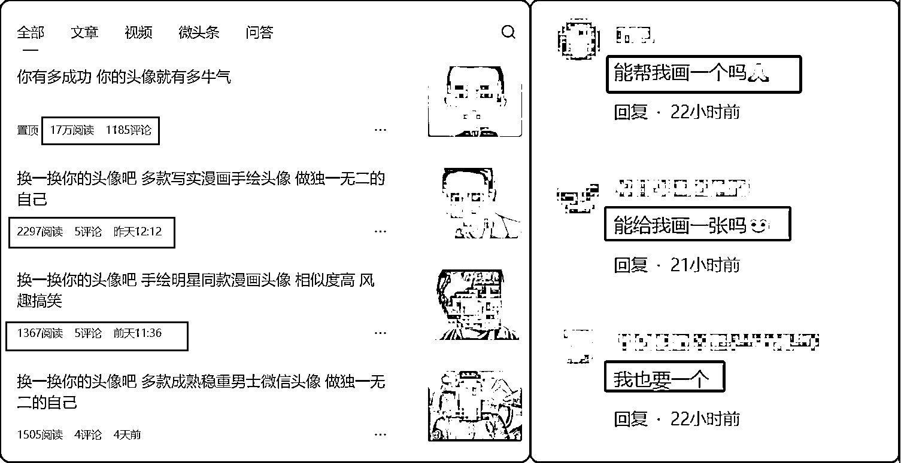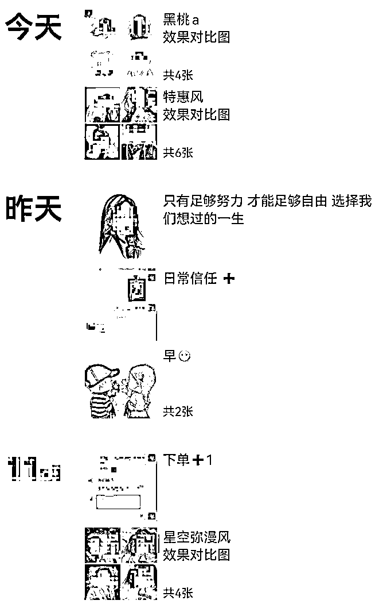 难吗？一点也不难。但赚钱的往往就是执行力强的人，而不是想太多的人。讲这些，不是劝大家都去做PPT模板或手绘头像，而是希望你培养一种发现小项目的能力，想清楚就下场。以前他也看不上这种简单玩法，项目做多了才明白：真正有效的玩法定然是简单的，越简单越容易赚钱，越复杂反而越容易亏。

后来因为版权风险，这个项目被他彻底放弃，但它留给他一个极简商业模型：需求/问题 → 流量/内容 → 产品/服务 = 转化。通俗点说，就是找到一群人的具体问题，用内容把他们吸引过来，再卖给他们对应的产品或服务。正是这套打法，让他赚到了互联网第一桶金，也买了人生第一辆车。不贵，但那种第一次靠互联网赚到钱的感觉，他至今都记得。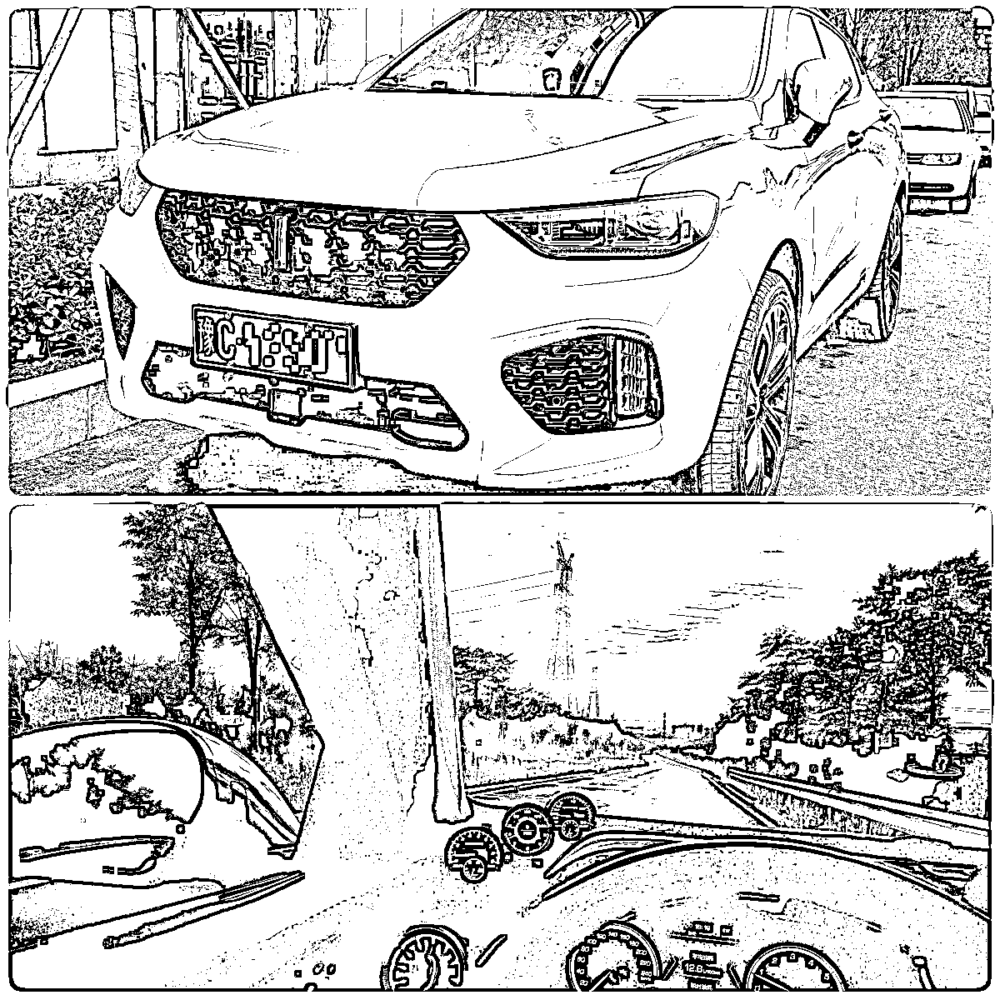

### 23岁：从批量剪辑软件到第一个100万
到了23岁，他终于赚到人生第一个100万。很多人迷茫，是因为看不清自己能做什么、该做什么。脑子里方向一大堆，却一个个模模糊糊。于是日子在纠结和娱乐中悄悄溜走。但真正的人生目标，从来不会一开始就摆在你面前。它需要你在不断试错中逐渐清晰。只要试错成本能承受，就去快速尝试，试着试着就找到了自己的路。

他的100万，起点是一款视频工具。当时图文竞争越来越激烈，他开始转做视频。为了提高内容生产速度，他给自己开发了个批量剪辑小工具。随后一个念头冒出来：既然自己有这个需求，别人是不是也有？于是他又重复了那套熟悉的流程：先找对标，把市面上能买到的批量剪辑软件全体验一遍，取长补短，做出当时功能最全的版本；后来咨询的用户越来越多，他又陆续开发了几款衍生软件。界面大概就是这种工具的样子：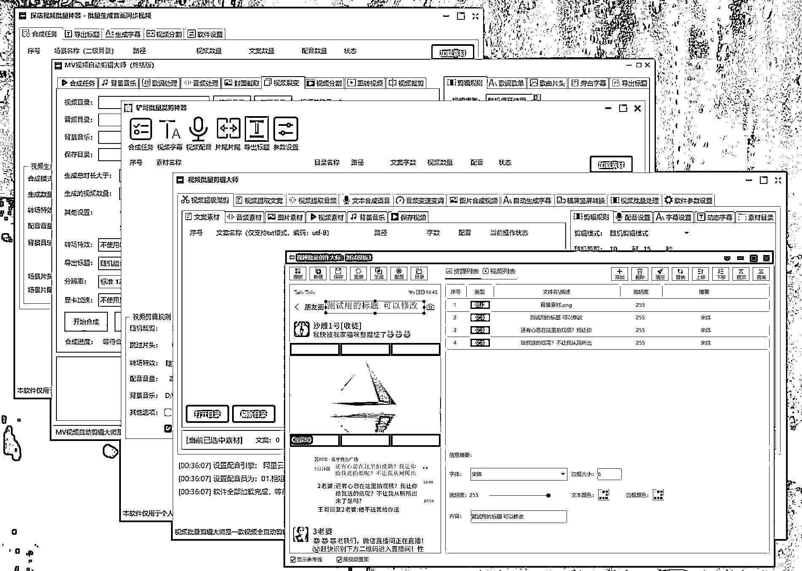

需要提醒一下，这些软件早已停售，市面上的破解版有风险。如果真有需求，可以用他的免费版“铲哥批量剪辑神器”，入口在精华帖里（`t.zsxq.com/eyv5g`）。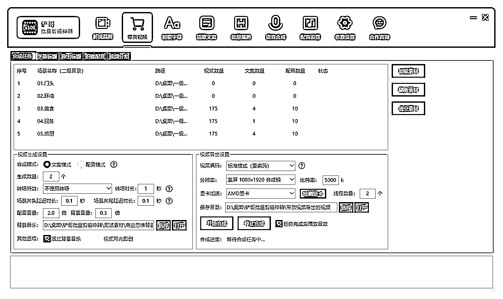 铲哥批量剪辑神器 主界面

第二步是验证需求。他把“批量剪辑”这个关键词输进各个平台的搜索框，看有没有下拉词。结果证明，需要这个软件的人远比想象中多。赚钱的本质，就是在生活里发现问题，再创造产品去解决问题。

软件做出来，只是第一步。最核心的问题是怎么卖出去。他沿用了老办法：做内容，全网铺开。引流其实没什么玄学，说白了就是不断产出内容，发到你所能触及的各个平台，把简单动作坚持做、认真做。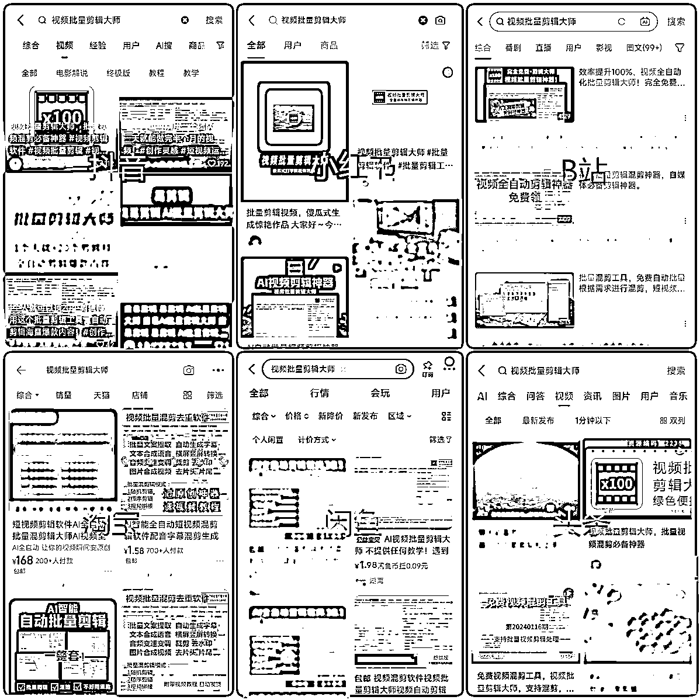

故事到这里，真正的高潮才刚开始。一个人又要研发、又要引流、又要客服、又要售后，相当于活成一支团队，精力终究有限。必须借力。他把整套流程整理成SOP，决定招代理复制放大。一张简单的招募海报发到朋友圈：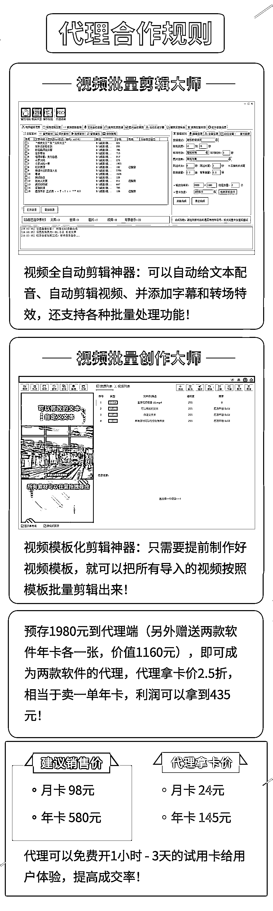（海报仅作示意，早已不卖了）。就是这一步，让许多买家变成了合作者。他负责开发与后端支持，代理们负责引流与成交，合作共赢。

本来是卖软件，叠加代理模式后，成百上千人一起帮他销售，也就等于成百上千人一起帮他赚钱。常见的杠杆无非这么几种：劳动力杠杆（开公司、招代理）、自媒体杠杆（短视频、直播放大影响力）、复制杠杆（软件、教程等低成本复制品）、资金杠杆（付费投放）。这个模式看似简单，一年却让他招到了上百名代理，睡觉的时候都有收入。拿到钱后，他给女友买过一台smart敞篷，给自己买过一台杜卡迪街霸。他对此的感想是：见过太多有钱人只知道赚不知道花，那赚钱的意义就变了。20岁想要的东西，30岁才拥有，早就没了当初的兴奋感。在合适的年纪赚到合适的钱，本身就是一种幸福。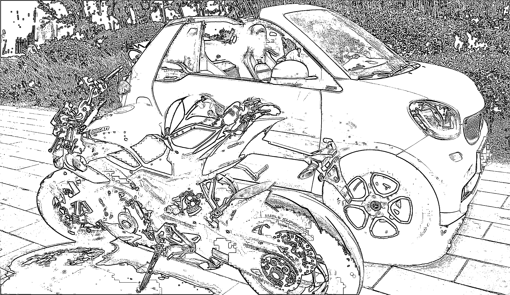

### 差异化竞争：7天实战营
再后来，他发现自媒体赛道涌进来的人越来越多，自己又有实战经验，便顺势切入自媒体培训。机会从来都是留给有准备的人，没有过去这些积累，风口来了也接不住。

当时市场上做培训的人也不算少，但大多数是收费后甩一套资料，让用户自己啃，很难真正落地。为了打差异牌，他设计了“7天实战营”，以实操为主、理论为辅。因为第一次做陪跑营，没有现成对标，只能摸着石头过河。他的做法是：把已经跑通的玩法录成具体步骤，直接发布招募。

他还做了一个在当时很大胆的决定：先带后收费。用户只需交100元押金，就能进营跟着实操，结营后不满意可退钱。低门槛加退款承诺，让第一期就吸引了上百人。这套玩法后来被很多个人IP博主借鉴，演变成了各种“缴押金打卡”模式。押金不是用来赚钱的，而是用来筛选真正愿意行动的人——用户交了钱，才会更重视。

那期实战营的交付流程大致是：报名后先告知开营时间和准备事项；然后建群，修改昵称、发群公告；开营前一天把所有付费用户拉进群；正式开营时发布教程，让用户自由安排学习，并做出3个成品视频发布；后面5天全是实操，每天只布置当日任务，遇到问题就远程一对一指导；最后一天发布转化文案，引导有需要的用户补尾款，同时退还其他人的押金。整套流程没有花活，靠的是实战和真诚。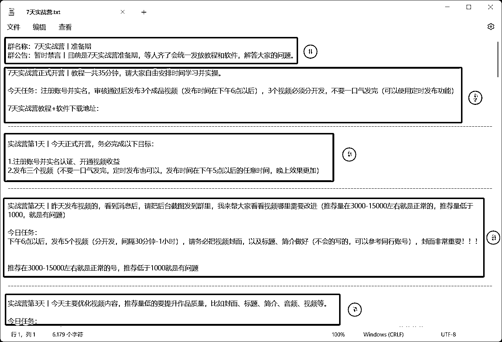

最后再回到那句关键提醒：当你有机会跑通一个业务闭环时，千万别守着三瓜俩枣沾沾自喜，一定要想清楚怎么借助杠杆，把它放大到更大的规模。

做增长这件事，本质上要同时解决两件事：第一波是把新的人找来，第二波是把服务稳定地交付下去。

那段时间直播已经开始爆发了，我也想把这股风用上。摆在我面前的路其实就两条：一是自己招人从零培养主播，二是直接去找已经在做直播的成熟博主去联动。

时间成本算下来就不一样了。自己带新人，等带出来能打的时候，窗口期基本也就过去了，赛道早满了。与其自己硬啃，不如把专业的事交给专业的人干。于是我选了合作。

没想到这步走得还挺顺。我接上了一家专做自媒体培训的直播公司，他们有现成的直播运营团队，也有成体系的后端交付能力。我手里恰好有已经跑通的项目和配套工具，双方一拍即合，互相补位，效益出来得很快。

后来同行涌入太多，获客成本被抬高，项目利润被稀释，这条线就自然收掉了。

事情给我的感触很简单：别给自己划框，资源都是可以被借用的。业务出现机会点的时候，不必非得从零堆经验，等你堆完行情早变了，直接找对的人搭伙，比闭门造车要快得多。

#### **只要开始，永远都不晚**

人生的走向，终究是自己选的。即便手上没资源、没人脉、没启动资金，也要相信主动权握在自己手里。

所有看起来光鲜的结果，都是一次次迈步积累起来的。第一笔100万只是个信号，后续换上了保时捷718，儿时想开跑车的念头也实现了。要问有没有什么秘诀，大概就是先动起来，再慢慢找到节奏。

#### **对未来的一些思考**

每个周期都有它自己的风口。先是电商的红利，接着是自媒体的红利，再往后是短视频和直播的红利。

往前看，最确定的增量方向，很难绕开AI+行业。人工智能已经在渗透生活的每个角落，基本可以说任何一个行业都值得被AI重新梳理一遍。

能从日常里捕捉到痛点，并用AI把它解决掉的人，就能吃到这一波的机会。

除了AI赛道，普通人还能怎么玩？

我觉得是超级个体。表达的价值不会消失，每个人都有机会成为某个领域的发声者。选定一个赛道，持续深耕几年，成为真正懂行的人，找到核心差异点，再把这个点做大做强。

感谢耐心看到这里，我是铲哥，欢迎各行各业的朋友交流，个人🛰️：zmt663

* * *

评论区：

旅星 : 如何链接您呢[憨笑]

Fly : 老乡厉害[强]

凡灵逸尘 : 啥时候来郑州带我飞

程为自己 : 优秀[强][强]

刘娜 : 太牛了，看完醍醐灌顶，很燃！大佬就是大佬！

铲哥带你飞 : [机智]都是线下见过的人了，回头去郑州找你聊聊

铲哥带你飞 : 学以致用，只有把学到的知识用起来，才能内化成自己的经验

铲哥带你飞 : 要不咱先把文章看完？[旺柴]

* * *