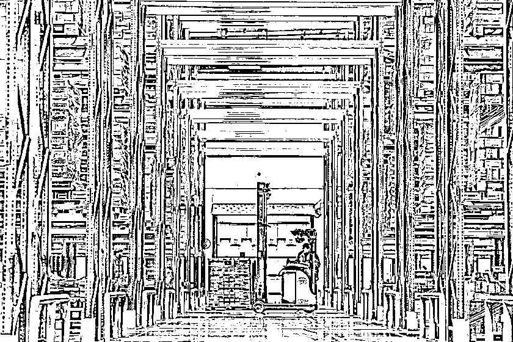

# 亏掉三十多万才看清的 Temu 跨境真相，以及我现在看好的四类选品方向

> 原文：[`www.yuque.com/for_lazy/zhoubao/fww01474wvmhcvzc`](https://www.yuque.com/for_lazy/zhoubao/fww01474wvmhcvzc)

在做直播带货的同时，我也捣鼓了近一年半的 Temu 跨境，全托和半托都试过，最后血亏三十多万，冻结的资金、平台罚款一笔笔算下来，肉疼。现在已经收手，不再继续折腾了，实在是耗不起。下面把我踩过的坑摊开说清楚。

先说个大背景：

佛山爱意家具，Molblly 品牌的老东家，过去在亚马逊美国床垫类目稳居第二，年 GMV 顶到 30 亿人民币。

结果直接宣布全面退出跨境业务！

为啥？

因为一次不合规被平台重罚 2000 万美元。创始人算完账，觉得继续扛不划算，直接关停。

有人会觉得奇怪，30 亿的体量，罚 1.5 亿人民币也就是 5%左右，应该扛得住啊？

2024 年的行情是，SHEIN、Temu、TikTok 电商个个都在开招商会，喊跨境风口，秀法拉利。我也去听过几场，和做不同赛道的几个跨境同行聊过，都说现在好做。那为什么头部大卖反而撤了？到底能不能赚钱？

先上几个数字感受下体量。

2023 年 SHEIN 在北美的 GMV 约 400 亿美元，Temu 约 200 亿美元，TikTok 电商约 200 亿美元，三家加起来 800 亿美元，约合 5500 亿人民币。

放国内看，拼多多 2023 年在中国的 GMV 是 3 万亿人民币，三家海外平台加起来也就拼多多的 20%左右。

空间肯定还有，但已经不是想象中那种躺赚的蓝海了。

美国市场地广人稀，消费集中在商场和超市，一次性采购完成。小众、长尾的需求被压得很低。这也是 eBay 当年能起来的原因。早期跨境靠中国直邮，售后压力小，除了物流几乎没有额外成本，专做细分垂类，流量很稳。

2018 年后 Temu、SHEIN、TK 起来了，海外前置仓模式开始普及。前置仓 3-5 天可达，比中国直邮 20-30 天快太多；贸易战也倒逼平台在美国本地化建物流，更符合当地监管。海外仓主要集中在纽约和加州周边，地价高，租金比国内贵不少。货一旦到仓，包装、条码、标签稍有问题，卖家就得付费让海外仓帮忙处理，人力成本直接飙升。

所以成本模型完全变了。

直邮时代：利润 = 销售额 - 广告费 - 采购成本。一件代发，不压货、不占款，做多少赚多少，特别适合个体户。

前置仓时代：利润 = 销售额 - 广告费 - 采购成本 - 海外仓租金 - 基础服务费 - 分拣打包售后回收费

这种结构，个体根本玩不转，必须是公司化运作的正规军。

那前置仓到底多贵？

1. 租金：北美前置仓约 0.7-1 美元/立方米/天
2. 入库服务：入库、装卸、商家服务、售后移仓等约 0.6 美元/件
3. 仓内处理：条码、封箱、包装、打印等约 0.5 美元/单
4. 出库费：约 0.5 美元/单
5. 末端本地配送：8-12 美元/单

举个中型店铺的模型：20 个 SKU，每个 250 件，共 5000 件，平均 1kg，总重 5 吨。按 2 个月卖掉 90%，退货率 5%，需要约 250 立方米的仓位。这个速度已经算快了，相当于每天每个 SKU 出 4 件。亚马逊头部店铺很多 SKU 一个月都到不了 100 件。

以美甲器、卷发棒这类小型家电举例，美国售价约 30 美元，中国采购成本约 50 人民币。

销售额：30 美元 × 5000 × 85% = 12.8 万美元 ≈ 90 万人民币

成本拆解：

生产成本：500×10×50 = 25 万人民币
海运到仓：8 人民币 × 5000 = 4 万人民币
海外仓租金 2 个月：0.7 美元 × 250 × 30 ×2 ≈ 8 万人民币
入库出库等：约 4 万人民币
末端派送：8 美元 × 4500 ≈ 28 万人民币

光生产+物流就 70 万左右。

平台抽成+广告按 GMV 的 15% 算 ≈ 13 万
国内团队+办公室 2 个月 ≈ 3.6 万

最后到手净利润约 3.4 万，月均 1.7 万，占 GMV 只有 4%。

利润极其脆弱。税务变动、平台规则调整、大促压价、保证金被扣、规格包装不符，一样就能把利润吃光，所以很多公司一出事就直接亏本清盘。

海外仓的租金是固定的，停就亏，必须保持稳定出货。所以得不断找爆品。货从国内发出后，如果规格、包装、标签、图片不符合平台要求，要么直接报废，要么付钱给海外仓整改，单件处理成本 1-2 美元，还要额外耗材。问题品基本只能收回成本，没有利润。

算完这笔账就明白了：中国卖家把仓搬到美国，用美国的成本去打美国市场，优势基本消失，本质上是在为美国创造就业，这也正是贸易战想要的结果。

所以廉价小商品的路越来越窄。随着平台品类扩张，唯有能拉动大 GMV、覆盖家庭生活大场景的大件、重件品类才有机会。这也是招商会上拼命推家具、汽车、家装、家电等重投入赛道的原因。

在这个赛道里，跨境卖家要直面沃尔玛、Target 等本土巨头，必须有极强的成本控制和营销能力。

再说说我目前觉得机会相对大的几个方向：

北美工业能力不缺，缺的是产业链，导致很多产品成本偏高。人工贵，超市收银一个月就能拿到 4000 美元，所以人工含量高的品类，跨境优势明显。

小家电 - 亲子家庭、母婴

厨房类：料理机、辅食机、面包机、热水壶等。中国能把单品成本压到 50 元以内，美国零售价基本是人民币转美元，利差可观。美国结婚生育率稳定，每年新增家庭约 150 万，市场需求持续。

摩托车/汽车零配件

美国有 2.8 亿辆汽车和 1000 万辆摩托车，多为燃油车，车型复杂、零件非标，很多零件在当地不生产。汽修工时费高，消费者倾向自己动手，非官方渠道采购需求旺。中国汽配城的货搬到线上，利润高且退货率低。

数码产品

蓝牙耳机、便携音箱、充电头、数据线这类年轻人刚需。美国指导价被苹果系抬高，一个耳机 150 美元，一个充电头 50 美元，一根数据线 20 美元。跨境价格优势巨大，类似 Anker 一年在美国就能卖 80 亿人民币。

家具

主攻年轻家庭的组合式、DIY 组装家具。家具机械化程度高，人工占比大，1000 人民币的餐桌在美国能卖到 1000 美元。过去物流成本高限制发展，现在前置仓能扛住成本，且北美消费者接受 DIY，运输和仓储成本可控，成为平台今年重点招商品类。

* * *

评论区：

悟参 : 说的都是美亚的玩法吧，shein temu tk 之类的仓储基本的都在珠三角地区

Max : 原因没有讲清楚啊

* * *