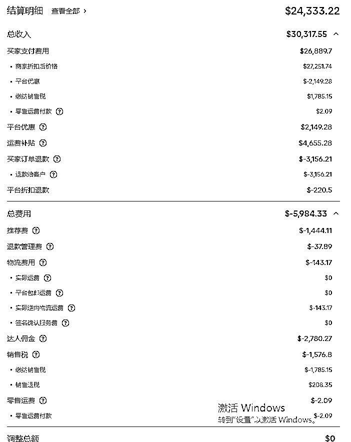

最近，身边从国内电商杀入 TikTok 美区本土店的朋友越来越多，连珠炮似地问我：“美国公司到底要交哪些税？”“公司注册在哪个州更划算？”今天干脆把我知道的都摊开来讲——特别说明一下，我自己投的那家电商公司，现在在美区 TikTok 某个品类里暂列第一，代理商甚至说我们每天的投流花费约占全美 TikTok 投流总量的 1/200，不过这个数字没经过验证，大家听听就行。

眼下 TikTok 的店铺分本土和跨境两类，我主要聊本土店。不少人是让美国的朋友帮忙注册一家美国公司，再去申请 TikTok 店铺，听说这样能拿到流量倾斜，我们没专门做过验证，反正我们自己的店全是本土店，没有跨境店。

先看美国公司最核心的三个税种：

1\. 联邦所得税。税率 21%，早前曾经是 35%，后来降下来了。这个相当于国内的企业所得税，按照公司的净利润来交。

2\. 州和地方政府税。美国是联邦制，每个州都有自己的征管规则，税率各自不同，也按企业净利润计算。我们公司落在亚利桑那州，州税 4.9%。在美国有六个州完全免征州税：内华达州、华盛顿州、德克萨斯州、怀俄明州、俄亥俄州、南达科他州。

3\. 销售税。卖东西或提供服务就得交，可以把它想象成国内的增值税。销售税率同样州州不同，以我们亚利桑那州为例是 8.38%。消费税为零的五个州：阿拉斯加州、特拉华州、新罕布什尔州、蒙大拿州、俄勒冈州。

这里有个好消息：亚马逊、TikTok 等美国电商平台眼下基本都开通了销售税代扣代缴，企业不用再自己跑申报，省下不少功夫。否则销售税还会因发货地和收货地不同，算起来相当复杂。

除了上面这三类，还有几个税要留意——如果你不在美国雇人的话，完全可以跳过：

雇主税：社保税和医保税都算在内，雇主得同时向联邦和州的机构缴纳。

财产税：公司名下的房产、设备这类资产，要按价值交税。

资产税：每个州有权单独定征收口径，所以各州之间差别不小。

其它税种：像职业税、许可证税这类，要根据公司注册地的具体规定来看有没有。

接下来重点提醒一句：别走“买单出口”！

好多卖家为了省事，直接让物流公司代办出口，自己不去报关。所谓的“买单出口”，就是本身没有出口权、或者不想用自己公司抬头的人，花钱去购买别的有出口资质公司的单证——包括发票、装箱单、报关委托书、核销单、特殊证书等等——然后拿对方的抬头去报关。

听着简单，可这样做非常不合规，极易滑向偷逃税、逃证、非法外汇交易那一串麻烦事。要知道，绝大多数商家的货出口本来就免税，单证齐全还能退税。最近因为“买单出口”被查出来要求补税的例子特别多，追溯期又长。本来你一分钱税都不用交，这么一搞，从万里汇之类的第三方支付平台回来的款就解释不清了，回头还得再补一笔。

申报时间也帮大家整理好了：今年 1 月 29 日开始报税；4 月 15 日是联邦纳税申报和缴清税款的大限；实在来不及可以申请延期到 2024 年 10 月 15 日，但前提是必须在 4 月 15 日前把延期申请递上去。

我是郑玉斌，干财税十年了，专门帮国内外电商公司做税务合规与筹划，目前给好几家年营收超 10 亿的电商公司当顾问，自己也投了几家细分赛道第一的带货公司。幸会。

评论区里，有朋友留言说“感谢生财裴勇俊的分享”，我一开始还愣了一下，去百度了一下这位是谁哈哈。总之，正在做 TikTok 美区的朋友，欢迎随时过来聊。

