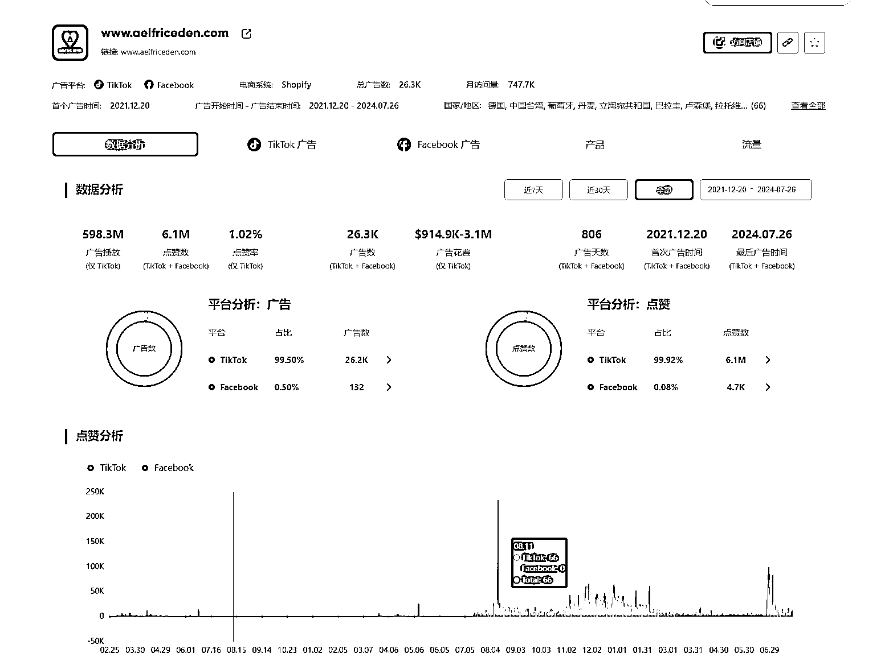
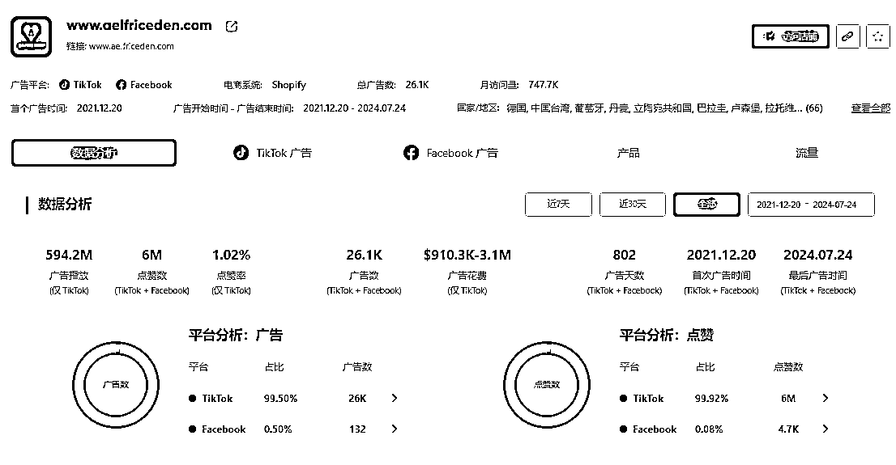
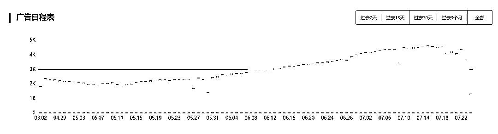
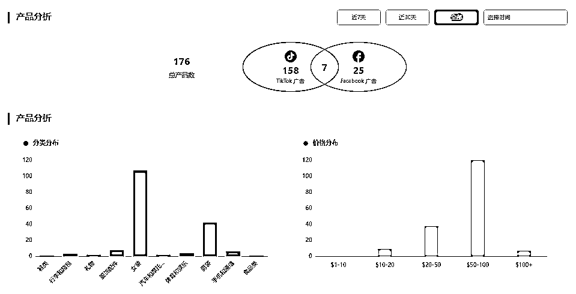

# 出海营销案例：TikTok 九亿级曝光是如何炼成的？Aelfric Eden 靠街头文化打动 Z 世代

## 出海营销拆解：Aelfric Eden 用街头潮流在 TikTok 杀出九亿热度

作者：梁小伟

日期：2024-07-26

根据 pipiads 的大数据监测，品牌 aelfriceden 在多渠道投放的累计曝光逼近十亿，而实现这一成绩所用时间却不足一年。究竟是什么样的打法，让这个街头新锐品牌完成突围？

广告主链接：[`www.pipiads.com/zh/advertiser-analysis/62184b819a301ef93d2475db/`](https://www.pipiads.com/zh/advertiser-analysis/62184b819a301ef93d2475db)

街头文化正重塑全球潮流版图

源自城市街头的街头时尚，以其强烈的原生感、丰富多元和极强的实用性，近年来快速攀升为引领全球时尚风向的重要力量。欧美年轻群体对街头文化的热爱持续升温，相关品类和市场也在不断扩张。在产品更迭加速、品牌生命周期缩短的激烈赛道里，Aelfric Eden 借助 TikTok 的多元化营销玩法，实现了逆势增长，迅速跻身 Z 世代的心头好。

#### 品牌速写

Aelfric Eden 由一位亚裔美国人创立，从诞生之初就承担着东西方美学融合的使命。该品牌尝试把亚洲街头语汇与西方设计语言结合，塑造出独具辨识度的时尚表达。创始团队希望借此打破亚文化与主流文化的壁垒，推出更具包容性与多元性的产品。

品牌主营印花卫衣、图案 T 恤、夹克及各类配饰，设计中糅入滑板、涂鸦、网球等多元街头符号，以新颖大胆的视觉吸引年轻用户。Aelfric Eden 试图将小众街头的文化元素推向主流时尚，这一点与 Z 世代追求多样、崇尚包容的价值观高度契合。整体风格大胆张扬、色彩饱满，因此在全球范围内收获了大量年轻粉丝。

据 PIPIADS 数据显示 Aelfric Eden

广告开始时间:2023.08.17-2024.07.23

广告播放:**594.2M**

广告数：**26.1k**

广告天数：**802**

pipiads 近期新增功能支持同步追踪 TikTok 与 Facebook 的投放动态，帮助我们更立体地解读品牌投放策略。

从监测结果来看，Aelfric Eden 的投放重心明显偏向 TikTok。

从投放日历来看，品牌在多个节点持续加码推广，投放节奏密集且稳定。

总产品数：176

TikTok 素材库统计显示相关广告累计播放约 24.8M。

其视频内容多采用快节奏剪辑，在短时间内串联多个场景与单品，信息密度高。场景频繁切换带来强烈的观感冲击，既提升了趣味度，也有效延长了用户停留时长。

暂时无法在飞书文档外展示此内容

* * *

评论区：

暂无评论

* * *