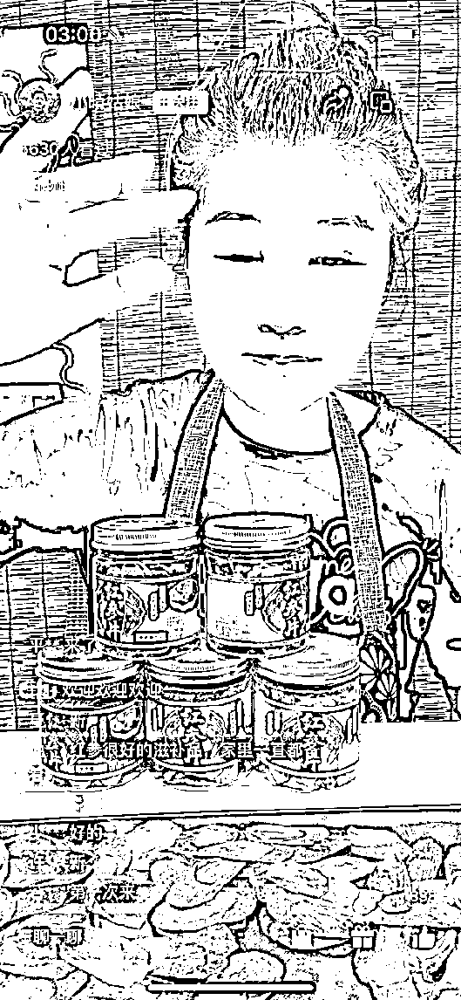
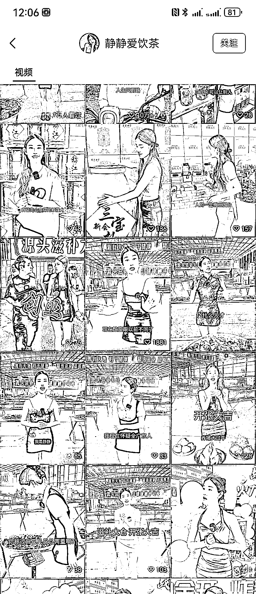
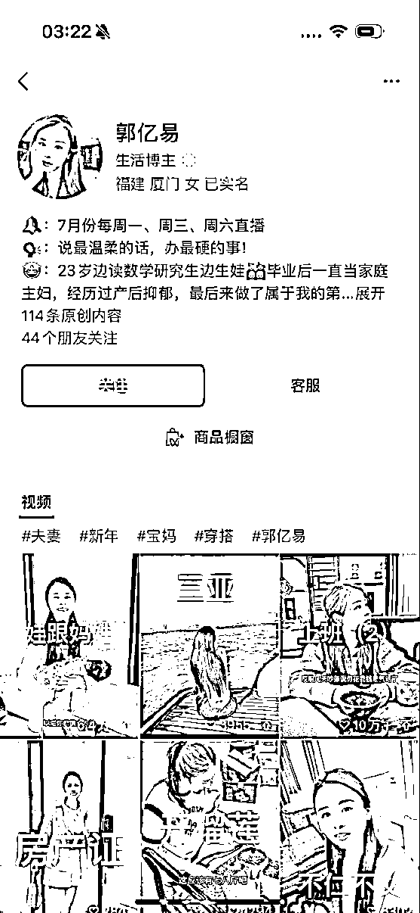
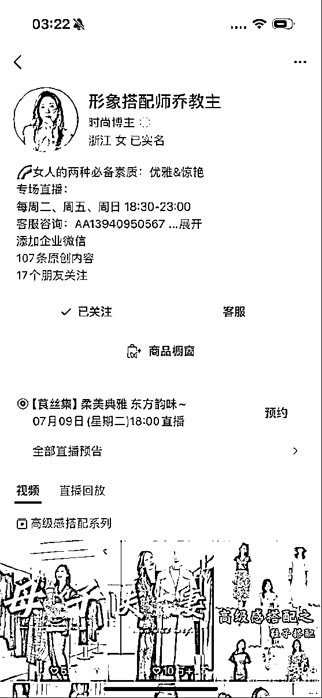
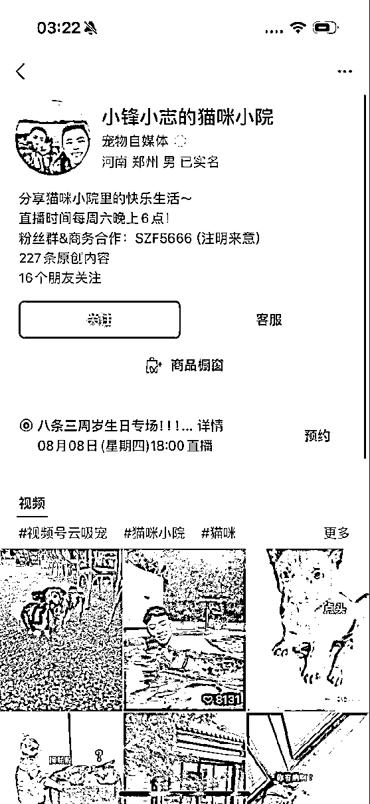

# 视频号现状与玩法解析：竞争小、天花板低、利润可观

最近总有朋友问我：视频号还能入局吗？到底有什么玩法？我在这里统一做个梳理。

我先简单自我介绍：我是一家电商MCN机构的负责人，从2022年初就开始扎进视频号这个赛道。几年间，我亲身经历了搬运混剪、无人直播、挂车投流、半无人直播、IP化直播、直播打品等各个阶段，也算是看着这个平台一路走到今天。

**先说结论：视频号现在的机会在利润，不在规模。**

如果拿抖音做参照，视频号的竞争压力确实小了不少，但它的市场容量和发展上限也不高。想在视频号里做出巨大的盘子，几乎不太现实；但如果你想闷声赚点稳当的钱，视频号目前仍然有一片相对宽松的空间。

不仅竞争缓和，视频号整体的玩法和套路，本质上就是抖音早年历史的回放。换句话说，现在视频号上玩的东西，大多都能在抖音的发展轨迹里找到影子；而这些玩法未来的走向，大概率也会走上抖音那条路。

下面，我把视频号上目前还活跃的几种主流模式逐一拆解。

### 第一站：短视频引流，爆款视频助推直播间成交

我在2022年3月初次尝试视频号时，用的就是这套打法。当初最简单粗暴的操作，是从抖音搬视频过来，哪个视频有爆的迹象，就在直播间里挂上简陋的场景去转化。

那时视频号电商方兴未艾，玩的人不多。我在实操中很快得出两个结论：**都不要混剪，直接搬运就行——平台让过就过，不让过剪辑再细也过不了；在红海平台要去做蓝海类目，在蓝海平台反倒要扎进红海类目去干。**

我早期有一批学员，真的就是原封不动地搬运，不做任何二次加工，也别去选什么冷门品类，直接冲进女装、鞋类等热赛道。作为最早吃螃蟹的那群人，大家确实赚到过钱。

但后来越来越多人涌入，搬运起号的难度陡增，平台的打击也在收紧。不过，从短视频拿流量、直播间做转化的逻辑并没消亡，只是一路迭代，到现在仍然成立。

**其一，混剪搬运。** 这套玩法还在，只是战线收缩到了蓝海或小众单品，素材和剪辑上也得下更多功夫，才能躲避查重和审核。如今仍有人靠它获利，但天花板明显，多集中在细分品类里；而那些硬碰大类的混剪号，则往往会陷入屡做屡被限流的循环——账号没被封，但流量彻底没了。

**其二，真人口播＋混剪画面。** 这个模式是视频号眼下的热门玩法，同样脱胎于抖音。抖音过去曾流行一种视频：主播不需要样品，不需要复杂场景，一镜到底，只出镜说文案，或配上些产品素材的混剪。这种模式门槛极低、成本可控，因此在搬运号受审核挤压后，那些做不出优质原创内容的商家，就把目光瞄向了这里。视频号的内容生态本来就不算饱和，所以这类视频如今仍有生存空间。

但这类内容的制作水准普遍不高，达人表现力也不算强，能火的靠的多是夸张化的文案表达——说得直白点，不少都带着“智商税”色彩，个别甚至接近骗人。也正因如此，平台治理的速度很快，这类账号往往只能存活几天。

不过，也有合规的玩家，他们会在达人特质、文案脚本、场景设计等细节上真正下功夫打磨，但这需要的就是一个具备专业技能的小团队了。

**其三，IP切片。** 实质还是二次混剪，只不过做的是平台认可的混剪方式。比如小杨哥、郝劭文的切片，把头部IP的直播素材或短视频拿来重新编辑，再发布到视频号。然而一旦视频爆了，系统会发起人脸识别，要求提供视频中人物的资料审核，否则就会判定违规并被限流；只有取得IP授权并提交认证，才能过关。

所以IP切片的核心壁垒就两条：一是拿到本尊的授权，二是剪辑要足够精细，避开同质化内容。这个模式可以长期做，但想赚到钱，拼的还是IP资源的优劣。大IP不难授权，但剪辑的人也多得惊人，想从中冒头，要么内容能力极强，要么组织力惊人——能拉起一支规模不小的剪辑队伍；而太小众的IP自带流量微薄，内容也不够出彩，怎么剪都难以破圈。

**其四，原创素材。** 回归内容电商的根本：踏踏实实做选品、写好脚本、拍好剪好，围绕一个跑出来的爆款脚本反复打磨，把一个单品、一条素材的流量价值榨到极限。这个模式无需多言，拼的就是团队硬功夫。

### 第二站：短视频挂车＋投流付费

这是视频号的元老级别打法，短视频直接挂购物车成交，再借助微信豆烧量拉增长。

这套路数在2019年的抖音豆荚时期就有过，本质都是投流换结果。早期监管不严、竞争不充分，大量夸张宣传的产品和内容依靠高毛利高转化，让不少人赚了一波。

视频号也复刻了这一幕：2022年前后，一批玩家依靠“短视频挂车＋微信豆投放”收割了红利。后来入局的人越多，平台规则也越严，留给违规产品与夸大宣传的生存空间被急剧压缩。全靠混剪+夸张说辞的账号，被限流的概率越来越大。

但和搬运混剪一样，这种现象也“剿不完”——利润虽薄了，还是有一批人在细分品类、细分内容里，用混剪短视频加上微信豆投放，低调地活了下来。

与此同时，有人也选择完全合规的原创路线，同样是选品、脚本、达人一整套体系，无需多提。

这里我单独说明微信豆和ADQ的区别。**微信豆是视频号板块自己的投放工具，只能在视频号站内跑，触达的用户基本都带有较清晰的画像，因此流量更精准；而ADQ属于腾讯广告部门的投放工具，覆盖的不只是视频号，还包括朋友圈、👸号、小程序等场景，所以流量相对泛一些。**

视频号挂车投流的初代逻辑就是纯微信豆，问题是微信豆不太容易放量。所以有些商家会加投ADQ，但这要求产品的毛利率更足、短视频素材更能打，通常只有“超智商税”产品才能覆盖成本。这种玩法需要一定电商操盘能力、团队基础和资金体量，散户玩家建议绕道。

### 第三站：微信豆直播打品

经常刷视频号直播广场，你会看到不少场景简单、主播平平、话术直接、只卖单一品类的直播间——主播就坐在镜头前，反复循环讲解同一款产品。这类直播间，靠的就是微信豆付费打品模式。

这种直播间在抖音基本活不了，但在视频号里还能占据一席之地。它的核心逻辑很简单：唯产品论，运营的目标就是用最低成本和最快速度，测试出能爆的货。

和搬运混剪、口播短视频相比，这种模式难一些；但对比传统直播间，难度已经算极小极小了。一个人也能落地：租个民房，搭个简易直播间，自己选品、写话术，再请兼职主播来播。测出一个表现合格的主播后，就可以开始大量测品。

不需要做短视频，直接微信豆付费直投直播间。一旦ROI能做到打平或微利，就马上围绕这款产品优化话术、优化主播表现，然后通投拉满。需要强调一点：这类直播间只能用微信豆投放，ADQ带来的泛流量太杂，以这种直播间的转化力根本接不住，投放就是亏钱。

跑通这个模式的关键就在品。滋补护肤类目是这种打法的核心战场。货是有生命周期的，所以打品团队只能持续测品，不断寻找下一个爆款。

做得比较久的打品团队，如果管理跟得上，还会慢慢沉淀出一批质量不错的主播。这些主播反过来又能承接刚需更稳定、生命周期更长的产品，壁垒也就建起来了。等手上有长线产品、也有稳定主播，团队就可以尝试叠加短视频素材，甚至往私域导流，寻求更大空间。

### 第四站：自然流直播IP

如果你关注过茶叶类直播间，会看到一种完全不靠短视频、没有付费流量加持、单靠自然流量和极少短视频辅助就能跑通的形态。

这种直播间和打品直播间的最大区别，在线路布局和货品结构。它们的场景经过精心打造，主播形象也经过一番设计。主播自身必须具备极强的观众缘和表达功底，靠人格魅力让用户产生信任，最终促成成交。

这类直播间的核心资产就是主播本人——如果上一打法的内核是测品，那么这个打法的命门就是选人。场景能模仿、文案能借鉴、排品能抄，唯一模仿不来的，是主播个人的形象谈吐与感染力，所以我们叫它IP打法。

与此同时，这种玩法的门槛明显提高。主播需要在培养过程中层层筛选，背后必须有成熟的团队和合理的孵化流程兜底。选人需要时间，这就让试错成本居高不下。但高门槛也带来高壁垒：同行难复制，直播间的生命周期也天然更长久。

### 第五站：付费流直播IP

还有一类直播间，同样极其看重视主播选拔，对主播的个人综合能力要求极高，但它们的核心流量来源是付费投放，且是微信豆＋ADQ并行的组合。

自然流主播流量成本低，但上限肉眼可见；即便叠加微信豆，量也依然有限。于是有人开始加投ADQ。

但前面说过，ADQ的人群很泛。要接下这种泛流量、并且还能从中获利，需要几个条件同时成立：产品毛利率必须足够厚，直播间转化能力要足够凶悍。这背后是主播能力极强，还要有副播、场控等一整套配置，以及团队具备制作优质短视频素材的能力。只有这些全部对齐，在ADQ放量时才能保证不亏。

这个打法的难度和试错成本都到了相当高的程度，对团队的考验是全方位的：资金实力、供应链、内容创作、投放技术……每一样都需要时间和“学费”才能积累出来。小团队就别轻易碰了，零经验团队贸然来做，准备100万起步的试错预算才算正常。

### 第六站：人设IP

这是我个人眼里最香、门槛也最高的一种打法。对达人的要求极其苛刻，对内容团队的要求同样拉满，这就是人设IP。

无论是垂直领域的大V，还是泛生活化的剧情角色，核心路径都是统一的：靠高质量短视频立住一个真实、有温度的人设，先圈住粉丝的信任，再在直播间完成卖货变现。

这套玩法不是砸钱能砸出来的。你需要一个真正懂内容、有内容基因的团队，再去碰运气遇到一个有观众缘、表现力强、又有带货天赋的好苗子。可一旦这样的IP被孵化成熟，它能带来的回报就非常惊人：生命周期极长，利润率极高。

### 第七站：视频号小店

2022到2023年那会儿，视频号小店还给过不少中小商家喘息的空间，甚至纯靠无货源模式也能活得很滋润。因为早年间平台后端非常单薄，入驻的商家凤毛麟角。但随着平台高速成长，涌进来的店家越来越多，小店的竞争局面已经白热化。

如今拼的完全就是供应链和成本优势。有些商家给达人的佣金开得比别人高，自己还照样赚钱；你跟进去，就只能保本甚至微亏。除了供应链，商务团队、客服体系、售后服务，也是全方位的降维打击。

一句话总结：红利期结束了，真正有实力的产业玩家已经下场。

那些还在艰难撑着的小卖家——尤其是无货源玩家——我真心劝一句：保持佛系运营，做到彻底没利润那天就体面离场，赶紧着手去找第二增长曲线吧。不管是卡搜索、卡排名，还是费尽心思去联系达人，在绝对的实力差距面前，都是无用功。

### 最终总结

视频号的轨迹，就是一出抖音历史的翻版：抖音的今天，就是视频号的明天。做后端的，终归要回到供应链的较量；做前端的，终归要回到内容的比拼（短视频也好，直播间也罢）。留给普通人打游击战、抓红利的窗口期，正在肉眼可见地关闭。

对没有资金、没有硬实力的小商家和小团队而言，眼下仍然可以赶在红利彻底消失前，去做做搬运混剪、微信豆打品这类模式。但在打游击的同时，必须时刻牢记“广积粮、高筑墙”——把赚到的利润用在团队升级、内容升级这些刀刃上，为将来市场进入充分竞争的那一天做好准备。

否则，等潮水真正退去，你还在沙滩上裸奔，就只会面临被淘汰的结局。然后再被迫换一个平台继续打游击，不断重复低水平的循环。

* * *

评论区：

刘 Leo : 有用

慧犀 Christin* : 谢谢盗坤老师分享。言辞中肯。[玫瑰][玫瑰][玫瑰]

凯文 : 分享的很合理[强]

微风 : 手动点赞，值得反复观看 👍 π : 受益匪浅

刘飞 : [强][强][强]

南淮 : 感谢分享

Dreamland : 跟坤哥一起进步[偷笑]

* * *