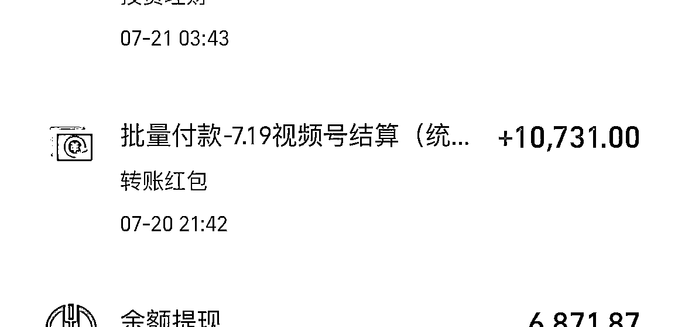
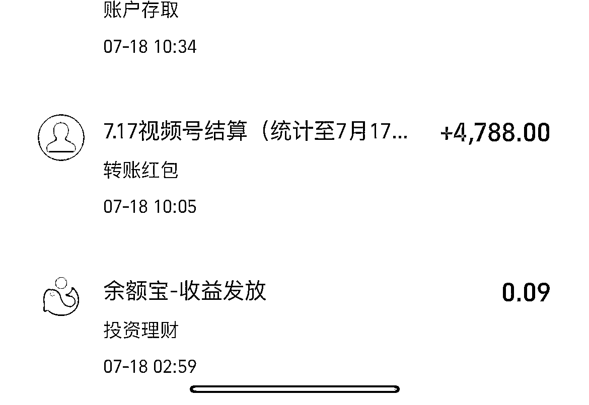
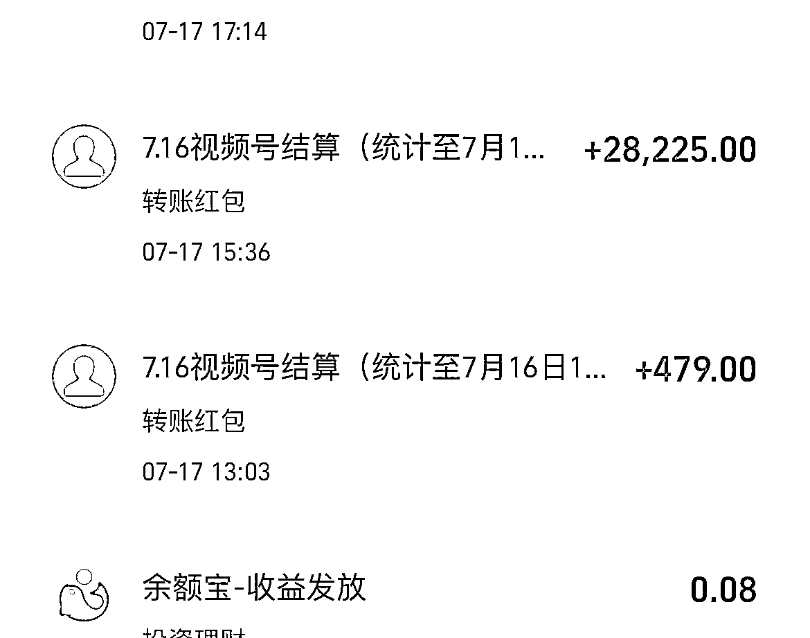
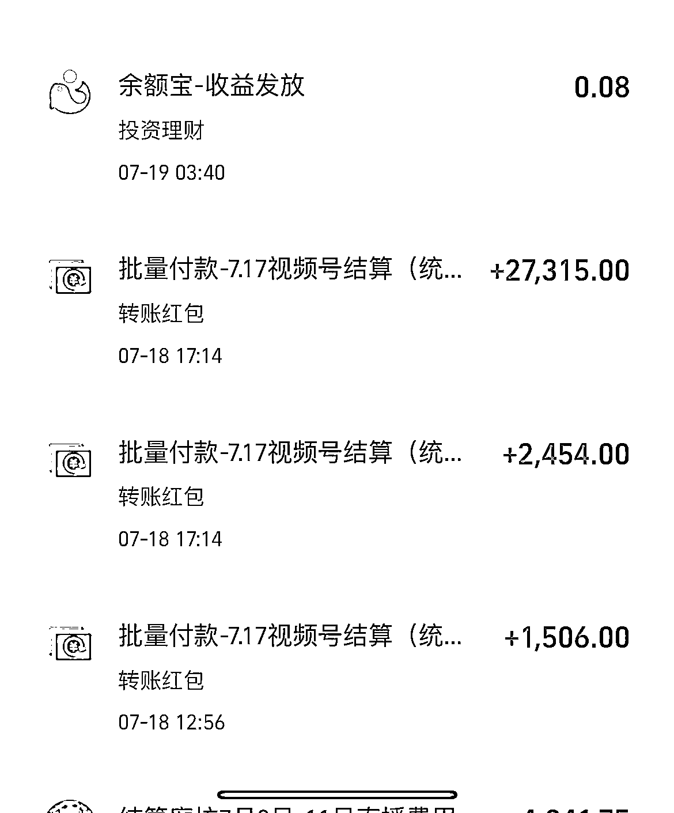
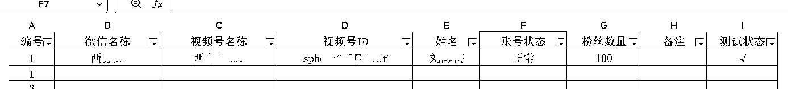
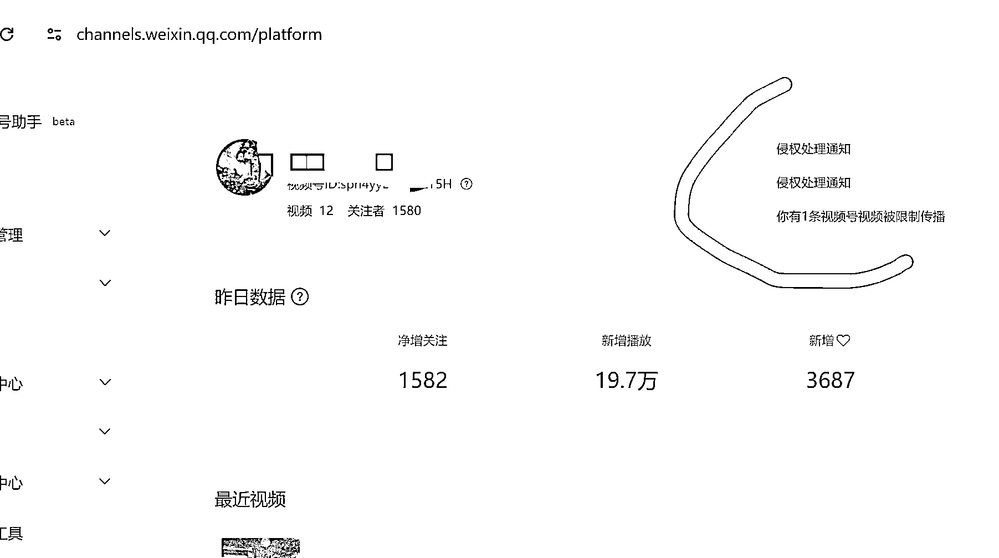
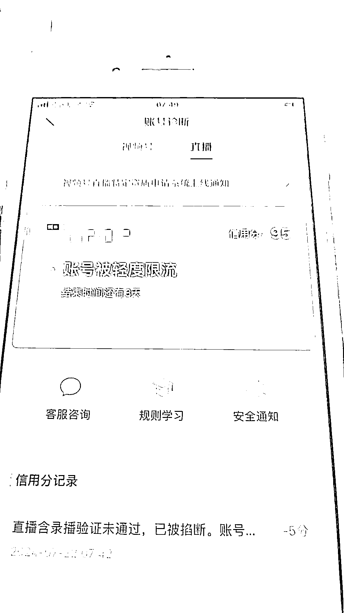
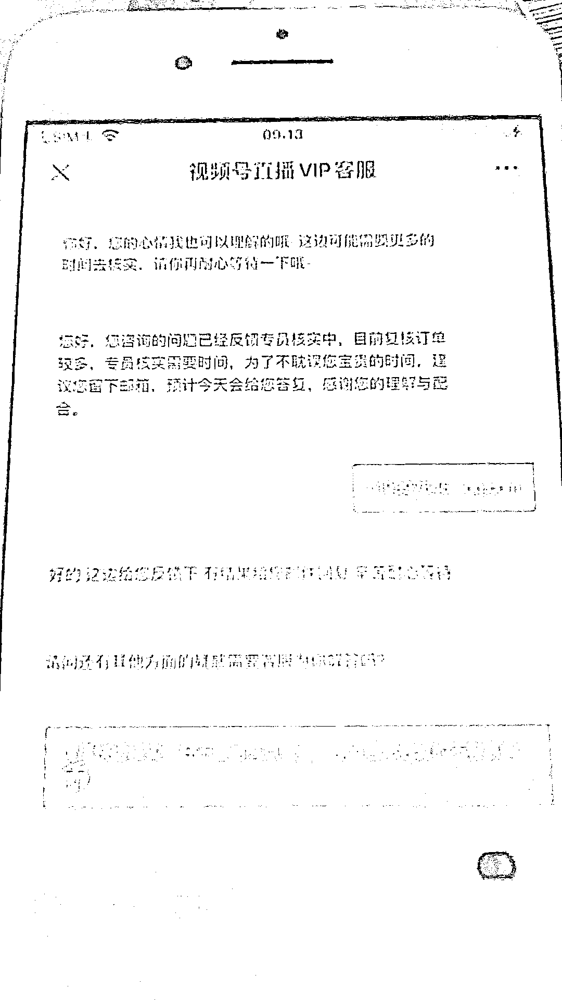

# 十天日更口播，视频号到手20万，我的实操全复盘

> 原文：[`www.yuque.com/for_lazy/zhoubao/era3nsbx6y61w8fg`](https://www.yuque.com/for_lazy/zhoubao/era3nsbx6y61w8fg)

## 10天日更口播，20万到账复盘

作者： 瀚水长流

日期：2024-07-25

各位好，我是瀚水长流。视频号带货这条路，我从6月底开始亲手上手，准备了几天后，7月11号正式开始打单。少废话，先看最近的实打实到账截图：

我现在主攻的是百货类目。说实话现在百货的风控比以前严了不少，但变现能力依旧很猛。所以我直接上了10个号做矩阵，跑下来的反馈非常可观。

下面我把从入局到现在，我都干了什么、怎么操作的、踩过哪些坑、该怎么避雷，全部摊开了说：

## 一、新手做号一定要先把管理理顺

刚起号就要用表格把号源盘清楚：微信号、视频号主体、视频号ID全部记下来。以后号一多，不会乱成一锅粥，也方便回头做垂类梳理。

习惯一定要早点养成，别觉得一开始一个号没必要。等你想复制起量模式，一次性要跑五六个、十几个号，手机一多，有没有表格决定你能不能稳住节奏，后面做矩阵也一目了然。

## 二、口播抠像快速起量的实战经历

**先说我7月11号起打品的那段经历：**

第一单选的是马桶清洁剂，心里没底就先刷广场，发现这个品有两个号已经炸了，信心一下就起来了。能爆的别人能做，我没理由做不了。

于是直接拿现成素材去剪片。身边有个小团队一起打，专门有人负责拍素材，信息共享，所以视频就不方便放出来了。

素材大概晚上6点多发出去，前两个小时我一直盯着数据，心里特别悬。到了9点多有个号播放冲过5000，橱窗开始冒单了，我立刻就开播转化。

当天一共上了5个号，其中3个都炸了，但我当时根本没当回事，特别后悔，只开了1个号在播，当天卖了13000多。流量还在往上走的时候我觉得播不动就下播了。回头想，应该第二天立刻补视频，继续拉直播时长。

第二天没停手，直接换品继续打。播放到5000、点赞每分钟10+我就敢开播。下午3点开播一直播到晚上9点多，直播间同时在线600多人，而且基本都是短视频导流进来的精准粉。当时我觉得这个号至少能打个十几万出来，结果翻车了：

用的素材是别人的原创，忘了提前报备，被原作者直接投诉侵权，号瞬间没了。当时那个心情真的没法形容，太致命了。之后这种低级错误我再也没犯过。

**从这两次起落里，我提炼了几条干货：**

**第一，素材储备量必须达标**
这是最基础的门槛。我现在10个号，每个号每天至少发3条作品。直播的时候，如果5分钟内进人不达20人，就要立刻用备用的短视频去补推。
口播拍摄剪辑本身没有太多玄机，靠的就是高频练习，日更+复盘。

**第二，执行速度必须拉满**
看到不错的品就要立刻跟进，哪怕你觉得时机不对，也一定要持续观察广场这个品有没有持续被打。如果广场上没人打，或者打了几波效果一般，可以再观察；一旦刷到好几个都在爆，就别再犹豫，立刻跟上。
另外，号一旦爆了要马上开播。我前面爆了3个只开1个，血亏。

**第三，低级失误绝对不能碰**
发片前我现在固定做4件事：
1. 看账号状态是否健康，加热是否正常
2. 先测试开播，看看要不要刷人脸。新号一般要经历3-4次刷脸认证
3. 用了他人素材，提前报备是必须的
4. 开播前准备几条随手拍的备用视频，一旦被限流可以立刻申诉
补充一句：号少的时候别碰高危文案。

**第四，别内耗，给自己点信心**
既然已经选了赛道，犹豫的时候别反复想。你的前辈经验比你多，他们在冲你就跟上。做生意哪有100%保证，先上车再说。

## 三、怎么把爆品快速放大

我的放大逻辑很简单：

先用3-5个号去测素材，确认爆了且违规率可控，就把这条素材通过去重剪辑的方式分发到全部账号。爆了就立刻开播，人手不够就找代播。

吸取了上次教训，现在选品定下来后，第一件事就是报备，转化节奏也快了非常多。这波素材我上了10个号，6个爆了。我和朋友一人播一个，剩下的4个交给代播，连续两天GMV过了7万。

播到后面，有2-3个号流量会时断时续，但只要还在出单，能覆盖代播成本就别停，很可能拉时长后会二次爆发。

事实也确实如此：
当时流量最好的那个号，第三天基本就疲软了，反倒是之前表现一般的号开始后发力，视频播放冲到80多万，当天成交1.8万多。24小时播满被强制下播，必须重开。

**放大后我又连踩两个坑：**

1. 重开播是凌晨两点多，系统提示要扫人脸。我用的不是本人号，当时联系不上人，300多公里过去也来不及。只好等到第二天刷脸再开。教训就是新号一定要提前测试开播，确认是否需要刷脸。
2. 重开播不到一小时，直播间弹窗提示系统误判为录播，直接限流三天。申诉审核花了整整三天。所以大爆间尤其是早上7-9点的高峰期审核很严，弹窗出现一定要第一时间回应，否则就会被限。

## 四、最后的总结

总体来说，视频号口播带货这个项目，我分享的更多是踩坑的真实经历。视频怎么拍，建议大家多去研读航海手册，多练习、多拉片打磨，保证日更产量，别偷懒。我这次用的素材来源有风险，不建议直接模仿。

还有一点很重要，多去问大佬。我刚上手时素材不会找、账号不会管、剪辑也不熟，总觉得大佬没空理新手。硬着头皮问了一次后发现，真正的大佬都很愿意带人。

希望之后能和大家多交流，一起把这个赛道玩明白。

* * *

评论区：

源（📷定金留档，靠谱* : 怎么给原作者报备 ne

希平 : 写的很好，感谢分享，特别是测品那里

华子树 : 坑就是宝贵的经验，感谢分享！

* * *