# 素人做短视频带货，到底是怎么从0到月入15万的？
作者：龙哥

## 素人短视频带货的实操复盘与底层逻辑

作者： 盗坤

日期：2024-07-25

很久没聊视频号了，最近有人追着问，我本来想简单回两句就打发了，结果一写就停不下来，几千字又出来了：[`t.zsxq.com/gKdzU`](https://t.zsxq.com/gKdzU)

说到这儿还意犹未尽。走过的弯路、踩过的坑、攒下的成果，每一段经历都想多讲一点给你们。灵感还在，趁热赶紧写，承接上篇《视频号七种主流赚钱打法总结》的思路，再把我们现在在做的素人短视频带货项目完整拆解一下。

看完上篇应该能明白一个道理：放长眼看，唯有合规且有内容护城河的玩法才能走得更久，空间也更大。特别是最后提到的那种人设型IP，投入产出比简直夸张。

夸张到什么程度？拿我们公司之前孵化的一个抖音达人举例，从0开始培养的签约主播，虽然合约去年底就结束了，但三年下来给公司贡献的利润非常可观。

他入职前是个纯素人，职业健身教练，从没碰过自媒体。我们当时也不敢确定他能成到现在这样。现在的收入就不展开了，随便截张直播PK的图给大家感受一下，27万音浪等于2.7万人民币，平台抽完50%还剩1.35万。

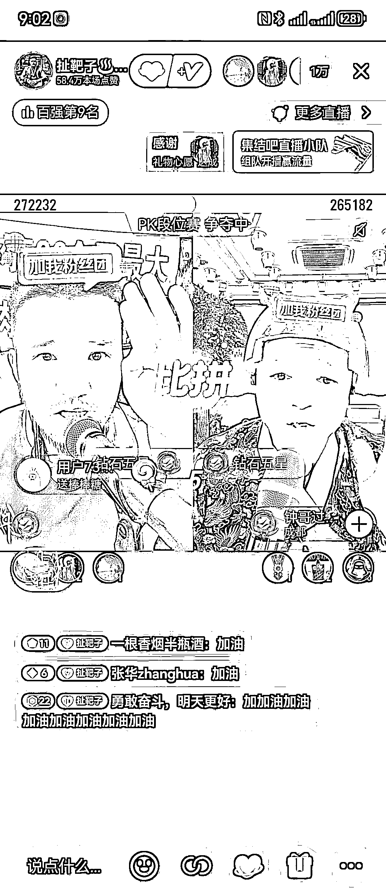

流量爆的时候在线人数能到五万，你自己算算一天、一个月能有多少流水。毫不夸张地说，他一个人的产出，能轻松碾压几十上百人的传统团队。

所以做自媒体这件事，有时候真的不要太早否定自己，给自己设限。小事和大事的难度其实是差不多的。对他而言，做搬运混剪和做个人IP花的时间精力差不多，但最后的回报天差地别。

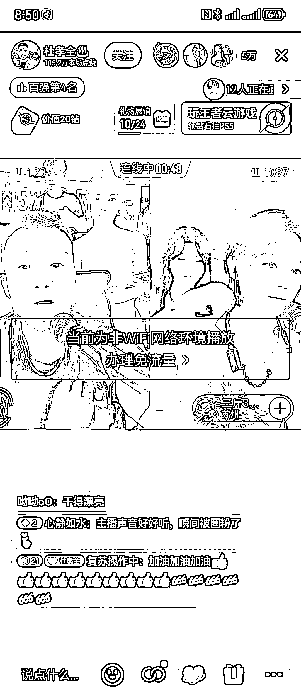

除了娱乐类IP，我们也做过电商类IP，而且变现能力一点也不输。只不过这种IP的孵化难度极高，千里挑一，全看达人的观众缘和表现力。在等待那种“天选之子”的同时，我们也在探索素人也能复制的路径，这就是今天要讲的素人短视频带货，也是重点。

案例账号是抖音的 **路路 lulu 来了（自律版）**。达人就是一个彻头彻尾的素人，还是我老婆。在做这个号之前，她在家闲赋四年，没有工作也没有做过任何副业。选她复盘不是因为关系，同期我们带起来的素人还有好几个，只是她的全过程我最清楚。

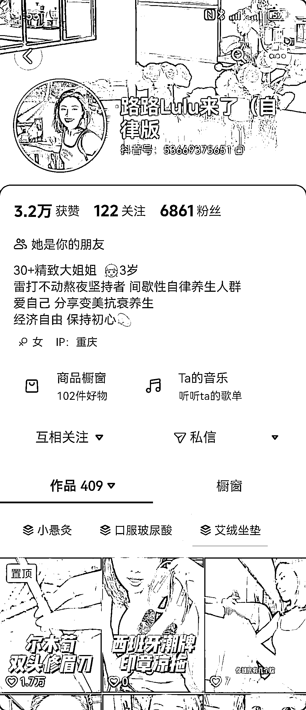

账号现状：截至2024年7月25日，一分钱没投过广告，商家投流除外。账号从3月5日发第一条带货视频算起，到现在发了409条作品，粉丝6861，其中3000多是买的，剩下的3000多基本都是我👸号过来的粉丝，粉丝数可以忽略，关键看带货数据。橱窗累计成交7.8万单。

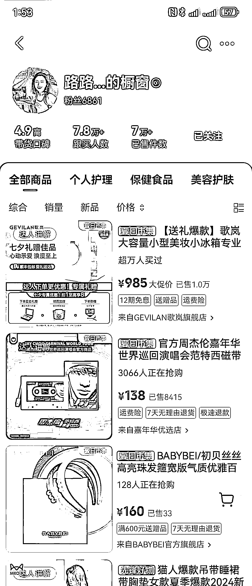

昨天单日GMV接近4.4万，佣金破万，按公司流程达人占50%，到手5339元。近30天GMV130万，退货12万，总佣金32万+，按10%退货率算下来最终佣金近30万，达人到手约15万。

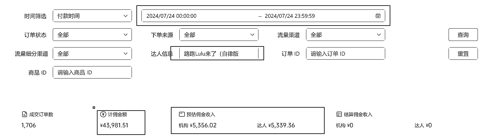

0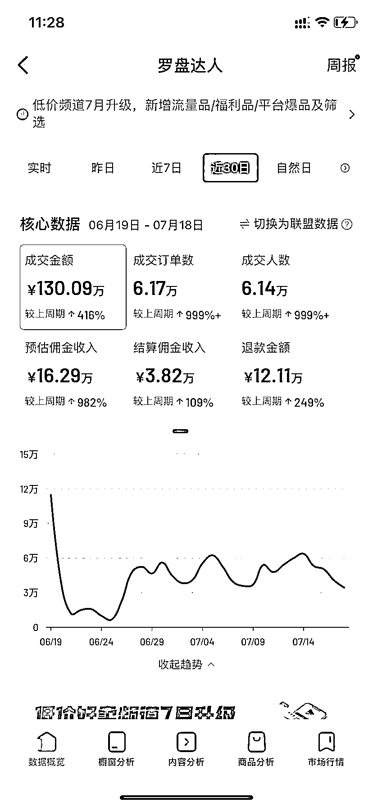

投入成本：前期买粉花了800多元，因为一天要发五条挂车视频需要3000粉，就直接买了3000个千川粉；前期买样品几百块，后面基本都是商家免费寄样；拍摄设备是她自己的iPhone，补光灯是我公司闲置的，几十块也能买到。完全0投放，以上就是全部成本。

背景交代完，我们来拆解账号为什么能起来。

### 一、敬畏常识，日拱一卒，唯有坚持

没错，就是这么朴素三个词。

短视频带货的本质还是内容。**内容过硬，5秒完播和转化才能打过对手，平台才愿意给你更多推流**。内容打磨需要时间，需要反复刻意练习。这就要求达人踏实下来，每天一点进步。

星球里放不了视频，大家可以自己去看她刚开始的作品和现在的对比，质感提升肉眼可见。

除了内容，账号等级和权重积累也需要周期。起号期内容本就不成熟，标签也不准，基础推流自然小。你每天拍视频，播放只有几十上百，还不出单，能坚持几个月？

我老婆第一个月就是这种状态，认真拍的视频出去只有几十播放，全月只卖了23单，到手佣金100.76元。

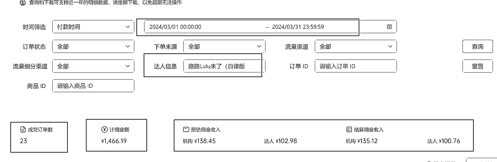

正反馈来得太慢，投入产出极度失衡，窒息感拉满。大部分人到这一步就退了。所以对素人来说，短视频带货最难的不是技术，是扛住这段没有回报的空窗期坚持下来。

**人都想要确定性，觉得只要努力就有回报。但真正的大钱，往往藏在不确定里。**

想有流量，内容必须提质，权重必须上去。可素人做带货时，往往不尊重基本逻辑。一个没权重的冷启动账号，一条质量平平的内容，抖音凭什么推？用户凭什么买？

正因为尊重常识，她从没指望第一个月就能赚钱，只要内容在变好，播放在慢慢涨，对她来说就是进步。

### 二、先用投流品抬权重，再用自然流赚利润

抖音账号的底层是权重，包含等级和标签。

**等级决定首波推荐量，等级越高，基础推送的流量池越大**。等级分八级，每月2号更新，主要看上月GMV。

  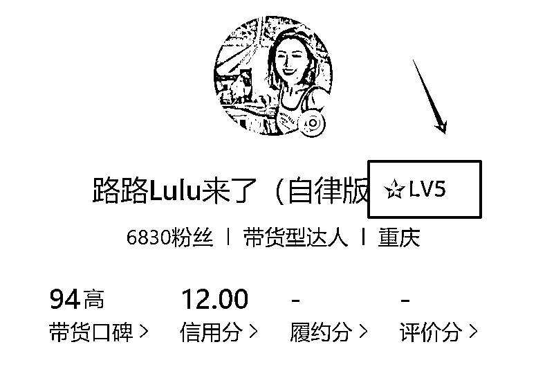

**标签决定首波推荐人群长什么样**。需要同类标签的用户跟内容产生互动，系统才会把你归类进去。我们做带货，最想要的就是目标年龄性别的电商粉、购物粉来互动，从而打上精准标签。

我老婆的号很多视频点赞极低却能成交，就是因为标签极准，全是来买东西的人。如下图，点赞一两个的视频也能卖两千多。点赞是共鸣，购买是需求，逻辑完全不同。

  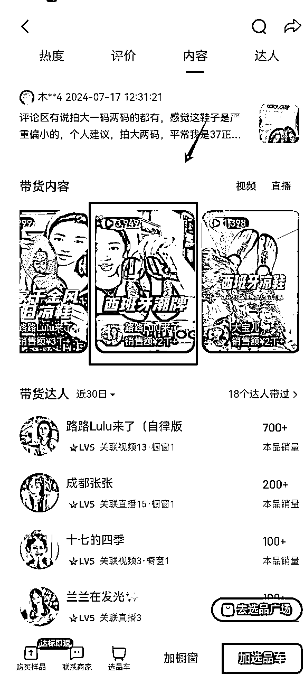

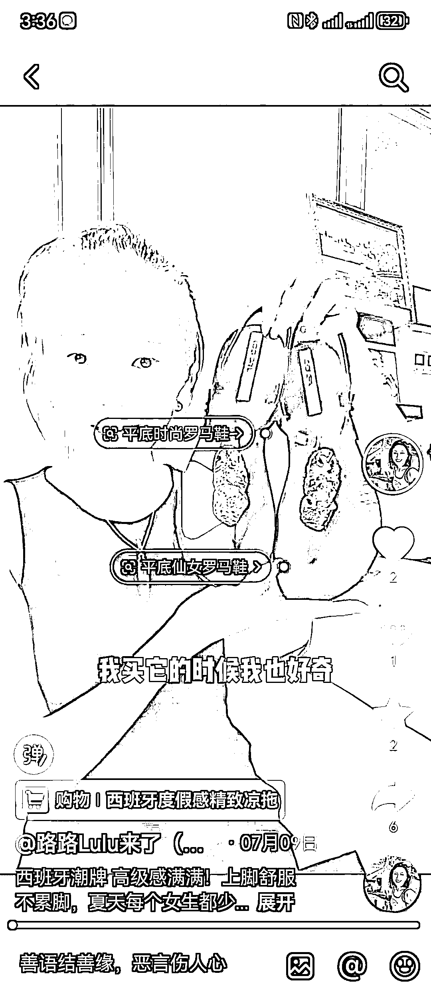

所以账号等级越高首波流量越大，标签越准首波人群越精准，5秒完播和转化就越容易赢，赛马里胜率越高。并且第一波互动的人群标签会反哺系统，持续给你推同类人群。

**因此做账号的第一步就是打标和提级**，拉高基础播放和人群精准度。

怎么做？让购物粉在你的号上成交。

新号有个捷径，就是用商家愿意投的品，用商家的预算帮你冲权重。如图所示，她点赞最高的九条视频里有四条是商家投流的。投流品佣金低，一般5%-10%，不赚钱，但能迅速打标、提等级。系统开始给你推更多精准流量。

  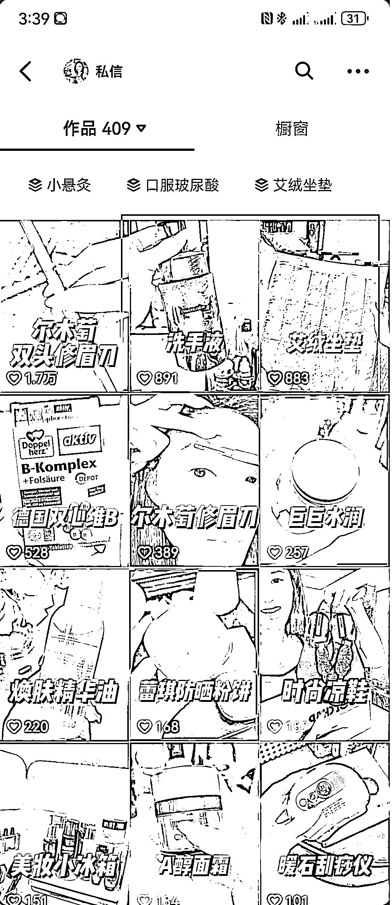

权重抬起来后，基础播放就稳定了，她的号现在基本几千起步，好一点上万几万，基本发一条就有单。

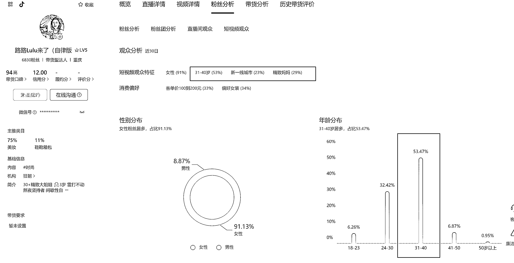

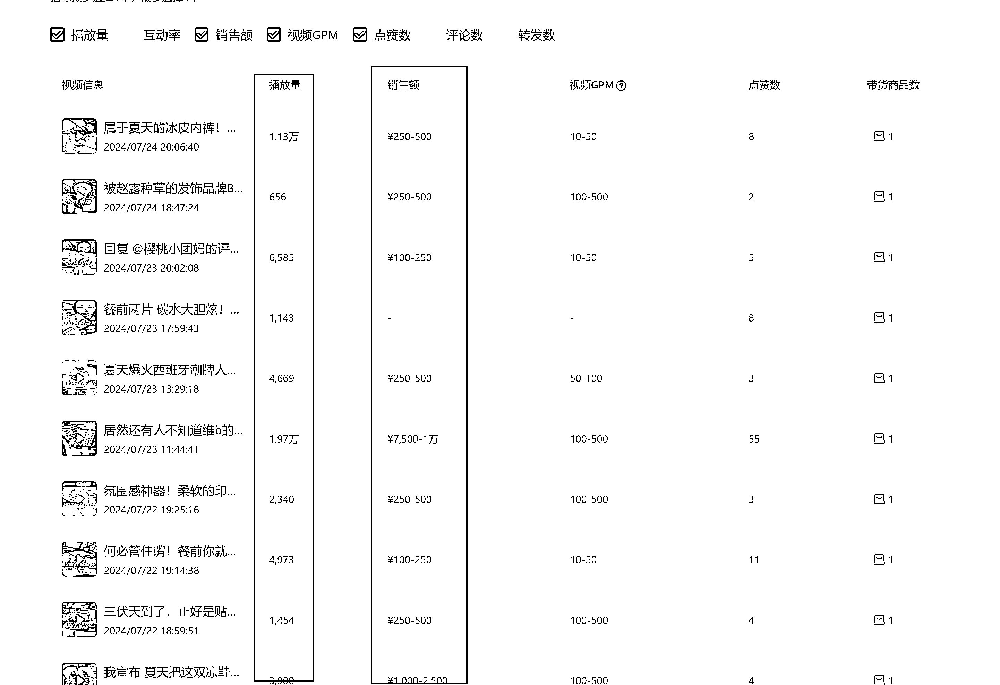

有了流量池，内容能力才是关键。这时就可以筛选高佣自然品来做利润。如图所示，她一条6月15日发的视频，到现在播放900多万，GMV110万，佣金30多万。

  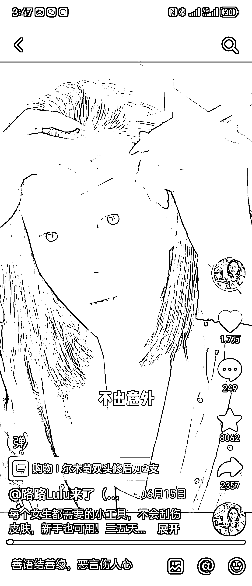

  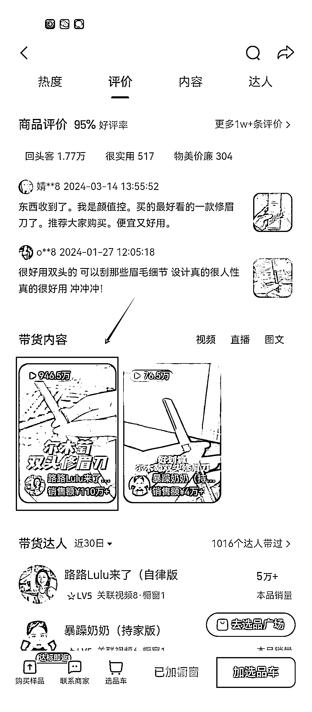

### 三、蓝海选品，用强打弱

短视频带货的竞争是多维度的。选定一个品后，对手数量、对手权重、对手内容质量叠加起来就是你的得分。

我们会根据达人阶段选品。起号期选市场不大但能出单、能提权重的品。账号成型、内容稳定后，再去冲有爆款潜力的品。

比如修眉刀，30天内有531个达人用短视频带货出单，共1373条带货视频，总销量8万+，市场足够，具备爆款基因。

  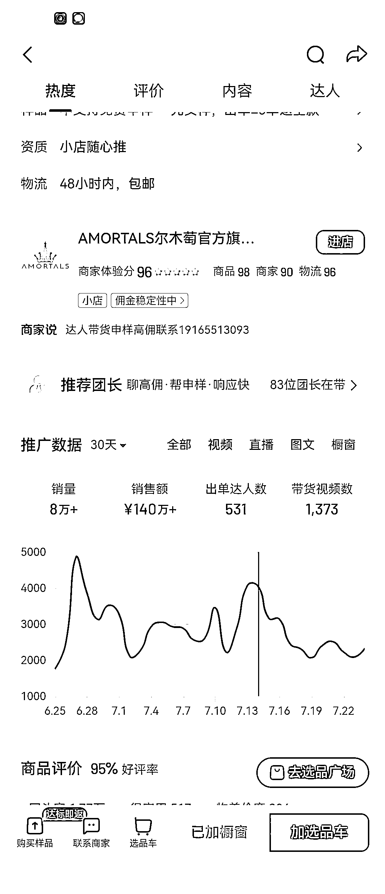

再细看，带过这个品的达人有1016个，其中不少还是2级、3级账号。当时我老婆账号也是3级，权重基本持平。

  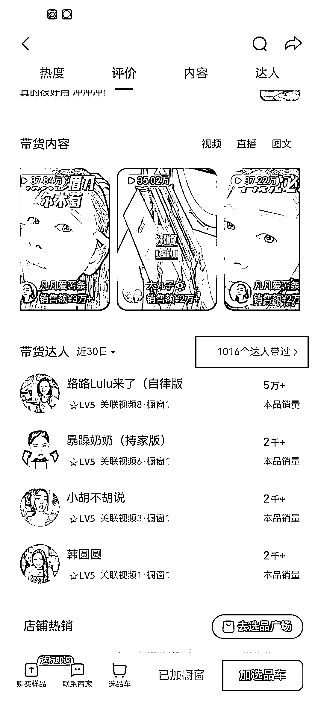

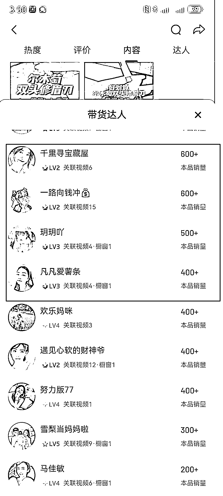

再看近30天出单靠前的短视频，质量并不高不可攀，账号粉丝三四千的新号居多。综合来看，她用强打弱，有机会胜出。

  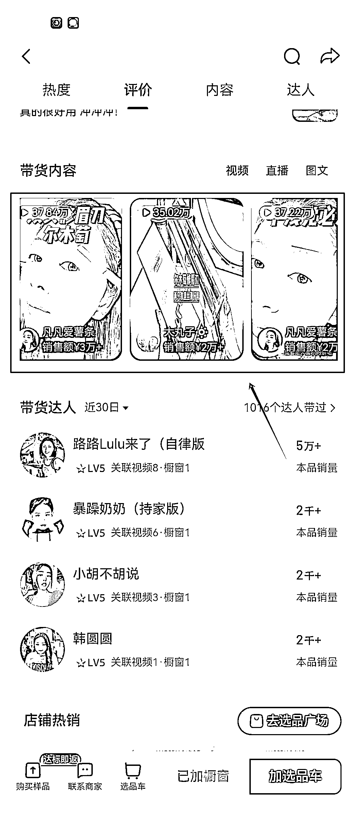

  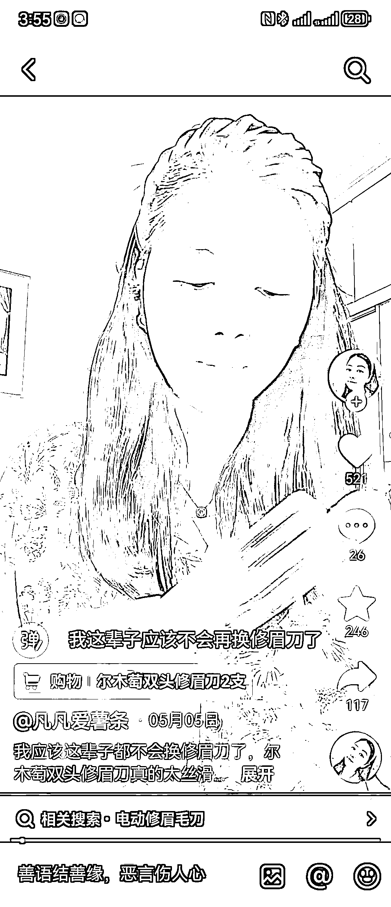

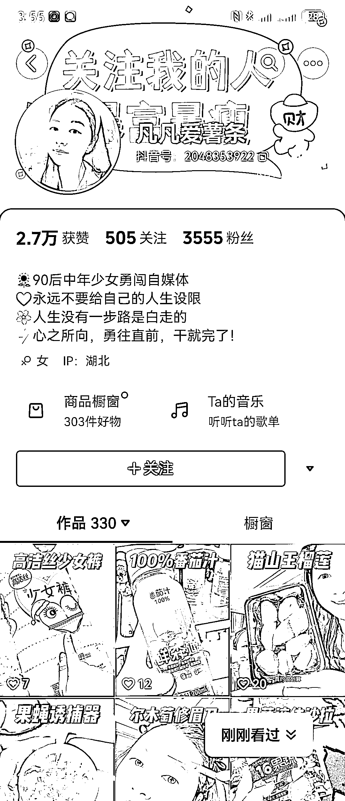

现实当然不会完全按分析走，但这不重要。核心是不断优化细节，提升内容质量，挂不住就换品，持续迭代。

时间差不多了要开会，今天就到这里。希望对正在做短视频带货的朋友有点用，谢谢！

* * *

评论区：

Dreamland : [得意]太厉害了坤哥，每一个成功女人的背后都有一个更加成功的男人

希声 : 收货多多！

回声 : [强][强][强]

老彭 : [得意]太厉害了坤哥，每一个成功女人的背后都有一个更加成功的男人

淋湿雨人的诗 : 这么好的文章竟然不是精华，今天搜关键词才找到

朱较瘦 : 厉害了我的哥

宇星 : 每次看您的文章都有收获，尊重常识 这个点真是给了我很多的思考。有时候焦虑真就是因为不尊重常识的结果。关于选品以及对标的数据分析也是给了我启发。感谢

叉叉敌 : 谢谢分享，脚踏实地+不停的调整+选一个蓝海，下一个就是自己

* * *