# 重新回归创业：选择小餐饮技术培训项目的心路历程

我是大海，一名重新归队的老圈友。21年加入赚钱，中间因为上班停了一年没续费，今年418又回来了。

这几年短视频风口肉眼可见，身边不少年轻人在抖音上做出了成绩。我也鼓起勇气再次出发，选项目时跟很多圈友一样纠结。我的思路很简单：多看项目、多比较、结合自身情况做判断。看过家庭教育、大健康、国学身心灵疗愈，最终定在一个门槛低、一个人能启动、只耗时间不耗额外资金的方向——小餐饮技术培训。

很多人不清楚这是什么，简单解释：帮口味好、生意实的餐饮老板做抖音，不做同城引流卖产品，而是面向全国招学员。学员到店由老板负责教，学费通常五五分。

讲讲我的过程和成绩：

1. 五一后开始研究这个赛道的流量玩法，做项目调研
2. 5月16日谈下第一家合作方——一个夜市卖卷饼的摊主
3. 5月31日发出第一条作品（抖音+小红书，账号：朱姐爆汁卷饼摊）
4. 六月底微信上有一百出头意向学员，成交5个，学费2180/人
5. 截至7月19日累计加微224人，成交9人。还有些高意向在观望，成交周期会拉长，需要用朋友圈慢慢“洗”，行业转化率通常在3%~6%

虽然数据不大，但我复盘后发现整个路径对想做事的人可能有点参考价值，展开说说过程。

五月初定下方向，我就开始在抖音“蹲点”优秀同行，研究账号搭建、视频结构、文案套路、私域打法，前前后后看了30多个账号。有个细节很触动我：三个月前刚起步的新号，粉丝不过三万多，单月收学员一百多人，客单价3980，月收入40多万。而且不止一个号这样，说明这行能干，做到60分也有结果。

合作方我特意找摆摊的，不找开店的。调研后我发现，摆摊招学员比小店容易，小店比大店容易。逻辑也通：拿得出十几万开店的人少，拿几千块摆摊的人多。南京夜市多，我挑了四个挨个逛，看哪些摊人气旺、有排队。聊下来大多数老板都愿意合作——我不收任何费用，招到学员才分成，没招到我一分不拿。流量归我，教学归老板。

谈合作有几个窍门：

第一，开场就强调不收钱，先打消老板戒心，不然话都聊不下去

第二，很多餐饮夫妻对互联网没概念，不知道招学员比做餐饮赚钱得多。我直接甩案例给他们看：指一个几十万粉丝的账号说是我以前合伙做的，一个月能招上百学员，现在单干，看你家生意好所以想帮你做。实际上那账号跟我没关系，创业嘛，偶尔还是得使点小聪明，圈友们别学我哈

第三，权责清晰。摊主基本是夫妻档，需要老板或老板娘出镜配合拍摄。账号我注册、客资我接、私域我成交，成交后学员到摊位学技术就行。他们做餐饮本来就忙，不想耗太多时间，所以私域一定捏在我自己手里。账号也一样——别考验人性，真做到月入几十万，你分走一半，老板大概率不甘心。等合作一两个月见了效果，双方都有诚意，最好补一份合作协议，保障各自利益。做IP不容易，做完被踢开就全归零了，这点要小心。

当时谈成三家：肉饼、爆肚、卤肉卷饼。我权衡后只选一个——前期精力有限，把一个品打透就够了。选卷饼有几个原因：

一，现在抖音流量内卷，发菜品拍排队已经招不到学员了，需要IP出镜、做人设。卷饼老板娘不善言辞，但长得踏实，人实在，天然具备可信度

二，选品决定天花板。要么追网红新品（今年火过的甘肃麻辣烫、一元一串钵钵鸡，有团队靠这个赚了一波），要么做长销大众品。新品是竞争者少、来钱快，但周期短可能就赚半年；大众品能做长期，不过需要更强的内容能力。卤肉卷饼属于后者，受众广、不淘汰

三，摊位离我家近

后来发现这个品有个局限，直接影响了收入，后面细说。

定好合作就开始拍摄。第一个月每周去一次，下午拍到晚上，制作间拍到出摊。其他时间剪辑、写文案、盯数据、回咨询。

视频分四类：人设型（IP讲故事、人生经历、摆摊技巧）、营销型（摆摊日常记录，开头讲摆摊赚钱人群，中间真实售卖，结尾留钩子）、转化型（学员案例，早期没学员就先找人演）、日常型（排队实况、干活生活细节，丰富人设）。

这行卖的其实不是项目，也不是赚钱机会——那些都是表象。真正卖的是故事、经历，是一种情绪价值。只要粉丝信你、认你，就有人追随你买单。头部IP一个路子。教卷饼的千千万，生意好的也多，人家凭什么找你学？把“凭什么”答好，就成功一半了。我根据老板娘的性格，给她定了“实在本分真诚的卷饼手艺人”人设。

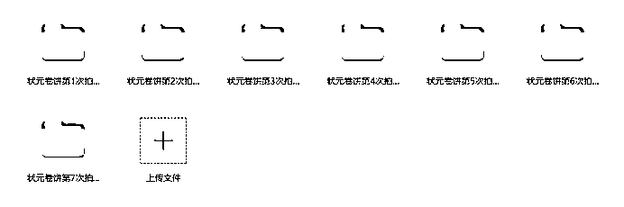

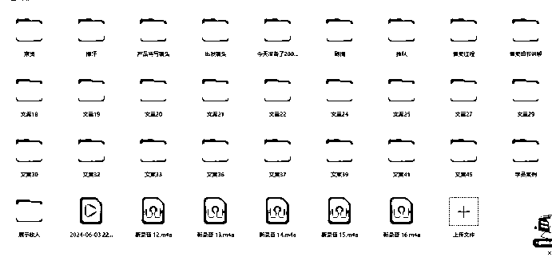

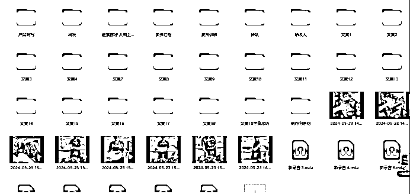

第一个月基本日更，发到第五条作品时成交了第一单。

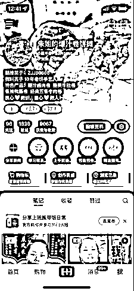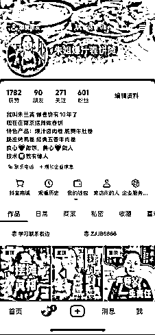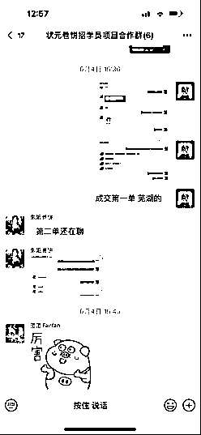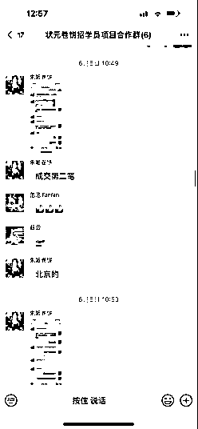

第一个月陆续成交5单，2180一位，给老板分1000，剩下归我。截至一个半月卖了9单，每单分成1180，合计10620（实际少点，个别学员为了逼单给了优惠）。

学员分三类：强意向——离职待业的，一周内成交；中等意向——还在上班犹豫的，1~2个月成交；弱意向——放朋友圈养着，说不定哪天就来了。

每个咨询都是我自己聊的，整理了标准话术，聊几句就能判断意向强度，分A/B/C。A类重点聊，三天内解决所有疑问顾虑逼单；B类正常回复不催促；C类先放着，用朋友圈内容慢慢影响。

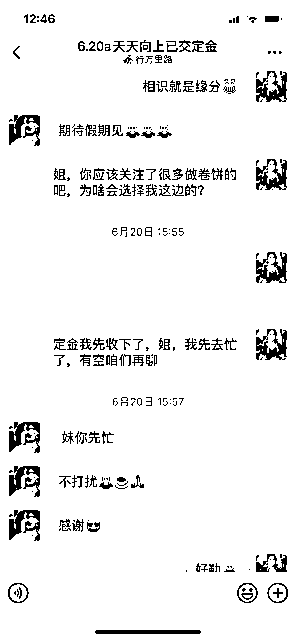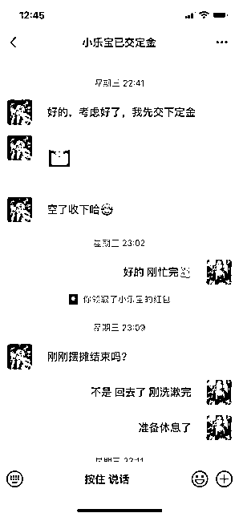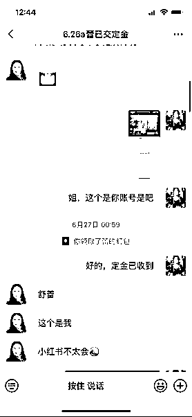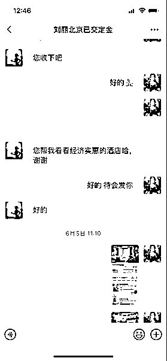

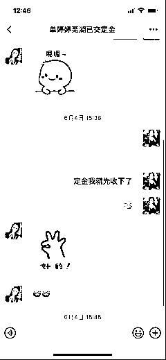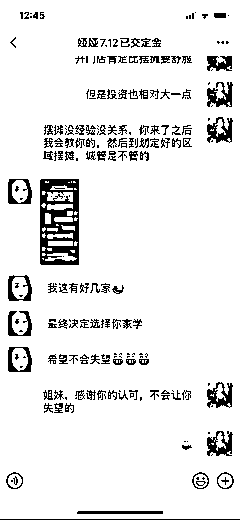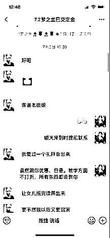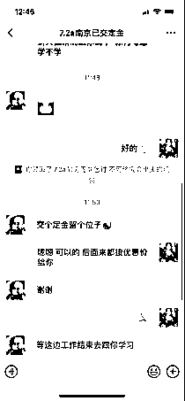

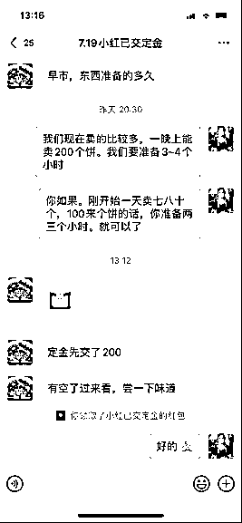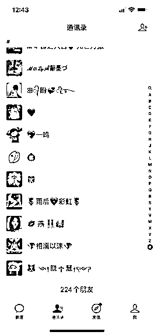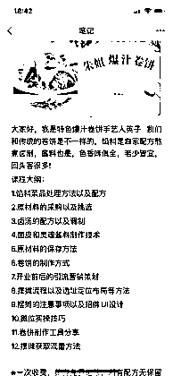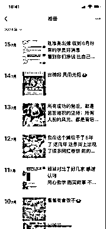

回到卷饼的缺点：客单价上不去。抖音有人卖一千多，也有人卖几百。像金汤热卤、麻辣羊蹄、旋转烤鱼这类“肉类”品，客单价能收到3980到6980。同样付出，收益差好几倍。所以七月份我复制第二个品时选了热卤，刚起步，后面再单独分享。

接下来核心任务是把流量做大。目标：卷饼项目月收30个学员。按5%转化倒推，需要每月600人进微信，也就是稳定日增20。要么加账号，要么开直播。我对这点有信心——那些优秀操盘团队单月过百的大有人在，人家做得早、做得细，保持学习心态向有结果的人靠拢就好。

同时也在纵向复制：一边谈新项目，一边培养操盘手，从拍摄、文案到剪辑手把手教，从单打独斗走向团队作战。

聊聊对行业的几点思考：

第一，餐饮技术培训在抖音经历了三个阶段。蛮荒期：老板不懂短视频能招生，随手拍菜品和排队就有人来学，无意中踩中风口。流量期：做流量的人发现这是个风口，下场跟老板合作或自己摆摊开店招生，懂点流量就能赚到钱，内容要求也不高。内卷期：也就是现在，要有专业流量能力、高质量内容才能跑出来，内容创作只是基本功，还得拼IP、拼选品。像从去年火到今年的6元麻辣羊蹄培训，一个小团队年收近千万培训费——靠的就是操盘能力+产品新颖+IP实在，三者缺一不可

第二，后端供应链也值得做。做好学员交付，让他们回去真正干起来，料包复购就是持续收入，有团队这块做得很好

第三，主流玩法分两种。一种像我这样：独立操盘手找商家合作，专注做流量，一部手机就能开工。另一种是全案操盘：自己选品选IP、摆摊开店，先把同城流量和营业额做起来再招生，适合有资金的团队，成本高但所有环节自己可控、利益最大化。两种模式都有月入百万的案例，不止一两个

第四，我短期能跑通0到1，是因为一边学习一边实操，不断试错总结，而不是简单找对标照搬。这也是我在实践里积累下来的餐饮流量手册

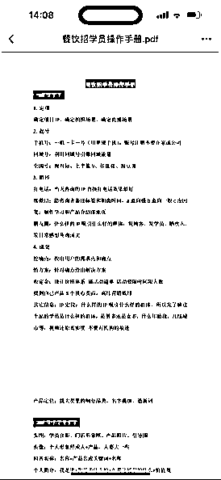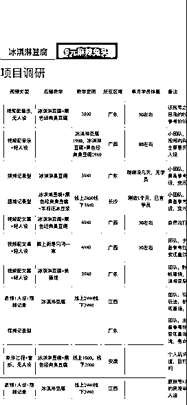

第五，好多人说平台流量越来越难做，我不同意。卷的不是流量，是内容创作能力。抖音够公平，内容好就给流量。肚子里有货，任何时候入场都不晚。想好了就干，3分的开始胜过万全的犹豫。

分享点到为止。以上只是我个人做这个项目以后的认知和判断，不一定全对，欢迎大家来聊。

最后感谢赚钱。做流量遇到专业问题我都在赚钱里找答案——小红书安全引流、聚光投放、抖音人设打造、私域成交转化，都有优秀圈友深度写过。这些内容单拎出来，放到外面线下课卖大几千也有人买单。加入赚钱确实帮我省了不少钱，哈哈。再次感谢！

评论区：

哄哄 : 海哥厉害[强][强][强]

