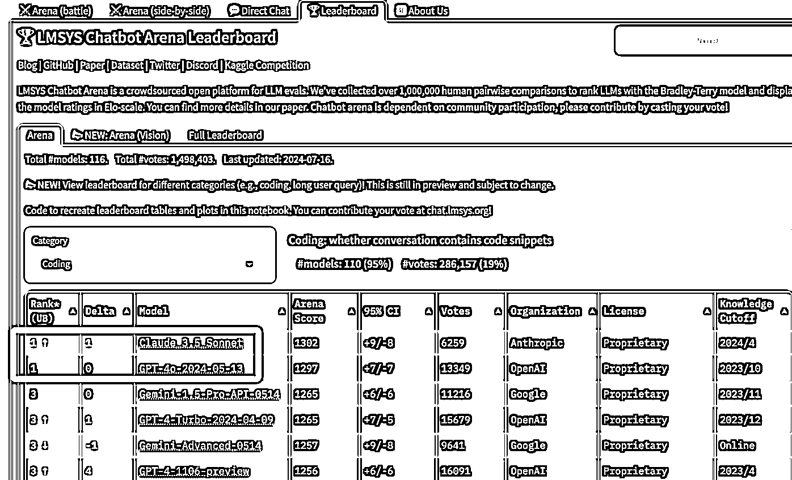
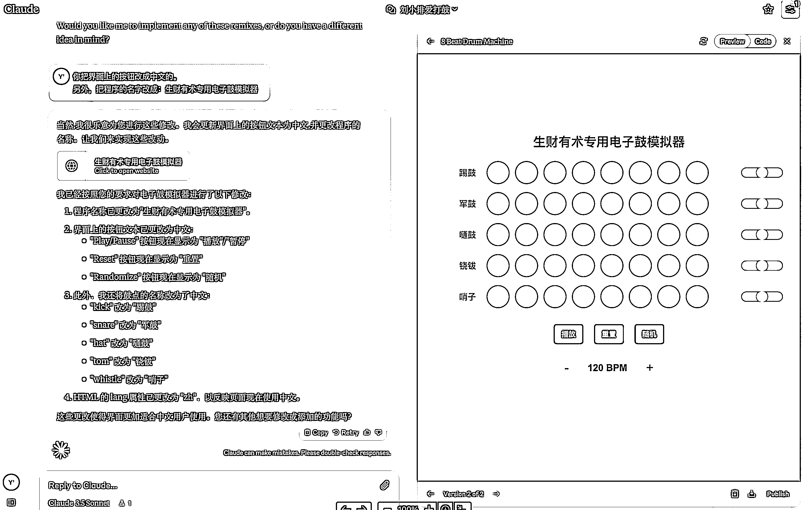
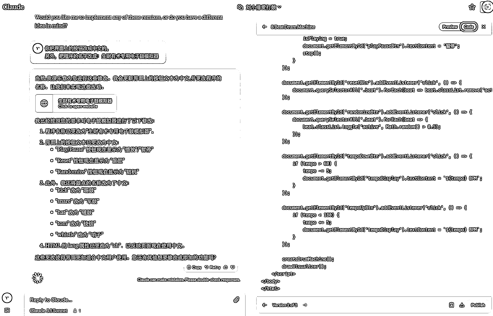
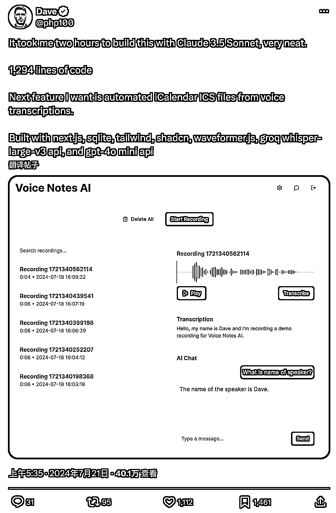
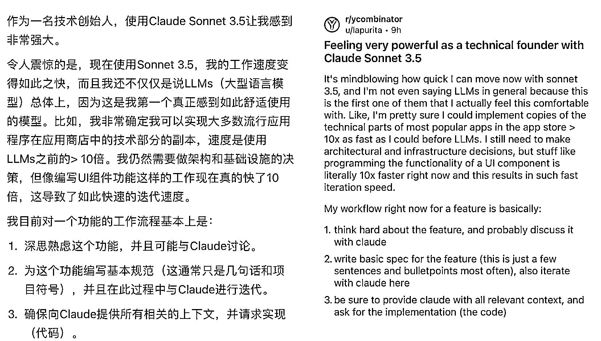
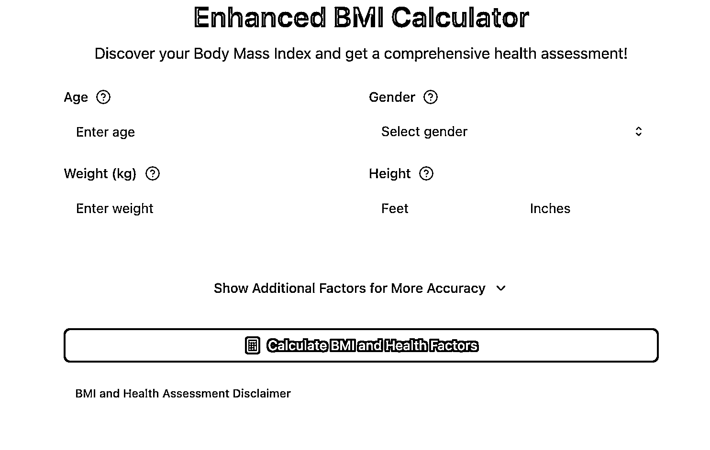
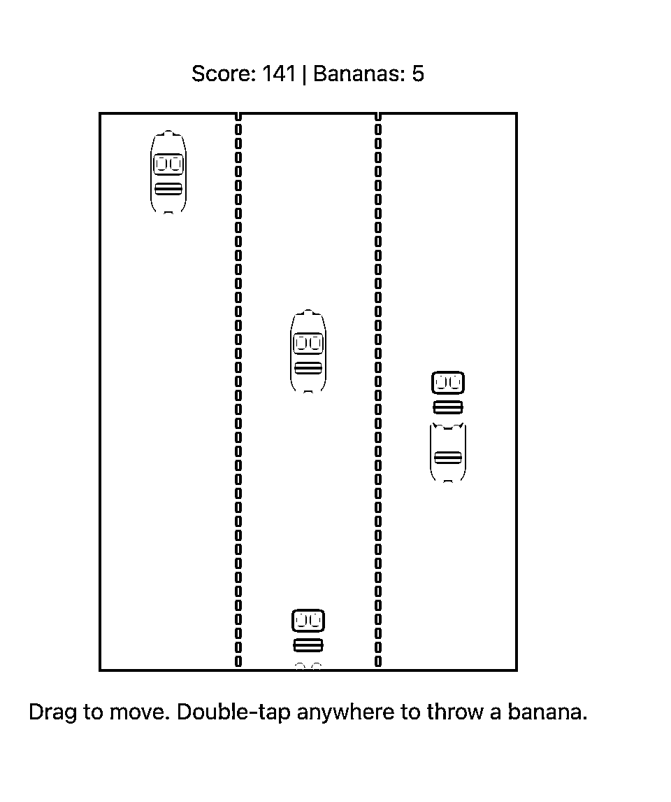

# 新手用 AI 入门编程的窗口，现在打开了

## (精华帖)(486 赞)新手用 AI 入门编程的窗口，现在打开了

作者： 刘小排

日期：2024-07-23

大家好，我是刘小排。

从 2023 年年初起，身边就不断有人问我：能不能靠 AI 自己学编程。

说实话，我当时一直没敢打包票。

去年的那些 AI 编程助手，对零基础的人来说帮助有限。像 Github Copilot、Cursor.so、Replit AI 这类工具，更像是程序员的产能放大器，能让初级开发者快速升到中高级，或让高手获得十倍效率。

小白用它们也多少能跑出点小 Demo，比如贪吃蛇、2048 之类的玩具，但要做出能真正用的东西还差得远。最致命的是环境搭建，装环境、配依赖、调版本，对新手就是一道高墙，至少挡住了八成的人。

情况在现在变了。真正适合零基础自学编程的黄金期，已经到来。小白也能顺畅上手，并且做出有实际用途的产品了。

# **一、现在只需要一把钥匙**

让这一切成为可能的，是一个专门为 AI 自学而生的工具：[Claude 3.5](https://claude.ai/)。

对新手而言，自学编程只需要它一把就够了。

首先，它的智力水准已经很高，在编程能力上是当下最强的大模型之一，超越 ChatGPT-4o。截止 2024 年 7 月，来自 lmsys 的大规模人类双盲测试结果也印证了这点，如下图所示 [`chat.lmsys.org/`](https://chat.lmsys.org/)

其次，它独家上线的 Claude Artifacts 功能非常关键。你写的代码能直接在对话里实时运行、预览，不用再折腾本地环境、不用来回复制粘贴，省掉了新手最头疼的环节。（如下图所示）

看看国外用户是怎么实操并评价 Claude 3.5 的编程实力的。

第一个案例：一位从未写过一行代码的人，仅靠与 Claude 对话 4.5 小时，就做出了一个功能完整、界面精致、带完整数据库的笔记应用。

原始连接 [点这里](https://x.com/rileybrown_ai/status/1814062312472694992)

如果网络受限，你也可以[点击这里](https://www.bilibili.com/video/BV1xH8qeEEdS/)，我已上传到 Bilibili

[`www.bilibili.com/video/BV1xH8qeEEdS/`](https://www.bilibili.com/video/BV1xH8qeEEdS/)

这支 15 分钟的视频，足够反复看三遍，它堪称用 AI 学编程的范本教材。

第 0 分钟到第 3 分钟：看他如何起步。

第 11 分钟以后：看成品面世时的兴奋感。

第二个案例：开发者 Dave 演示了自己用 Claude 3.5 Sonnet 所做的 Voice Notes AI，一个语音笔记工具，只用了两个小时。

原始连接：[点这里](https://x.com/php100/status/1814776161542557928)

第三个案例：Y Combinator CEO Gary Tan 在 Twitter 转发 —— 认为用 C=Claude 3.5，可以在十倍以上速度下，做出应用商店里几乎任何一款应用。

原始连接 [点这里](https://x.com/garrytan/status/1814732623073456165)

# **二、实操路径**

1、把上面提到的视频【[一个完全没有写过代码的人，只靠和 Claude 聊天 4.5 小时，完成了一个功能齐全、界面美观、有完整的数据库功能的记笔记的应用](https://www.bilibili.com/video/BV1xH8qeEEdS/)】研读透彻，同时把 3 条原始推文链接打开，从评论区和作者的回复里汲取经验。

这是最核心的一步。我身边不少朋友就是照着这个视频模仿起步，一个周末就出了让人意外的成果。

2、想一个想做的产品点子。先从自己的生活和工作痛点挖掘。

3、找一个现成的同类网页产品作为参考对象。

4、把目标产品的截图丢进 Claude，让它帮你复刻界面。

5、用自然语言沟通，让 Claude 把它改成你想要的样子。

6、界面成型后，继续让它加上功能、数据存储等逻辑。

7、点击 Claude Artifacts 右下角的 Publish，把作品分享给朋友试用。

8、根据朋友反馈修改问题。

9、把网页产品部署到正式服务器，用域名对外发布。

# **三、网友的练手作品**

**1.一个 BMI 计算器**

[点击使用](https://claude.site/artifacts/6fd95417-f0cd-4f4c-b9a2-a31a80982ca9)

**2.一个高考倒计时**

[点击查看](https://claude.site/artifacts/eabdd426-239a-4d05-b9a2-a31a80982ca9)

**3.一个给 5 岁小孩玩的汽车游戏**

[点击查看](https://claude.site/artifacts/d582516d-48b7-46df-b9a2-a31a80982ca9)

**4.一个 emoji 射击游戏**

[点击查看](https://claude.site/artifacts/7e18124d-c97a-45a5-93f5-c99fad0ebf84)

# **四、常见疑问**

**问：链接打不开，网络环境和账号注册、会员开通怎么弄？**

答：当下信息很发达，龙哥盟社区本身就聚焦互联网变现，这些问题的答案很容易检索到。若你卡在这一环，更可能的原因是——你内心还没真正下定决心学编程，潜意识在找“不是我不想学，是我不会注册账号”这样的借口，让“工具再好我也没开始”显得合理。

**问：学着学着代码报错了怎么办？找谁问？**

答：继续问 AI。我现在的做法是 Claude 写代码，ChatGPT-4o 处理通用问题，因为网页版 ChatGPT-4o 能联网搜索、能自动拆解任务。说实话，今天的程序员没有一个人比 AI 更懂，你去问资深老司机，他最后也多半会问 AI，干嘛多一道中间商。

**问：先做什么形态，网页、App 还是微信小程序？**

答：务必先从网页产品入手。因为

1\. 网页能完美发挥 Claude Artifacts 的即时预览优势，大幅提速学习和开发。

2\. 网页更容易分享给朋友体验和提意见。

**问：大概要投入多久？**

答：20 小时。从零基础到上线一个自己愿意用、有实用价值的产品，20 小时足够。

如果没学会，通常只有一个原因：时间没花够。

**问：为什么视频里的人 4.5 小时就做完了？**

答：有可能是为了吸睛有夸张成分，也有可能他并非绝对零基础，遇到问题时解决更快。总之别人的时长是别人的事。

我建议把学习预期调到 20 小时。

你可以把它当成龙哥盟的小航海项目，花一个月，每天 1 小时。

目标是：一个月内投入 20 小时，发布一个有实用价值、自己有成就感、看不出新手痕迹的网页产品。

**问：完全没想法，不知道做啥？**

答：

1.  优先做工作中能用的小工具，你的工作里一定有痛点或重复性劳动，动力最强。
2.  其次，复刻你日常常用的产品。
3.  再次，可以接入[fal.ai](http://fal.ai) 的 API 做 AI 类应用，例如：文生图、风格迁移、图转视频、AI 心理咨询、AI 虚拟伴侣等。这类应用好玩且变现可能高。
4.  最后，可以直接复刻上面的视频教程，做笔记软件、语音笔记软件。有人已验证可行，成功率更高，自信心也更容易建立。

如果你看完决定开学，欢迎在评论区报个到，我会替你开心！

学习中遇到问题也可以在评论区交流，但请先避开文中问答已覆盖的问题喔～

期待你的好消息！ 😄

* * *

评论区：

源（📷定金留档，靠谱* : 等着下一次航海

刘小排 : 不用等呀～现在先抢跑，岂不是更好[偷笑]

源（📷定金留档，靠谱* : 咋个做

悟一 : 小排老师，给的建议中肯和有效

刘小排 : ……请再看一遍全文

源（📷定金留档，靠谱* : 好叭

纷飞 : 明天开始学！其实我 0 基础入门编程时就是靠问 ai 解决了大部分问题的，现在功能越来越强大了

刘小排 : [强][强][强]

* * *