# 全自媒体平台，陪诊账号调研（1）
作者：龙哥

陪诊账号调研（1）：🛰️生态里，陪诊号都在怎么抢流量？

大家好，我是龙哥。陪诊这行，不能只闷着头跑业务，还得看清行业风向。尤其对操盘手而言，大家怎么用自媒体获客、效果如何，是很关键的情报。这篇文章我其实写了好几天，越写越长，想想还是拆开发。今天第一篇，先聊🛰️生态。

🛰️生态里的陪诊内容阵地，主要是四个：👸号、视频号、问一问、小程序。另外还有一些更零碎的入口，后面有空再补。

先说👸号。大多数陪诊号目前的处境，可以用一个词形容：凉。内容基本逃不出三类——搬运没人看的专家信息、持续输出高端医疗这类专业话题、或者直接发自家陪诊广告。这几类号很难做起来，阅读量大多连 200 都到不了，还有很多早就停更了。反观少数流量好的号，基本都是注册得早，少说也有一两年积累，内容能力不弱，又肯坚持，写的还是大众健康类内容，天然更容易传播。

我在🛰️里用“陪诊”搜了一圈，结果大概是这样：

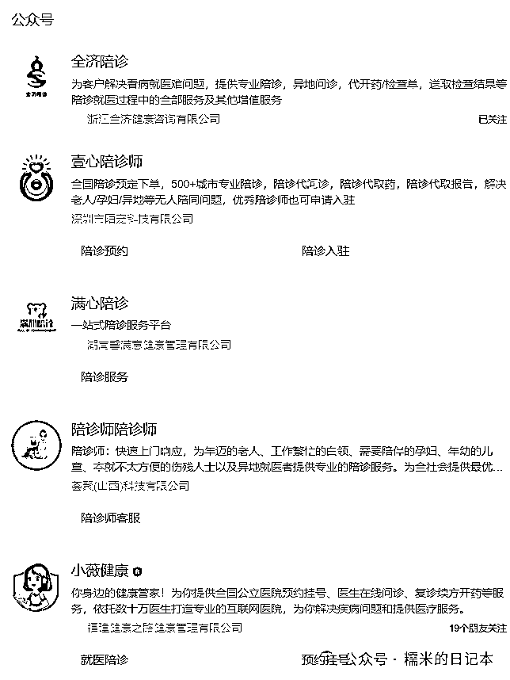

然后我顺着搜索结果一个个点进去看，重点记录六件事：第一，注册时间；第二，发过多少篇文章；第三，阅读、点赞、转发的真实情况，特别要排除靠硬转发堆出来的数据；第四，什么选题能跑出阅读量；第五，流量好的账号整体水位如何；第六，优质账号的主体、调性和定位。

先看“全济”。我印象里他们很早就开始铺抖音矩阵了，但账号开了一堆，里面基本没什么内容，现在好像已经没什么声量。👸号这边，断更在去年 8 月，参考价值不大；以前能打开的小程序，现在也显示维护中。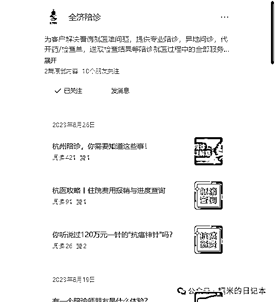这个号注册于 2022 年 12 月 30 日，认证了蓝 V，总共 10 多篇内容，平均阅读几百，唯一一篇 6000 多的是“靠谱的陪诊接单平台”。整体定调，就是企业身份来做行业知识普及。

第二个是“壹心陪诊师”。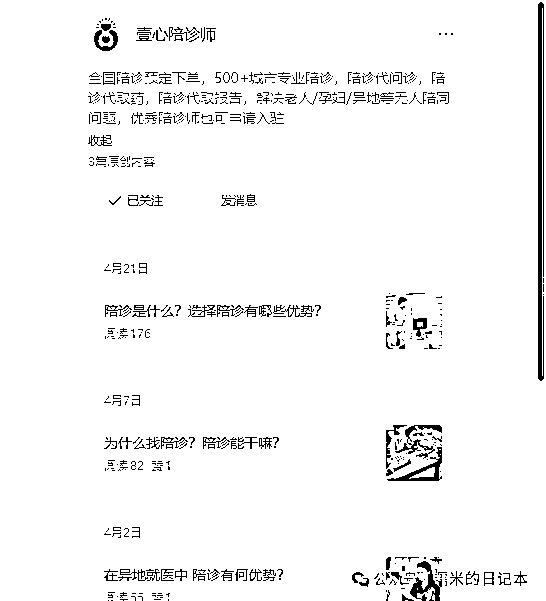页面里挂着“500+ 城市专业陪诊”的说法，我判断大概率有水分；就算真有那么多城市覆盖，陪诊师质量也未必靠谱。这个行业里如果有高品质的同行，我在医药圈不可能一点消息都不知道。它的注册时间是 2024 年 1 月 6 日，有公司主体但没认证蓝 V，只发了几篇，4 月就停了。平均阅读 100 左右，最好的一篇 188，选题是“陪诊是什么，有什么好处”，走的也是行业知识普及路线。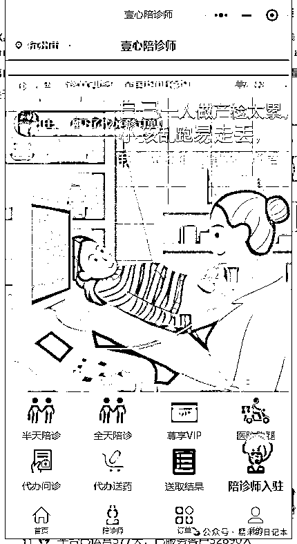

它家小程序我也看了，营销味很重，甚至还有“谁谁刚才下单了”这种假动态，做得挺粗糙。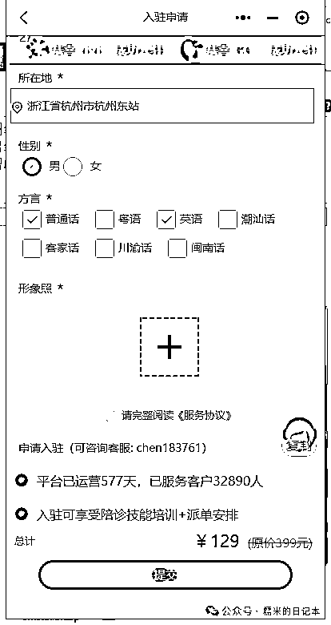陪诊师入驻需要填基础资料，还要交 129 元。我感觉这个小程序的主要目的就是收这 129，顺便攒陪诊人力资源，再顺手接点单。

我顺手加了客服🛰️，聊下来专业度和服务态度都一般。报价半天 300 元，按 4 小时算，价格偏高；超时每小时加 80。放在杭州现在的市场行情里，这个价格估计很难出单。

这里有个运营细节值得记一下：加时费是客户非常敏感的环节。因为只要一谈加时，最终费用就变得不可控，客户会立刻缺乏安全感。与其把加时费定得松，不如定得高一些，让客户自己紧张起来。客户怕超时，陪诊过程中就会更配合，我们也能更快把服务跑完。为什么这么说？因为我见过买 4 小时服务、但 2 小时做完客户却不放人的；也见过全程磨蹭、最后超时了又跑来理论的。

行，接着往下看。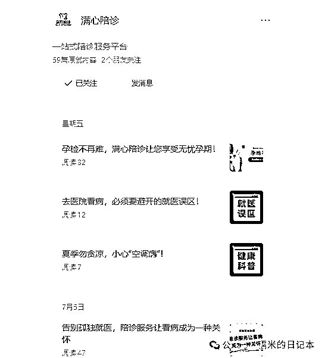

这个号我也有印象。它在多个平台注册过，但别的平台几乎不更新，只有👸号一直比较稳定，阅读量整体一般。注册时间是 2023 年 4 月，有蓝 V，群发了 50 多次，每次带 3 到 5 篇内容，最近一次更新在 7 月中旬。平均阅读 200 左右，最高一篇 2000 多，选题是“想做陪诊的人进来看”。它的内容调性比前两个丰富：行业知识科普、自家广告、成绩背书、健康科普、政策新闻都有。

更值得说的是它家的👸号菜单，设置得很全：高价专病服务、医药资源、商城、to C 服务、to B 培训考证，还有加盟。这套菜单逻辑，以后可以直接拿来参考。

最后再放一个表现很亮眼的号。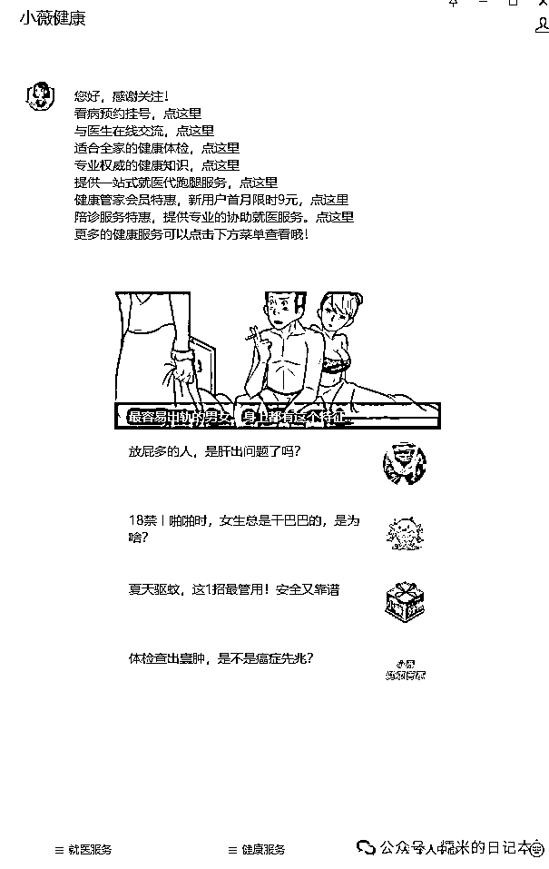

这个号注册时间很早，流量也很能打，走的就是内容路线，尤其是大众健康类内容，而且一直没断更，背后肯定有专门团队在运营。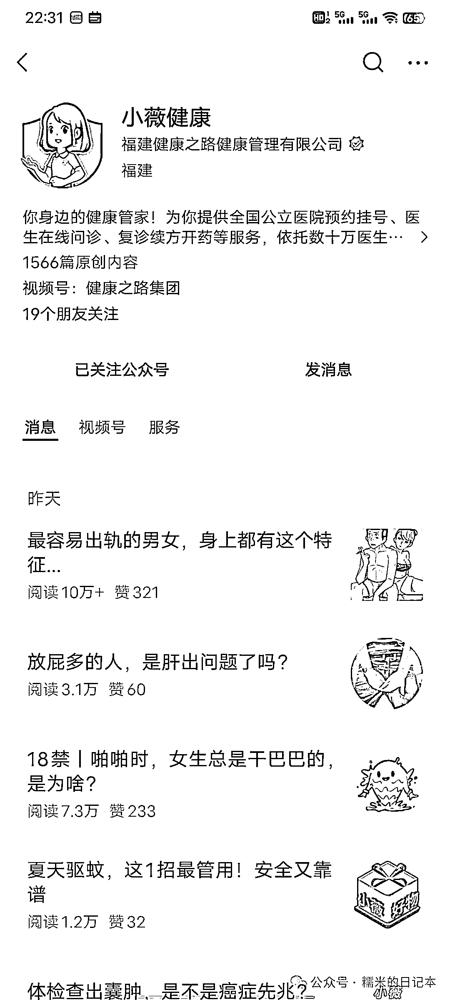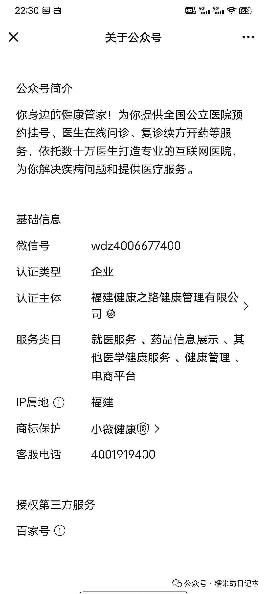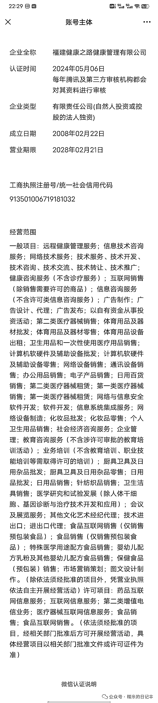到这种程度，已经形成了时间护城河：多年沉淀下来的粉丝、行业积累都在，主页菜单也做得很完整，能直接看出它涉及的业务板块。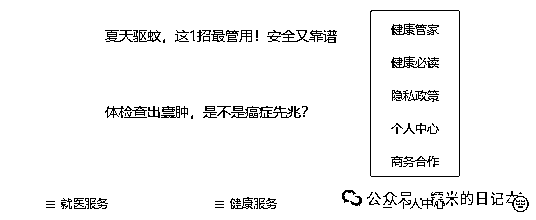这个号跟医院的关系很深，大量服务都围绕医院场景展开，还自建了线上药房。注册时间看不出来，但公司成立时间很早，2008 年；蓝 V，原创内容 1566 篇，起码更新了好几年，最近昨天还在发。流量更是夸张：第一栏 10w+，第二第三栏也有上万。内容里直接讲陪诊的比例不高，更多是养生、两性、健康这些大众题材。做到这个份上，基本就是在自己的领域里顺着大众需求输出内容就行。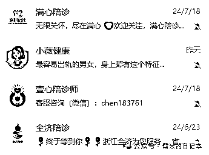

顺便观察到一个共同点：上面这些账号，都直接出现在对话框里，没有被折叠进订阅号文件夹，而且都是企业号，一个月可以群发 4 次。至于企业号是不是有流量加成，还得继续验证。

最后再放几个特殊案例。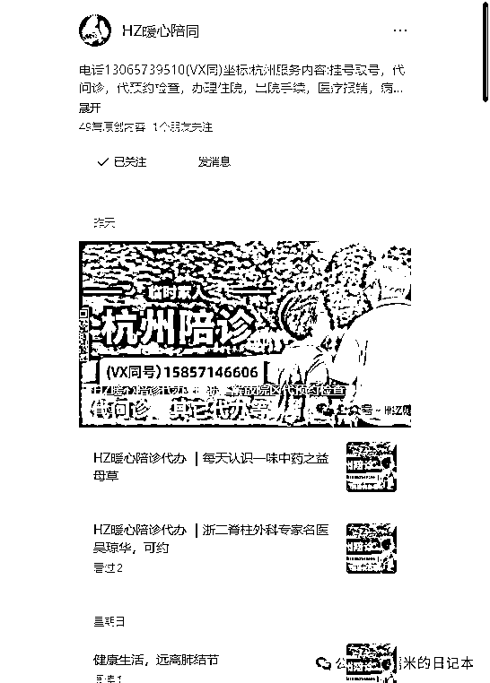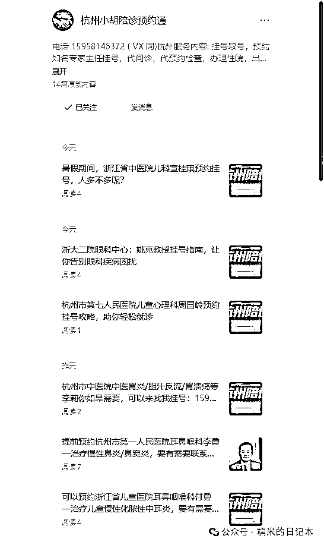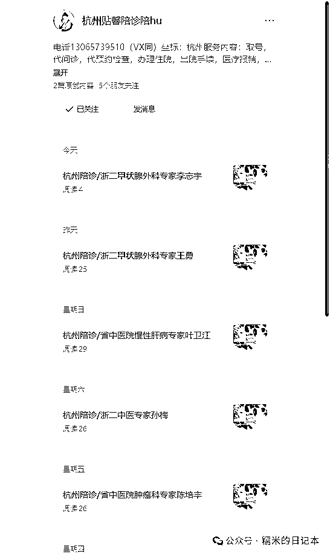

这几个是杭州的同行，情况和开头说的一样：更新频率没问题，但内容大多属于凑数，很难把流量打开，至少目前还没看到他们刻意模仿大 V 的创作思路。

篇幅和时间都有限，今天先分享到这儿。明天我们继续看🛰️生态里的视频号，聊聊那边陪诊账号的最新情况。

