# 全平台陪诊账号复盘·视频号篇 第二弹

> 原文：[`www.yuque.com/for_lazy/zhoubao/gvu9crs4rzizdd8p`](https://www.yuque.com/for_lazy/zhoubao/gvu9crs4rzizdd8p)

## 全自媒体平台，陪诊账号调研（2）

作者： 糯米

日期：2024-07-24

**糯米认为，作为陪诊赛道的操盘者，必须紧盯行业最新动向，而自媒体获客就是重中之重，即**

陪诊赛道现在都在用哪些自媒体渠道拉新，效果怎么样，又在玩什么新打法？

今天聚焦到微信生态里的**视频号**陪诊内容获客，先说结论。

2024 年的视频号，想靠陪诊视频出圈基本没戏，平台对这块的态度非常冷淡。糯米的判断是平台机制把大量内容和账号直接限流隐藏，根本搜不到，我自己的作品就经历了这种处理。放到显性层面，视频号里陪诊相关的内容更新几乎停滞，近一个月能刷到的更新也就十几条，且表现都很平庸。偶尔冒出点数据的，也多是跨界内容，比如保险从业者随手拍一条陪诊相关，或是行业揭秘博主来探店陪诊这个职业。整个平台的可检索陪诊账号，加起来也就一百多号。

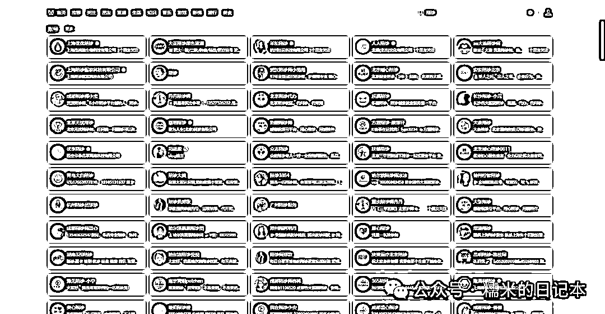

OK，细说一下判断逻辑

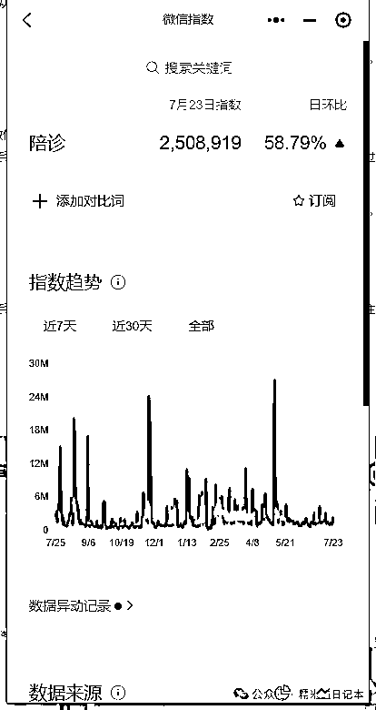

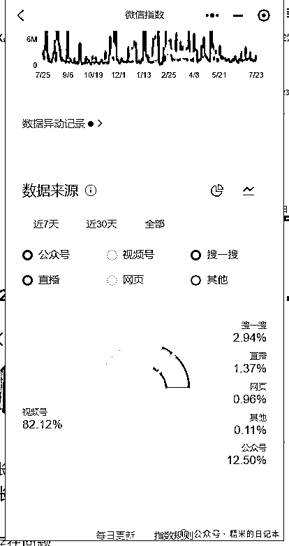

先看微信指数。陪诊这个关键词在微信生态里的关注度其实不小，昨天不去重的数据达到了 200 万次检索，较 7 月 22 日涨了 58%，按这个增速倒推，7 月 22 日的检索量大约在 100 万左右，这个体量并不算小。

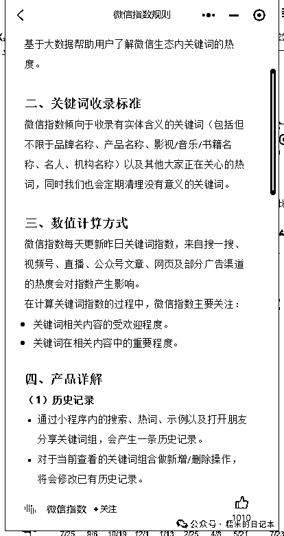

会有朋友问，我凭什么敢把微信指数直接等同于检索次数？微信官方确实没这么定义，我这个说法是参考百度上的解读，得出的推算，可能存在偏差。

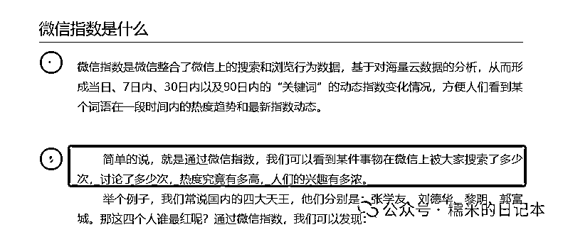

再来交叉验证一下

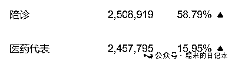

这一批相关关键词的热度曲线基本一致，我们再看下细分分布

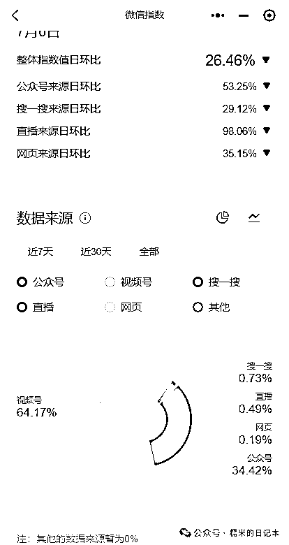

把医药代表和陪诊放在一起对比就能看明白，两者都是典型的圈内词，出了行业内，能主动去搜的人很少。

把陪诊的整体热度放到微信生态的常用大词里对比，差距非常明显。可以拿医药代表的搜索量来类比陪诊的市场关注容量。更深度的拆解糯米就不展开了，继续往下。

综合来看，视频号仍是微信生态里陪诊流量最大的入口，却几乎没有优质内容和垂类账号发力，大部分带数据的陪诊内容还停留在 2023 年。根源还是平台的规则限制。

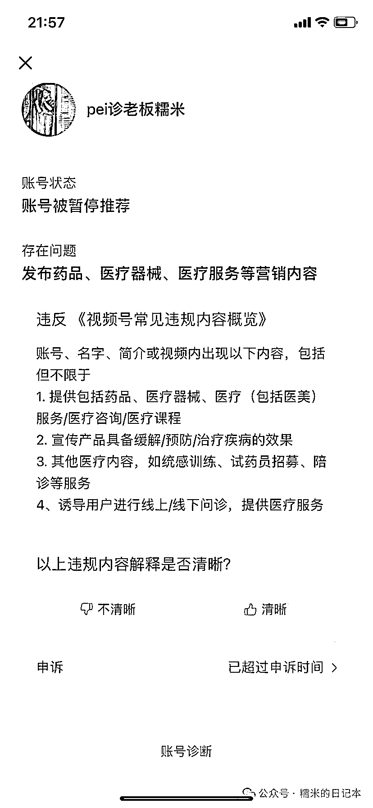

这一点平台是有明确说明的，陪诊相关表述不能出现在账号名称、简介以及视频内容里。

陪诊内容被划归到药品、医疗器械、医疗服务这类敏感范畴。

下面放两份视频号的违规管理说明，有需要的可以自己去查。糯米看完规则后只有一个感受，视频号执行得相当严苛，基本是照章办事，原创之外几乎没人能玩得转。

ps. 之前糯米转去做游戏博主，也是因为游戏赛道管控宽松。

[视频号健康医疗对外公约 (qq.com)](https://support.weixin.qq.com/cgi-bin/mmsupportacctnodeweb-bin/pages/CjOPllXfPz5wqzFQ)

[视频号常见违规内容概览 (qq.com)](https://weixin.qq.com/cgi-bin/readtemplate?lang=zh_CN&t=weixin_agreement&s=video_guide#1)

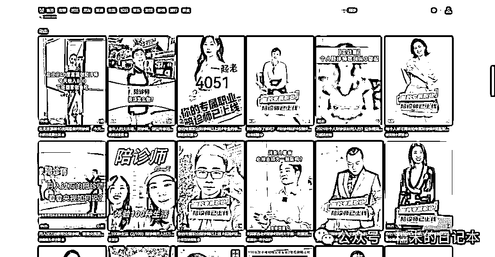

最后补充一个观察，经过糯米反复排查，现在还能苟住正常流量的，大多是这类打法：

完全不提陪诊二字，只用蛛丝马迹暗示自己在做陪诊。内容主题全是生活不易、衣食住行日常，视频里极其隐晦地塞一点陪诊场景，用个人生活号的形态来做流量。

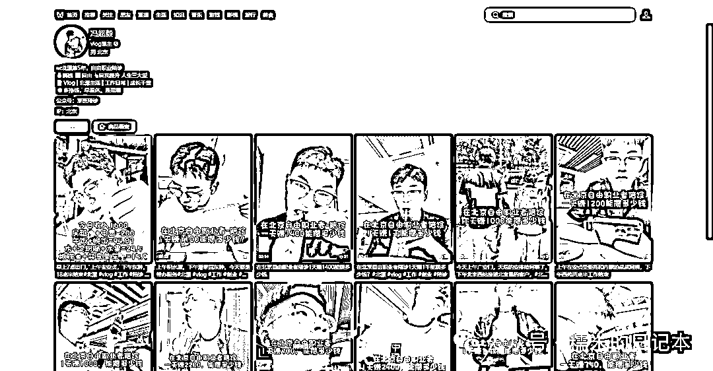

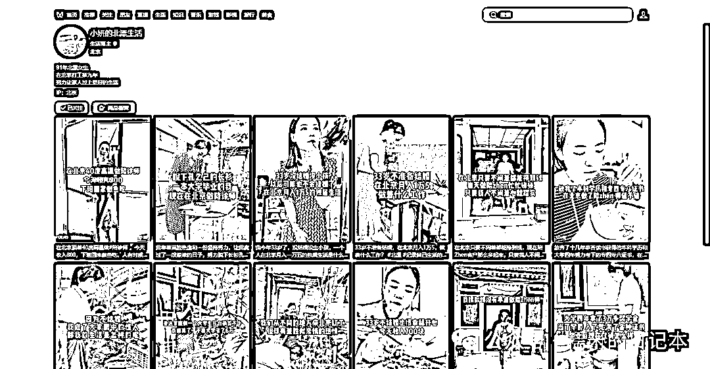

举两个账号给大家参考一下。

篇幅和时间有限，今天就分享到这里，明天我们接着聊下一个垂类的陪诊内容/账号调研。

* * *

评论区：

暂无评论

* * *