# 全自媒体平台，陪诊账号调研（3）
作者：龙哥

陪诊行业的操盘手，嗅觉必须时刻在线，尤其要盯紧各平台的自媒体获客动态。前两篇聊了🛰️生态里的👸号和视频号，从🛰️指数看，除了这两个阵地，像搜一搜、直播、网页，几乎没见着什么陪诊内容的热度。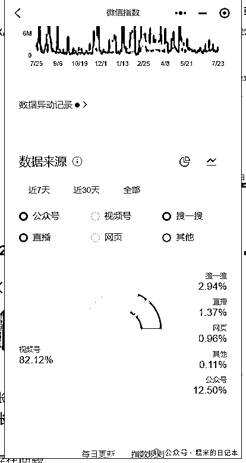

今天，咱们就把🛰️生态这盘棋彻底收个尾。

先看“问一问”——这个被视为🛰️版知乎的入口。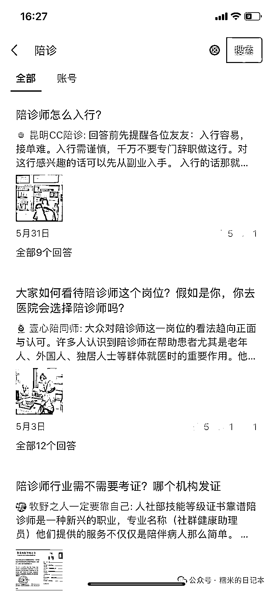去年10月前后它火过一阵，当时不少人觉得机会来了，个个热血上头。可眼下糯米调研下来，结论挺冷静的：问一问里陪诊相关内容少得可怜，内容少，账号更少。用“陪诊”当账号词条的，拢共十几个，多数是低活跃甚至死号。只有两三个账号硬扛着发了上百条回答，攒了几百个赞，平均下来一条回答一个赞，换谁坚持这么久，心也凉透了。其中两个账号专做医药健康垂类回复，另一个是医药加泛问题混着答。总的来看，问一问的陪诊行情不景气，但有意思的是，这平台上陪诊乃至医疗内容几乎没什么管控，7月23号还有账号在回答里直接写医疗用词。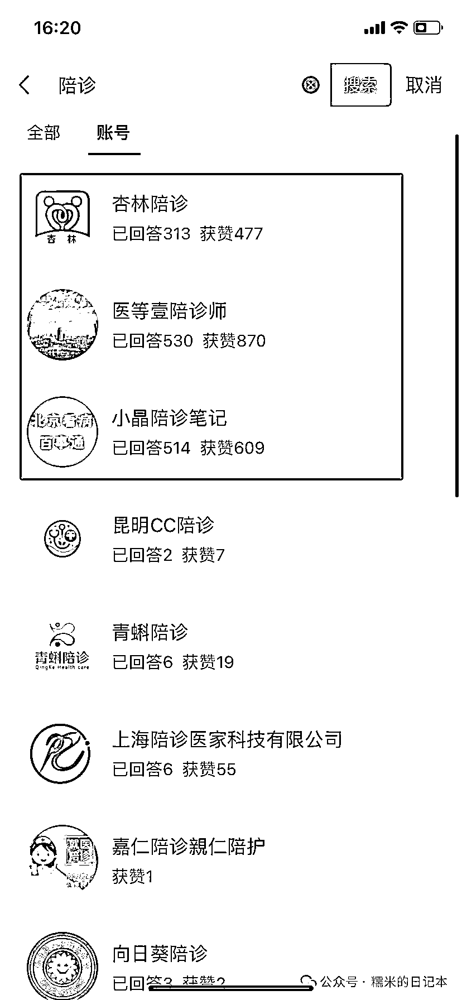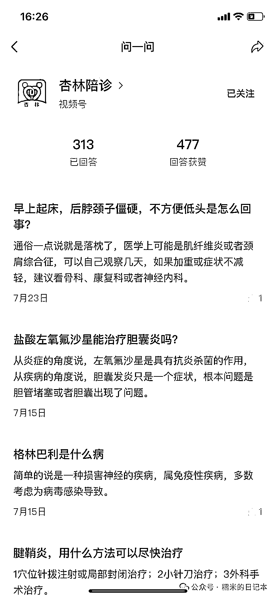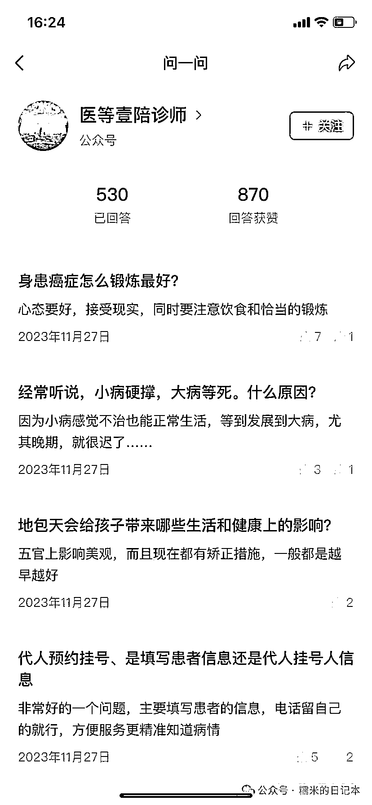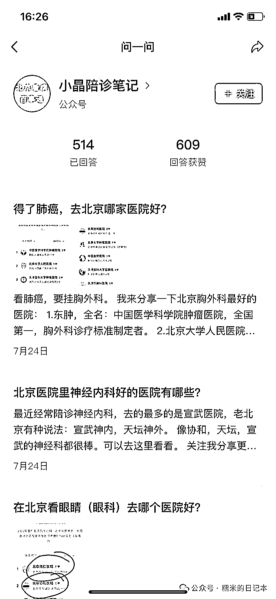

糯米对这块的判断是：量小的平台、竞争少的板块，可以先铺一点量放着，等别人跑出结果了，或者平台突然放量，再及时进场。前提是操盘手得持续盯着各个平台的动态。

（说句实在话，平台体量小是时势所致，凡人左右不了，别瞎使劲儿。）

接着看“小程序”。

实话讲，小程序这头没法直接摸清对方的获客情况，但有价值的是能看到对方的SKU、小程序设计、给客户和陪诊师的规则制度，还有平台的细节玩法。各家SKU差别不大，除了常规陪诊，有的小程序加入了陪护、助浴这类照护服务。另外，糯米注意到一个有意思的现象：不少小程序像约好了似的，都打开了分销权限。这个点值得琢磨，说不定是条不错的裂变传播路，尤其眼下陪诊行业想靠自媒体打开宣传口子太难了。

下面逐个拆几个小程序。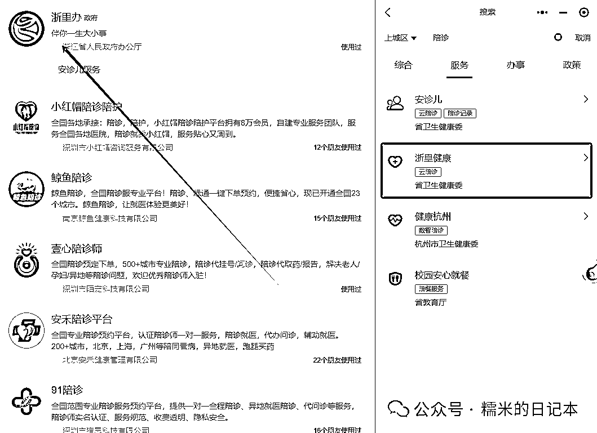

第一个是浙里办。浙里办提供的叫“云陪诊”，本质是AI就诊助手，能覆盖一部分人群、解决一部分需求，跟咱们熟悉的陪诊模式不是一回事儿。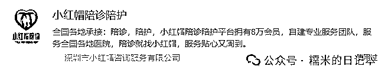

再看一个深圳公司，确实成立两年了（对方直播时糯米去交流了两句），认缴资本100万。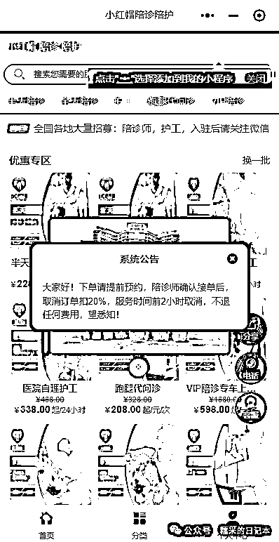其实照着他们的规则，完全能抄作业搭建自己的产品规则体系。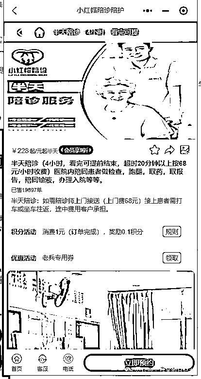这些页面能看出SKU设计和营销动作。

以前糯米总觉得陪诊这行很难做营销，谁会为了还没发生的陪诊需求提前付费、提前领优惠券？现在看来，是当时格局小了。视频推广算一种营销，平台优惠政策也算促进客户沉淀的营销动作。光埋头干活远远不够，还得运筹帷幄整个市场。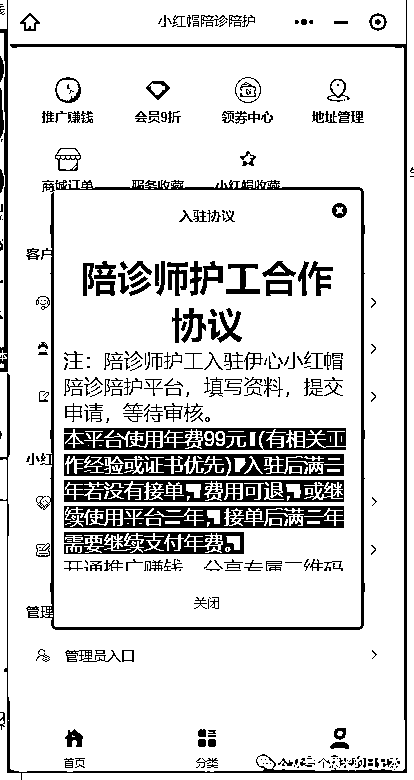

类似这里的陪诊师护工合作协议，也是可以直接抄作业的范本。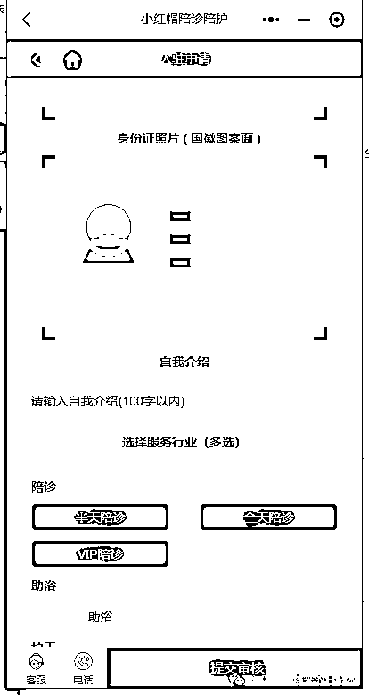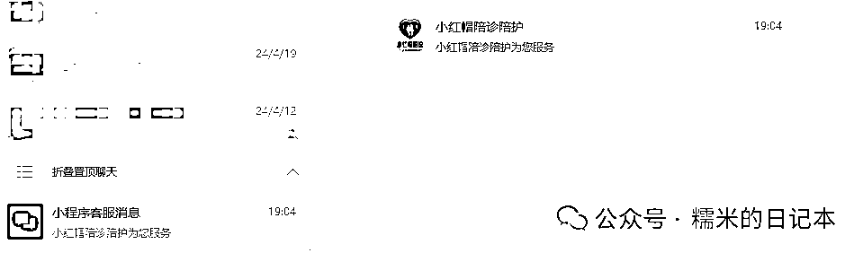

顺带还发现一件事：原来小程序的客服能直接接入🛰️对话窗口。

继续，下一个稍微有点名气，是南京的鲸鱼陪诊，2023年初注册，认缴资本100万。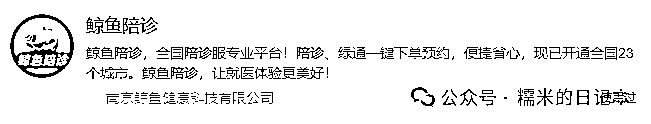同样参考它的SKU设计。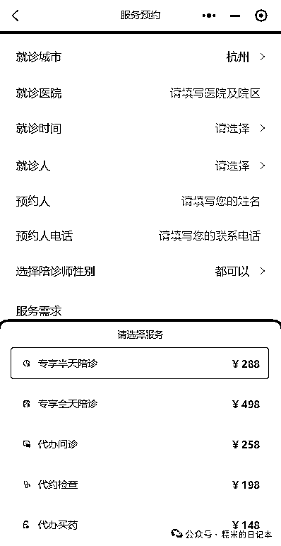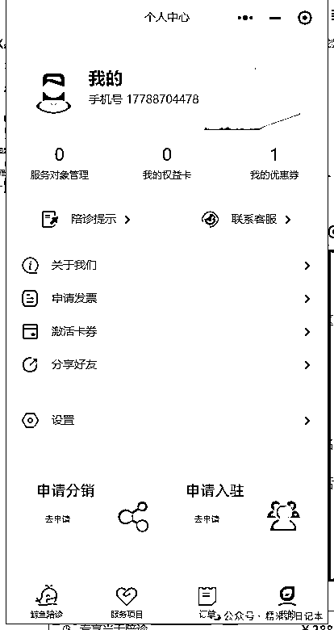页面设计、功能架构都比较完善，前面说的分销权限对外开放，这家也有。多看看牛平台怎么玩、怎么做决策，能品出不少蛛丝马迹。

再往下这个小程序，糯米就要重点吐槽了。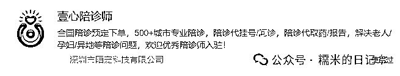

它做得是真有点水。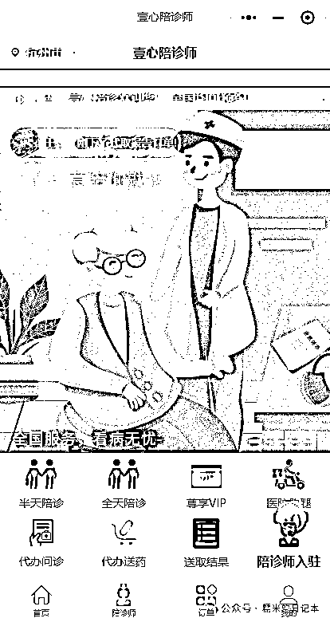先是老套的促单套路——现在做得好点的平台，界面都是干净清爽为主，一堆广告轰炸的App，定位普遍是下沉市场。再看这个所谓的入驻协议，陪诊师入驻协议写得根本不像协议。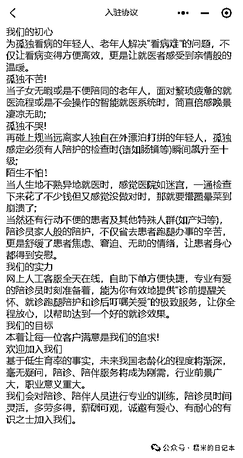还有这个下单协议，点了居然弹出来一个客服🛰️，实在是太草率了。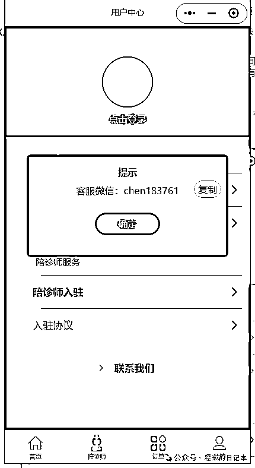

所以总结一下：小程序这头，虽然很难直接分析出各家获客情况，但我们能通过它借鉴同行的交付流程、规则、SKU设计，顺带嗅到市场运营和维护的门道。

🛰️生态里，还有值得聊的就剩“直播”了。🛰️指数是2023年10月新增的直播领域热度收录。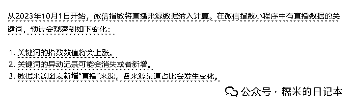但眼下直接搜陪诊类的垂直直播根本搜不到，只能先去关注具体的👸号、视频号，才能看到相关直播。这个类目里，哪怕是知名度较高的“陪诊界”，一场直播也没多少流量。但让糯米意外的是，这个内容话题在视频号直播里几乎没什么管控。

至于🛰️剩下的领域——新闻、百科、读书、表情，就没什么可讲的了。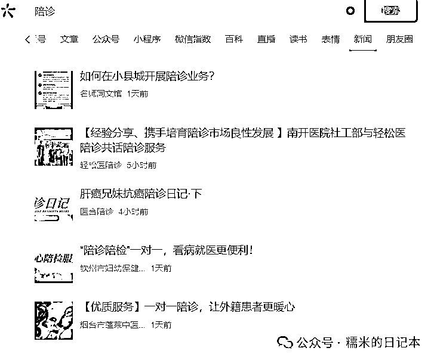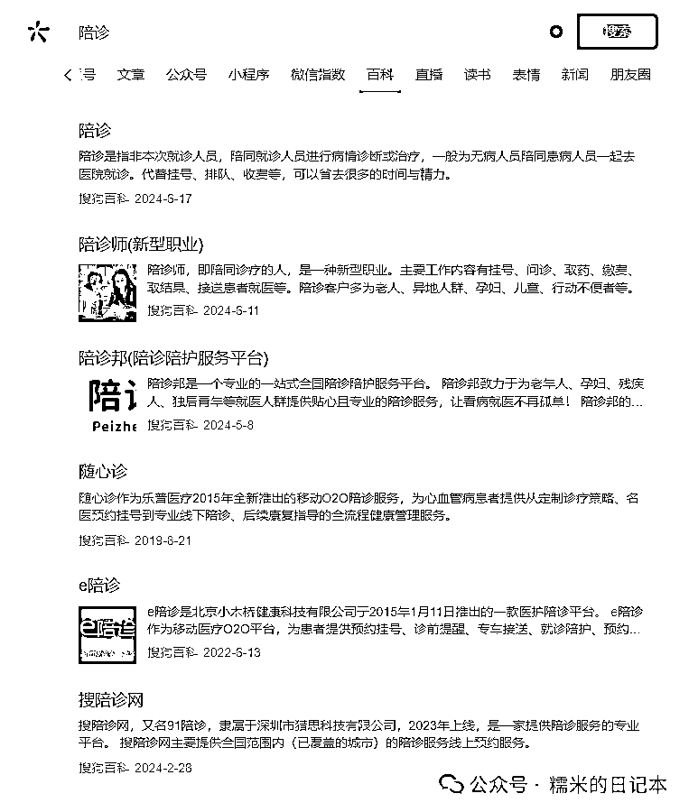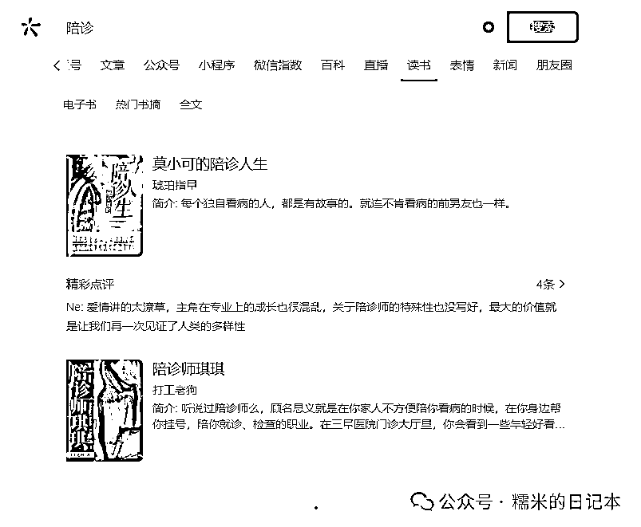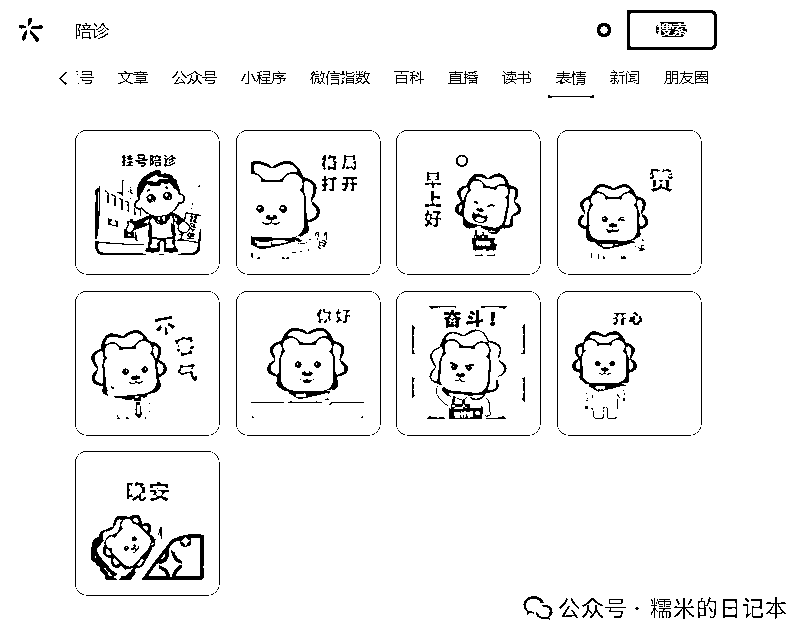

到这儿，🛰️生态所有关于陪诊的内容、账号、玩法，调研就全部告一段落。明天，咱们继续下一个平台。