# 零粉丝也能起量！4小时160万 GMV 📕直播拆解实录
作者：龙哥

## 4小时卖破160万，这个没有粉丝的家居号是怎么打的

作者： 谢无敌🐱闪亮猫传媒

日期：2024-07-19

哈喽，赚钱圈的朋友们，我是龙哥，闪亮猫传媒的创始人。

最近后台被同一个问题刷屏：**账号没多少关注，还能做直播带货吗？**

答案是完全可以，而且往往比想象中更快破零。

前阵子📕官方请我去做场分享，主题是低粉商家如何做店播实现稳定成交。会后反馈很高，很多商家说思路终于通了。

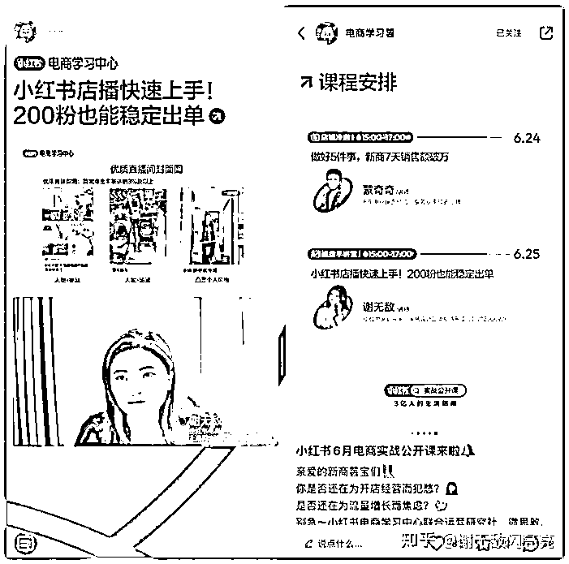

说实话，我操作的家居号本身并不算大号，但618那场店播直接刷新纪录。

四小时GMV冲到160万，实时买手榜冲进前三。

这足以说明，📕直播不依赖网红光环，方法对了，普通商家一样能变现。

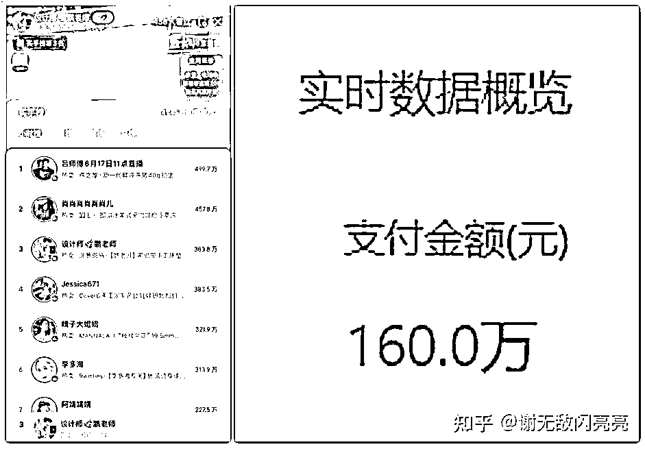

今天把核心拆成两块来讲：把人引进来，以及让进来的人下单。

下面会讲预约笔记怎么写、直播笔记怎么发、商品怎么配、抽奖怎么玩、话术怎么把握。

帮助你从零建立直播方法论，实现从0到1的生意启动。

## 一、流量从哪来，怎么放大

先搞清楚来源，再去做增量，方向才不会偏。

### 1、直播间的四个主要入口

① 直播内上下滑跳转
② 好友或用户主动分享
③ 内容笔记带动：预约笔记+开播当天笔记
④ 店铺、购物频道、订单页入口

最后一种占比有限，前三种才是主力，尤其是②③是可以主动操盘的，必须重点投入。

### 2、放大曝光的五点

**① 播出频次与时长**
很多人纠结一场播多久。结合平台规则和实战经验，**建议每周固定2-3场，每场保持3小时以上。**

先用一个月跑通转化模型，效果稳定后再逐步提频。

**② 留存时长与互动**
平台衡量直播质量的关键指标。观众待得越久，推荐力度越大。

行业基准不同，但逻辑一样：提升互动。当间内人少时，可以让助理号或朋友进场引导评论，扮演气氛组把热度撑起来。

**③ 预约笔记预热**
预约量基本决定首波进场量。可以在开播前3-7天陆续发预约笔记，让目标人群提前知晓并预约。

开播当天再发一条，争取首页推荐，提高进场率。

**④ 封面点击表现**
**进房率=实际进房人数/预约人数。**封面就像笔记的封面，一眼决定点击意愿。

备3-5版不同风格封面，关注后台数据，低于1-2%时立刻更换迭代。

**⑤ 榜单带动**
店铺榜、主理人榜、品牌榜。前面做到位，就有机会上榜，上榜后会带来第二波流量加持，进房率自然提升。

## 二、预热期如何把预约拉满

明白入口后，就要做内容预热。转化率高的预约内容大致有三类：

**① 合集拼图真人秀：**素人出镜+场景+多品合集
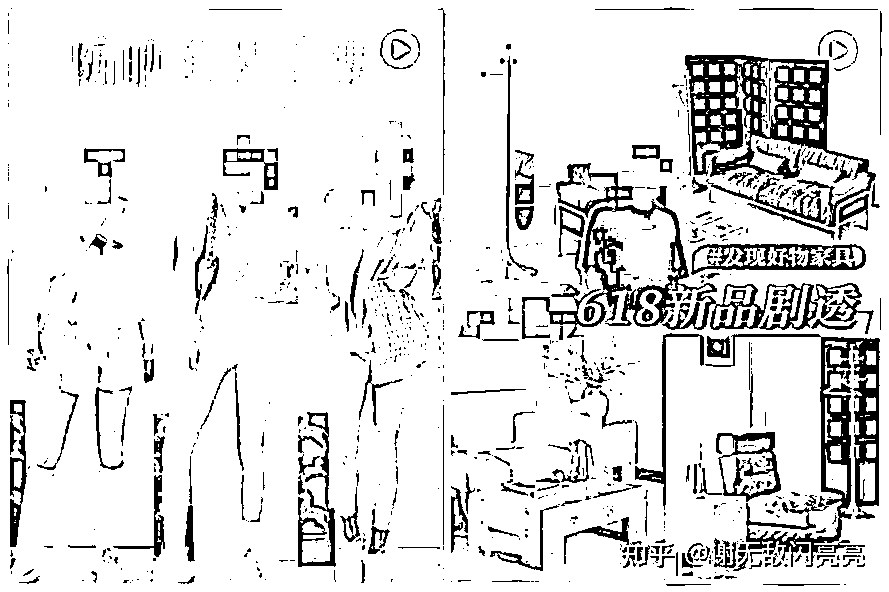

**② 单场景真实摆拍：**单图里素人+多款商品
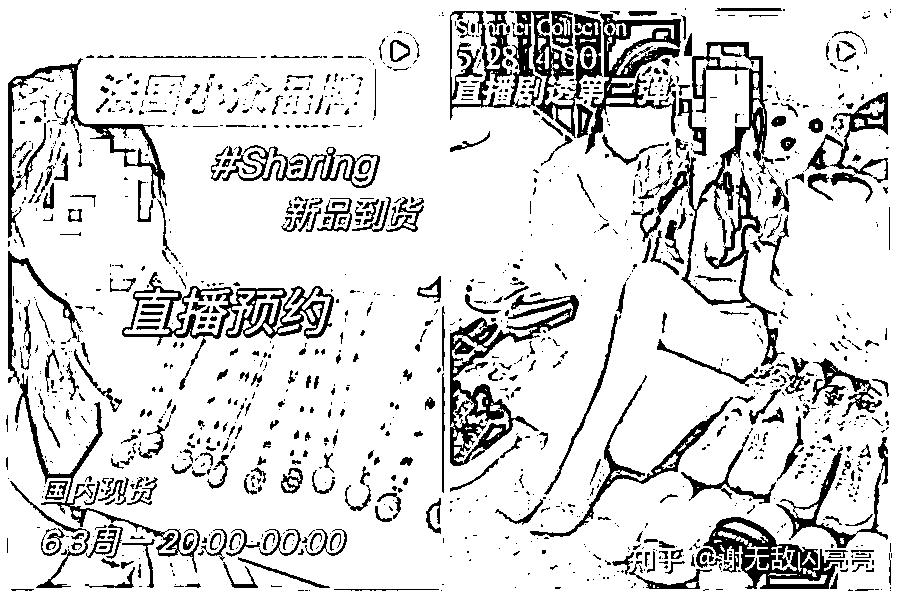

**③ 无出镜产品合集：**纯产品合集，多图拼接
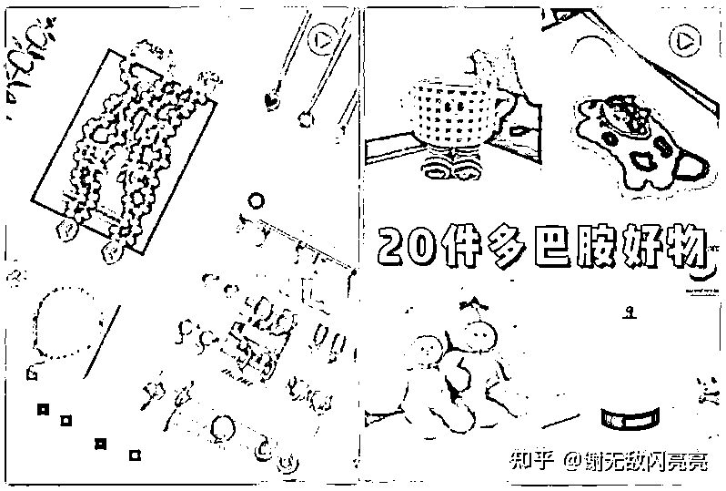

总结下来，高效预约笔记=真人+商品合集+视频化。视频的数据表现通常优于图文，更适合做预约。

### 1、选题怎么找

选题直接影响笔记能否被看见，也影响预约能否跑起来。

**① 关键词检索法**
在搜索栏输入**“你的赛道或商品+直播预告”**，比如“珠宝直播专场”。找到近期表现好的笔记，直接对标学习。
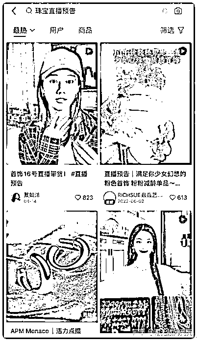

**② 长尾词挖掘**
输入“赛道+直播预告”，看下拉长尾词。以“珠宝直播预告”为例，挑选与商品相关的长尾作为切口。
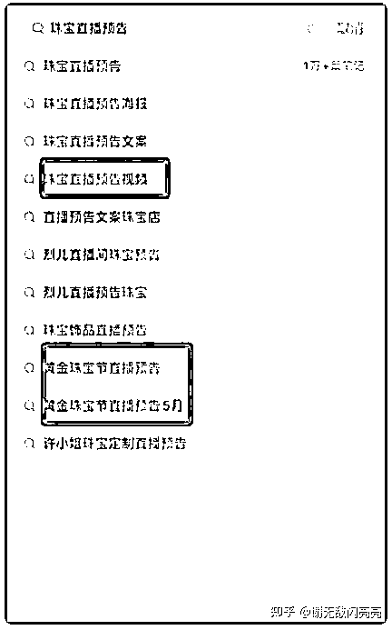

也可点进相关关键词，找到近三个月的好内容做参考。

**③ 竞品直播间观察**
搜索品类词点进直播tab，看到正在播的竞品账号，进主页看他们的预约笔记做法。
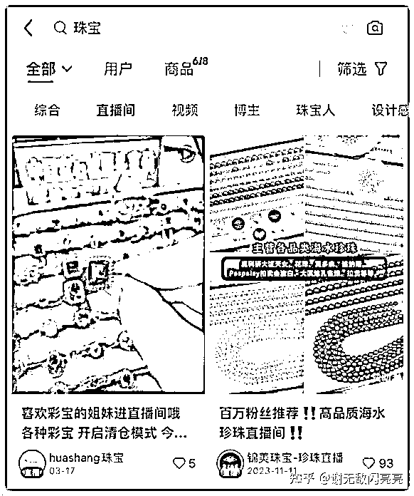

**④ 直播广场采集**
借助直播广场，找到有爆款潜质的账号主页，收集选题方向。
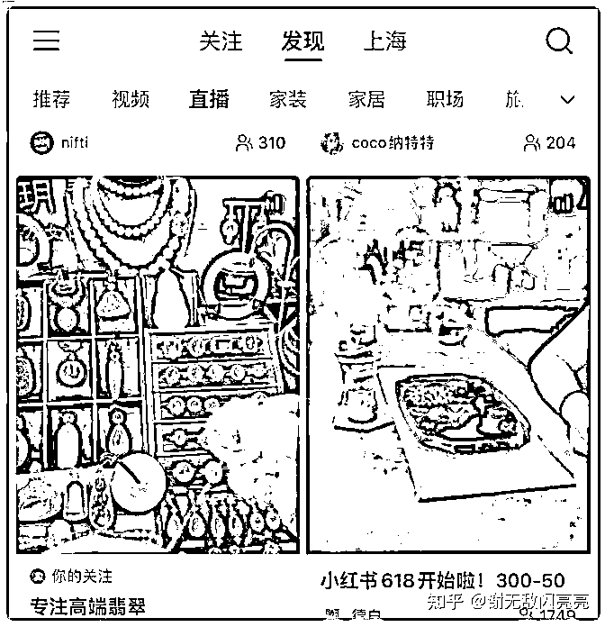

**⑤ 选题公式直接套用**

**季节/节日主题：**借当下热词吸睛
例：夏日百搭、缤纷清透
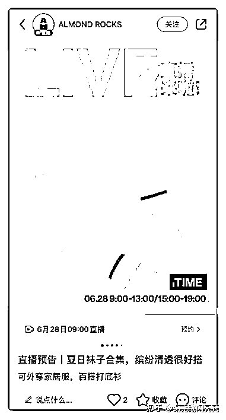

**系列主题：**从风格/场景切入
例：古着穿搭、vintage
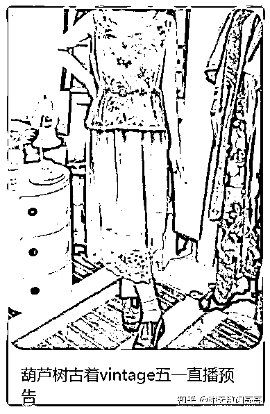

**新品预告：**以新款做钩子
例：新品+体验官
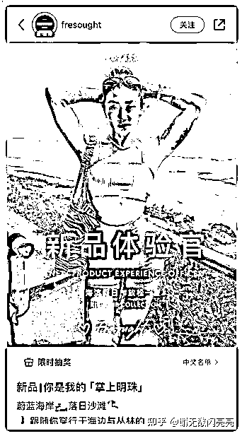

**数字突出：**用显眼数字体现丰富度
例：1000件渐变裙
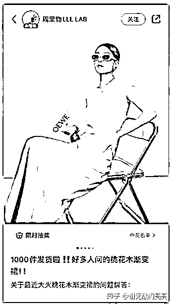

### 2、标题怎么写

标题要兼顾主题卖点与吸睛点。

三个优化方向：

**① 用画面/符号/数字描述结果**
原：南洋风家居搭配技巧
改：南洋风家居搭配分享，闭眼入轻松get

**② 做法+收益/痛点解决**
原：家居好物分享
改：这些家居夏凉好物，清爽过夏天

**③ 风格+商品+直播福利**
原：床品上新
改：天丝凉感被上新，首发福利送套

### 3、封面怎么选

封面点击率做到3%就很优秀。三种优质封面参考：人物+商品、人物+场景、凸显个人风格的。

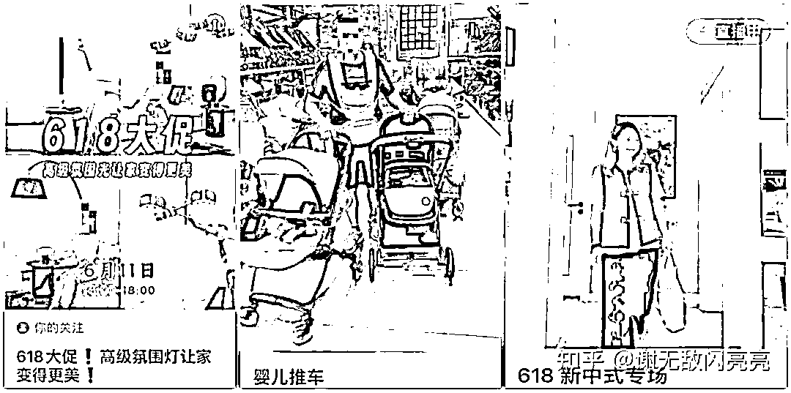

本质仍是人+货+场，审美门槛不高，找对标学习模仿即可。

### 4、社群与资料联动

开播前后，把直播信息同步到📕粉丝群、私域群聊。个人简介、瞬间动态也更新直播时间。

让新老用户都能第一时间获取动态，增加曝光与预约。
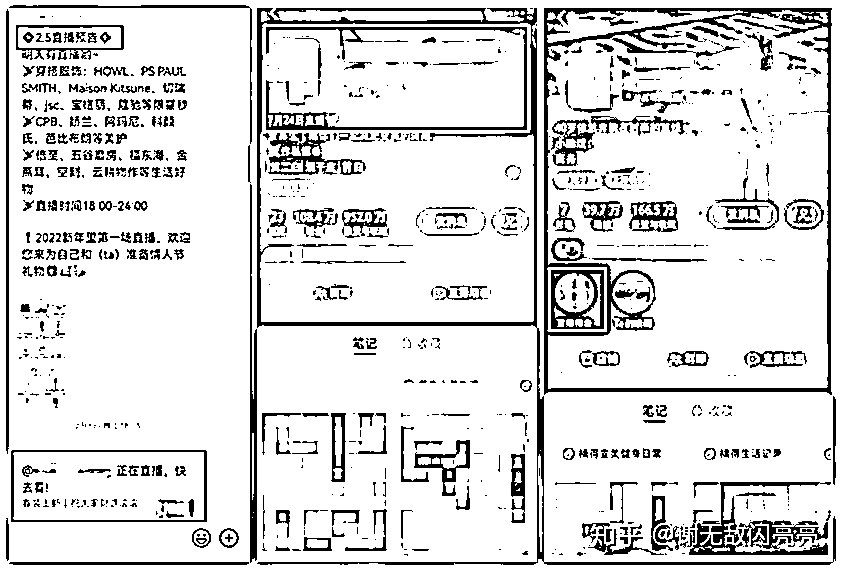

## 三、提升直播间成交

📕直播不需要高喊，关键是逻辑清晰、用对方法。

### 1、商品搭配

实测下来，直播间30-40个链接最合适。太多主播讲不过来，观众也选不过来。

**① 秒杀引流款 必备 10% 3-4个** 放在最上方吸睛
**② 长期热销款 必备 40% 12-16个** 做信任背书
**③ 利润款 30% 9-12个** 拉整体利润
**④ 差异化款 20% 6-8个** 体现品牌调性

### 2、直播节奏

**开场10分钟：**与观众轻互动，等待人数上涨，用福利款留人。遇到人数或销量小高峰时，用抽奖把人稳住，后续下单概率会提升。

**中段数小时：**主讲热销、利润、特色款。通过互动提升参与感，或安排小助理、客服、好友充当气氛组，提升新进用户的停留。

**收尾半小时：**集中推热销款促单，同时预告下场时间，带动下一场的预约。

### 3、抽奖留人

定时福利能稳定留存。红包、赠品、折扣券都可用。

**节奏：**每15分钟小奖，每整点大奖
**形式：**关注、加入粉丝团、下单抽奖。其中进团和下单的促单效果最好
**提醒：**粉丝群+直播公告+置顶评论，多次提醒引导参与
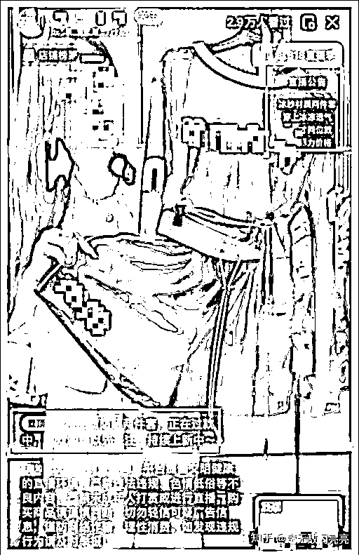

### 4、粉丝群运营

群运营做好，转化直接提升。

**开播前：**在群里推送预约笔记，用粉丝专属福利、新品上新撬动预约
**开播时：**群里发直播间链接，提升进房率；同时把进间用户拉回群
**开播后：**群内做售后、关联推荐、群内购，并预告下场

### 5、话术与避坑

📕直播对普通人很友好，话术不需要套路。

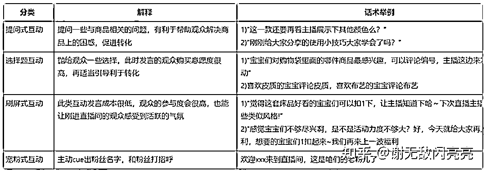

特别注意违禁词。“最低”、“第一”等极限词没有真实数据支撑就不要用，容易被判定违规导致直播中断。
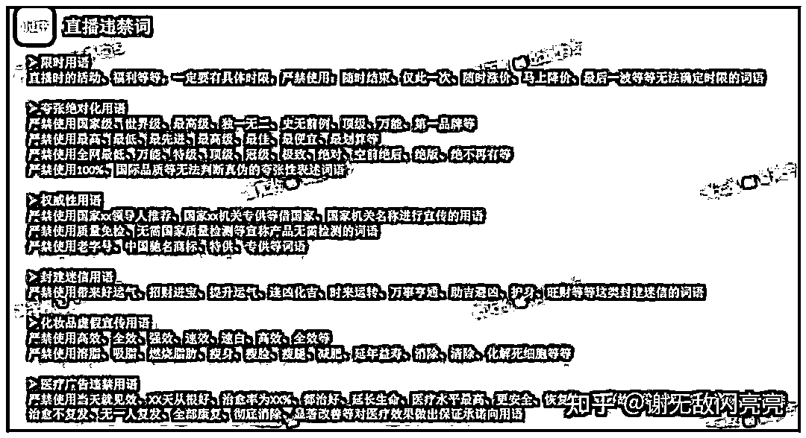

可让助理在旁提醒，或用更中性的表达替代。

## 四、自播之外的放大方式

除了自播，还能通过买手合作提升品牌覆盖、做矩阵、拉整体销量。

通过蒲公英中心的买手中心即可完成筛选、联系、合作。

合作要点：

**① 坑位费与佣金比例**
**② 货盘与手卡准备** 让买手快速了解商品
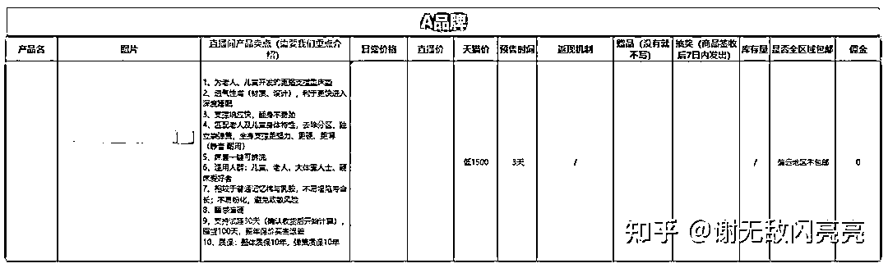
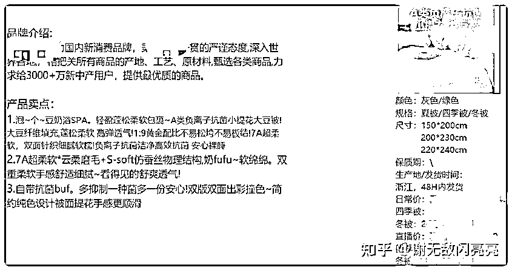
**③ 档期确认** 锁定直播时间
**④ 合作形式** 是否需寄样；虚拟商品或大件家居需提前沟通链接或直播场地
**⑤ 曝光时长与数据确认** 明确商品在间的展示时长与预期转化，避免后续纠纷

只要搞清平台底层逻辑，用对方法持续迭代，📕直播也能实现弯道超车、快速爆单。

* * *

评论区：

大柚子 : 你是我的神[色]

书豪 : 你是我的神[色]

小六六 : 你是我的神[色]

* * *