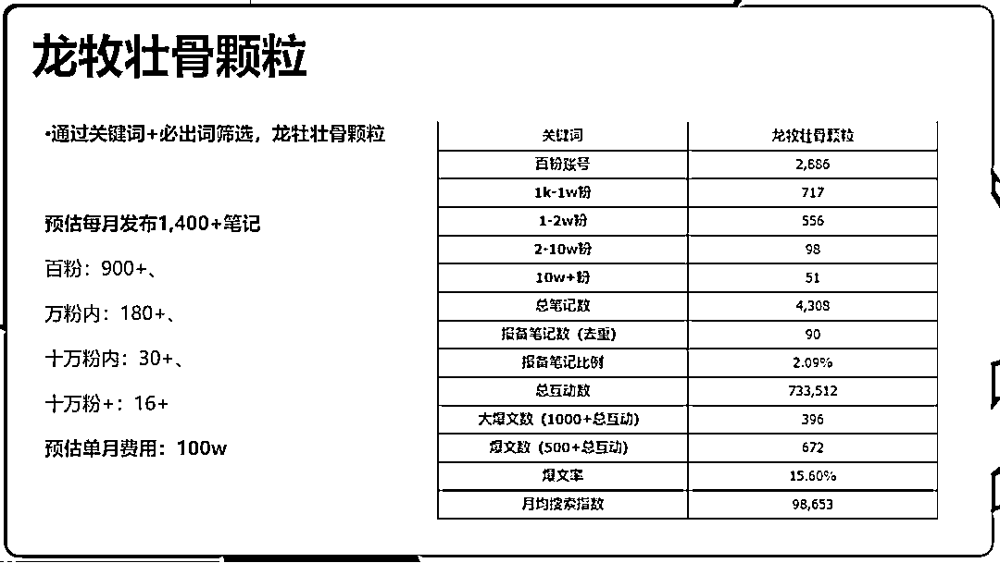
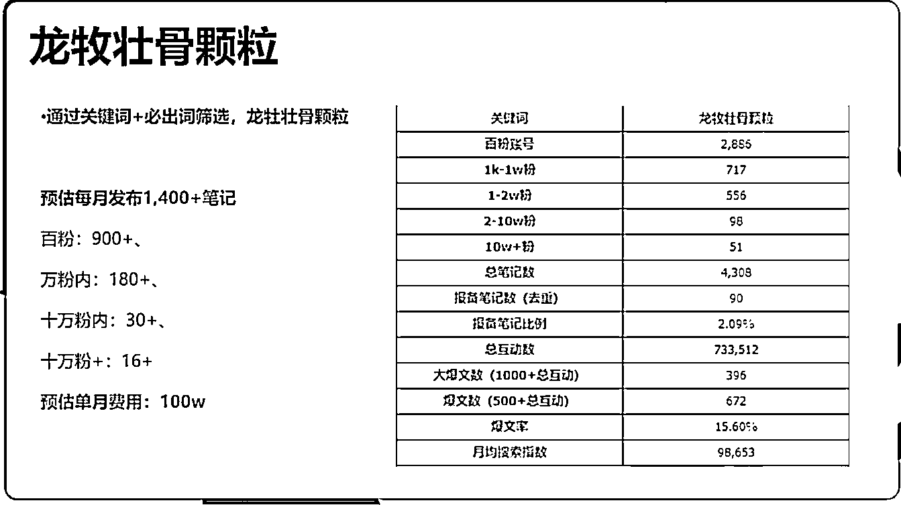
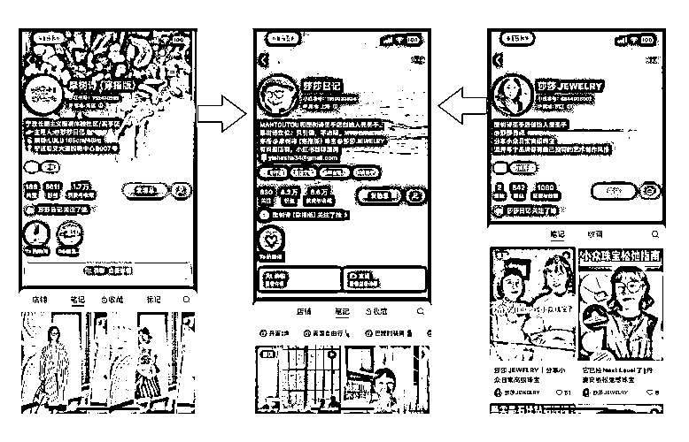
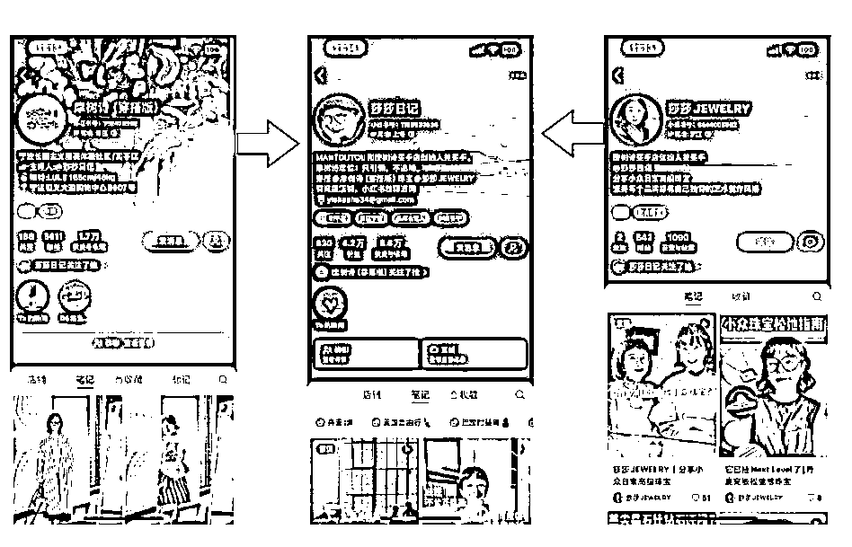

# 📕拿到大结果的 4 种打法
作者：龙哥

想在红薯地上做出百万级别的生意，光靠砸量不行，硬投广告也不行。这个社区去年以来商业化走得很快，直播、小店、投流工具接连升级。它的人口盘子很特别：女性占了七成多，一半人在高线城市，大量九零后零零后，愿意为好内容、好设计买单。表面看是座金矿，但这里的流量池并不算大，入场门槛也很低，算法又特别分散，内容没审美，基本连水花都看不见。所以那些在传统电商和短视频平台上粗放直接的办法，到这里多半要失灵。

真正能拿到回报的人，核心都是顺着社区的逻辑在做。下面四个方向，已经有人跑通。

一、站在这里种草，去别处成交

谁适合：有成熟店面的品牌方，懂内容投放的白牌，以及原本就在电商体系里有老店的团队。

红薯地一开始就承担“被搜索”的职能。用户刷到喜欢的东西，转头去购物App搜同款下单，这个动作到今天都没变。与其跟习惯作对，不如利用它：在这里做低成本的内容曝光，订单交给站外老店去接。老店自带历史销量和评价积累，承接起来更顺；团队也不用重新学一套后台规则，省下来的运营精力，全是隐形利润。

还有一个很多人忽略的点：这个社区对店铺进驻审查比较严，但老牌购物平台那边反而更宽松。一些资质不全的商品，可以先挂到电商平台卖；这里不能写的宣传文案，也可以在电商页面里正常放。

平台方举过一个例子。一款儿童营养补充剂，在红薯地铺了大量中小达人笔记，夹杂头部账号，每个月笔记量约一千多篇，投流加杂费超过百万，最终在京东体系内完成三千多万成交额，搜索热度从年初到四月翻了快十倍。

跨站导流也不只靠用户“想起来再搜”。现在有官方跳转工具，比如跳淘宝的“小红星”、即将上线的跳京东工具，以及618期间推出的CID。它们的价值在于缩短从看见到购买的路径，数据也全透明，不再依赖人工估算搜索回流。

二、把高净值客户引入私人池子长期运营

谁适合：做高单价产品、定制服务、复购品类，或者有升单空间的项目。

这里的用户画像很值钱，所以值得用付费流量筛出更值得经营的客人，再导进私人号或轻应用，提供一对一的长期服务。但私域运营不能是捞一笔就走，一定要围绕一个真人持续输出生活化内容，客户才信任你。有了信任，转化和复购才会出现。流量获取成本一直在涨，真正支撑利润的，其实是回头客。

选品上，单价高、毛利高、回头率高，三样至少占两项。定制游、留学、移民身份、港险、招商加盟、减脂医美，都是客单价和利润率双高的行业；高端女装、潮鞋则是毛利和复购都不错。很多平台的女装退货问题严重，但私域里反而能控住，优秀团队甚至能做到接近零退货。产品线多的品牌，还可以靠小程序和分销机制，把红薯地来的客户沉淀到🛰️生态里，慢慢经营。

引流方式建议走官方付费链路，比如私信和表单工具。不花钱的方式本质上是截流，小打小闹可以，规模一大就会陷入账号、设备和人力成本的无底洞。付费链路虽然看着要花钱，但成本好算，链路也稳定。

三、让一组“个人号”在站内把流量相互喂养

谁适合：内容能力强的团队、品牌方、白牌，以及需要强背书的产品。

这个社区有一套独特的绑定机制：一个总账号可以挂3个企业号和3个私人号，所有子号共享商品橱窗和投放权限。官方把其中一类叫“主理人”，本质就是带有品牌身份的个人IP。品牌官方下场容易显得太正，而这些个人号可以说人话、晒日常，天然有亲近感。而且一个品牌可以同时养几个不同人设的子号，各自对应不同喜好的人，最后人之间还能互带流量，形成站内循环。

“莎莎日记”就是这套玩法的样本。她靠几个号各发各的内容，各带各的货，笔记加直播一起跑，月销稳定破百万。

白牌同样能借力。品牌声量不够，就多开几个个人号，用不同角度去抢流量，所有路径终点是一家店。那些容易踩红线的品类，比如滋补品、功能性食品，直接在页面里写效果容易触线，让个人号去分散试错，反而能保护主店的正常经营。

四、全网协同，占领用户心智

谁适合：预算充足、组织能力强的成熟品牌方。

前三招分别对应“去电商平台成交”“去🛰️里运营”“留在站内成交”三条路径。第四招是把前面全部打通：达人投放、个人号矩阵、付费流量、自有店铺、搜索卡位，同时在站内开跑；站外则对接到短视频、社交和购物App，形成一张全方位的网。用户在不同节点多次刷到这个牌子后，心中就会留下“这个牌子到处都是”的暗示，之后随便哪个平台再见到，就可能成交。

这套组合拳的代价也很明显：管理难度极高，投入预算大，不适合小玩家。但一旦跑起来，天花板也是最高的。它更接近一盘战略棋，细节展开需要很长的篇幅，要是留言多，回头单独聊。

如果你也在红薯地上跑出过不错的结果，欢迎在下面分享。

