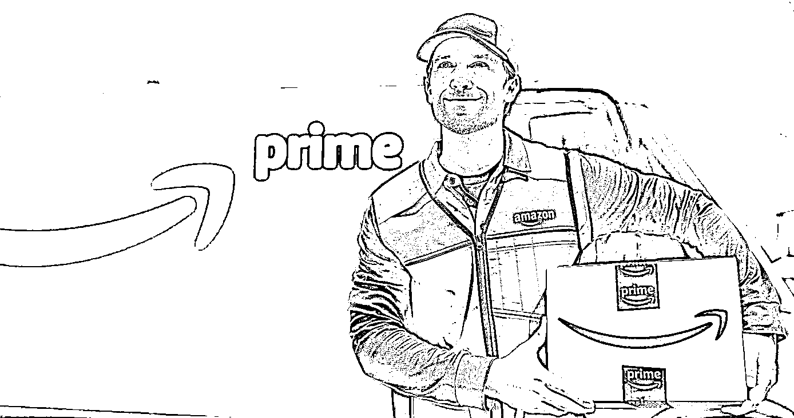
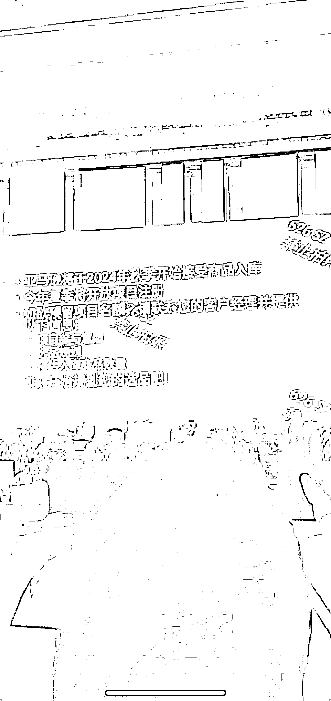
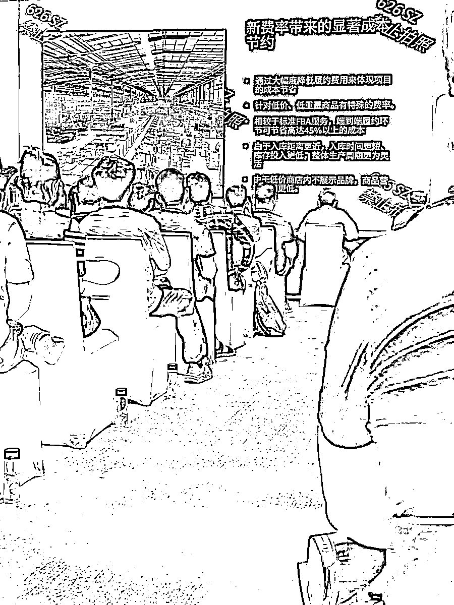
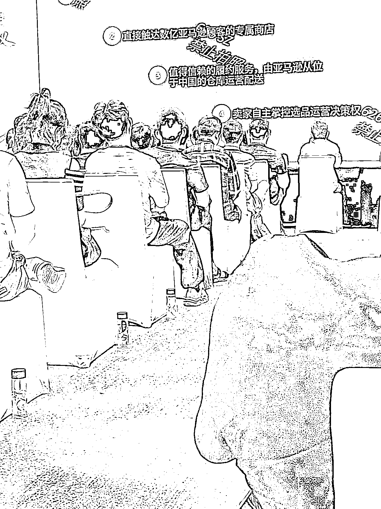

# 亚马逊也要低价卷了？赚钱的机会你看到么？

亚马逊被Temu逼得坐不住了，终于放下身段，搞了个“低价商店”出来应对这场内卷大战。没错，这个酷似Temu的新模式，已经正式落地招商。

这个低价商店主打什么？简单说就是无品牌的白牌货、时尚类目和高频家居用品。卖家只需把货备到亚马逊设在中国境内的仓库，后续由仓库直接以国际小包裹形式发给海外买家，物流周期大概9到11天，平台还会在首页给这个入口专门导流。根据内部招商会的消息，目前先实行邀请制，首批注册的商家今年秋天就能发货了。

对谁来说是机会？毫无疑问，那些已经在Temu上拿到结果、跑通模型的朋友，这就是上车的好窗口。每个新平台开跑的第一波，都会疯狂倾斜流量，流量还便宜的时候，你很容易做到“单车进去、小车出来”。没收到邀约也别着急，可以主动联系身边的亚马逊客户经理，争取进入第二批。

至于大家最关心的问题：这个低价商店会把Temu干掉吗？或者被干掉？现在有风声说美国打算对低于800美元的商品征收关税。我在美国这边看到很多讨论，当初设定800美元免税额度，是因为征税本身的人力成本比税款还高，而且这个口子本来就是亚马逊游说出来的结果。现在想把门槛往下调，海关就得增加人手，可美国现在的工作效率你懂的，加上就业环境紧俏，压根招不到人，就算法律通过了，大概率也是没人执行。所以Temu继续冲击各行各业，一两年内改变不了。亚马逊之所以选择降价策略，同样也是因为扛不住全球内卷的洪流。

我们为什么永远在卷？说白了，绝大多数人都还趴在产业链的最底端。真正赚钱的环节是什么？一是研发与创新，造出有专利壁垒、高附加值的硬核产品，像苹果一样靠技术垄断赚取超额利润；二是品牌与市场营销，像耐克、可口可乐，把品牌打到人尽皆知，价格远超成本也没人觉得贵；三是销售与渠道，亚马逊、阿里巴巴这种手握海量分销网络的平台，或者苹果直营店直接掌控零售终端，利润都能自己留下；四是金融与投资，投行、对冲基金、私募，还有那些早期押中独角兽的风投，赚的都是钱生钱最快的钱。

可惜，超过95%的跨境卖家，一个环节都没踩上去。中国企业能站到这些位置的，也屈指可数。既然看清了事实，抱怨没意义，强者选择接受现实，再想办法往上攀。

从长期主义的角度来看，跨境圈里真正活得滋润的，有几个参考：韶音耳机，靠骨传导技术打天下，产品质量没得说，品牌影响力通过环法自行车赛和自媒体放大得相当成功；还有insta360，运动相机品牌，也是靠社交媒体把用户认知做得极强。

未来跨境卖家想赚到价值链顶部的钱，得怎么做？第一，要真正懂美国市场，知道本地人要什么；第二，会玩美国的社交媒体，用低成本把品牌炒热，顺便带掉货；第三，多平台和独立站一起发力，保证现金流的同时，还能沉淀私域用户。像TikTok shop、YouTube shop、Instagram这些社媒流量阵地，都是绕不开的。

方向其实大家心里都有数，关键是老板们愿不愿意革自己的命，敢不敢二次创业。以前草莽做跨境，难度小，胆子大就能赚钱；现在要落地高阶玩法，不掉一层皮是万万做不到的。

当然，如果你想继续用低端玩法薅平台红利，那也没问题，但要提前想明白：新平台前期的流量红利注定要吃一波就走，走的时候把店铺卖掉全身而退，也是一种活法。

我给你们讲讲我自己的案例吧。最近我有一款独立站产品，在平台上卖得其实很一般。但后来我去找YouTube和Instagram的网红合作，让他们帮我带货，加上自己又多学了一些流量玩法，现在这款产品每天都能稳定带来1到3千美金的收入。很多东西就是这样，不去钻研，不肯下功夫，挺着肚子当甩手掌柜，还指望月薪一万的小朋友比你厉害？躬身入局，把自己的市场嗅觉练出来，这才是真正的王道。

以上！