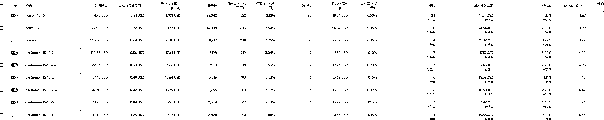
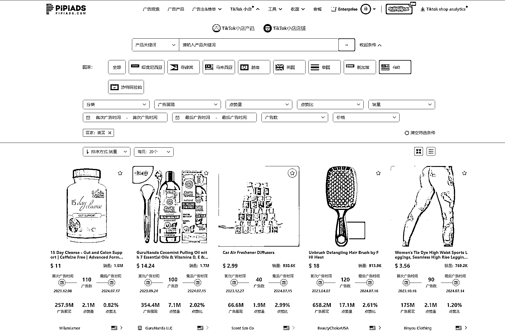
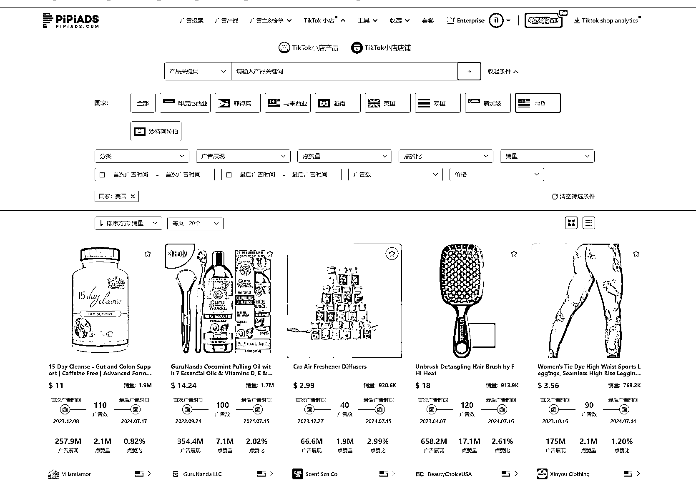
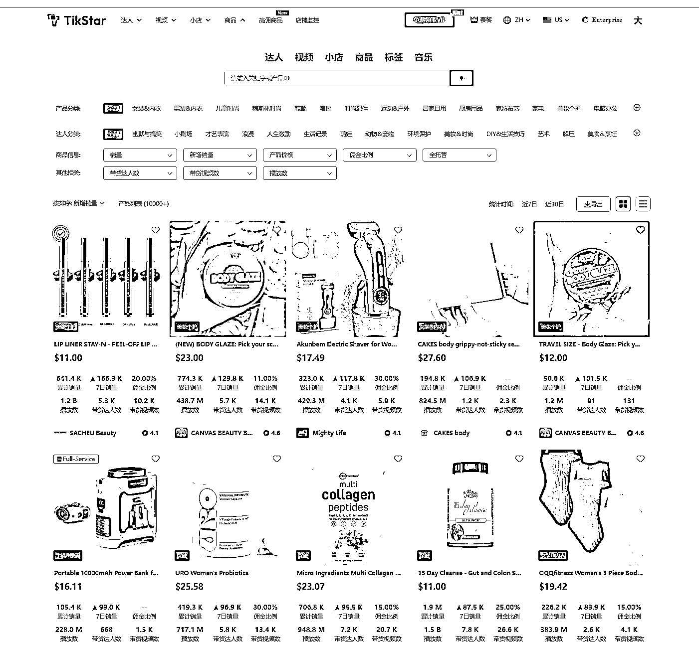

# 做 TikTok Shop 前：我命油我不油天！做 TikTok Shop 后：呜呜~老天爷放过我（随笔经验篇）

做TikTok Shop前：总觉得人定胜天；做TikTok Shop后：我只想求老天爷放过。

大家好，我是梁小伟。最近吃了一个亏，这回是真老实了。

先说背景。这位商家是个多渠道布局的跨境大卖，Facebook、TikTok、YouTube全都有涉及，各个平台都卖得不错。可一到TikTok Shop，就栽在了一件小事上——入驻之后没马上做品牌备案。结果，那些擅长挖信息、执行力又强的卖家一下子涌上来跟品。更绝的是，有人连店铺名和账号名都改成了那个商标，直接借尸还魂，正大光明地出单，简直裂开。

接下来，我把这段经历按阶段拆开讲。

第一阶段：投流起量，本来一切都在轨道上。

前后花了一万美金，准备了一个炮灰号，用混剪的投流素材做冷启动，出了几百单。基础销量打好后，自然流订单稳定在每天几十单。

为什么选投流？因为达人建联又难又慢，商品卡测品呢，门槛降低后入场者变多，效果越来越差。干脆直接烧钱起量。反正其他平台已经验证过销量，不需要测品，直接挑一款素材最好做、又最符合平台调性的产品，集中火力打爆，用一个爆品带动全店自然流。

执行上就是：混剪达人素材和自然流素材，炮灰号准备好，优化完再投。高客单价，前3000美金消耗时ROAS只有1点几，迭代了三批素材后拉到3点几，结果断货了。按趋势，这个爆品ROAS本来可以打到5。要知道，ROAS到2就能回本了。

第二阶段：加码自然流账号，做品宣和曝光。

爆品抢量成功，店铺动销起来，商品卡自然流也吃到了。这时我们立刻准备了15个号，批量剪辑、批量复制。有橱窗的，直接挂链接带货；没橱窗的，就引导去亚马逊或TikTok Shop搜索页面，既能做品宣，也能吃自然搜索流量。

到了这个阶段，重点来了。我怀疑数据异常被pipiads抓到了，过去一搜，果然。然后大批跟品商家就出现了。

这些跟品商家蹭流量蹭得毫不客气，价格直接打到五六折，商品卡流量照样吃。不投流、不做账号、不找达人，零零散散居然也卖了好几万美金。这波属实被抢量了。最夸张的还是那个：连店铺名带账号名，全部换成那个商标，让用户一不留神就当成了正版。对这种做法，我不支持也不反对，保持中立。能赚钱，是人家的本事。

然后回到怎么解决问题。

第三阶段：火速注册新店+紧急品牌备案。

这里要给所有人敲黑板：品牌备案一定要提前做，而且要做好多来几次的准备。为什么？因为备案审核每次大约要3个工作日，我们反复提交好几回都过不了。万一碰上审核不过，或者商标日期对不上的情况，几周甚至一个月就搭进去了。解决办法就是：同时开工单找客服，备案前把每一步都确认到位，别浪费时间。

等备案成功，就能一个一个举报侵权行为。

最后同步一下目前的玩法心得：

第一，测品或者过新店期，建议用投流起店。

第二，平台早期，跟品依然有机会，但要花更多精力做调研。可以去tikstar或pipiads找异常值，注意提前查清楚对方有没有商标专利。

pipiads 

tikstar 

第三，自然流太耗时间，成功率也低。现在橱窗号封得很严，不建议买号挂。自己养号到5000粉也未必能开橱窗，得看播放能不能爆、账号稳不稳定。

评论区：暂无评论 