# 特朗普遇刺！跨境卖家发现新商机？
作者：龙哥

枪响之后，有人忙着吃瓜，有人却已经开张赚钱了。

这两天美国最炸裂的新闻是什么？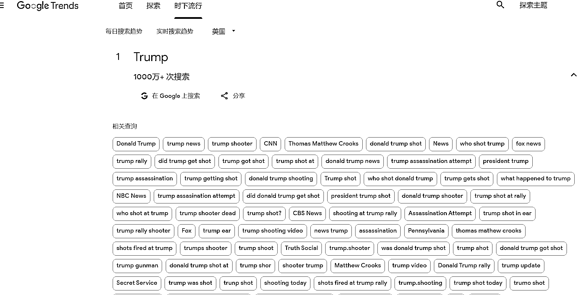毫无悬念，就是特朗普在竞选集会上被枪击。

当地时间7月13日下午，特朗普在宾夕法尼亚州巴特勒县的一场竞选演讲中突遭枪击。现场画面显示，他的右耳被击中，脸上血迹明显，特勤局人员迅速护送他撤离，最终安全转移。事后特勤局通报称特朗普无恙，但这起事件导致枪手和至少一名观众死亡，官方定性为“暗杀未遂”。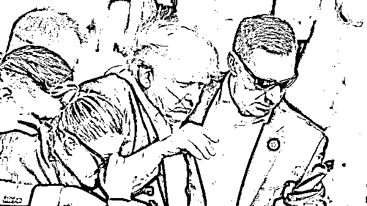

对于这件事，网上吵成了两派：

一派觉得这是“自编自演”。理由很直接：枪手站在特勤局安全布控范围之外开枪，而特勤局竟能在不到一分钟内将枪手击毙，这反应快得不正常；再者，子弹正中右耳却没要命，巧得像安排好的苦肉计；再加上大选竞争激烈，民主党内部又幺蛾子不断，很可能是特朗普为了选情精心策划的一出戏。

另一派则认为纯属意外。现场视频里枪声一响，场面立刻失控，特朗普右耳流血是实打实的，这种伤很难伪造。特勤局训练有素，快速反应并击毙枪手，本就是本职工作，没什么好奇怪的。

但真正让人没想到的是，事发不到24小时，电商平台上就已经有“特朗普遇刺”主题的衬衫在卖了。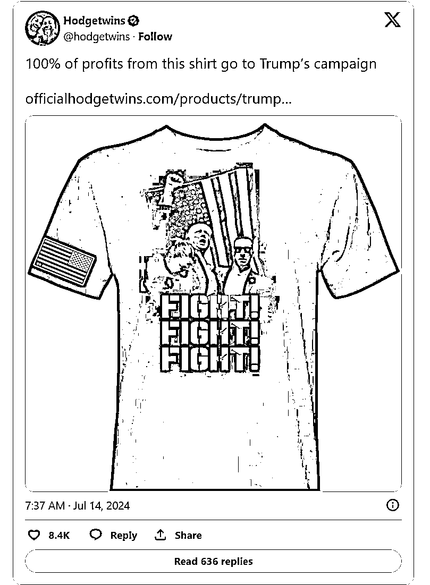

比如这件网上出售的衬衫：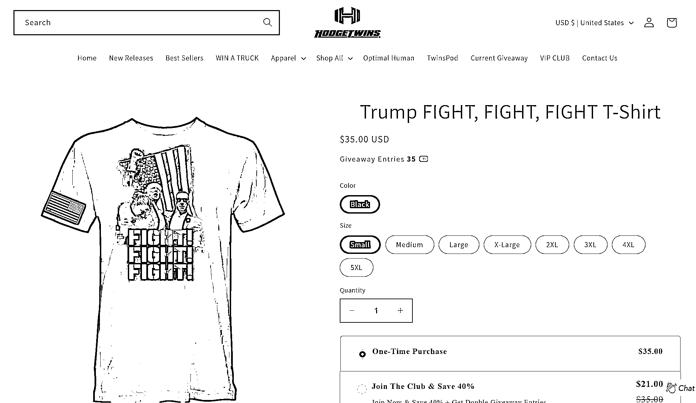售价35美元。拼多多上同类的POD定制印花衬衫，大概也就20块人民币，中间差价超过两百元。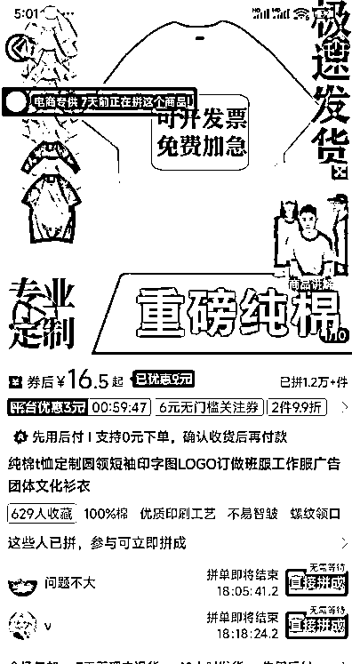当然，老外也卷价格，像这家就卖得便宜些。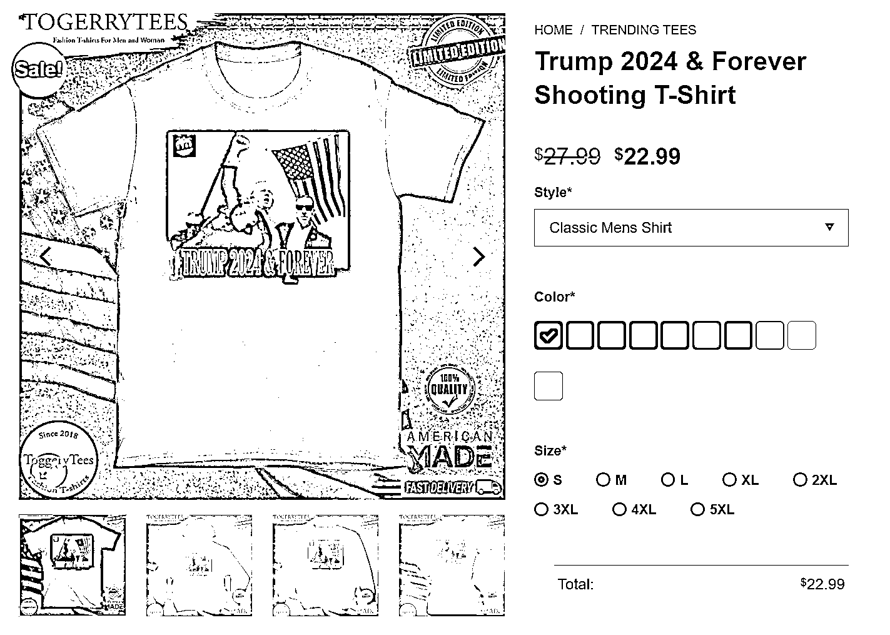

我还翻了翻，发现还有不少其他款式可以参考：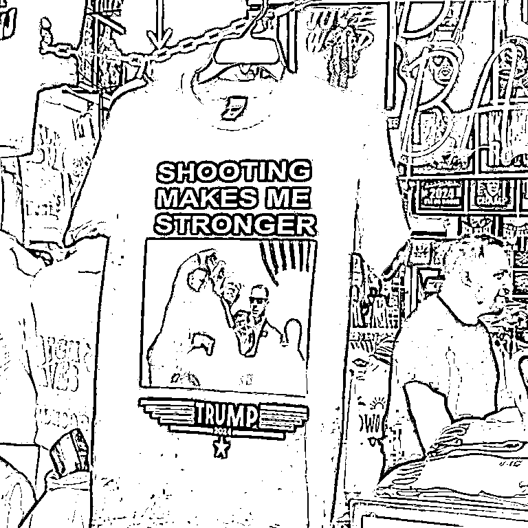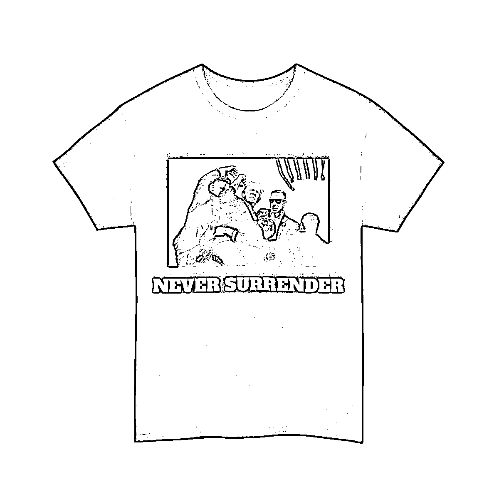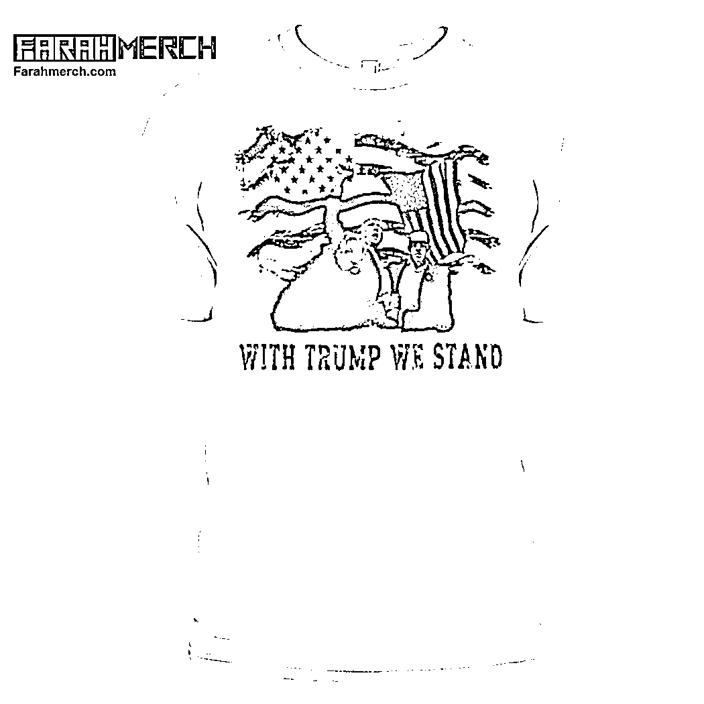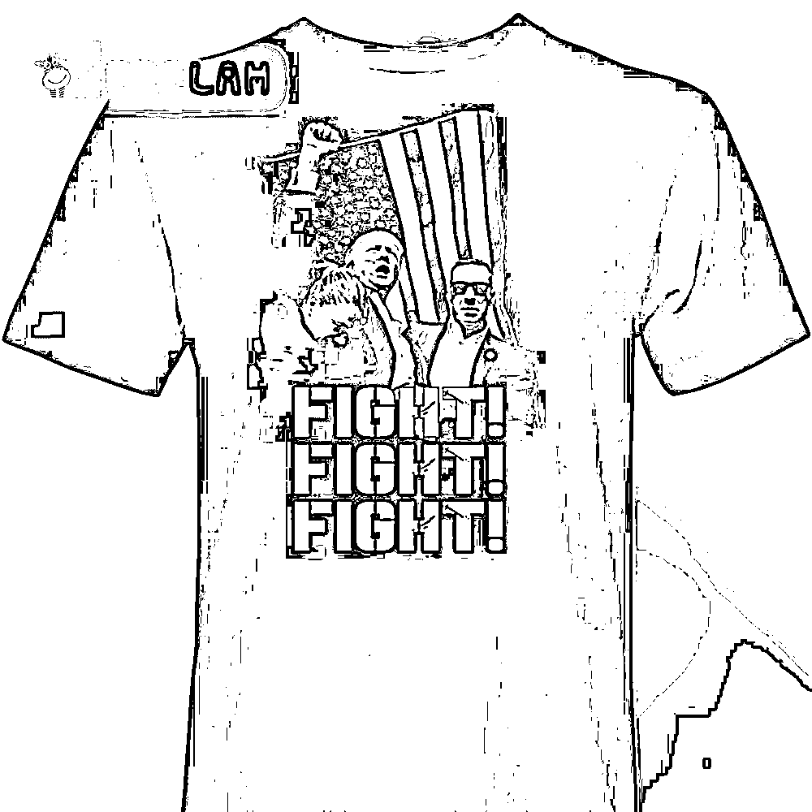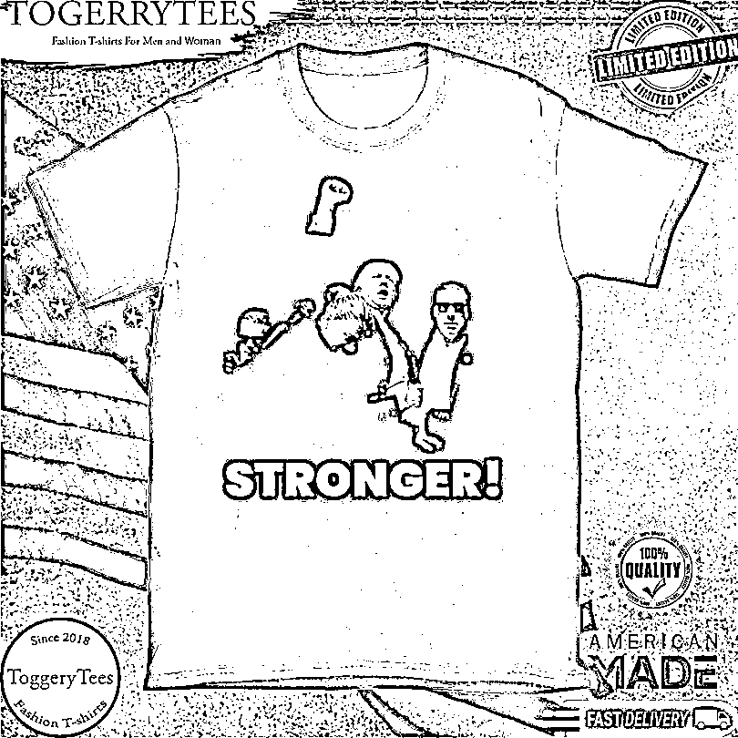

说到底，不只是衬衫，特朗普的周边一向好卖。比如这双土豪金战靴：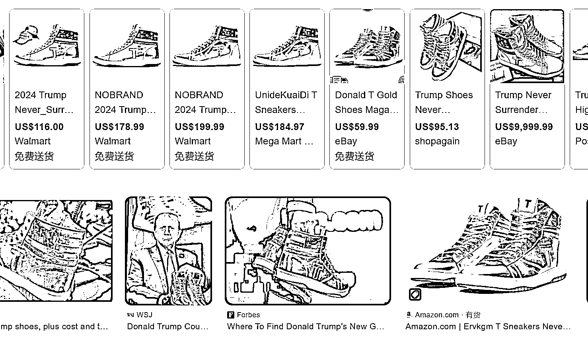还有“懂王”佛像摆件和同款衬衫：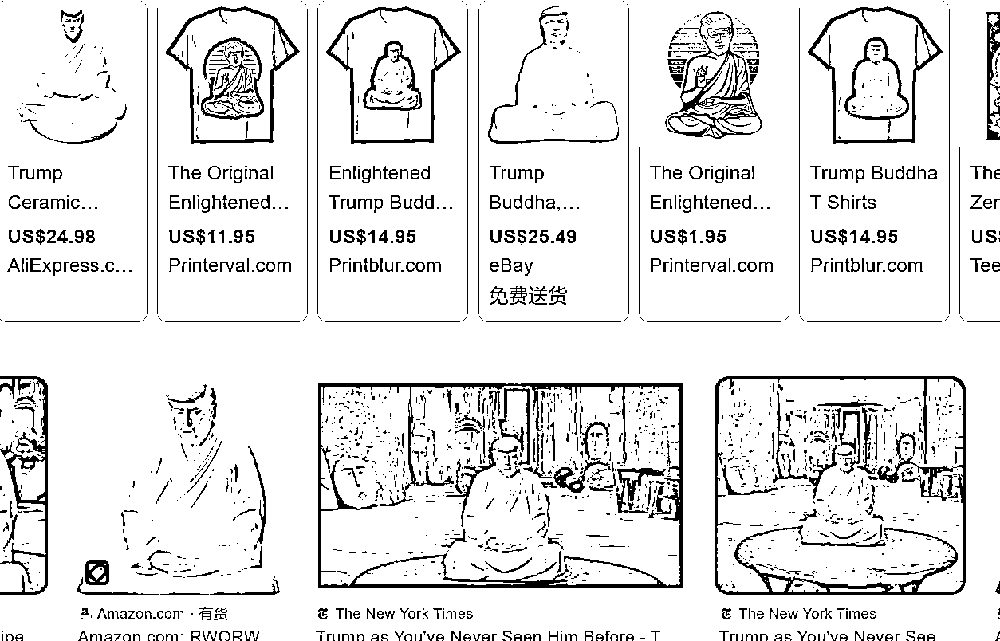会员群里有人分享的挂饰：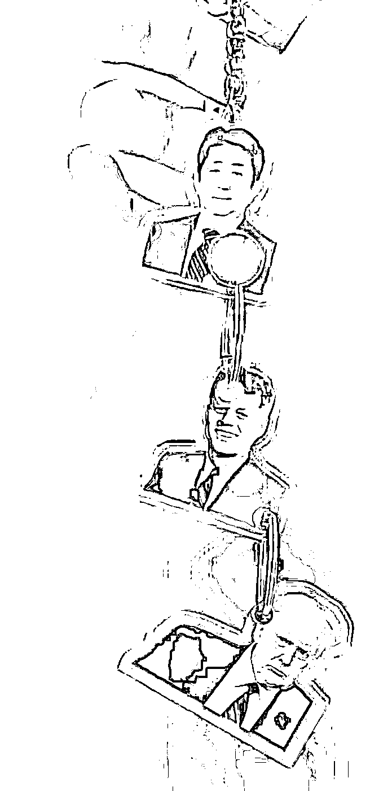以及这些传统小配件：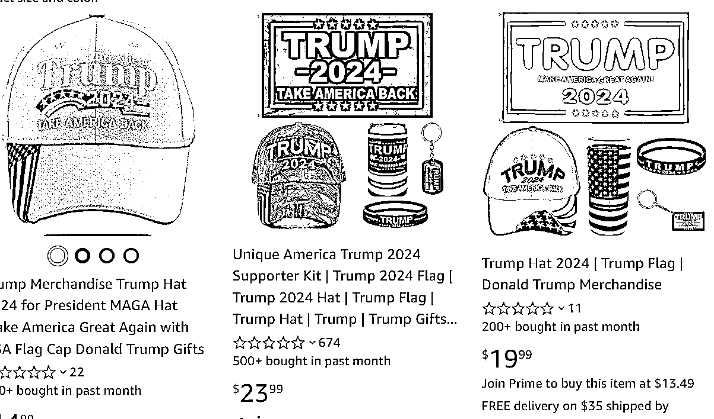

这种玩法怎么拆解？其实核心就三步。

第一步，紧盯新闻热点，或者监控搜索飙升的数据。

第二步，把热点图丢给POD，一切皆可印。

第三步，学会二次创作。

看到大新闻，先想：这个画面能不能印在衬衫、水杯、摆件上？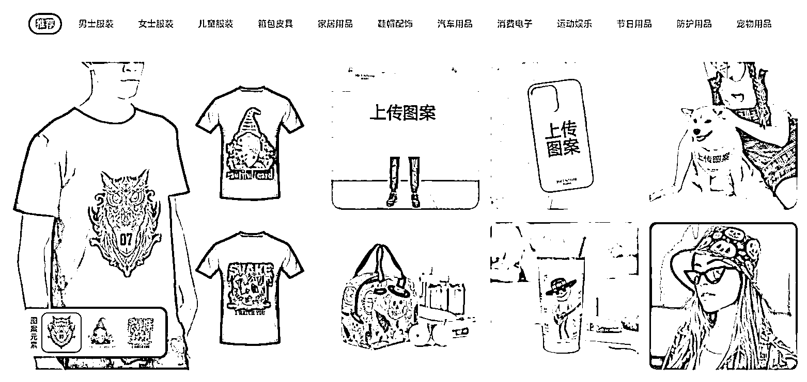可以原图直印，也可以做点艺术加工——转成素描、黑白、动漫风，或者加上一句口号。最后，把成品扔到社交媒体上推广。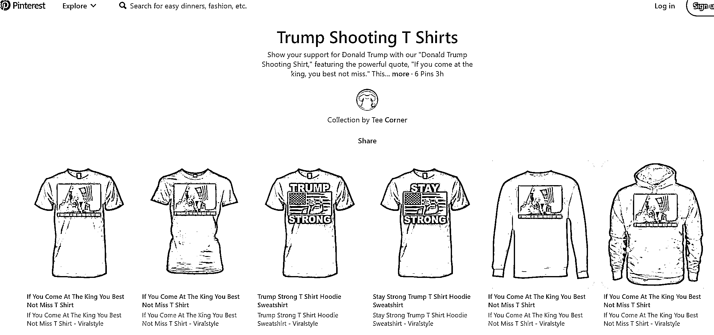等不及的话，直接开个TikTok或Facebook广告测试一下也行。

不过，关于这波“危机商机”，我有几点看法：

1. 这种蹭热度的生意，我本人不太感冒。它可能让你一夜暴富，也可能让你亏到怀疑人生——等你备好货，热度可能已经过了；就算你接住了流量，收款账号也可能因为风控被冻结。另外，这类产品还容易踩侵权红线。真要入场，务必三思。

2. POD模式倒是有一个真优势：美国本土就有不少POD供应商和网站。这样一来，你的成本只有建站和投广告，有订单后由美国POD网站直接定制、一件代发，产品库存和物流成本都省到了极致。

3. 能定制的产品远不止衣服、包包。如果你有点美工功底和艺术嗅觉，一定别偷懒，做二次创作才是打出差异化、拉高客单价和利润的关键。

4. 还有人反复问我：这波钱到底怎么赚？简单说，就是Shopify这类SaaS系统建站，配合Facebook、TikTok投流，出单后再去POD网站下单。但如果你之前没做过跨境，很可能连收款账号都没有。单量一般倒还好，一旦爆单，新账号很容易被风控干掉。所以没点资源积累，想靠这个赚大钱其实挺难。

以上，就是这次“特朗普遇刺”事件背后的一点点商业观察。欢迎来评论区聊聊你的看法。