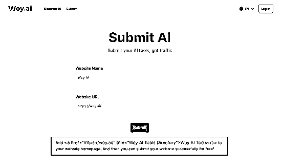
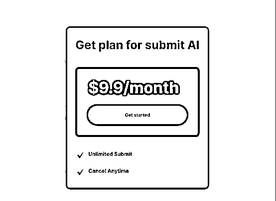
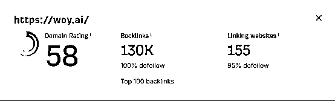
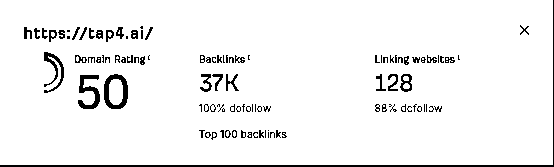
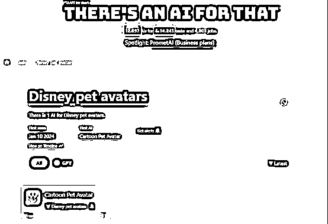
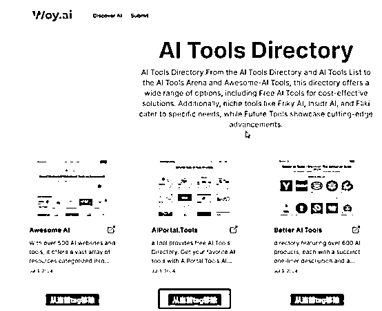

# AI 原生 CMS 如何做 SEO？我从哥飞直播里拆解出的 5 条实操心法

7 月 3 号，出海鼓励师哥飞做了一场长达两个半小时的直播，主题是《SEO 友好的 AI 原生 CMS 思考和实践》。看完后我脑子里嗡的一声，赶紧把要点整理成笔记，不然后劲过了就忘。

## 1. 用外链交换换来低成本的自动化增长

woy.ai 的页面提交机制设计得非常精妙。提交时只要填写的 AI 工具官网里带了 woy.ai 的反向链接，就能直接通过审核。

如果官网没有外链，系统就会弹出付费窗口：每月 9.9 美元，无限次提交。

一招两吃。免费通道让站长用外链置换收录，付费通道让急于上线的玩家花小钱无限刷。9.9 美元的定价远低于市面上其他导航站的收费。更狠的是，这个不限次数的额度还能被二次包装，变成“AI 工具收录代发服务”去赚差价。

对提交方和导航站来说都是划算买卖。尤其免费策略，站长几乎零成本地帮 woy.ai 换来了外链和产品信息，典型的边际成本为零的增长。说白了，这就是把增长黑客用在外链数量上，而不是用户数上。

哥飞透露，仅靠这个打法，woy.ai 两个月内 DR 干到 58，引荐域名 155 个。

另一个同路人 tap4.ai 也走类似路线，两个月 DR 冲到 50，引荐域名 128 个。

当然不能神化这招。市场上不乏照搬做法却没起来的导航站，我判断关键在于内容本身的含金量和前期的种子外链基础，没有这两样，外链来了也留不住权重。

## 2. 让 AI 生成真正 SEO 友好的内容

核心思路是先爬后洗再生成。先用爬虫自动抓取待收录产品的公开信息，再人工补齐缺口，汇总成参考资料喂给 AI 清洗整理。

产品页不再是千篇一律。系统会根据产品特性动态拼装不同区块，比如简介、功能亮点、团队背景、价格、评测等，每个区块都是独立的。

SEO 三要素 title、description 等，也由 AI 基于参考资料生成。这样既压制了幻觉，也避免了大面积重复。

更关键的是“一词一页”原则。产品下的每一个信息维度都拆成独立页面，比如“XX 产品 定价”、“XX 产品 功能介绍”。这样能精准命中用户的细分搜索意图。

内容仍由 AI 基于参考资料输出，保证质量不掉线。

多语言处理也很讲究。不是统一用中英文 prompt 再翻译，而是为每种语言定制专属 prompt，从英文版派生出来，保持语义准确。

渲染层面，AI 生成时直接输出 Markdown 并同步预渲染好 HTML 存库，避免用户访问时重复计算，节省资源。

关于输出格式，我个人踩过坑。JSON 看着结构清晰，但 AI 偶尔丢个逗号就解析失败。硬地骇客在 podwise 的案例里也提过同样问题。短文本重试成本低，长文本还是 Markdown 更稳。

## 3. 别让 AI 乱打标签，要用搜索量驱动

直接让 AI 自由发挥打标签，结果往往是搜不到的冷门词，这对 SEO 毫无价值。

我自己做导航站时就吃过亏。后来改成研究头部站的做法，比如 theresanaiforthat.com。

它用 task 作为一种细粒度标签，数量远超工具本身，很多 task 下只有 1 个工具。这类词搜索量理论上很低，但像 TAAFT 这种 DR 74 的大站，也可能是在刻意造词抢占先机。

哥飞的解法是先行汇集一批高热度的标签关键词作为白名单，再让 AI 依据参考资料在白名单里做匹配。准确率上去，排名机会自然变大。

标签是多语存储的，而且不是直译。不同语言的标签是基于该语言的真实搜索数据采集，再配上标签说明辅助 AI 理解，进一步提升命中率。

标签还可以多维度交叉：功能维度、形态维度、定价维度……组合起来就能长出新的内容切口。比如“免费的去除背景 APP 平替有哪些”这种问句式长尾，正好用农村包围城市的方式切入排名。

## 4. 别堆后台，够用就行的提效小工具

直播演示时我注意到标签列表页里有几个隐形的小工具：移除当前标签、把指定工具强制归类到某标签。功能很轻，但用起来飞快。

这比从零搭一个完整管理后台省心省力，又比直接改数据库安全高效多了。

给开发者的启发是，面对重复性杂活，先想想能不能用几行代码做个小面板自用。别在非核心体验上过度打磨，比如样式美化，时间花在刀刃上更划算。

## 5. 结语

整场分享的核心只有一个：以真正对用户有价值为前提做 SEO，再用 AI 原生 CMS 来承载。让 AI 负责它擅长的重复劳动，人类负责投喂高质量参考。信息被清洗、聚合、重组后，比对手更有料，谷歌才会更偏爱，用户才会更停留，飞轮就转起来了。

受限于篇幅和我的理解深度，很多细节没展开。感谢哥飞的干货输出，完整回放可以在🛰️视频号搜索“哥飞出海”查看直播回放。

* * *

评论区：

暂无评论

* * *