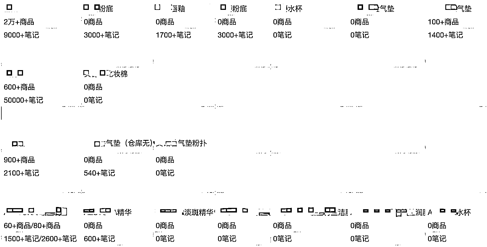
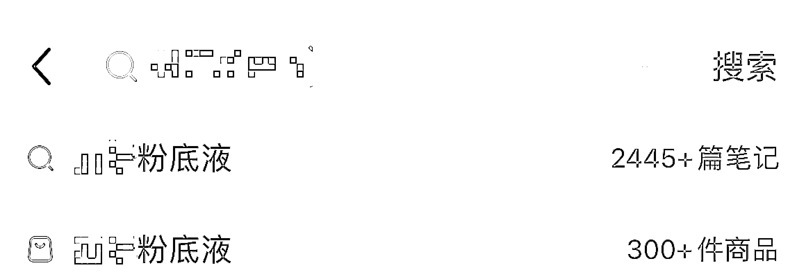
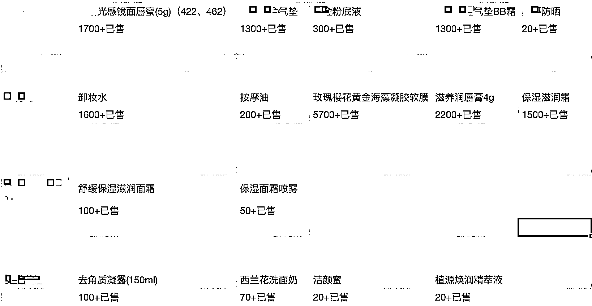
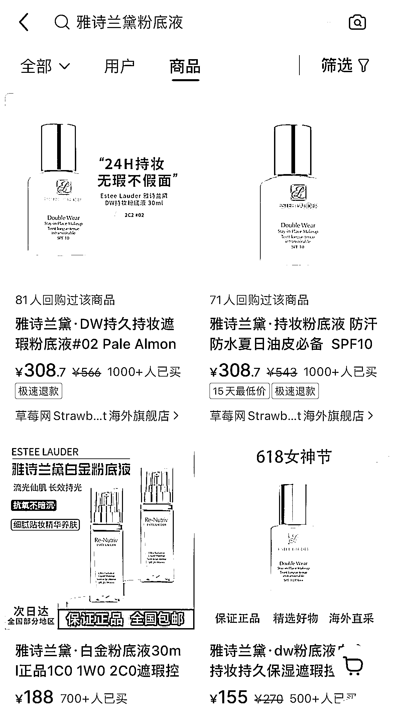
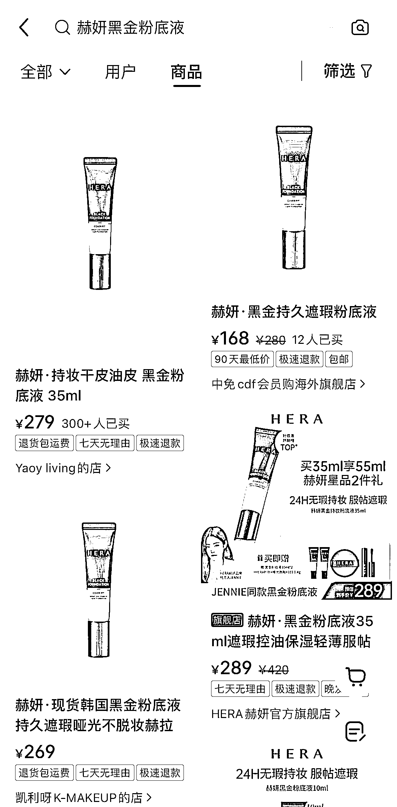

# 同赛道品类爆炸时，📕选品怎么破？

作者：加麻
日期：2024-07-09

赛道已经确定，供应链也已经谈妥，却发现品类多到眼花缭乱，这个时候怎么挑？

就拿美妆来说，底妆、眼妆、唇妆、腮红、修容、高光、眉笔、眼影、口红、粉底液、睫毛膏、眼线笔、散粉、遮瑕膏……品类密密麻麻。不同品类里又分不同品牌，每个品牌擅长的细分品类还不一样。如何在同一家供应链里挑出真正适合放到📕上的品，选品直接决定成败。

我的实操思路分三步走：

第一步：先用📕搜索框做热度初筛
直接在搜索框里输入品名，看笔记量和商品数是多少，把数据记录下来。笔记少商品也少的品类，第一轮就先淘汰掉。
⚠️ 这里要说明一下，表格里标的 0 商品 0 笔记，并不是绝对为零，而是搜索结果里完全不展示数据，我们就默认为热度很低。同理，笔记很多但商品为 0，说明这个品类内容在跑但商品没铺满，正好可以靠内容和素材去卡位抢先机

第二步：热度筛选后，如何在品牌内选品类？
剩下的是📕已有一定热度的品了，这时候在搜索框输入具体商品名，切到商品 tab，按销量排序。看这个品牌下哪个品类最能打，观察销量前五的产品有没有低粉爆款出现。评判标准是 低粉爆款 > 普通高销量，优先锁定销量表现强的品类，再做二次筛选

ps：下面这两个你会选做哪个？

第三步：最后看库存能不能扛过首发
前面两步筛完，剩下的都是有热度又在📕卖得动的品了，最后只看一件事：库存够不够。优先上架库存充足的，建议至少 100 支以上起步，避免爆了没货。

看不明白的可以多看几遍，有问题随时私信我。

* * *

评论区：

暂无评论

* * *