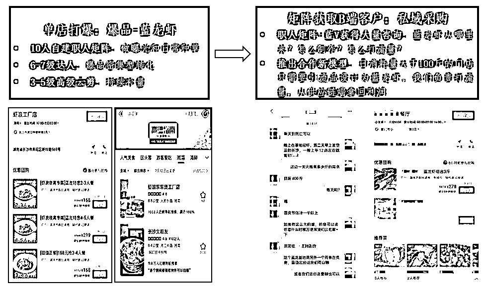
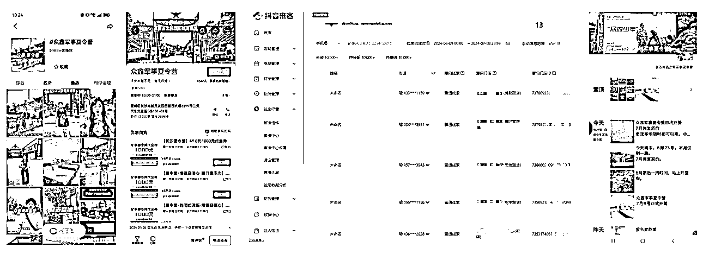

# 同城高客单抖音玩法：一线团队两年的安全跑量实战

2024 年，抖音同城做高客单已经进入全面闭环的阶段。通俗点说，就是【线索进线 → 私域沉淀或门店成交】这条路子被彻底打通，而且即便团队本身不擅长做爆款内容，也能稳定复制。

**Part 1 为什么一个只做前端流量的团队，反而把私域养活了**

一切要从 2022 年说起。

当时我们做餐饮爆品供应链，投放了十几个抖音号去带店。没想到，闻风而动的不是终端消费者，而是上游的供应商和采购方。他们直接在私信里聊、在评论区问、甚至打客服电话，最后都被我们引导进了微信。

我们本没有私域运营的基因，却硬生生攒下了上千个精准微信好友。电话也是源源不断，高峰期一天 50 通，日常也有十来通。更关键的是，期间一个抖音号、一个微信号都没有出现封禁或违规。

这件事给我们最大的启发是：**通过职人矩阵咨询、以及官方电话咨询过来、并且愿意加微信的客户，精准度极高、合作意向极强。** 这个逻辑，后来被我们迁移到同城高客单的各个赛道之上，也就形成了企业职人矩阵的雏形。

**Part 2 三条被验证过的同城高客单拿量链路**

这套方法从 2023 年就开始迭代，到 2024 年融合了抖音搜索 SEO 后，沉淀出三条核心路径。都是我们团队亲手做的项目，可复制性强，下面按场景拆开讲：

**1、城市级职人矩阵拉流**

链路：职人矩阵 → 以城市 POI 做同城覆盖 + SEO 关键词承接精准搜索 → 用户直接私信咨询或到店

适合的赛道：展会宣发、房产看房、本地招工、工厂 ToB 产品等。比如赛灵力第一届数字人大会的宣发，现场超 1000 人到场；增城华哥看房系列，月均 300+ 私域进线；轻喜到家、天鹅到家的招工内容；包装厂、头部化妆品代工厂的 B 端询盘。

要点：吃的是城市大盘流量，客群密度不高，所以不能只盯自家门店。需要基于城市 POI 大面积筛选，再用话术把人引到微信做长线孵化。视频多以矩阵形式批量投放，十个号起步，每个账号锁定一个痛点或一个成交理由，形成流量漏斗。

**2、门店+职人+下单线索的闭环**

链路：职人矩阵 → 城市 POI + SEO 精准流量 + 引流爆品 → 主动建联进私域成交 → 到店用标品集中转化，无效线索做长期运营

适合的赛道：家装建材、门窗家居、珠宝、夏令营、防水维修、租房中介、求职辅导等。可对标方圆家居、众鑫军事夏令营、寓伙伴、点燃求职。

要点：引流品必须真正爆款，否则线索质量不行。如果客单价不到 2 万，流量到位后必须用标准化到店服务做密集转化，提升效率。线索要分级管理：A 类直接下单/电话意向，B 类账号咨询留资及流失客户，C 类评论区捞回的二次触达对象。

**3、门店+弱 IP+职人+下单线索的定制化玩法**

链路：职人矩阵 + 弱 IP 运营短视频/直播 → 城市 POI + SEO 流量 + 引流刚需品 → 私域长期经营，定制服务转化

适合的赛道：高端上门家教、高端月嫂、西装定制、装修、法律咨询、医美等高客单强信任行业。

要点：引流品必须是刚需，内容和文案只打痛点。私域要做长线运营，客单价普遍在 2 万以上，靠定制化服务完成转化。

**Part 3 现场的复盘与判断**

从 2023 年开始，穿云团队持续用这套打法跑项目。两年下来，抖音号没有被封、微信号没有被封，供给端客服经常被电话打爆。

后期我们做了降维优化：在确定爆点后，把视频质量从 80 分降到 50-60 分，按供给侧需求灵活调数量与质量，跑得更稳、更可持续。需要快速放量时，则用 KOL + 职人 + 本地推的组合叠加，效率得到过 5 个以上案例验证。

总结一句话：抖音同城高客单的核心，可能就是**用短视频矩阵做私信引流，用抖音 SEO 提升客服进线咨询，再被动加微信，最后在私域里反复运营、多次成交。**

空窗期会不会来不确定，但我们已稳定跑了两年，依然安全。我的判断是，这条路还能走很久，且同款逻辑在其他平台同样适用。矩阵，才是当下第一性。

* * *

评论区：

宗源 : 怎么链接？大佬