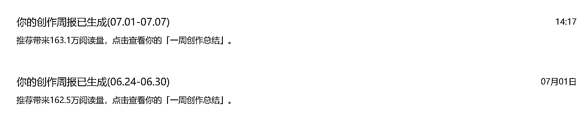
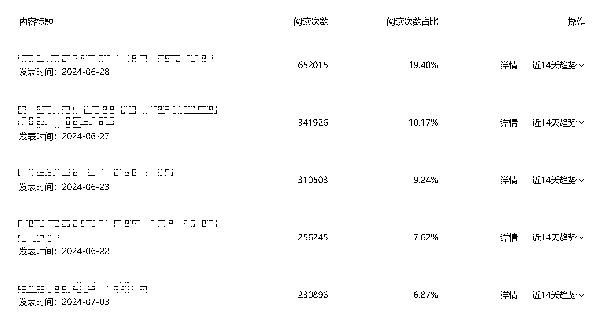
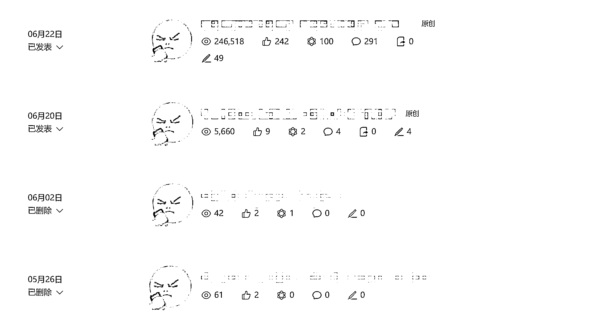
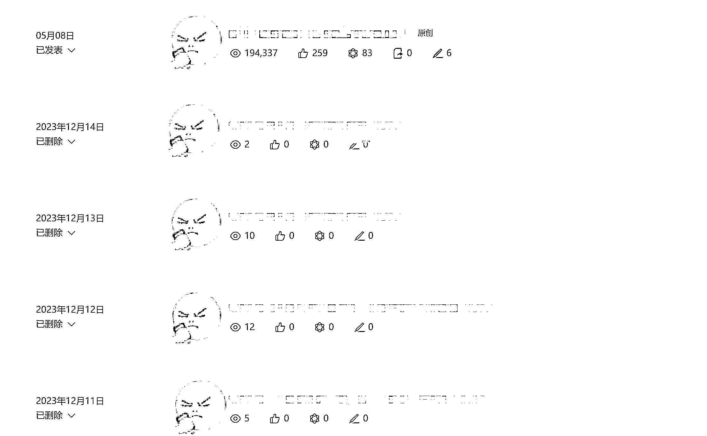

# 两周 320 万阅读、1.3 万变现，我用「细分赛道+关键词」把一个沉寂号扛上了公众号爆文航海

## 细分赛道加关键词，公众号爆文航海 2 周收获 320 万阅读量，变现 1.3 万

作者： 一 ge 不小心

日期：2024-07-11

各位朋友好，我是一 ge 不小心，今天再来复盘一次微信公众号的爆文实操。这次复盘的是刚结束的公众号爆文航海，用的是一枚之前就养着没动力的老号，没想到它直接扛起了整场航海。原本打算航海一结束就整理，结果后面被其他事耽搁了，现在才补上。

**先说结论，目前公众号流量主真的在窗口期，普通人上手就能吃到。**

下面先交战报。整个航海周期 14 天，总阅读 320 万，累计变现约 1.3 万。单日最高收益破 2000+，单篇最高阅读 65 万，10 万、20 万级别的文章一大把，而且是连续不断地在 10 万+。时间分配也很平均，第一周 162.5 万，第二周 163.1 万。

多篇破 10 万的稿子往往集中爆发：

说个有意思的细节。这个号以前我就写过几篇，后来觉得没劲就搁置了。航海初期我主要是在另一个账号上发，结果那个号掉了流量池，被迫切到这个沉寂号上试水。没想到一上就炸了。之前的文章阅读只有个位数，启用后直接起飞。爆了之后我就开始日更，慢慢加码到一天发五六篇，基本都能出效果，只是爆的大小有差别。这就是爆文项目的魅力所在。

成绩汇报完，说说复盘。我觉得公众号爆文现在门槛很低，普通人只要方法对，很快就能见效。

**战略比战术重要，选错方向再努力也白费。**

在我看来，能否在爆文项目里拿到结果，选题决定一切。

选题决定了你的竞争面大小，选题决定了对应人群的需求体量，这两点直接关乎项目生死。

现在越来越多的人发现公众号能赚钱，入局的人多了，同质化就上来了。想脱颖而出，就必须做差异化，而差异化的核心就是选题。

如果你现在还停留在很宽泛的赛道，比如只写职场，就职场泛泛而谈，看到什么写什么，基本很难得到理想的回报。

我自己长期在做电商，也习惯用电商打比方。卖卫生纸只是起点，你得继续细化：是家用还是商用？是什么材质？比如现在的湿厕纸，定位就是卫生纸-厕所场景-湿式，精准到这种程度，就容易卖爆。

公众号同理。只写“职场”等于只写“卫生纸”。你得往下钻：职场下面有薪资、晋升、国企、民企、外企、细分行业等。你每多做一次加法，竞争对手就少一波。

举例：先锁定薪资，赛道就变成职场+薪资，比单纯职场垂直很多。如果再加上你熟悉的互联网行业，就变成职场+薪资+互联网，垂直度再升一级，竞争自然更小。

找到自己想做的细分方向后去做测试，结果一定比在泛赛道里硬碰硬要好。

选好赛道就够了吗？未必。执行上很多人还是会卡住。比如你确定了职场+薪资+互联网，那具体写什么？还是会懵。

**这时候就用上我总结的「赛道+关键词」找题法，照着对标写，10 万+的概率会大幅提升。**

赛道细分完，下一步要想这个细分人群到底在关心什么。关心点=需求=关键词。关键词就是你在这个赛道里的微观切口。

至少想一个关键词，然后去搜。比如互联网职场薪资，人群可能关心多少钱，对应的关键词可能是“总包”“大厂”“年薪”等。我这里只是举例，实际要结合你自己的思考，把能想到的关键词都列出来，用微信搜一搜，按热度排序，看哪些词下 10 万+文章最多，人气就在那里。

锁定热词后，就去对标写。你可以把热度最高的文章全部对标一遍。甚至把标题单独再搜一遍，如果别人用类似标题也爆了，再写的成功率就更高。按热度从高到低依次对标，基本都能出效果。起号期一天发一两篇就够。

航海期间我就是先筛出一个细分赛道，再在这个赛道里筛出一个核心关键词。整整两周，我的内容生产都围绕这一个关键词反复拆解、反复写。穿透力很快就建立起来了，流量也就跟着来了。

这套思路本质上是不断缩小竞争范围，给自己找一个最容易出结果的切口。就像做电商，不知道卖什么的时候，把全网卖得最好的 1000 款都上架，也会有成交。

**内容怎么写**

前期我主要用 Kimi 和 ChatGPT 4o 帮忙生产。流程是先把爆款文章复制到文本文档，让模型分析它的结构、语气、风格，再让它学习后按同款风格原创一篇，我再人工润色一下就能发。

航海中听人说 Claude-3-opus 写感更自然，我就买了来试。实测机器味比 4o 更轻，后面基本切到 Claude-3-opus 生产，提示词微调一下，其他步骤不变，效率又上了一个台阶。

选题对路，文章质量过关，爆的概率就很高。

最后说心态。公众号靠的是免费流量，天生波动大，别太执着。很多号火着火着就凉了，也正常，很多号常年几百阅读突然就爆了，也正常。你很难完全掌控，所以预期放低，心态放稳，不然赚到钱也会焦虑。

像这次突然起来的号，就是我之前一度以为废了的号。后来跟圈里人交流才发现，长期不发再重新启动的号，有时反而更容易起。所以也不用焦虑，号不行了就先放着或注销重开，我这种放养的号后面再写也可能再爆。

赚钱是为生活服务，别让项目反过来绑架生活。

* * *

评论区：

lily : [鼓掌][鼓掌][鼓掌]大佬就是大佬

陈义轩 : 学习了

WILL : 退而结网 ing

大锤 : Claude-3-opus 这个工具是在哪里买的啊

道法自然 : 感谢大佬又提供了一种细分的思路

Qwen : claude3opus 哪里买？多少钱一个月？

无中生有 : 淘宝搜 poe

无中生有 : 淘宝搜 poe

* * *