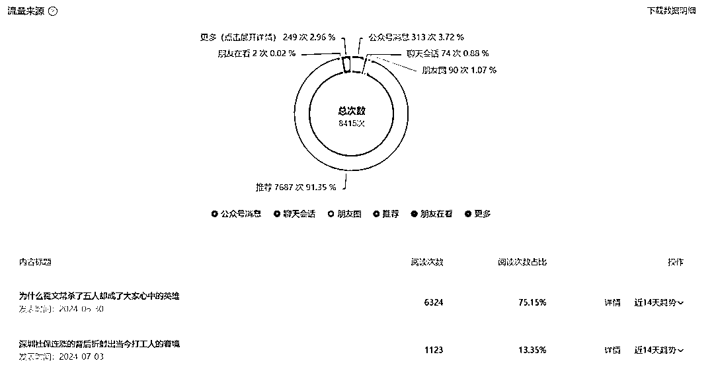
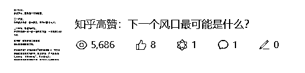
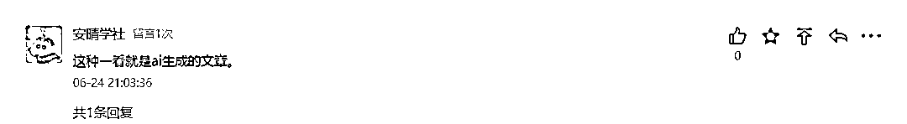
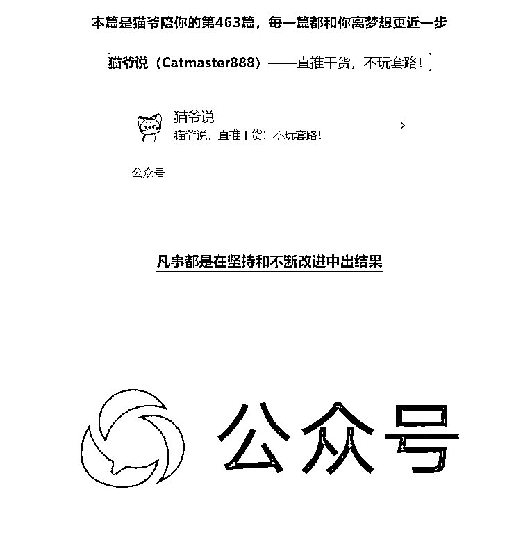
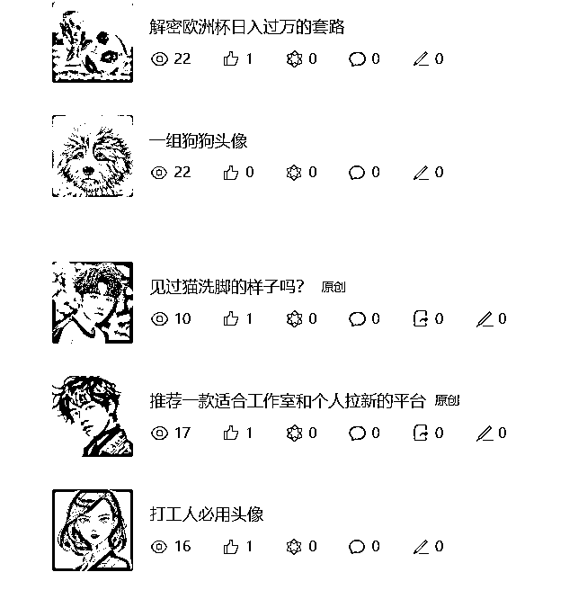
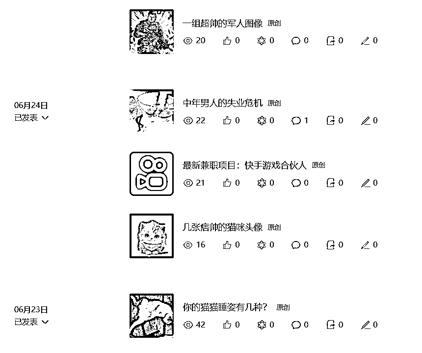
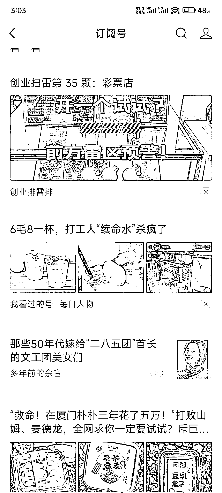
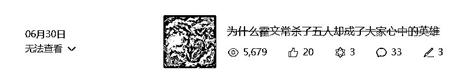
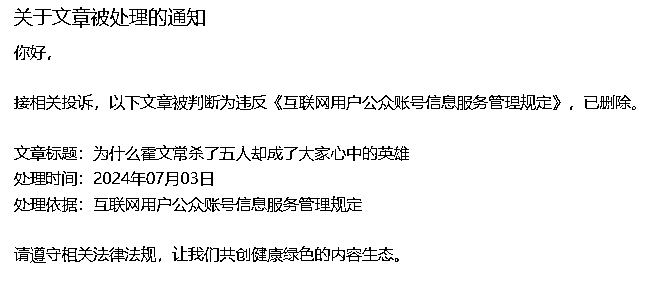

# ('不靠 AI 如何打造公众号爆文？', (2, 18))

凌晨两点还坐在电脑前，我盯着后台数据有点出神。从六月底恢复更新公众号，到这个月初，已经有三个晚上写出来的文章阅读量破了千。虽然和大佬们没法比，但其中91.35%的流量都来自平台推荐——这说明我的内容被官方看中，送进了流量池，心里还是挺踏实的。

其实一开始，我也犯过懒。当时给自己定了日更的目标，又看到不少同行都在用AI辅助写作，就跟着试写了一篇《中年男人的失业危机》。发布之后，反响很平淡。直到有位读者在留言区说了一句：“这是AI写的吧？”那一瞬间像被当头棒喝。我做自媒体，说不想赚钱是假的，但如果连读者都能一眼识破是机器生成的文字，那这样的内容靠什么留住人？AI再强大，也替代不了人心里那些细腻的、活生生的小情绪。糊弄读者，说白了是在糊弄自己。后来我把这条留言设成了精华，当作对自己的警醒。也谢谢那位叫“安晴学社”的朋友，是你把我拉回了正路。

接下来聊聊我踩过的坑。最早，我的号叫“猫爷谈赚”，每天推副业项目、赚钱思维，内容也算用心，可阅读量长期在两位数徘徊。写了两年、四百多篇文章，粉丝才勉强到一千。后来主业一忙，就停更了一年多。上个月重新捡起来，最初几篇还是老路子，依然没起色。这就是我的第一个教训：定位不清、方向不明，心态浮躁，犯了“病急乱投医”的毛病。

直到在生财的思维课里学到“对标思维”，才慢慢开窍。我开始在订阅号的“看一看”里，专门找那些阅读量10W+的文章来研究。能被官方推到那个位置，说明平台已经替我们筛过一遍了。我先琢磨标题、排版、配图，再以一个读者的身份问自己：这篇文章到底哪儿吸引我？是题材？是封面？还是内容本身？然后把五菱那句广告词改了改——“读者喜欢什么，我们就创作什么。”在选题范围上，我锁定了人文历史、时事热点、法律、美食、美景、穿搭、萌宠这些受众面广的领域。结合自己的积累，我最终从时事热点切入。第一篇尝试，就小爆了一下。

至于后面为什么被下架，我留到后面说。

现在说说怎么写才让人“愿意看下去”。我们大部分人不是文豪，不追求语不惊人死不休，能做到让人不累、愿意往下读，就已经很好了。

标题是第一关。要贴合文章内容，别玩夸张，也不要过长或过短，得把主题亮出来。但有一条底线必须守住：千万别带欺骗性，更不能消费读者的负面情绪。我第一篇文章被官方下架，就是因为标题有煽动负面情绪的嫌疑，申诉了也没用。平台规则是不讲情面的，这是我最深刻的教训。

写作思路上，我主要分成三步。第一步，先把事件本身讲清楚。我会先翻主流官媒的报道，吸收事实信息再整理，这样既保证真实，又保证了开头部分的质感。第二步，扩展一个同类型的事件。时间不限，只要类似就行。讲述时尽量用当事人的视角，带点感情进去，让大家有代入感。第三步，保持距离去做分析和观点输出。以第三者的身份，不掺杂个人情绪，尽量客观公正，不做情绪煽动，更不搞“不转不是中国人”那套。结尾要么给一个实用提醒，要么留个开放式的思考，但千万别用“你怎么看”来凑——那真的太掉价了。

技巧上，我建议可以适度用些成语或俗语，会显得人干脆利落，文字也有味道。但别过量，堆太多会给人一种“掉书袋”的感觉，反而招人烦。还有一点：不要死磕字数。我以前特别在意长短，总觉得写越多越厉害，结果为了凑数写出一堆废话，半天到不了重点。现在我只顺着思路走，能写多顺就多顺，反而写得更流畅，字数也实实在在。就像你们看到的这篇，一口气写下来居然三千多字，还破了纪录。

配图和视频也别偷懒。我以前不爱放，后来发现无论写得多认真，看起来总像缺了点灵气。就好比一个硬装精致的房子，没放家具，显得空荡荡。适当地放些图或视频，能让整篇更有生气，阅读体验也会好很多。排版方面，我参考的是“洞见”和“多元思维 Hack”的视觉风格，目前用的开头版式也是从他们那儿学来的。 字体就用系统默认的17号，重点地方加粗、下划线或者换个颜色做标记；行距隔行留白，电脑上最多写六行就换个段落，这样读者看着不累，层次也清晰。

说到底，这一路有人批评、有人点赞，都是礼物。我把自己目前仅有的这些心得写出来，能帮到同路人的话，也算没白熬这么久。也欢迎大家在评论区指正不足，愿和所有想在自媒体上做出点名堂的朋友，一起往前再走走。