# 不是标题党，我真的一边旅行一边把钱赚了

疫情后，旅游需求像憋了很久的洪水一样涌了出来。后台常有朋友问我：旅游赛道还能做吗？普通人不会直播、不会拍短视频，也没有旅游资源，能从中分到一杯羹吗？我的答案是：能，而且我自己就是亲测者。

先讲我的故事。2017年，我在朋友圈刷到一个小姐姐，她天天发不同城市的风景照，日子过得又自由又让人羡慕。我抱着好奇去咨询，才知道她做的是一种“分享式旅行”项目。简单说，就是当线上旅行社的代理商。当时加入花了2888元，其中2000元是旅游基金，以后出去玩可以直接抵扣，等于888元撬动了整个后台资源：全球旅行线路供应商、地接社、旅行社资质，还有客服、计调、法务一整套团队支持。自己报名有优惠，朋友家人报名你能拿佣金。说白了，你就像拥有了一家线上共享旅游公司。核心八个字——自用省钱，分享赚钱。

我看完就觉得这是自己一直在找的机会。大学时我带过上百人的微商团队，私域基本功还算扎实。加入后大概三个月，第一个月就开始盈利了，纯利润稳定在每月5万到10万；一年下来走了15个城市，基本是边看世界边进账，在平台里也属于做得不错的那批人。

有人会问：现在开传统旅行社不是更正规吗？但你也知道，办执照、租门店、养员工，一套下来至少要30-50万。而且携程、途牛这些OTA平台早把用户养成线上比价下单的习惯，传统门店早就不香了。普通人想切入旅游赛道，更聪明的做法是走轻资产：不需要复杂执照，🛰️上就能操作，上班族也能当副业。从2016年起，市面上就陆续出现这类项目，代理的名字也很好听：旅行体验师、旅行主理人、旅行达人……换汤不换药，本质都是同一个逻辑。虽然这个模式有过争议，但生命力很强，到2024年加盟代理商已经接近25万，分公司也破万了。

更妙的是，旅游本身自带流量，好传播、好做内容，而且几乎是所有人的向往。在私域里聊旅游，天然比聊别的品类更容易破冰、更容易成交。

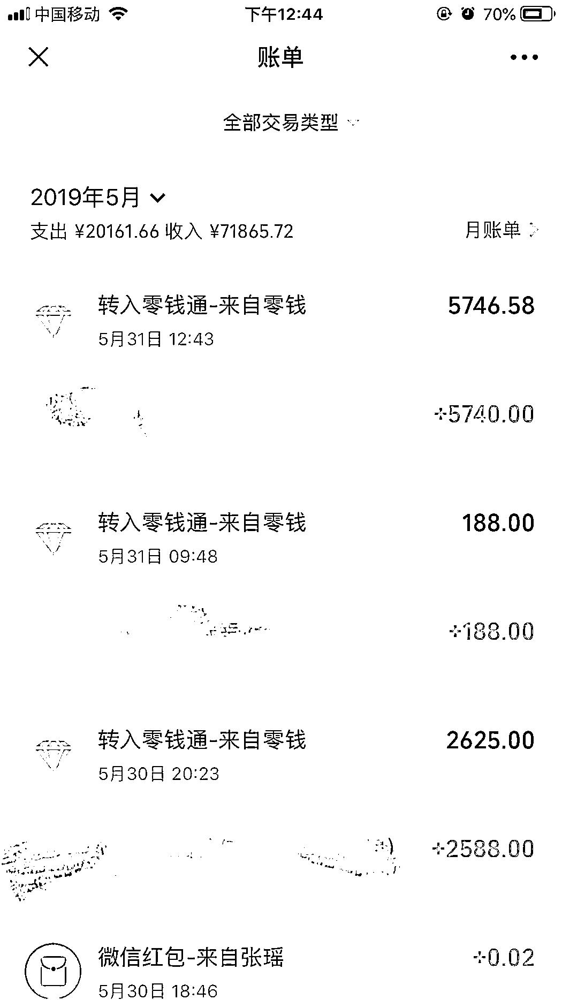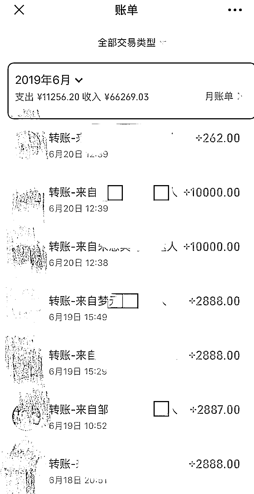

今天我就不讲平台和公司背景了，重点拆解从公域引流到私域变现的完整链路，尤其是普通人怎么低成本启动。

## 一、公域选对平台，0成本钓到精准客户

先想清楚你想服务谁。旅游消费人群有两个典型极端：18-30岁的年轻人，以及退休后有钱有闲的叔叔阿姨。📕上活跃的大多是年轻女生，视频号则聚拢了消费力强的中老年。我们主打年轻人社交旅行，所以主战场放📕。2018年我只发了3条笔记，就吸引了一百多个爱旅游的人私信加🛰️；第一个月就有福建、黑龙江、浙江的粉丝来咨询，还有人直接升级成3万的主理人，当月收入破5万。那批粉丝的精准程度真的高。

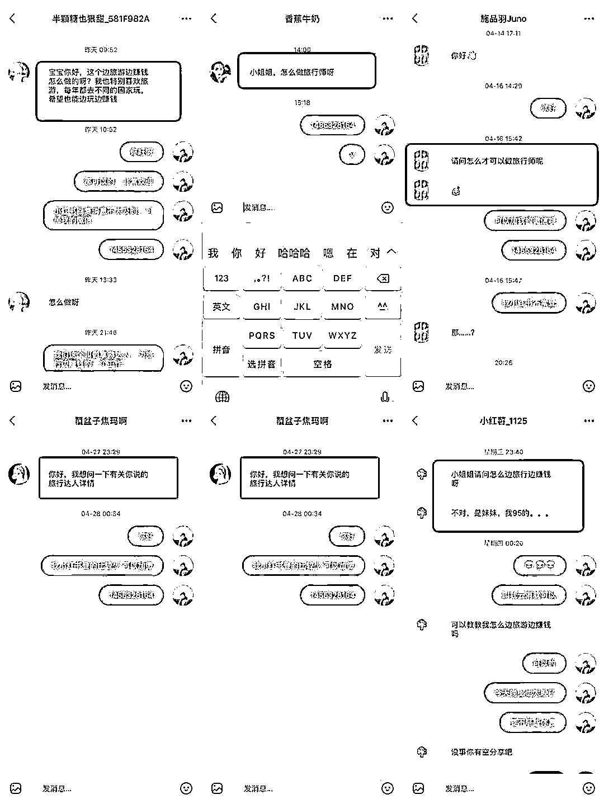

线上代理还有一个好处：没有地域限制，全国客户都能接。传统地接社往往只能做本地线路，这完全是两个维度的玩法。

## 二、账号搭建和内容引流，批量释放钩子

先记住一个底层认知：与其经营一个万粉大号，不如同时握有5个500粉的精准小号。别执着于涨粉和做网红，我们的目标是打造“引流爆款”，把5000个爱旅游的人导到私域，做到这个量级，年入百万并不难。

账号有四个地方要用心：头像、昵称、简介、群聊。头像最好用真人旅行照，昵称和简介多放“旅游”“爱玩”“边旅行边赚钱”这类关键词，让人一刷就知道你是干什么的。

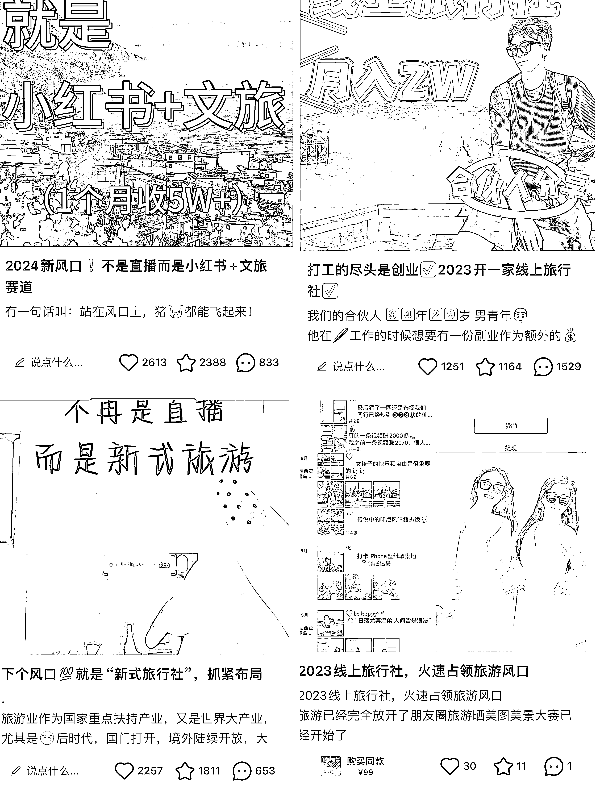

内容上，📕直接发图文就好，一天产出10条不是问题。标题要会抓心理学，比如捷径心理：“适合普通人低门槛的赚钱副业”；慕强心理：“25岁年薪百万，分享给女生的搞钱经验”；贪便宜心理：“学生党500块玩到嗨”；恐惧心理：“千万别带父母去泰国，因为这”；猎奇心理：“刚毕业每月出去旅游，还能月入10万”；还有求搭子心理：“有没有旅游搭子”“一起下班开旅游工作室”……核心就是把“旅游+赚钱+线上+特定人群”自由组合，比如大学生、宝妈、裸辞打工人、社恐星人。然后去搜索关键词，把热门笔记下面浏览量最高的标签整理出来，发内容时全部用上；做垂直账号的，比如只做新疆定制游，就多打垂直标签。

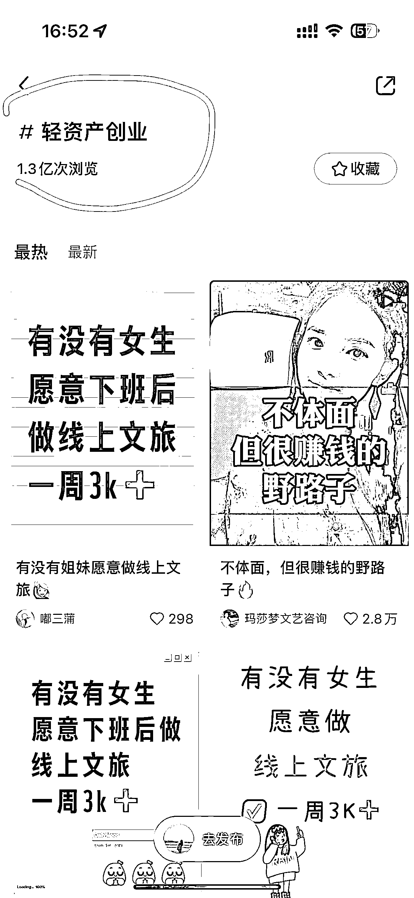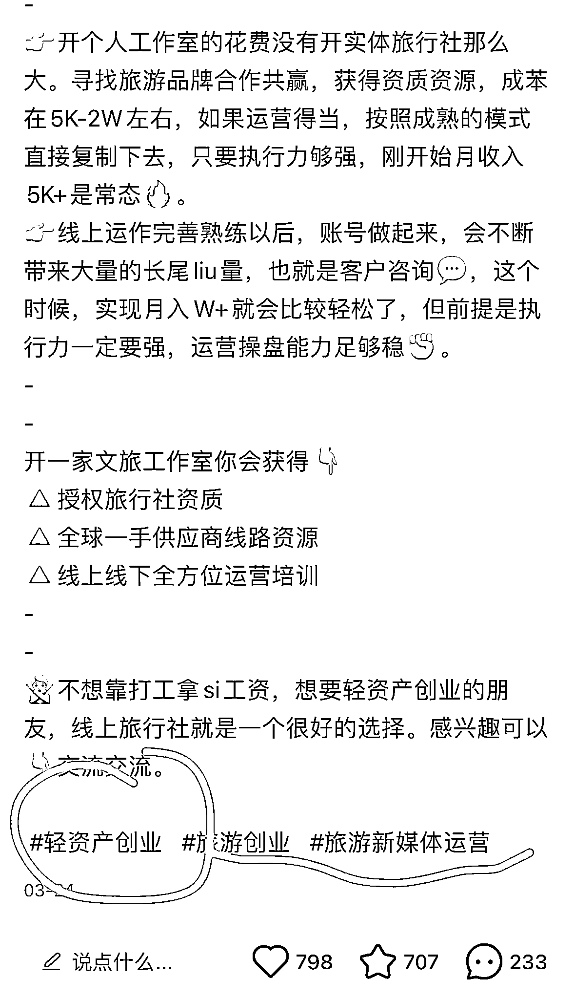

📕对站外导流卡得比较严，亲测有效的方法有：收藏法、图片法、拉群小助理法、店铺法、专辑法、主页打卡法。比如准备两个号，小号发布带🛰️二维码的图片，用户私信时发过去；或者把🛰️号藏进10张图片里；爆款笔记下方挂群聊，用户进群后小号发消息；主页打卡区也可以放🛰️号图片。基本就是这些玩法。

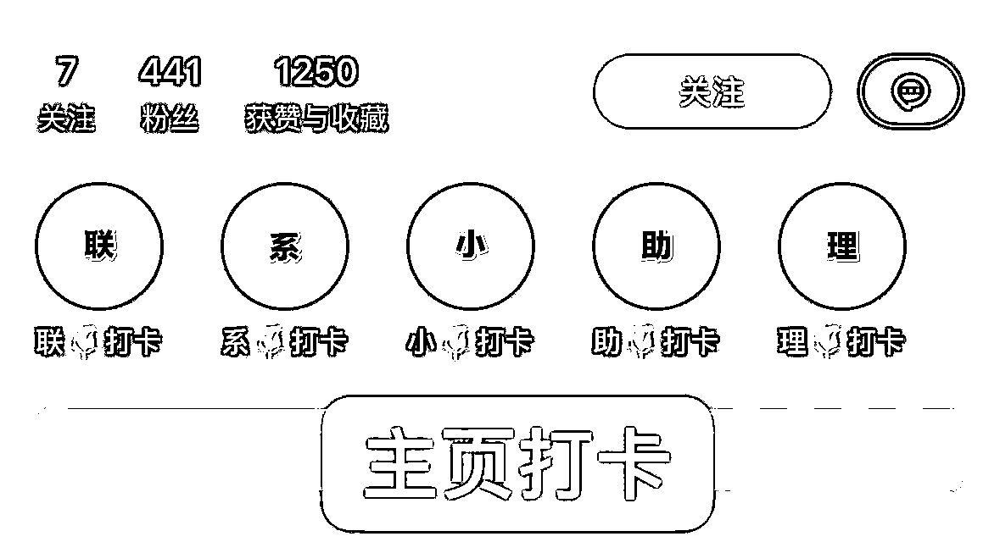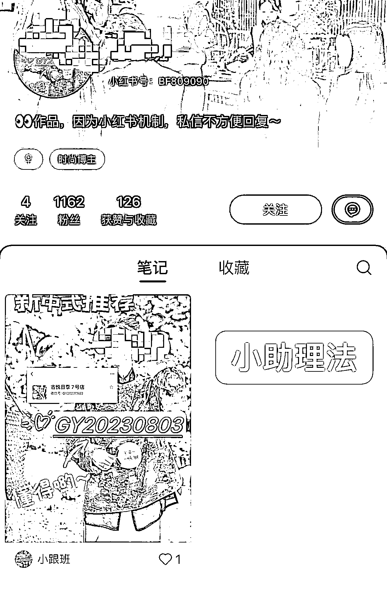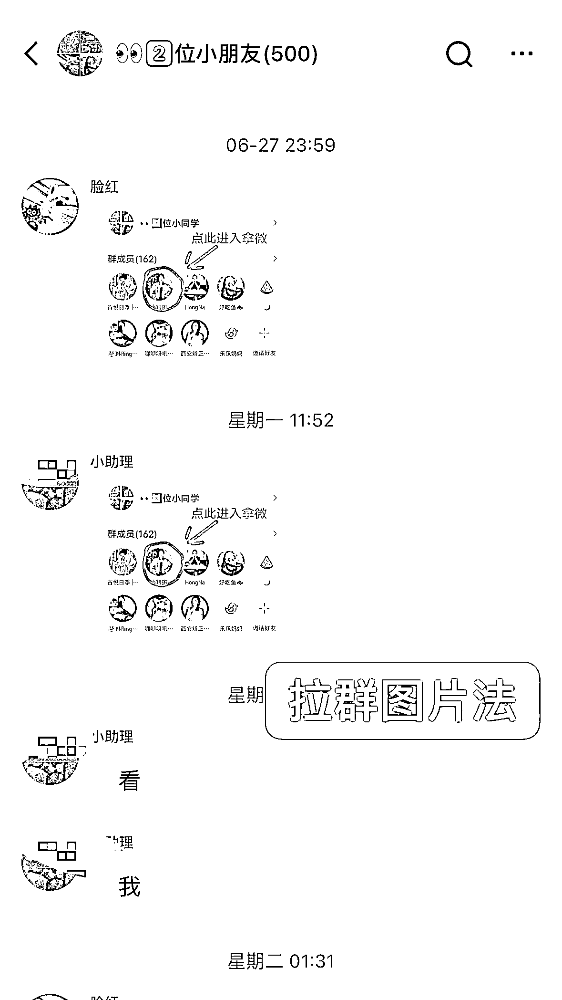

线下引流也别忽略。第一，外出旅游别老和熟人抱团，多报年轻人多的旅行团。2020年我去韩国，报了个12人的小团，80%都是年轻人。我没刻意推销，就是在聊天中自然说起自己在做的事，结果12个人里有6个选择了加入这个模式。那一趟旅行不仅没花钱，还赚了好几万。出发地优选江浙沪，目的地选海岛或年轻人爱去的地方。第二，去谈实体门店合作，美业店、咖啡店、服装店、酒吧、美甲店都行，这些地方聚集的年轻女性正是精准客户。可以在店里摆个“长沙旅游搭子群”的活码，先主动提出付费，再了解每月客流，按进群人头结算也行；老板要是担心，你正好借机给她介绍项目和平台，说不定她先成了你的合伙人，毕竟“一间门店做两份生意”是很有说服力的理由。

## 三、私域培育转化：朋友圈+社群+私聊

公域引来的流量，最终都要在私域里成交。朋友圈是最快建立信任的地方，要布置好五件套：头像、昵称、个人简介、背景图、置顶。头像尽量和公域平台保持统一，昵称简单好记。置顶三条必须用心：项目权威背书、我为什么做这个项目、我做出的成果展示。

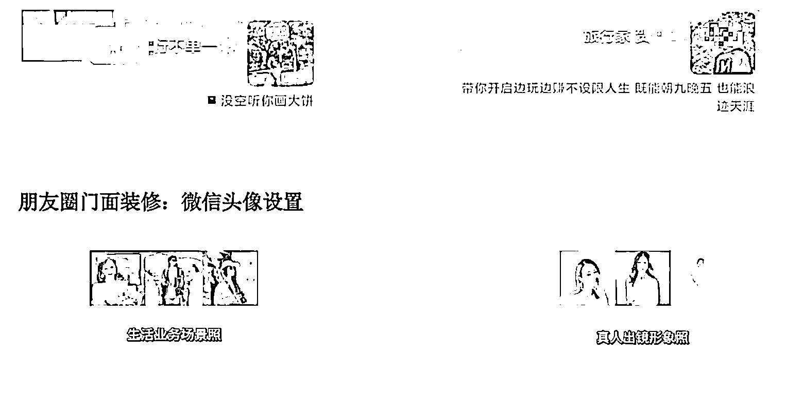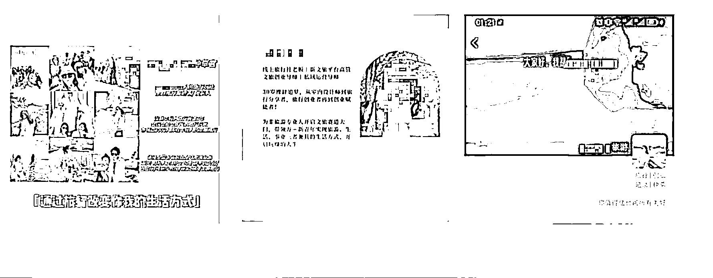

朋友圈内容要稳定输出，每天围绕四个框架各发一条，让自己持续曝光。排版上该分行就分行，别一口气写一大段，也别像微商一样堆满表情；简洁干净，偶尔用表情表达情绪就好。频率不要一天刷屏十几条，控制在3-5条；甚至可以一小时发一条再删掉上一条，让用户总是刷到你，但点进主页又只有一条。每周记得筛选，把广告和旧内容藏一藏，别让营销味太重。当大家把你朋友圈当“品牌店”逛的时候，变现自然就来了。

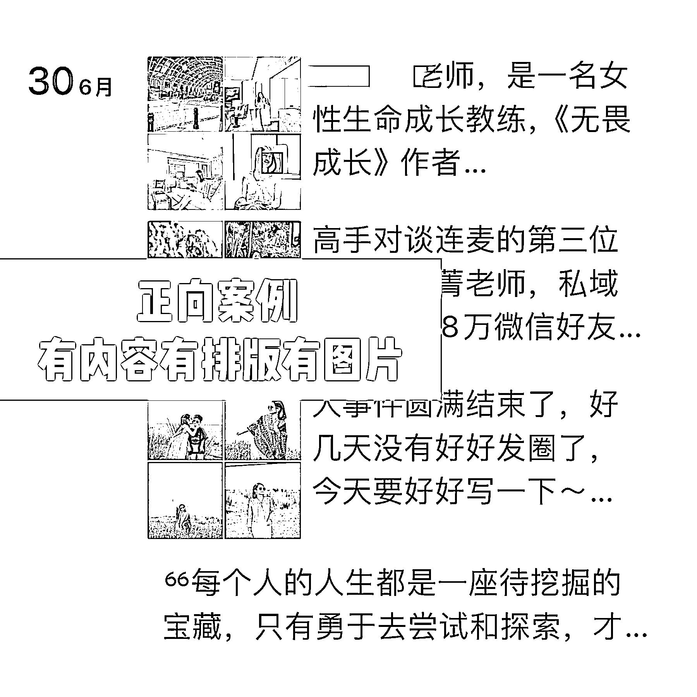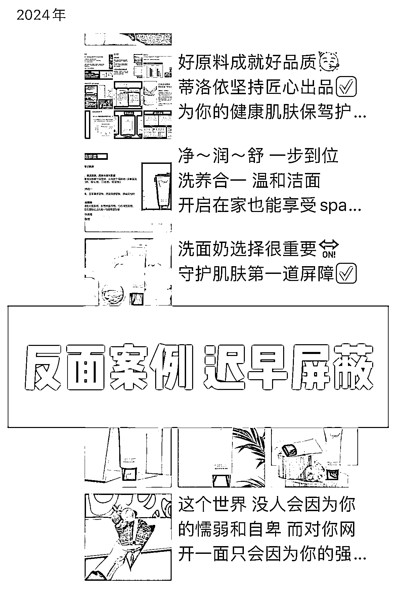

私聊要有SOP，但话术千万别像客服复制粘贴。好友申请别拖太久，最好当天中午或晚上通过，保证互动及时。加好友后马上打标签：渠道来源、加好友日期、身份和黏性。年轻人先甩一个表情包拉近距离，自然问怎么称呼，再找点共同话题。用选择性问题摸需求，比如“你是想找旅游搭子，还是想尝试线上旅游副业？”第一次聊天重点是建立好感，第3天和第7天再发一些官方资料证明项目靠谱，然后把她拉进主题社群。

社群定位很重要，要先想清楚你是谁、身边都是什么人。宝妈可以做“遛娃看世界”，学生可以做“同龄人旅游搭子群”，能和长辈玩到一起的可以做“实惠长辈团”。群名也要有钩子，比如“月薪三千也能出国游”“心动的旅行搭子集结”。建群顺序是：先拉前40个精准潜客，再邀关系好的朋友，最后在朋友圈公开招募。

到了转化阶段，提前准备好项目介绍海报、付款截图、客户反馈截图、收款码。有图有视频，比单纯说一百句都管用。客户开始提问时，直接调用高频问题库，快速回应。临门一脚时，找个理由语音沟通：一方面能听出她真实顾虑，另一方面也能自然逼单。

## 四、为什么老客户会一直复购？

我从17年做到现在，疫情三年几乎没怎么做运营，但老客户依然定期回购旅游团，每个月还能赚钱零花钱。首先是模式自带复购：我们招的代理其实就是死忠粉，他们能拿返佣，自己报名还能用旅游基金；同样的团在携程订可能贵几百上千，在自家平台订又便宜又有返利，自然愿意一直留在这里。

其次，产品要过硬。推荐线路前，自己先看行程细节：进了几个购物店、住宿什么星级、航班是不是红眼航班、覆盖哪些景点；再找负责这条线的计调问问游客的真实反馈，在同一价位里优中选优。同时要讲求匹配：问清楚客户的人数、出行日期、打算玩几天、预算多少、想去哪几个城市、对住宿有什么要求。预算不好直接问，就通过其他问题侧面估算。只有客户觉得“值”，复购才会一直发生。

最后聊聊第一批客户怎么来。个人私域的高段位冷启动，靠的不是资源多，而是把现有好友经营到位。哪怕你🛰️只有几百人，只要朋友圈内容吸引人，再配合社群和私聊的完整链路，照样能把旅游变现跑通。我当年就是从一个朋友圈文案开始的，没有花一分钱投流。旅游本身自带吸引力，你要做的，只是把大家心里的“向往”变成“行动”。

旅行和赚钱从来不是单选题。轻资产、小投入、重私域，这条路普通人完全可以复制。希望这篇分享，能给你打开一种新思路。

# 旅游私域怎么玩？把服务做细，客户才会心甘情愿帮你转介绍

做旅游私域，尤其是刚起步的时候，别急着推线路，先把客户的需求聊透：预算大概多少？对住宿条件有什么想法？更喜欢自由行、半自由行，还是能接受跟团游？只有把这些细节都问清楚，才能匹配合适的团，客户满意度才会高。

这里有个特别容易踩的坑：低价团往往都带着购物店。如果客人报了这种团，一定要在报名前说清楚，把预期做到位，后面才不容易因为心理落差产生投诉和差评。

## 一、用“私人管家式”服务陪客户走完全程，满意了自然有裂变

客户报名不是服务的终点，而是服务的开始。报完团就不管，后面就别想有转介绍。

出发前，先把几件事落实：旅游地攻略、当地天气，如果是出境游，护照签证、现金兑换这些都要提前沟通好。

旅行过程中，不需要天天打扰，但要有温度地关心一下：住得怎么样、吃得习不习惯、有没有拍到好看的照片。这些细节最能拉近关系。

等旅程结束，如果客户玩得开心，这时候可以顺势提一个小请求：帮我发个朋友圈，推荐一下你的🛰️。为了减少对方麻烦，提前把文案和配图都准备好。文案的思路大概是：客户自己的真实感受 + “我是找朋友报的团，她经常出门旅行，像旅游百科全书，会玩也会拍照，还组织了一个旅行搭子群，经常有踩线团推荐，喜欢快乐又有性价比旅游的朋友可以加她。”配图可以用客户旅途中的照片、你的🛰️二维码、旅行搭子群的截图。

## 二、做标签、建社群、发定向内容，复购就是聊出来的

客户不是一次性生意，要长期培育、反复触达，才能带来复购。

先按人群打标签、分组：中老年客户一年通常出游2到5次，年轻人频率会低一些；像公司老板、采购这类团体客户，要单独维护，不用拉进普通群。

社群运营可以参考这几个方向：
1. 不同人群进不同群，发不同内容；
2. 培养群里的活跃型意见领袖，也就是那些外向、爱社交、对咱们产品很满意的客户；
3. 定期发优质且性价比高的线路，比如1999元巴厘岛；
4. 建立一个固定栏目，比如“疯狂星期三”放超级踩线团，6999元游欧洲4国；
5. 组织线上线下活动，比如本地露营、城市探店；
6. 设置群内福利机制，把免费美食、SPA体验这些作为粉丝专属奖励。

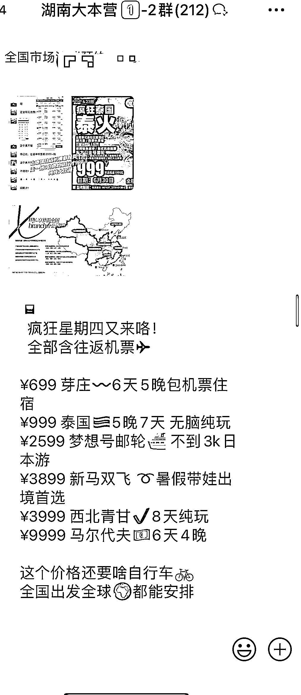

## 三、第一批客户从哪来？私域冷启动的路子可以这样走

我是2017年开始做的，那时候还没用上抖音、📕这些平台，也没有公域流量，第一批客户完全靠私域运营积累起来。

第一步，自己先去玩，玩过的体验才最有说服力。正式收客之前，我亲自跟过一次团，确实好玩，团里大多是年轻人，也夹杂着一些中老年朋友，整体氛围特别轻松愉快。回来后把一路拍的美照发到朋友圈。大家其实最关心的是你的真实生活，尤其还是旅行大片，这种内容不招人讨厌，互动率还特别高。

比如在云南路上随手拍一张自拍，配一句互动文案，让大家猜猜在哪、聊聊想不想去。发完之后做两件事：一是给点赞和评论的朋友私聊，问问最近有没有时间出去旅游，要不要组个旅行搭子，聊天深浅看关系来；二是顺手给这些互动的人打上标签。这样对方不会觉得你在推销，反而觉得你在分享好玩的生活，信任就在聊天中慢慢建立起来。通常一次旅行发圈，就能和十几个朋友建立信任。有些人虽然不点赞也不评论，但很可能一直在默默关注你。

第二步，做一次有仪式感的官宣。前期铺垫够了，会有不少朋友好奇你怎么一边旅行一边赚钱。这时候就需要一个契机，大大方方告诉大家：我选定了这个旅游事业，准备认真开始做了。

官宣文案不用太花哨，主要把项目资质、业务内容、目前进展、个人体验这些讲清楚。这条朋友圈的核心信号就是：旅游业务已经上线，欢迎来找我。

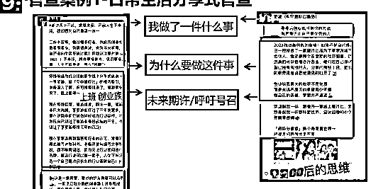

第三步，用群发把培养过的客户激活。朋友圈触达率有限，不可能每个人都看到，所以需要一次群发。但群发不能天天用，一用就得有效果。文案越短越好，最好控制在20字以内，目的是把人引导到朋友圈去看，因为朋友圈的展示效果比群发消息好得多。最高级的群发，是让朋友看不出来这是群发。比如：“在吗？好久不联系，好消息在我最新朋友圈，感谢支持！”还可以在朋友圈评论区放一个小福利，比如点赞送小礼物，把点赞量带起来。这样做的好处是：天天群发容易被屏蔽，但只要大家给那条朋友圈点过赞，以后你再在评论区发重要通知，就等于提醒了那些真正关注你的人。

官宣之后，自然会有客户来咨询。之前培育过的人，也会开始有人问这个事业能不能做。具体怎么转化，前面已经讲得很清楚，可以往上翻。

旅游这件事其实特别适合做私域浪潮式发售。我做过一次为期3天的活动，个人收入40万+，收了30多个代理，还裂变了10个分公司，而且这还只是我一个人的成绩。

最后说说传统旅行社和这种私域旅游模式的区别。传统旅行社要承担房租、水电、人工，还有注册成本，产品相对单一，客源也受地域限制。而我们的模式主战场在私域，启动压力小很多。补充一个行业小知识：个人开国内游线路，要去旅游局交30万押金；出境游线路要交120万。光这两笔钱，就已经把很多想入行的人挡在门外了。

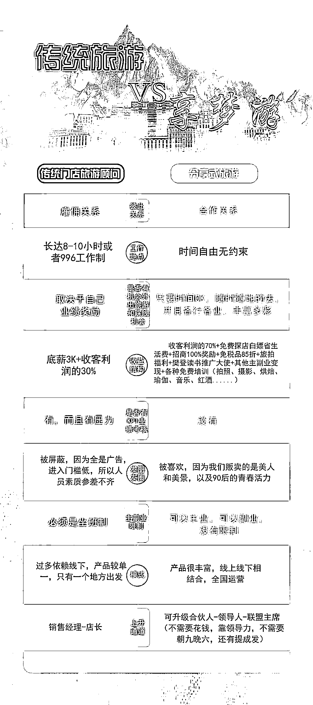

评论区里也有不少讨论：有人问“这个具体怎么做？”，有人回复“+1”，有人说“很详细，干货满满”，也有人质疑“是不是主要靠收代理赚钱？”还有位用户说自己交过3800多元的体验费，到现在还没用上，建议别再用“分享赚钱、自用省钱”那套话术，觉得这本质上还是传统玩法，靠代理和拉人头，后续运营跟不上，合同签得也随意，内部分润层级说不清。她补充说，整套逻辑并没有变，只是获客渠道换成了新媒体公域流量，真正转到私域之后其实更考验运营功力。另一位则直接说“这不就是拉人头收代理吗？”，还有人认为这只是一个推广项目，不怎么值得看。

