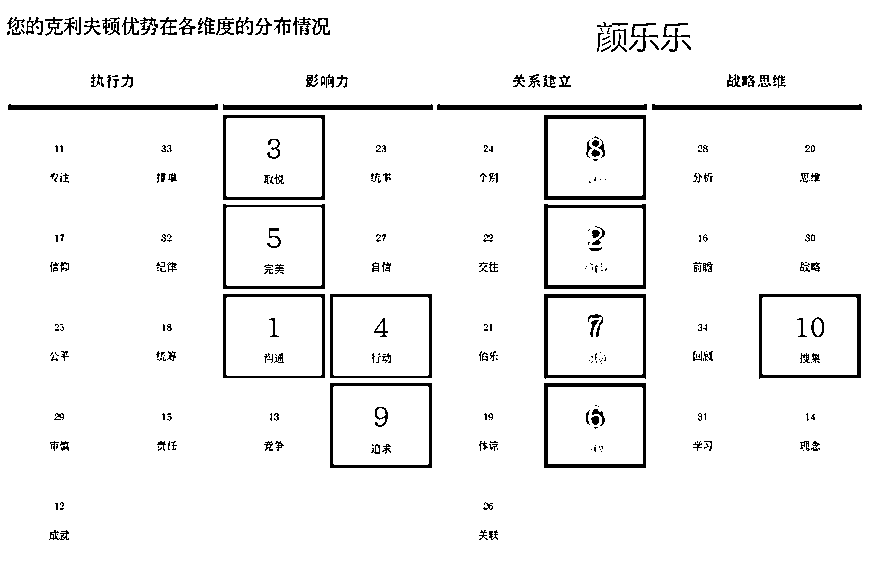
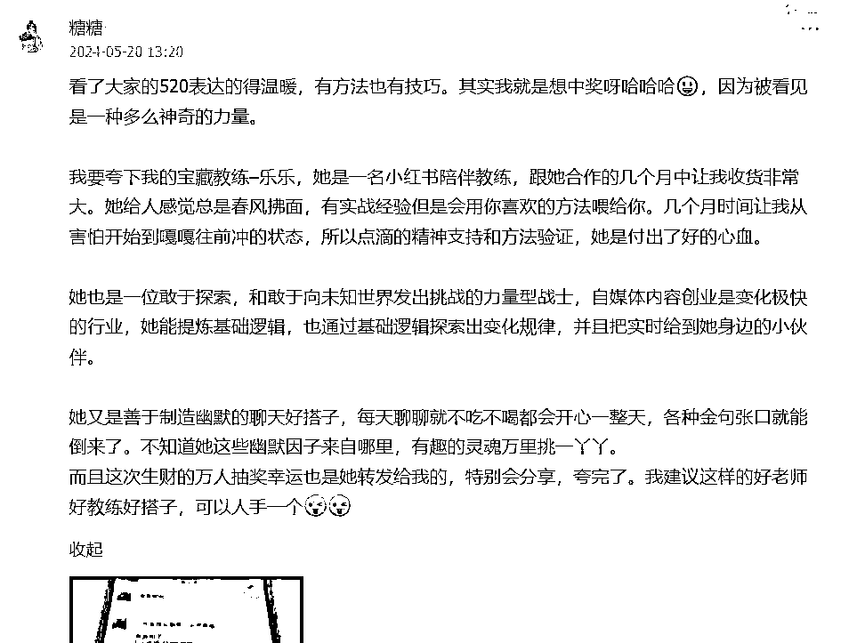

# ('辞职这一年，月收入从 2000 到 4 万，我经历了什么？自由职业 1 周年复盘', (2, 42))

辞职整整一年，回头看，当初那个在地铁里暴躁刷帖的姑娘，大概想不到自己现在能坐家里把收入从两千块刷到四万块。自由职业满周年，认真交个作业。

**先上结论，再讲经历**

去年刚离职时，扣除失业金，我月收入大概只有两千左右。今年五月，单月收入突破四万。抛开渠道分成和学习投入，靠不上班净赚了十五万。放生财圈子里这成绩其实平平无奇，但我自己已经很知足——毕竟原本计划是搞不出名堂就滚回职场，好在运气站在了我这边。

**但我必须先泼盆冷水：别脑子一热就提离职！**

当初我离职，其实是被动的——公司资金链断了，倒闭没赔偿。我揣着深圳失业险和存款硬扛。离职头六个月，我把短剧推广、公众号流量主、三只羊直播切片、品牌号代运营全都试了一遍，结果倒是都挣到钱了——但每样只挣了一块钱。没有放大能力，撑不起生活。梦想这个玩意儿，撞上现实，啪地就碎了。

回到职场的念头像潮水一样涌来。在深圳，经济压力从不给你喘气的机会。我跑各种线下活动，看到别人把项目玩得风生水起，郁闷地想：我为什么干啥啥不行？

复盘很久，得出结论：问题不在项目，在我自己。所有项目都跑通了，但都不够耐心，没有放大的思维。同期有人做短剧做得比我好得多。如果项目别人能赚到钱而你没有，真的，先审视自己，别急着甩锅给项目。

2023年9月，更狠的一刀来了。体检发现身上长了巨大异物，医生要求住院做增强CT才能判断性质。钱没赚到，命还可能有危险，心态彻底崩了。

住院十八天，没有WiFi，反而被迫安静下来。作息规律，脑子也清醒了：存款能撑多久？真要回去过以前那种日子吗？给自己下了死命令：再试半年，不行就收心上岸。

当时其实还有一个现实原因，家里孩子没人带，老人也不愿意千里迢迢来深圳，而我找不到能朝九晚四兼顾接送的工作。硬着头皮，只能再闯。（讲真，我好想上班的哈哈哈）

**财富要“抄”，关键是抄对样本**

十几年都在做品牌营销、媒体相关的工作，忽然想：能不能教别人做自媒体？

但线下活动里每个人都有自己的标签，我的标签呢？离开公司后，我好像只能卖时间和体力——代运营就是变相卖时间，账号有起色就被客户收回，根本没积累。

直到一句话击中我：人这辈子卖很多东西，但终极本质是卖自己。那好，就围绕“我这个人”做文章。IP这个概念，像闪电一样劈进了我的脑袋。

同时刷到芷蓝在生财的帖子，里面有句话让我共鸣：教练这个IP越来越有商业价值，比普通副业项目更有复利效应，特别适合自由职业者和超级个体。

就它了。辞了职出来，横竖都是自己兜底——出院后，我坐在奈雪门口晒着初冬的太阳，下了决定：再给半年时间，不换方向了，就卖自己。没退路，身边没人走这条路，但网上有人走。那就找个人抄作业。

**付费请教，是最省时间的路**

教练到底是干嘛的？我当时的思路很简单，花钱亲身体验不就知道了。事实证明，这笔钱最大的产出其实不是技能，是状态。在深圳，不聊搞钱连局都凑不齐，花钱请教本质上是给自己的进度条加速。

普通人的毛病是把方向当借口，总觉得方向不对、这不行那不行的。其实当你怀疑的时候，往往是执行还不够。小白追的是速成，大佬练的是基本功。观察来观察去，生财里牛的人无不在持续做流量、写内容、刷朋友圈。该卡壳的时候，找个人帮你判断一下太重要了。身边没人干过这个，只能上网找。这个圈子最好的地方就是：带问题、发红包，基本都会得到认真回复。

**普通人做IP，三步就够了**

IP遍地是金矿，普通人的入局路径是什么样的？那些人能起来，共通点是先亲手做成过一件事。这件事不必大，在航海里就练得出来——就像我当初做短剧，其实有结果，只是没有放大意识。

把事做成——把经验和SOP提炼出来——复制给更多人。这就是全部公式。

做成一件小事，比如小红书拿到万粉、闲鱼跑通首单、自己引流卖出产品，然后复盘、分享，影响力越滚越大，IP自然有势能。如果你正迷茫，别刷帖了，选个小项目去跑，碰到问题再回来查，用尽全力把它跑完。

项目没做起来之前，别混圈子。资源交换是赢家的游戏，你的每一笔付费，都应该对准当前项目卡点。0到1阶段，学引流、学发圈，围绕核心方向花钱。

**流量穷人，不做标品，不挑客户**

我延续了过去做产品运营的思路，给自己定了高中低三档产品线。早期没想法，全靠抄——海报就是抄的别人的小红书教练海报，抄完再微调迭代。因为流量不多，我干脆不做录播课，只做陪伴式的一对一定制辅导。想想看，录播课盗版满天飞，我一个人哪有精力折腾，不如扎扎实实做个性化服务。

这个策略走通了。客户的五花八门需求，逼我发现了自己的隐藏技能：帮人找到个人价值锚点和差异化。曾经在公司做营收导向的内容，我懂怎么设计前后端衔接，辅导时就把这套打法嫁接进去。来咨询的往往是有实际业务做的人，有业务底子做起流量反而更能出结果。

前期没得选，什么行业学员都接。但走着走着就明白，有业务基础、见过面的客户，沟通成本低，交付也更容易深入，满意度高，信任感强。渐渐地我找到了最顺手的赛道，再针对这些赛道在公域做内容引流，一切开始丝滑。现在我甚至能做到公域精准流量24小时内转化3980的产品——回想当初卖个199都要磨半天嘴皮子。成长这东西，果然只能靠做事。

**大胆卖，真诚交付**

卖东西就绕不开发朋友圈。很多人卡在这一步，我也是过来人。我的方案是：屏蔽你在意的人，然后放飞自我。持续宣传、持续谈单——没有数量打底，转化率无从谈起。

今年我重新小红书起号，三个月涨粉破万，引流上千人。配合朋友圈持续输出，老同事和老合作伙伴开始主动给我介绍客户。成长的状态不要藏着掖着，大大方方展示出来，让人看到你的变化。说有技巧那是假的，真诚就是最好的技巧。

交付更要真诚。新人入行，攒案例比赚钱重要。收款不是终点，而是交付的起点。我带人的方式是在企业管团队时练出来的：沟通需求——制定计划——辅导落地——解决执行问题——阶段复盘。不做标准课，原因很简单：知识网上到处都是，陪伴和落地才是大家真正缺的。

正因如此，我的交付里包含非常细致的梳理和长达一年的社群陪跑。几百块的咨询单，反馈口碑和转介绍都很不错。私教课我死死控制每月五个名额，目的就是保证体验感。这也解释了为什么很多客户愿意把我推荐给身边人。

**给想转型的人几条建议**

第一，普通人也可以卖知识：90分教60分，60分教30分，都有市场。

第二，新人成长的法门就是动手：做成事，提炼出SOP，反复用它。

第三，自己闷着想不通的问题，去找人请教，带着明确目标付费，效率翻倍。

第四，新赛道起步前，先盘点自己可迁移的能力，往日的积累别白白扔了。

第五，不做标品，做非标，往高客单走——转化大单和转化小单花的力气其实差不多。

这份复盘写给我自己，也写给所有想尝试新个体、数字游民、自由职业的朋友。感谢芷蓝老师、靠谱老师、鱼丸，以及生财里帮过我鼓励过我的每一位伙伴。

**最后还是那句话：我的经历仅供参考，请勿盲目辞职！**

祝大家爱财爱己，风生水起，一起生财有术。

