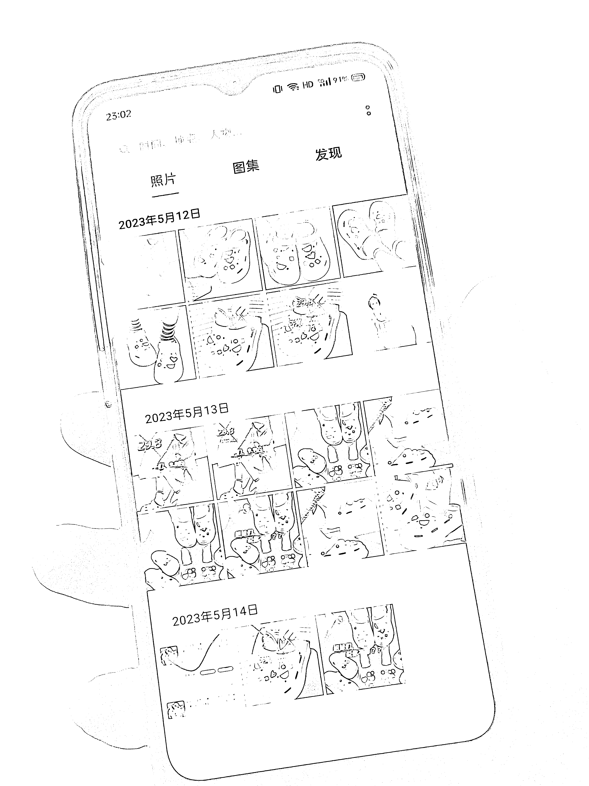
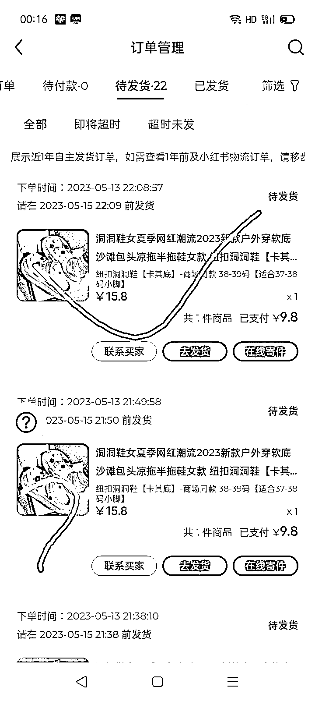
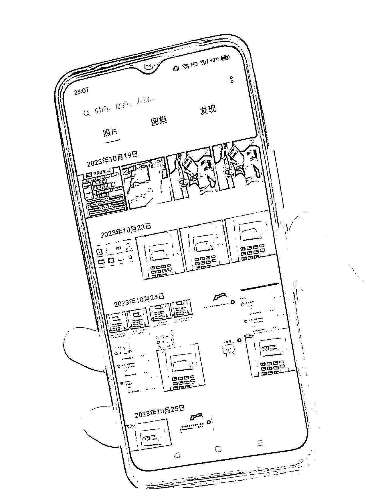
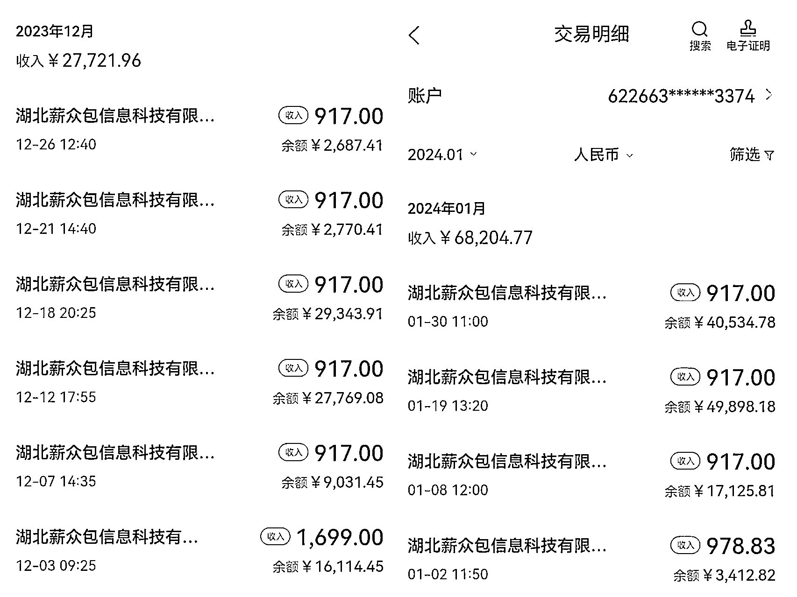
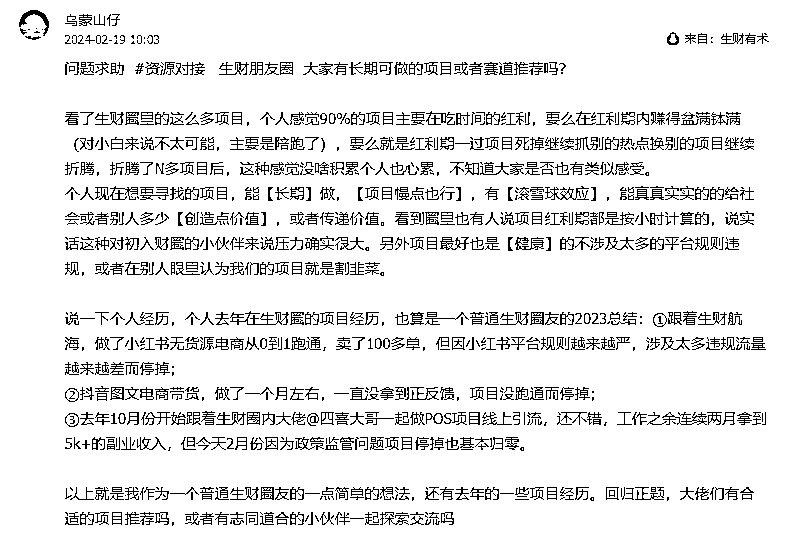
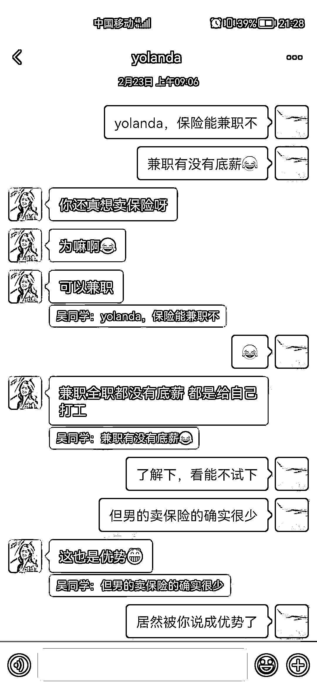

# 折腾了大半年副业后，我为什么最后押注在了保险这条路上

## 一、我为什么会想出来做副业

可能你也有过类似的职业焦虑，我先聊聊我的处境。

毕业十年，数据分析干了七年。16、17年搭上大数据热潮入行，到现在算是熬了过来。

但在上一份工作里，我很清晰地看到了这个岗位的天花板。上升路径窄、晋升口子小，如果不转岗转型，就只能一直待在数据分析师这个位置上。在非一线大厂，数据分析就是个高级取数工，思维和视野难有突破，每天就是接需求、跑数、做琐碎的表，价值很难被看见。

说白了，岗位门槛不高，新人带一两个月就能上手。随着BI工具越来越成熟，数据分析正慢慢退化成风控或运营人员的基础技能，而不是一个独立的专业赛道。

做得越久越觉得尴尬。

更现实的是，我连着两次参与公司晋升答辩都没过。既没有可拿得出手的核心竞争力，也因为团队项目一直是零散的0到1试错，没有业绩沉淀。同期过会的同事，个人能力强且团队成绩亮眼，差距很明显。   

外部环境也在收紧，以前能进前10%就能上一步，现在得前5%，甚至前1%才有机会，公司近千人，竞争很残酷。

再加上我一直渴望一种时间地点都由自己掌控的赚钱方式。不是朝九晚五的上班，而是能真正自由支配的工作形态。

综合这些原因，从去年开始我陆续试水各种在家就能做的副业。

## 二、去年到底折腾了哪些副业

### ① 📕电商：两家店都关了
去年年中，📕无货源电商风很大。跟着赚钱圈的航海我开了第一家店，卖女款洞洞鞋。0到1跑通了闭环，下单后去1688、拼多多找货。运气不错，有篇文章爆了，一晚上卖了100多双。后面平台开始严打无货源模式，再加上我经验不足，流量断崖式下跌，店就关了。

没多久又试了母婴用品，也撞到一个爆文，卖了几十单纸尿裤之类的，但客单价低、利润几乎为零。没有持续出爆品的能力，坚持一阵后也只能关店。
  

当天爆单第一天，一晚上就买了二三十单。
  

当时做📕的素材和爆单截图

### ② 公域引流卖POS机：月入五千到归零，只用了一个月
去年国庆后，我在赚钱圈看到有人靠卖POS机月入20多万的案例。于是从📕、今日头条、抖音写软文引流做私域，三個月累积了230多个好友，成交转化超过50%，11、12月连续两个月稳定在5000+。本想着2024年就能破万。

结果项目涉及套现相关，1月底政策一刀切，项目直接停摆，收入也跟着归零。
  
  
当时做POS的素材和收入截图

哎，一个项目又凉了。

期间还试过抖音团购图文带货、达人带货，自己没起来，反而一起做的弟弟妹妹赚了1万多。

## 三、又开始到处找下一个项目

两次失败后，我对新项目更谨慎了。前面两个项目本质都是踩政策红线，稳定性太差。这次想找一个能长期做下去的方向，于是去赚钱圈发帖求助，关键词就是长期。

2月份在赚钱圈的求助帖截图

大家给的共识是做个人IP，值得长期深耕。方向有人建议做心理咨询、家庭教育、保险销售。前两个我身边没有靠谱的引路人。

## 四、为什么最后选择做保险经纪人，是天时地利人和

从过完年2月就开始调研，犹豫内耗了差不多三四个月。
  

### 1、我以前接触过，但当时拒绝了
大学刚毕业时校友就带我参加过保险活动。以前在国企时，两个同事一个武大一个中国矿大也转行卖保险了，走的是传统一家公司+线下拓客的模式。他们坚持不到半年就退出了。

如果还是那种传统卖法，我这种内向性格肯定不合适。早五年若是合适，我早就做了。

### 2、我认可保险本身的价值
这个认知来自三个地方：其一，身边高知朋友从不同角度解读保险，罗振宇跨年演讲的那张图很多人都看过。
  
其二，毕业后朋友圈里水滴筹的求助我至少见过二十多次，风险无处不在。其三，街上三天两头能看到生病众筹，如果早有配置，结果会好很多。

### 3、我认可经纪人+顾问式的打法
经纪人卖多家产品，不会王婆卖瓜。不是站在保险公司角度推销，而是站在客户角度匹配方案。客户核心诉求就是买对且性价比高，经纪人用一套高性价比方案帮客户对冲个人和家庭风险。

我也认同顾问式销售的逻辑，愿意卸下孔乙己的长衫，做一个真正的销售。线上卖本质也是一种创业，公司给产品，我负责找客户。生意归根结底就两件事：卖什么，卖给谁。顾问式就是把合适的产品，精准卖给正好需要的人。

### 4、我觉得自己能搞定流量
做了几个项目后，我对公域引流有一定手感，可以试一试。

### 5、其他考量
① 时间地点的自由，能兼顾家庭，而且天花板高于死守数据岗，35岁焦虑相对小。
② 不消耗人脉。线上公域展业+顾问模式，不用动用亲友。
③ 不消耗自己。做得好需要持续学习专业知识和见识，通过专业能力帮客户合理配置风险，同时实现自我价值，比天天写SQL强。
④ 遇到贵人。加入一个靠谱的团队，氛围好不内耗，保险团队天然有利益绑定，比纯割韭菜的项目更踏实。
⑤ 本质都是卖保险，只是卖法不同。不推销不教育，只筛选客户。你正好需要，我正好在。

### 6、成本几乎为零
我选择兼职加入，反正也没什么损失，最大成本也就是时间。眼下主业不忙，时间还算充裕。

## 五、做保险的难处我也很清楚
1、考验自律，投入时间不够就容易掉链子。
2、见效慢，前期很容易放弃。

**给还在观望的人：**
有选择余地时，可以把保险放进备选清单，不要把它当成唯一出路。已经走投无路时再入场，失败概率会很高。

**给自己：**
目前没找到更好的选项，综合下来这个方向还算靠谱，那就试试看。先行动起来，迈出第一步再说。

* * *

评论区：

白白 : 巧了，我也入职做保险了，可以交流交流群哇[调皮][发呆][发呆]但不是保险经纪人这种，就卖自己公司的产品

乌蒙山仔 : 好滴，可以一起交流哇[握手][握手]

PLM : 加油，其实我也想过尝试的，但是一直都没做[捂脸]

乌蒙山仔 : 都可以试试的

王司 : 分析的很好

乌蒙山仔 : 🙏🙏🙏 云天猫猫 : 哈哈，你找的哪位赚钱大佬带你呀

乌蒙山仔 : 保险嘛？不是赚钱圈的

* * *