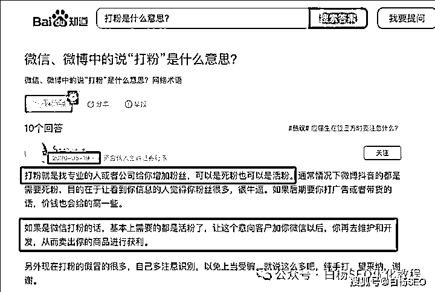
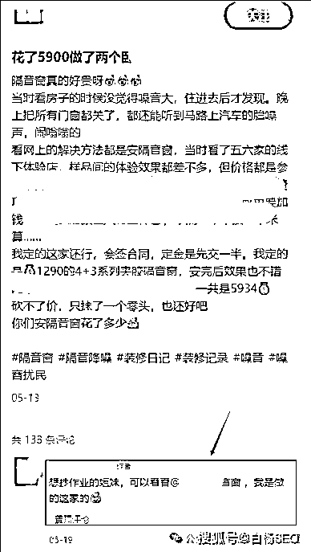
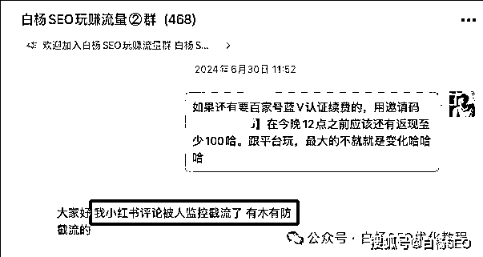
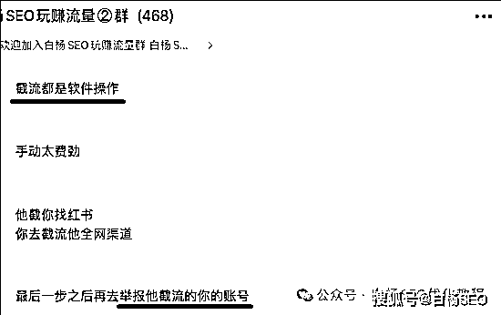
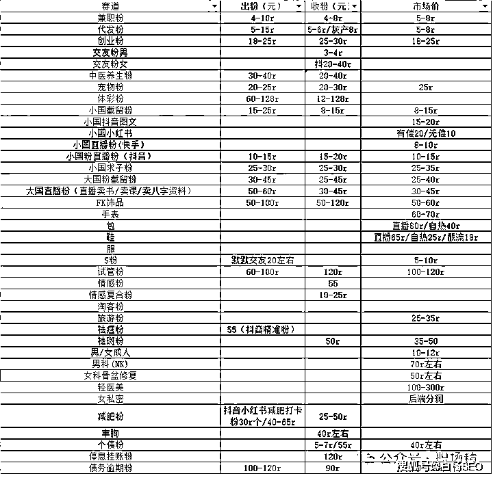
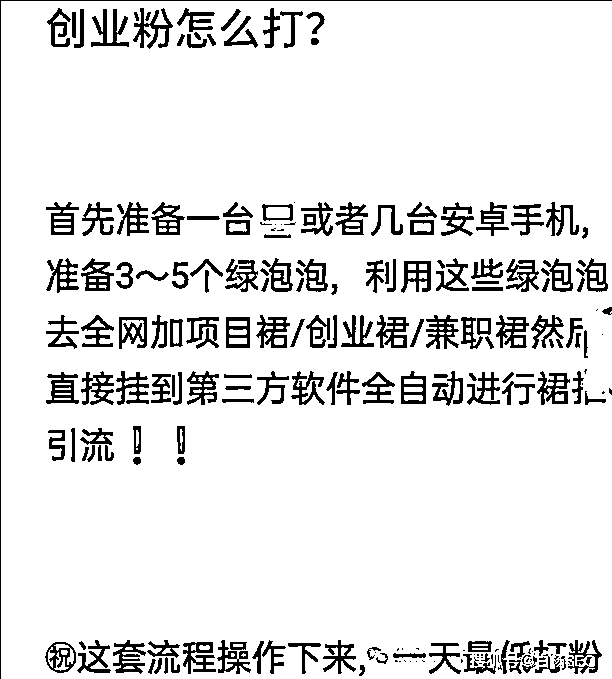
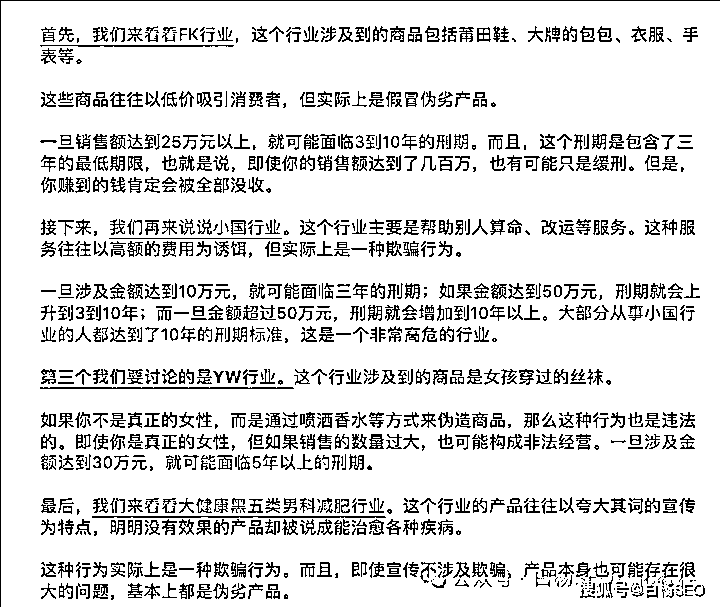
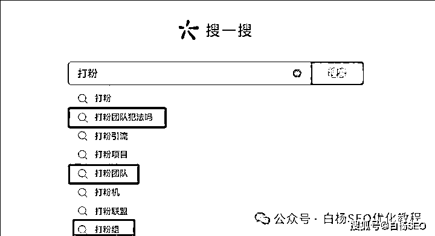
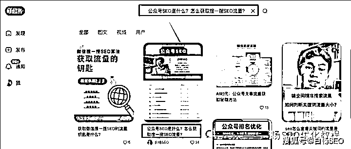

# 打粉是啥？打粉引流犯法吗？📕代发效果好吗？怎么做更好？
作者：龙哥

最近“打粉”这两个字，是不是频繁出现在你的推荐流里？好多人以为这是2024年才冒出来的新词，其实它早在四年前就有人讨论过，只不过当时的重点是在🧣、🛰️上做增粉。 到现在，玩法已经大不相同，“打粉”几乎成了私域引流的同义词，经常被叫做“私域打粉”。

怎么理解打粉？说白了，它和“引流”有点像，但又不完全一样。常规引流，是让产品和服务找到精准用户；而打粉，是在抖音、快手、📕这些平台上，批量产出图文、短视频甚至直播内容，把目标用户引到🛰️里，最后按加到🛰️的人数收钱。这两年📕流量大，所以大批打粉团队都盯着这个平台。顺便提一嘴，流量也分推荐流量和搜索流量——做SEO的人更看重搜索流量，而打粉团队大多吃推荐流量，当然也有人学会了用SEO批量打法去操作。

接着看方法。打粉手段基本分两类：引流和截流。

所谓的引流，大多数走免费路线：去各平台发内容，指望自然流量爆一条，或者用SEO关键词打法，配合批量账号、批量作品去覆盖搜索入口，再把主页包装好，引导用户添加。圈子里有个词叫“A种B收”，其实就是大号带小号：A号负责发内容，B号负责接流量，A发完以后在评论区置顶@B，或者干脆在正文里带@，甚至有人会建📕群来做承接。

截流就不太好听了。白杨SEO本人很反感这种做法。用现在的话讲，就是去同行评论区“捡漏”，找到那些已经对产品表现出兴趣的用户，再用账号人设留钩子，诱导他们加🛰️。以前做百度或🛰️搜索时，就有不少“李鬼”喜欢冒充品牌截流，说白了跟偷抢没啥区别；现在则是有人直接上软件，批量扫评论私信。

既然打粉这么热闹，怎么赚钱呢？两条路：卖粉，或者自己转化。

先看卖粉。 从市场报价就能看出来，业务越灰，粉价越高。但这种钱最好躲远点。私域打粉的完整引流和变现流程，可以看下面这两张图。 现在做打粉的大多是团队，搜一搜下拉词就能看到多少人问。 卖粉的好处是周期短、见效快，所以团队都爱做；坏处是既没有复利，又有连带风险——你根本不知道买家会怎么用这些粉，一旦对方搞违法犯罪，你也很难撇清关系。

再看自己转化。这条路得靠稳定的后端产品和很强的运营功底，变现慢，但持续稳定。敢做这条路的人，一般不会碰灰色擦边，因为一旦翻车，不仅白干，还可能“进去教育”。这里还涉及一个词——私域IP。公域IP大家听得多了，在公域平台打造个人品牌；私域IP则很少有人专门提。这个说法是白杨SEO六月杭州线下聚会时老七分享的，做承接转化必须解决信任，所以朋友圈运营、内容营销都得做扎实。上周末的聚会图放在下面，你能一眼认出哪个是白杨SEO吗？

很多人还会问：打粉引流犯法吗？这个得分情况。

第一，你如果是在自家公司做打粉，公司本身有产品有服务，那这就算正常获客，不是犯法。第二，你在一个代运营打粉团队里做，靠卖粉赚钱，但业务正规，风险相对较低；不过白杨SEO还是建议你去第一种，或者学学正规推广引流。第三，你自己卖的就是灰粉，甚至专门做灰色领域，那你已经在违法犯罪边缘游走了，只是暂时没被发现，建议立刻收手。

赚钱不容易，但君子爱财、取之有道。日子难过也不能成为干坏事的理由。白杨SEO说自己有点理想主义，但至少想做到问心无愧，以上只是建议。

我们再聊聊📕代发。很多人问“📕代发是啥”，说白了就是花钱找人替你发笔记。找那些专门做代发的中介，一般5-20条一个价；如果找素人、KOC甚至KOL，价格从几百到几千都有。为什么公司愿意找代发？因为公司自己的账号数量有限，又想持续做营销，就只能雇兼职来发。

那批量代发效果到底好不好？白杨SEO圈六月杭州线下聚会的主题正好是📕流量玩法，现场一位付费群朋友说，他们一天发成百上千条笔记，问这样有效果吗？细聊后明白了，他们是找了代发，代发又去找人发。这大概率就是那种养了一堆账号的“小MCN”机构。我就问：帮你发笔记的号，是不是也在发别的商家的内容？如果真是这样，你的笔记被📕收录的概率会很低，可能连10%都不到。不管你想做推荐流量还是搜索流量，收录是最基础也最关键的一步。没收录，发再多有什么用？判断方法很简单：把笔记完整标题复制到📕搜索框，如果能在前十，特别是第一位搜到，说明被收录了。

所以我给的建议是：真要代发，优先去📕官方蒲公英找达人，或者自己花精力找一些素人。虽然一天只能发十几篇，但往往比那种几千篇的“轰炸”更有用。同时，标题和正文一定要埋好用户会搜的关键词，不同素人之间的文案要尽量差异化，别整篇复制。关于📕SEO标题和关键词怎么布局，可以看看白杨SEO那篇《📕标题怎么写？如何引流到🛰️？违规注销不了怎么办？📕运营33个热门问题解答》。

今天就聊到这儿，觉得有用的话，可以继续关注我。

作者：白杨SEO，专注SEO十年，全网SEO流量实战派，对互联网精准流量有深入研究。

评论区里有人说：终于有人讲清楚打粉了。也有人说：打粉就是把人加到🛰️吧？白杨SEO回了一个字：是。