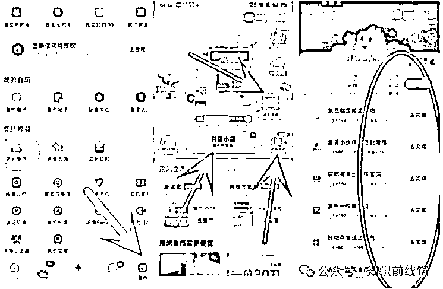
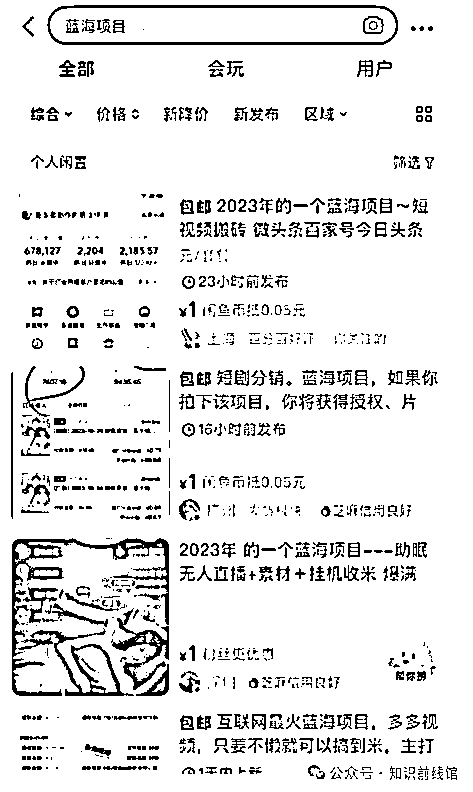
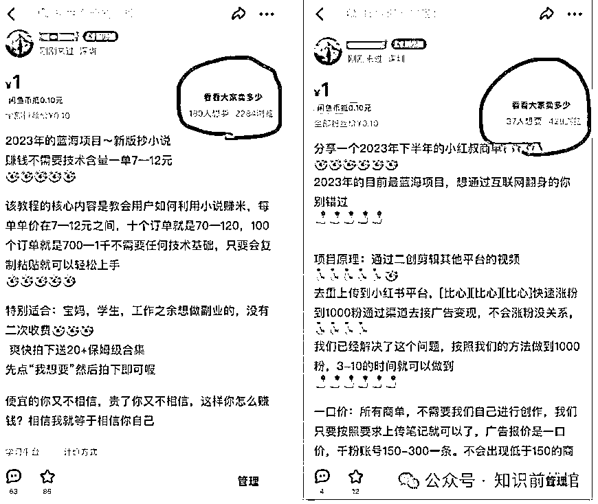
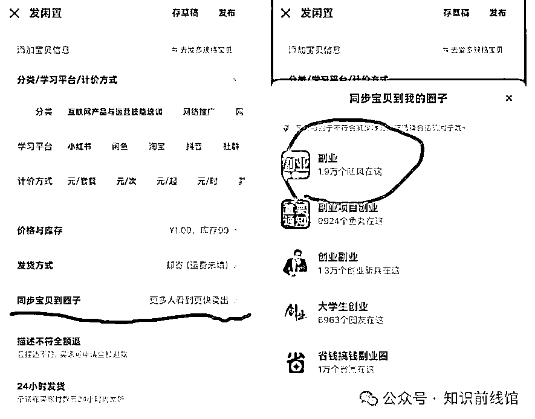
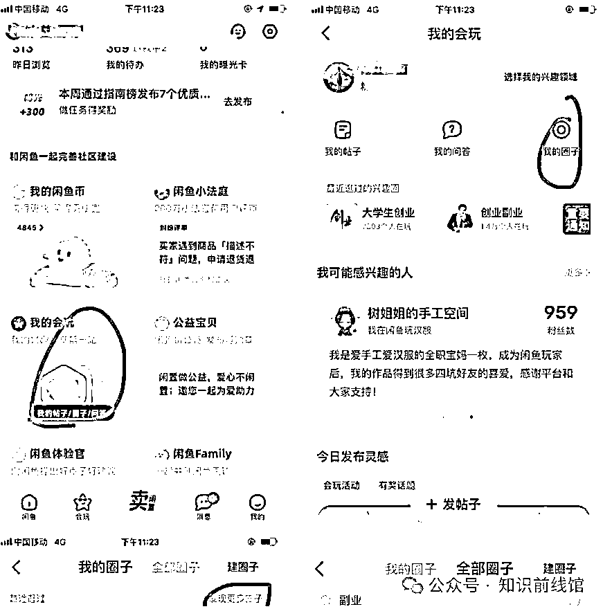
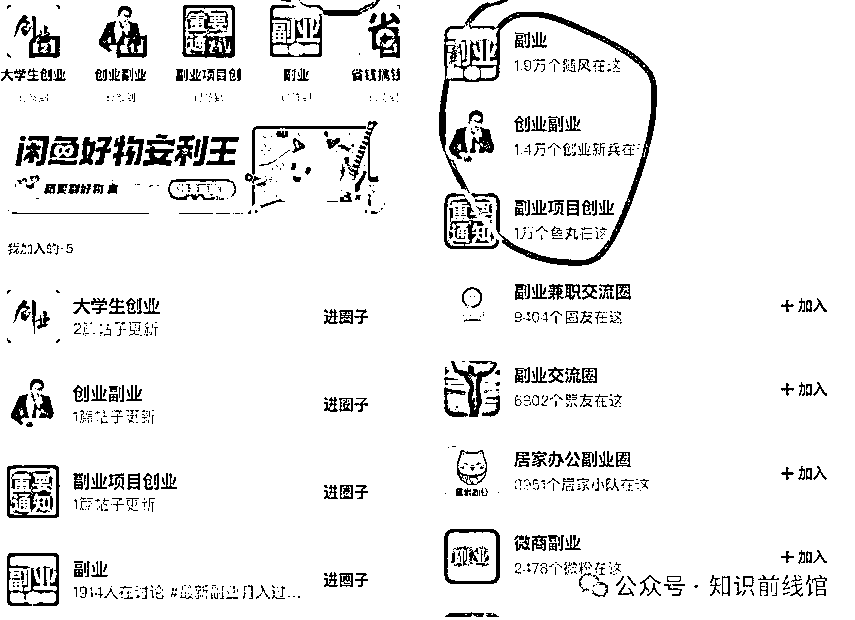
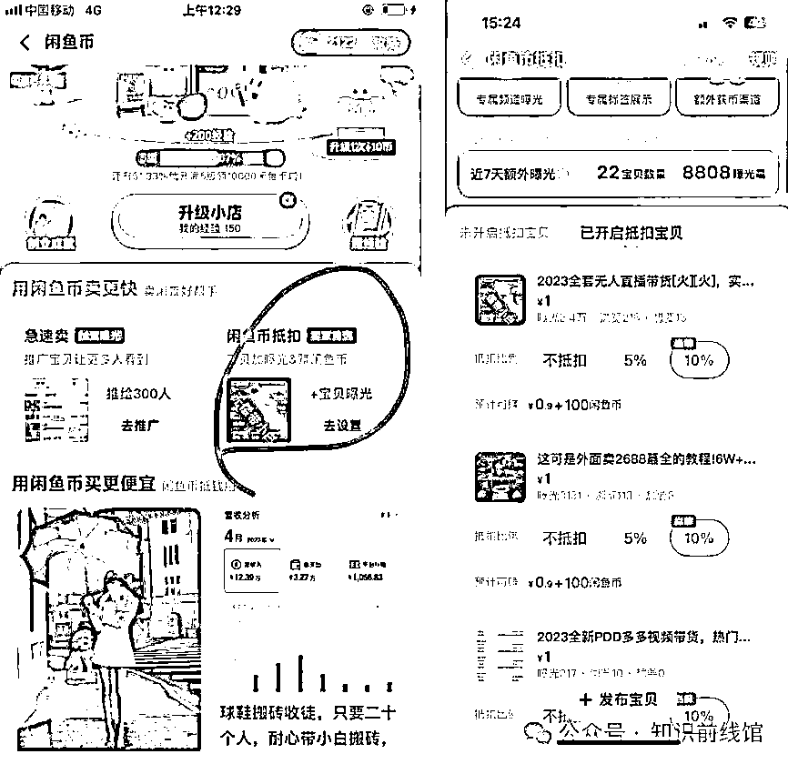
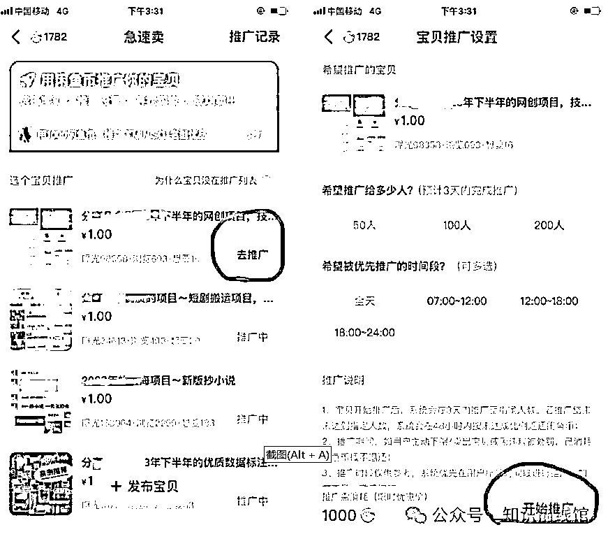
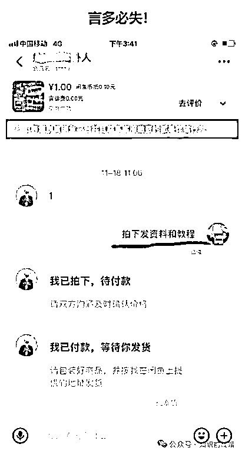
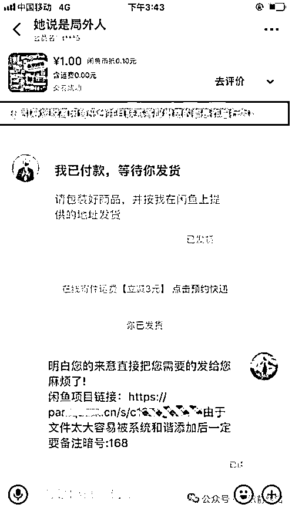

# 闲鱼搬砖，零基础也能快速上手

## 30赞 闲鱼掘金，小白也能做

作者： 知识前线馆
日期：2024-07-02

# 一、号养起来

1、在首页搜**“项目”**或**“赚钱”**之类的词，随后每隔八小时**收藏8个**、**逛30个**、**关注6个【重点】**，这样刷就像真买家在滑屏
2、号养熟后，上架6条动态
3、去做闲鱼任务，在“我”的页面找到互动权益点开“领闲鱼币”，具体看下图
4、每日领币并把**“赚经验”**里的任务清完后给小店升等级

# 二、上架商品流程

1、在闲鱼首页搜副业或赚钱相关内容

2、挑一个粉丝量大的商品做参考

3、搬运文案和图

把上面的文案完整复制下来，《把开头15个字改一下就能过重合》图片直接截屏就好，千万别下载

4、定价

起步可以定2元，然后慢慢每隔一段时间降0.1，闲鱼币抵扣记得打开【在首页签到里】。如果开了有鱼小铺可以设置个粉丝价

**ps：记得同步到圈子**

# 三、怎么进圈子

3.2、发动态【每天发6-10条】
3.3、打开闲鱼币折扣提升曝光

3.4、开“极速卖”增加曝光量

# 四、客服话术

1、有买家问商品时，只回一句话：拍下就发资料教程，就这句，别多说

2、确认下单后，把带你专属暗号的链接发过去

**说明一下：暗号链接就是我这边给你的，照发就行，每个人不一样别发错**

# 五、如何快速提升曝光

1、上架时统一定价2元，上架1小时后开始降价，每次降0.1
2、降到1元就停手
3、刷单：在闲鱼搜0.01元的小黄鱼，联系对方说：来不来？或发个“虎”，这是暗号。看得懂的会回复你来或把商品推给你，直接下单先别付款，等对方改成双方同意的价格再付款。反之别人找你也一样，也可以找群友互刷【一天2-4单够了】
4、每天12点准时擦亮，能拿到双倍曝光
5、开启闲鱼币折扣
6、开启极速卖

**每日必做清单：**
1、签到领闲鱼币任务
2、每天至少上新8个宝贝
3、宝贝必须每日降价，每件都过一遍
4、卖出去一个立刻补一个
5、闲鱼币折扣和闲鱼币推广常开
6、宝贝每天擦亮，早上8-9点可以，晚上12点整最好【双倍曝光】
7、刷单，注意频率，每天2单左右
8、晚上12点准时擦亮拿双倍曝光
9、每天在加入的圈子里签到

# 六、闲鱼虚拟品曝光的底层逻辑

第一、账号权重：
1、注册时长，是否违规过
2、活跃度，每天是否在做任务
3、是否有过购买记录，评价、点赞情况
4、账号里商品数量、成交情况、好评率，最关键的就是这点

第二、商品权重：
1、上架内容和平台同类商品的重合度
2、是否含敏感词、违禁词、违规词：
3、注意事项：发项目类内容容易踩线，需要想办法规避，自己多测试，最稳的是参考同行再优化，怕踩雷可以用闲鱼违规词检测工具检测一下：[`uutool.cn/check-word/`](https://uutool.cn/check-word)
4、商品的浏览曝光比和点击购买比

# 七、总结

1、号养的时间越久权重越高，合规发布什么都能被推，曝光自然多
2、上架内容越不像平台上的重复款，曝光越高，这就看你改文案改图的能力了
3、浏览曝光比主要看封面图和文案前15字
4、购买转化比看你文案的煽动能力

会封号吗？
不会，我们是用网盘链接下发个人V，网盘里先让客户加我们的私人微信，再发虚拟资源

会不会封号
网盘引流到私域，不封号、不封号、不封号

真被封了大概率是关键词违规或标题违规，细节没控好

以上就是全套保姆级打法，项目拼的就是细节和文案优化。很多新手没看完就上手，直接违规被封。我自己养了9个号基本没封过，日曝光稳定在5万到几十万！

跑通后需要自动发货的通道：[`www.agiso.com/product/alds`](https://www.agiso.com/product/alds)

记住：别三天打鱼两天晒网，按步骤严格执行，执行力到位不差钱。祝大家暑假期间都能赚得盆满钵满，有问题随时来问！

* * *

评论区：
夜的第七章 : 没看懂，这到底卖什么[嘿哈]
知识前线馆 : 卖虚拟类商品，比如网课、资料之类的☝️
飞鱼哥 : 资料去哪拿
知识前线馆 : 资料可以是任意虚拟产品，不一定跟我一样

* * *